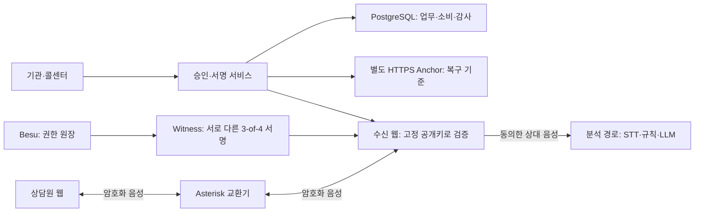

# CallSign

**Team Signal · 기관의 연락 승인과 현재 통화를 함께 확인하는 서비스**

CallSign은 연동된 콜센터의 연락 권한을 기관이 승인·회수·추적하도록 하고, 고객 화면이 연결된 환경에서는 현재 통화의 승인 확인과 위험 안내까지 제공합니다. 현재 개발 사례는 모의 금융기관의 이상거래 확인 연락입니다. 수신자는 서명된 승인과 실제 통화 연결을 확인하고, 동의한 상대 음성에서 위험한 요구가 발견되면 별도 안내를 받습니다.

**기관이 연락을 승인했다는 사실은 통화 내용의 안전을 보장하지 않습니다.** 기관 승인·현재 연결·내용 위험·분석 장애를 구분합니다. 연동되지 않은 전화·우회 발신을 통제하지 않으며 실제 금융기관·통신사와 연동한 서비스나 일반 전화망용 앱은 아닙니다.

[연락 데모](https://callsign-rouge.vercel.app/demo/call)·[공동 관리 데모](https://callsign-rouge.vercel.app/demo/governance)의 공개 로그인·API·통화는 각각 별도로 확인합니다. **현재 확인한 범위와 남은 조건은 [기준 SHA가 붙은 현황표](docs/guide/05-IMPLEMENTATION-STATUS.md)**를 참고하세요. 준비된 역할 계정이 필요하며, 로그인 성공만으로 음성·분석 성공을 뜻하지 않습니다.

## 어떻게 사용하나요?

| 사용자 | 하는 일 |
|---|---|
| 기관 담당자 | 연락 업무·수신자·목적을 정하고 상담원에게 할당하며 위임·개별 연락을 승인합니다. |
| 상담원 | 위임과 할당 범위 안에서 승인받은 연락을 시작합니다. |
| 수신자 | 이번 연락의 승인·현재 권한·연결을 확인해 통화를 수락하고 음성 분석 동의를 선택합니다. |

시연 진입점은 `/demo/call`·`/demo/governance`이며, 기존 업무 화면과 인증 callback의 `/service`는 유지합니다. 업무 위임과 개별 승인을 분리하고, 양측 키 소유 증명·승인 일회 소비·서명 영수증을 통화 세션에 결합합니다. 120초는 **최초 연결 시작 창**이며, 진행 통화에는 별도의 갱신형 유지 허가(lease)를 사용합니다. 명시적 철회·취소·로그아웃은 통화 회수 경로에 연결됩니다.

## 구성과 신뢰 경계



기관·콜센터의 장기 개인키는 서버에 두고 브라우저에는 전달하지 않습니다. 수신 웹은 서버의 성공 표시 대신 서명과 연결 근거를 대조합니다. Asterisk가 음성 종단이며, Witness는 신뢰한 상태 증언자이지 체인 자체 증명은 아닙니다. AI는 연락 권한을 발급하거나 통화의 안전을 확정하지 않습니다. 자세한 역할·키·데이터 경계는 [아키텍처](docs/ARCHITECTURE.md)를 참고하세요.

## 어디까지 확인했나요?

[구현·검증 현황](docs/guide/05-IMPLEMENTATION-STATUS.md)은 공개 로그인/API, 공개 통화 조사, 내부 실제 미디어, fixture 분석, 직접 제공자 호출, 복원·전달 증거를 구분합니다. 각 결과에는 당시 소스와 환경이 있으며, 과거 PASS를 현재 코드 전체의 성공으로 사용하지 않습니다.

## 개발 시작

Node.js 22와 `package.json`에 고정한 pnpm을 사용합니다. 의존성 설치는 네트워크가 필요하며, 기존 의존성이 있으면 설치를 반복할 필요가 없습니다.

```bash
pnpm install --frozen-lockfile --ignore-scripts
pnpm light
```

`light`는 소스 위생·타입 검사·네트워크 없는 단위 시험을 실행하며 worker는 최대 2개입니다. DB·체인·브라우저·서비스를 기동하지 않습니다. 웹 번들만 컴파일하려면 `pnpm --filter @callsign/web build`를 사용합니다.

**실제 서비스 실행은 별도 준비가 필요합니다.** 위 명령은 통합 환경을 설치하거나 기동하는 quickstart가 아닙니다. [작업 지침](AGENTS.md)과 [실행 범주·검증 절차](docs/RUNBOOK.md#실행-범주)를 확인하세요. 일반 push/PR CI는 light만 실행합니다.

## 현재 운영과 산출물

현재 실행 목표는 서버컴의 CallSign 전용 지속 backend입니다. [지속 운영 절차](docs/RUNBOOK.md#지속-서비스와-시험-환경의-분리)에서 승인된 자원 조건·공개 연결·기동/중지 방법을 확인하세요. 일회성 시험 데이터와 지속 DB·키·계정은 분리하며 일반 재시작에 초기화를 반복하지 않습니다.

소스·공개 Release·비공개 GHCR은 별도 전달물입니다. [고정 전달 기준](docs/RUNBOOK.md#github-delivery-20261102)의 source와 image digest를 확인하며 `latest`를 배포 기준으로 추정하지 않습니다. 과거 AWS 준비 절차는 보존하지만 AWS 자원 생성과 별도 reader는 이번 서버컴 데모의 선행조건이 아닙니다.

## 문서 찾기

[전체 문서 안내](docs/README.md) · [서비스 가이드](docs/guide/README.md) · [개발 명세](docs/MASTER-DEVELOPMENT-SPEC.md) · [아키텍처](docs/ARCHITECTURE.md) · [알려진 한계](docs/KNOWN-LIMITATIONS.md)

멘토링·기획서·과거 시연과 검증 증거는 [문서 안내의 기록 보관](docs/README.md#기록과-자료)에서 찾을 수 있습니다. `/finals`는 이전 직접 통화 호환 경로이며 `/demo/call`과 `/demo/governance`는 실제 업무·통화·관리 API를 재사용하는 데모 작업면입니다. API 미연결 공개 배포는 실행 성공을 표시하지 않습니다.
