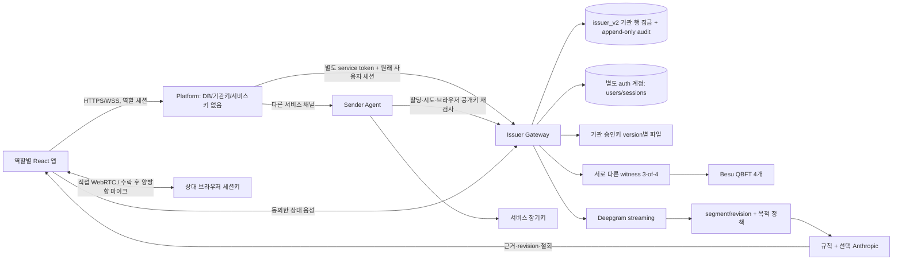

# Architecture

## 확정 기본 서비스와 이행 상태

2026-10-27: 등록 기관/콜센터 URI·키를 기본으로 하고 DID는 선택 호환 기능이다. VC는 기관→콜센터 업무 위임, 개별 승인은 이번 고객·업무·세션에 한정한다.120초 시작 승인·현재 권한 freshness·진행 통화 lease를 분리한다. 기본 음성은 양측 웹↔Asterisk PJSIP/WSS+ARI↔웹이며 Asterisk가 media edge 종단이다. native proof는 별도 후속 확장이다.

`service.ts` protocol/SDK, `service-authority.ts`/routes, `service-current.ts`, `asterisk.ts`/PBX routes, `pbxSip.ts`, v3 audio를 추가했지만 기본 화면·trust/키 준비·운영 worker·PBX 회수·배포는 미연결이다. 아래 v2 도식은 보존한 코드 경로이며 새 기본 서비스가 이미 완성됐다는 뜻이 아니다. [현재 상태](FINALS-IMPLEMENTATION-PLAN.md#service-20261027), [서비스 구조도](guide/02-ARCHITECTURE.md).

## 현행 v2 코드 경로



같은 소스 이미지를 `SERVICE_ROLE`로 나눈다. Platform 역할은 DB client와 private key를 생성하지 않는다. Sender는 서비스키 한 개만 mount한다. Issuer는 기관 승인키, 업무/소비 쓰기 계정과 auth 별도 계정을 가진다. 원장 관리/긴급 정지 계정은 별도 mount이며 공동 승인자 개인키는 어디에도 공유 mount하지 않는다. `scripts/sign-recovery.ts`는 승인자 환경에서 자기 키 하나만 사용한다.

기관별 JSONB aggregate에 업무/위임/시도/승인/영수증을 저장하고, `SELECT ... FOR UPDATE` 후 검사·서명·갱신을 같은 transaction에서 수행한다. 감사는 별도 테이블에 append한다. Platform/Sender group에 issuer_v2 schema 접근을 주지 않는다. 실제 DB 계정 격리·경합/가용성은 통합 시험 대기다. JSONB aggregate는 기관 단위로 상태를 직렬화하는 현재 선택이며 대규모 저장소 설계는 아니다.

브라우저는 짧은 세션키만 가진다. 고정한 trust bundle hash에서 기관/서비스/witness키를 얻고 VC·승인·허가·소비영수증·최신 nonce 상태응답·원장 snapshot·SDP·실제 DTLS/datachannel을 직접 대조한다. `/official` 권한은 별도 OIDC audience/cookie와 소유권 조건이다. 브라우저 코드와 trust bundle을 함께 바꿀 수 있는 운영자는 여전히 신뢰 경계다.

## 직접 경로와 PBX

직접 경로의 DTLS 종단은 상대 브라우저 PeerConnection이다. ICE 변경·새 연결은 새 승인과 전송 검증이 필요하다. 수락 전 마이크 track을 sender에 부착하지 않고 종료/오류에서 track을 stop한다.

새 PBX 경로의 종단은 Asterisk다. `asterisk.ts`는 실제 ARI channel·Call-ID·bridge를 조회해 signed browser report와 대조하고 준비 시 두 채널을 mute, 수락/lease 후 bridge 멤버 확인·unmute한다. 별도 PBX Ed25519 키의 JWS를 `verifier/service.ts`가 승인·receipt·lease·state·SIP Call-ID·DTLS 문맥과 대조하는 코드를 작성했다. `pbxSip.ts`는 SHA-256 digest REGISTER와 수신 INVITE/ACK·WebRTC answer의 제한된 브라우저 모듈이다. 역할 UI 호출·ARI event/restart·철회/logout 자동 회수·설정/배포·전체 시험은 남아 있다.

이전 `media.ts`의 `AsteriskAdapter`/`MediaEdgeAdapter`는 과거 helper이며 실제 외부 Edge가 존재한다는 근거가 아니다. PBX는 상담원 개인 신원이나 내부 구간의 종단 간 진실을 증명하지 않는다. v2 consume/SDK는 여전히 PBX profile을 직접 통화로 승인하지 않는다.

## 배포

`infra/deploy/compose.yml`: DB, Besu4, witness4, Issuer/Sender/Platform, web, 선택 HTTPS/TURN. DB/RPC는 host에 공개하지 않는다. application network는 내부망이고 provider 통신은 별도 egress network다. 각 witness는 자기 private key와 deployment metadata만 읽는다. 키 누락 시 자동 재발급하지 않는다. 체인·DB는 named volume, 키/trust/genesis는 명시적인 persistent 디렉터리다. GCP 구성은 기존 배포를 재시작할 뿐 bootstrap을 하지 않는다. 자세한 이전/복원은 [runbook](RUNBOOK.md).

## v1 로컬 회귀 구성

아래는 보존한 v1 실행 구조다. v2의 키 격리 또는 현재 검증 증거로 읽지 않는다.


```mermaid
flowchart LR
  I[기관 브라우저] -->|역할 세션 + CSRF| API[Fastify API 프로세스\nissuer 코드·signaling 경계 분리]
  G[게이트웨이 브라우저\n로컬 Ed25519 키] <-->|인증 WebSocket| API
  R[수신 브라우저\n고정 trust bundle] <-->|인증 WebSocket| API
  G <-->|WebRTC audio + datachannel\n동일 PeerConnection| R
  API -->|원자적 consume| DB[(PostgreSQL)]
  API -->|viem tx| C[InstitutionRegistry]
  C --- B1[Besu 1]
  C --- B2[Besu 2]
  C --- B3[Besu 3]
  C --- B4[Besu 4]
  B1 --> W1[Witness 1]
  B2 --> W2[Witness 2]
  B3 --> W3[Witness 3]
  B4 --> W4[Witness 4]
  W1 & W2 & W3 & W4 -->|동일 payload 서명 전달| API
  API -->|집계만 수행| R
  R --> O[/official 별도 로그인]
  O --> DB
```

## 배포 구성

- Compose: PostgreSQL 17.6, Besu 26.8.1 validator 4개, witness Node 프로세스 4개.
- Host: Fastify API·issuer·signaling 단일 프로세스 4100, Vite 4173. 배포 프로세스는 합쳤지만 issuer key 코드, gateway 브라우저 key, signaling 역할 검사는 분리했다. Besu RPC는 18545/28545/38545/48545에 localhost로만 노출한다.
- 원장: chainId 20260914, QBFT 고정 validator set, 초기 block period 2초, Cancun 활성화, zero base fee 데모 프로파일.
- 계약과 상태: 고객·연락 데이터는 DB/서명 객체에 있고, 원장에는 기관·위임·정지·복구·directory 상태만 있다.

## 신뢰 경계

수신 앱의 배포 코드와 그 안에 생성된 trust bundle, enrollment 서비스, 기관 승인 시스템, gateway 종단 코드, 브라우저/OS를 신뢰한다. 집계 API의 `verified` 플래그는 존재하지 않으며 브라우저가 서명을 검증한다. 다만 동일 운영자가 웹 코드 배포와 trust bundle까지 교체하면 정상 표시를 위조할 수 있다.

네 witness는 프로세스·키·RPC 경계가 분리됐지만 한 컴퓨터와 한 Compose 운영자 위에 있으므로 현실의 독립 기관 운영을 입증하지 않는다. QBFT 합의와 witness quorum은 서로 다른 신뢰 가정이다.
