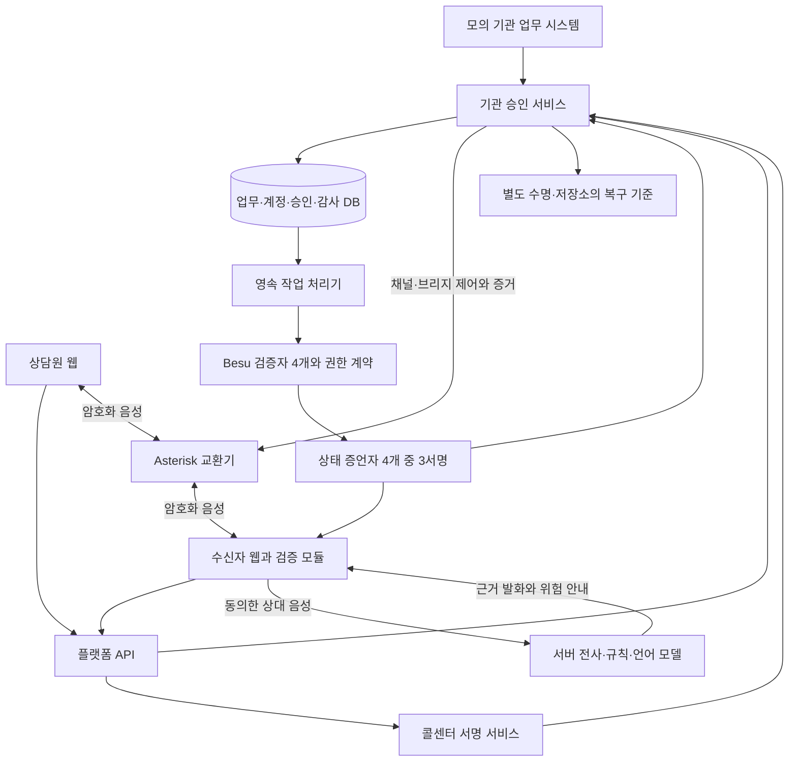

# CallSign 개발 결과 통합 검토서

작성·저장소 재확인: **2026-10-29(KST)**  
최근 개발·검증 기록: **2026-10-27(KST)**

이 문서는 기본 서비스 연결 작업과 실행 전 보강 작업을 함께 설명한다. 피드백을 받는 사람이 이 파일만 읽어도 서비스 목적, 구현한 흐름, 주요 설계 판단, 검증 범위와 남은 일을 파악할 수 있도록 정리했다. 기능 요구사항의 새 기준이나 전체 서비스 완료 선언은 아니다.

## 1. 현재 상태부터 정리하면

CallSign은 **기관이 승인한 업무인지, 위탁 콜센터의 권한이 지금 연결된 통화에 해당하는지** 확인하고, 동의한 상대 음성에서 위험 요구를 찾아 별도로 안내하는 서비스다. 대표 업무는 모의 금융기관의 이상거래 확인 연락이다. 실제 금융기관·통신사와 연동한 서비스는 아니다.

기본 화면부터 승인·검증·통화 유지·교환기 제어·분석·영속 작업·관리 화면까지 호출 코드를 연결했다. 이후 공동 관리의 승인 수 불일치, 계정 권한 회수, 음성 송신 경합, 작업 소유권과 복원 기준을 보강했다.

**현재는 코드 연결과 오프라인 검증 단계다. 실제 DB·체인·교환기·브라우저 통화·외부 AI·GCP 검증은 하지 않았다.** 기관의 연락 승인도 통화 내용의 안전 보장은 아니다.

| 구분 | 확인한 사실 |
|---|---|
| 저장소 | [0u-Y/CallSign](https://github.com/0u-Y/CallSign) |
| 브랜치·HEAD | `main` · `a9d67f0b4b50a022b0e20de1e4071ec49cdcbd8a` |
| 개발 결과 위치 | HEAD 이후의 미커밋 작업 트리. HEAD만으로 현재 결과를 재현할 수 없음 |
| 기본 사용자 경로 | `/service` 화면 → `/v3` API |
| 보존한 호환 경로 | `/finals` 직접 통화와 초기 시연·시험 데이터. 기본 경로의 실패를 호환 경로로 자동 우회하지 않음 |
| 최근 light 검사 | 2026-10-27, **38개 파일·171개 시험 통과** |
| 이번 문서 작성에서 한 확인 | Git 상태·문서·관련 코드·저장된 검증 결과·기록된 코드 해시 대조. 시험은 재실행하지 않음 |
| 보존 | 기존 미커밋 변경, 두 과거 작업 요약, 과거 artifacts·시험 증거·기획 자료 |
| 실행·게시 | 이번 개발과 문서 작성에서 서비스 기동·외부 제공자 호출·commit·push·배포 없음 |

검증 증거에 기록된 코드·설정 등 비문서 파일의 해시는 현재 파일과 일치했다. 이 대조는 기록된 파일 범위에 한정되며 실제 실행 검증을 대신하지 않는다. 이 문서는 검증 이후 작성됐으므로 당시 시험 대상에 포함되지 않는다.

## 2. 서비스가 해결하려는 문제와 사용자 역할

발신자가 기관 이름을 알고 있거나 업무 위임 증서를 제시하는 것만으로는 이번 고객에게 연락할 권한이 있는지 알기 어렵다. 유효한 승인을 다른 고객·목적·연결에 복사하는 문제와, 정상 권한을 가진 상담원의 위험 요구도 따로 다뤄야 한다.

| 사용자 | 제품에서 수행하는 일 |
|---|---|
| 기관 담당자 | 연락 업무 생성, 등록 수신자·콜센터·상담원 할당, 취소·재할당·진행 확인 |
| 기관 관리자 | 내부 계정·세부 권한 관리, 위임 발급·철회, 기관 등록·정지·정책/키 변경 요청 |
| 콜센터·상담원 | 할당 업무의 개별 승인 요청, 웹 발신·통화·종료. 콜센터 장기키는 서버에 보관 |
| 수신자 | 자기 연락 확인·거절·수락, 서명·현재 연결 검증, 분석 동의·철회, 별도 공식 업무 |
| 공동 승인자 | 주요 관리 명령의 정확한 변경 내용을 검토하고 각자 보유한 키로 서명 |
| 시스템 운영자 | 설정·배포·관측·백업·복원. 운영 권한만으로 기관의 연락 승인 권한을 얻지 않음 |

고객의 DID나 지갑은 요구하지 않는다. DID는 분산 식별자를 뜻하며 기존 선택 구현만 보존했다. 기본 서비스는 **등록 기관 주소와 등록 공개키**를 신뢰 기준으로 삼는다. 임의 주소에 있는 문서나 키를 자동 신뢰하지 않는다.

## 3. 전체 구조와 신뢰 경계



그림은 **구현한 코드의 책임과 연결 구조**다. 실환경에서 이 모든 선이 성공했다는 뜻은 아니다. 수신자 웹의 상태 요청은 플랫폼/기관 서비스를 거쳐 전달될 수 있으며, 최종 서명 검증은 브라우저 검증 모듈이 수행한다.

- **플랫폼 API:** 인증된 요청을 전달한다. 기관·콜센터 장기 개인키와 기관 업무 DB 쓰기 권한을 갖지 않도록 역할을 분리했다.
- **기관 승인 서비스:** 업무·할당·위임·수신자·목적·상태를 확인하고 개별 승인·소비 영수증·통화 유지 허가를 서명한다.
- **콜센터 서명 서비스:** 장기 서비스키를 보유하며 이번 요청과 브라우저의 단기 키를 결합한 소유 증명을 만든다.
- **DB와 영속 작업 처리기:** 업무·세션·승인 사용·감사·재처리 의도를 저장하고 원장 작업을 처리한다. 제출과 확정 상태를 구별한다.
- **Asterisk:** 웹 양측의 암호화 음성 종단·채널·브리지를 맡는다. 별도 미구현 외부 미디어 서버를 기본 의존성으로 두지 않았다.
- **복구 기준 저장소:** VM 백업과 다른 수명으로 최신 소비·권한 이력의 기준을 보관한다. 같은 오래된 백업에서 함께 복원하면 독립성이 없다.

온체인에는 기관·위임 식별자와 공개키·내용 해시·상태·세대를 연결한다. 고객 업무 원문·음성·전사는 올리지 않는다. 업무·계정·승인·감사는 오프체인 DB에 두고, 원음은 기본 저장하지 않는다.

## 4. 실제 사용자 흐름에 연결한 기능

### 4.1 기관 준비와 업무 위임

수신자는 서비스의 HTTPS 웹 주소로 직접 들어와 사전 연결된 외부 로그인 계정으로 로그인하고 자기에게 배정된 연락 목록을 확인한다. 자동 문자·메일 초대로 진입하는 경로는 아직 선택하지 않았다. 운영자가 검토한 공개 신뢰 설정을 웹 빌드의 SHA-256에 고정하고, 브라우저는 API가 전달한 공개키·신뢰 설정의 해시가 이 값과 같은지 확인한다. 웹 배포·HTTPS 제공 주체도 최초 신뢰 경계에 포함된다.

등록 기관·콜센터 URI와 공개키, PBX 공개 인증서, 상태 증언자 공개키로 신뢰 설정을 준비하는 코드를 작성했다. 기관 최초 등록은 공동 서명을 검증해 원장 작업으로 보낸다.

기관 담당자는 등록 수신자·콜센터·상담원을 지정해 연락 업무를 만든다. 모의 CRM/FDS는 이상거래 확인 업무의 개발용 입력원이며 실제 외부 기관 연동이 아니다. 다른 기관 업무 접근, 임의 수신자·목적 변경, 미할당 상담원의 발신을 서버에서 거절한다.

위임 VC(서명을 검증할 수 있는 자격 증명)는 **기관이 콜센터에 맡기는 재사용 업무 범위의 증서**다. 기관·콜센터 키, 목적·정책 해시, 기간, 위임 식별자와 권한 세대·상태 참조를 결합하고 원장에 내용을 연결한다. 정상 통화마다 새 위임을 생성하지 않는다. VC 사본만으로 임의 고객에게 발신할 수 없다.

### 4.2 개별 승인과 일회 사용

상담원이 할당 업무에서 새 통화 시도를 만들면 브라우저의 단기 세션키와 콜센터의 요청별 증명을 기관 승인 서비스가 확인한다. 개별 승인은 고객·목적·업무·시도·세션키·일회성 난수·만료·권한 세대에 결합한다.

수신자는 직접 만든 난수와 공개키를 등록한다. 양측은 같은 업무·통화 시도·협상 내용에 대해 키 소유를 증명한다. 서버가 돌려준 성공 boolean만 믿지 않고 브라우저 검증 모듈이 서명과 연결 관계를 직접 확인한다.

승인 사용은 기관·승인 ID 단위의 공통 저장 영역에 고정한다. 같은 연결 관계의 재시도에는 같은 저장된 서명 영수증을 반환하고, 다른 연결이나 다른 호환 형식으로 다시 쓰는 것은 거절하도록 구현했다. 취소와 소비는 같은 기관 DB 경계에서 처리한다. 실제 PostgreSQL 동시성·원자성은 시험 전이다.

### 4.3 수락·웹 통화·진행 통화 유지

상담원과 수신자 모두 웹을 사용한다. 기본 경로는 **웹 ↔ Asterisk PJSIP/WSS·ARI ↔ 웹**이다. PJSIP는 SIP 통화 제어 드라이버, WSS는 보안 WebSocket, ARI는 교환기의 제어·사건 API다.

양측의 준비·SIP 등록/수신, 실제 채널·Call-ID·브리지 매핑, 연결 증거, 사용자 수락·검증 상태를 통화 시도에 연결했다. 수락·검증 전 마이크 송신과 수신 오디오를 차단하고, 양측 준비 후 음성을 허용하는 코드를 연결했다.

120초는 **통화 시도 생성부터 최초 연결을 시작할 수 있는 창**이다. 승인 발급 때마다 새로 120초를 더하지 않으며 전체 통화 길이 제한도 아니다. 진행 통화는 같은 연결과 이전 허가에 양측이 다시 서명해 유지한다.

| 시간·상태 | 처리 규칙 |
|---|---|
| 최초 연결 창 종료 | 새 소비·연결 차단. 적법하게 연결된 통화를 승인 만료만으로 새 통화로 만들지 않음 |
| 통화 유지 허가 | 30초는 설정 가능한 초기값. 갱신은 기존 연결·순번·난수에 한정 |
| 최대 통화 시간 | 4시간은 설정 가능한 초기값. 운영 합의나 검증한 보장 시간이 아님 |
| 업무·VC 만료 | 해당 만료가 더 이르면 통화 허가의 상한이 됨 |
| 명시적 취소·철회·기관 정지·세대 변경 | 새 연결 차단 및 해당 진행 연결·분석 회수 |
| 현재 권한 조회 장애·최신성 초과 | 신규 연결 차단. 진행 통화는 확인 불가·기본 음성/분석 정지와 명시적 선택을 구별 |
| 확인 불가 상태에서 계속 선택 | 기존에 검증한 같은 통화와 유효한 유지 허가 범위에만 한정. 이미 만료한 허가를 부활시키지 못함 |
| AI 장애 | 분석 불가로 표시. 권한 철회나 안전 판정으로 바꾸지 않음 |

권한 확인 불가 시 서버에 계속 선택을 기록하는 주체는 수신자이며, 갱신에는 양측 세션키의 증명이 필요하다. 상담원과 수신자 브라우저는 각각 미확인 계속을 허용해야 로컬 검증을 통과해 음성을 재개한다. 양측 갱신 서명이 위험 감수 동의를 서명한 것과 같은 뜻은 아니다. 유지 허가 자체가 만료하면 화면은 기한 경과·음성 정지를 표시하고, 서버의 만료 처리와 PBX timeout으로 연결을 회수한다. 이후에는 새 통화 시도가 필요하다.

재접속·새 PeerConnection·연결 정보 변경은 이전 검증을 그대로 재사용하지 못하게 한다. 거절·부재·종료·오류·중복 종료·늦은 사건을 상태 기계로 처리한다. 로그아웃과 권한 회수 시 연결·동의·분석을 정리한다.

### 4.4 상대 음성 분석과 공식 후속 업무

분석 입력은 수신자 자신의 마이크가 아니라 **실제 통화 상대의 원격 스트림**이다. 동의 후 서버로 보내 스트리밍 전사 → 수정 번호 관리 → 정책 규칙·언어 모델 → 근거 발화·위험 안내로 연결했다.

기존 Deepgram·Anthropic 연결 코드를 기본 경로에 사용하고 선택 Ollama 코드는 보존했다. 제공자는 이번 작업에서 호출하지 않았다. 임시/확정 전사, 중복·역순·수정, 늦은 응답, 부정·인용·자기정정, 요청 한도·처리 지연·취소를 다룬다. 근거가 현재 전사 수정 번호와 맞는지 검사하며 AI가 임의로 통화를 제어하지 않는다.

분석 동의 철회·종료·로그아웃·권한 회수 때 수집·전송·분석과 늦은 결과 반영을 중단한다. 기관 승인·실제 연결·내용 위험·분석 장애는 화면에서 분리한다. ‘기관 승인’을 ‘안전한 전화’로, ‘확인 불가’를 ‘사기’로 표시하지 않는다.

민감한 후속 업무는 `/official`에서 별도 로그인 용도와 업무 소유권을 확인한다. 현재 구현된 공식 후속 경로는 이것 하나다. 존재하지 않는 공식 경로를 목록에 추가해 성공한 기능처럼 제시하지 않는다.

## 5. 이후 보강한 주요 결함과 설계 결정

### 5.1 공동 관리: 계약부터 화면까지 2-of-3으로 통일

보존한 기존 계약의 공식 경로 변경은 관리자와 승인자 한 명의 서명을 사용했다. 최신 주요 관리 정책인 2-of-3과 달랐고 정책 버전을 바꾸는 연산도 없었다.

새 `ServiceRegistry`에 공동 설정 변경 연산을 추가하고 기존 단독 경로를 거절하도록 했다. EIP-712 서명에는 체인·계약·기관·작업 종류·정확한 이전/다음 내용 해시와 버전·권한 세대·난수·만료를 결합한다. 서로 다른 등록 승인자의 키만 집계하며 세 번째 중복·무효 서명도 거절한다. 복구 서명을 정책·공식 경로·다른 작업에 재사용하지 못하게 한다.

관리 화면의 제안 → 승인 수집 → 제출 → 확정/실패 → 활성화를 구별했다. 제출 응답이나 트랜잭션 영수증만으로 DB 정책을 활성화하지 않는다. 정확한 확정 이벤트·같은 블록의 계약 상태·최신 상태 증언을 확인한다. 관리키 서명은 구조화 데이터 서명인 EIP-712, 오프체인 위임·승인·세션 증거는 JSON 서명 표현인 JWS와 Ed25519 알고리즘으로 역할을 나눈다.

| 변경 | 기존 권한·통화 영향 | 이유 |
|---|---|---|
| 현재 공식 경로의 표시명 변경 | 권한 세대 유지 | 실제 허용 업무·경로는 같음 |
| 허용 질문·금지 요구 등 정책 해시 변경 | 세대 증가, 구 VC·승인·통화 무효화 | 승인한 업무 범위 자체가 바뀜 |
| 키 교체·공동 복구 | 새 키/세대 확인 후 활성화, 구 권한 부활 금지 | 유출되거나 이전 세대인 키의 재사용 방지 |

기존 계약에 업그레이드 구조는 없다. 새 계약 주소·코드 해시·초기 정책 해시·승인자·배포 블록·신뢰 설정으로 명시 전환해야 한다. 정책 변경 후에는 새 위임·업무와 해당 정책 버전에 맞는 신뢰 설정·웹 배포가 필요하다. **새 계약의 컴파일 산출물은 실제 배포 기록이 아니다.**

### 5.2 내부 계정 관리와 이전 권한 회수

외부 로그인 제공자 계정 생성과 내부 사용자 등록을 분리했다. 관리 UI/API는 등록 OIDC 발급자 주소와 정확한 subject를 기관·역할에 연결한다. OIDC는 외부 로그인 규약이고 subject는 해당 제공자가 부여한 사용자 식별자다. 이름·이메일만으로 기존 사람의 권한을 연결하지 않으며 새 비밀번호 저장소도 만들지 않았다. 첫 로그인에서 실제 토큰을 검증한다.

등록·조회·활성/비활성·권한 변경을 최근 재인증·CSRF 방어·감사·멱등 요청에 연결했다. 다른 기관 계정 연결, 자기 권한 상승, 보유하지 않은 관리 권한 부여, 일반 관리자의 공동 승인자 생성/수정을 거절한다.

권한 변경 때 로그인 세션을 폐기하고 소속 세대를 올린다. 계정을 나중에 다시 활성화해도 옛 세션이 살아나지 않도록 요청 인증 뒤 DB 작업 경계에서도 현재 세대를 재검사한다. 계정 SQL 변경과 복구 checkpoint 처리를 같은 DB 트랜잭션에 넣었다. 실제 SQL 권한·잠금·경합 검증은 남아 있다.

### 5.3 통화·화면의 경합과 장애 처리

- 비동기 마이크 track 부착 사이에 음소거·숨김·허가 만료가 끼어도 송신이 다시 켜지지 않도록 수정했다.
- Asterisk 채널의 절대 timeout을 설정·조회한 뒤 음성을 허용하고, DB 조회 장애 시 알고 있는 채널을 음소거하도록 연결했다. 실제 교환기의 timeout 동작은 검증 전이다.
- PBX 제어 요청 지연을 허가 기한에서 빼므로 실제 연결/갱신 여유는 120초 또는 lease보다 짧을 수 있다. 기한을 늘려 성공 처리하지 않는다.
- 업무 목록 자동 갱신, 늦은 응답 폐기, 중복 동작 방어, 선택한 시도와 실제 연결한 시도 분리를 보강했다.
- 업무 생성 재시도는 같은 요청 ID·내용을 보존한다. 인증/권한 회수 응답을 받으면 이전 승인 표시와 로컬 연결·분석 상태를 지운다.

### 5.4 영속 작업·복원·백업

원장 변경은 DB에 처리 의도를 저장하고 작업 처리기가 claim·기한·재시도·운영자 확인 상태로 처리한다. 같은 서명 트랜잭션 원문과 해시를 영속 저장한 뒤 제출·재조회·재전송한다. 결과 불명 상태를 정상 실패처럼 버리거나 새 nonce로 조용히 다시 제출하지 않는다. 외부 호출이 정확히 한 번만 일어난다고 가정하지 않는다.

서명자별 영속 준비 lease와 소유권 검사를 추가해 늦은 결과 반영을 차단했다. 원장 네트워크 서명 준비 중 전역 DB 트랜잭션 잠금을 유지하지 않도록 하고 기관별 작업 범위·잠금 순서를 맞췄다. 이벤트 소비 위치를 영속 저장해 재시작 후 중복 처리를 다룬다.

소비 이력뿐 아니라 계정·키·정책 변경과 취소/회수 사건도 별도 복구 기준의 hash journal에 연결했다. 오래된 DB·키·신뢰 설정을 함께 복원했을 때 그것들끼리 맞는다는 이유만으로 최신이라고 판단하지 않는다.

외부 기준 갱신은 CAS, 즉 이전 값이 정확히 같을 때만 다음 값으로 바꾸는 방식이다. 응답 유실은 정확한 다음 값 재조회로만 복구한다. 외부 기준만 전진하고 DB commit/정확한 이력을 잃으면 신규 발급·연결을 차단한다. DB와 외부 기준 사이 분산 원자성을 주장하지 않는다.

전체 journal 검사는 읽기 전용 snapshot으로 수행하고 마지막 짧은 잠금에서 head·권한 metadata·검사 token을 재확인한다. 새 권한 checkpoint 기준이 없는 구 DB를 flag 수정만으로 채택하지 않는다. 최초 새 배포는 검토한 빈 DB·독립 zero 기준에서 시작하며, 기존 배포 이행은 별도 신뢰 검토가 필요하다.

백업은 암호화와 별도로 manifest의 진위를 인증하고 파일 해시·크기·대상을 확인한다. archive의 링크·특수 파일·경로 이탈을 거절하고 새 빈 대상으로만 복원한다. 복원 뒤 로그인 세션은 모두 폐기하며 복구 차단 상태를 유지한다. 실제 백업·복원은 실행하지 않았다.

### 5.5 한도·알림·계측·증거 수집

공유 사용량의 예약·정산·중복 정산 방지, 결과 불명 비용의 보수적 처리, 보관 기한과 삭제 작업을 연결했다. 오래된 승인 payload를 줄여도 재사용 차단에 필요한 승인 ID·연결 해시·journal은 유지한다. 사용 초·요청·입력 바이트를 계측하지만 실제 제공자 청구서·가격·결제는 구현하지 않았다.

내부 웹 알림은 수신 대기·상태·실패 등을 영속 저장하고 사용자별 조회·읽음·설정·만료·중복 억제를 제공한다. 외부 문자·메일 공급자는 정하지 않았으며 메시지도 발송하지 않았다.

승인·검증·PBX·분석·작업 대기/재시도와 프로세스 자원을 관측하는 코드를 연결했다. 처리 시간은 같은 환경의 단조 시계로 측정하고 서버·브라우저의 다른 시각을 단순 차감하지 않는다. metric label은 고정 차원으로 제한하며 원음·전사·토큰·고객 식별자·통화별 무제한 ID를 넣지 않는다. 브라우저 표본은 비신뢰 관측이다.

실행 전 검사는 파일·설정·공개 신뢰·ABI·이미지 식별·역할별 접근 경계·OIDC/PBX/TURN/복구 기준·migration·guard를 로컬에서 점검한다. 증거 수집 도구는 허용한 오프라인 검사만 실행하고 dry-run에서는 검사 자체를 실행하지 않는다. 기존 파일을 덮지 않고 출력 크기·비밀값을 제한한다. 실제 환경 trace·화면·통화 증거를 지금 수집하지는 않았다.

## 6. 코드·설정·요구사항 추적

아래는 주요 변경의 대표 근거다. 파일 전체를 이번에 새로 만들었다는 뜻은 아니며 이전 미커밋 구현을 이어 보강한 파일도 포함한다. 전체 74개 요구의 완료 선언은 하지 않는다.

| 영역·요구 ID | 주요 파일·호출부 |
|---|---|
| 기본 UI·통화 제어 — UI-001~007, CALL-001~006 | [기본 화면](../apps/web/src/pages/Service.tsx), [통화 제어](../apps/web/src/lib/serviceCall.ts), [마이크/수신 오디오](../apps/web/src/lib/liveMedia.ts), [관리 화면](../apps/web/src/components/ServiceAdministration.tsx) |
| 업무·인증·계정 — BUSINESS-001/002, AUTH-001/002 | [업무/관리 API](../services/api/src/service-management.ts), [계정 경계](../services/api/src/account-management.ts), [서버·로그인](../services/api/src/finals-server.ts), [권한 모델](../services/api/src/finals-model.ts) |
| 승인·위임·검증 — IDENTITY-001/003, CALL-001~006 | [통신 객체](../packages/protocol/src/service.ts), [승인 서비스](../services/api/src/service-authority.ts), [브라우저 검증](../packages/verifier/src/service.ts), [현재 상태](../services/api/src/service-current.ts) |
| 공동 계약·정책 — CONTRACT-001~005, GOVERNANCE-001/002, BUSINESS-003 | [새 계약](../contracts/src/ServiceRegistry.sol), [공동 설정 서명](../services/api/src/configuration.ts), [단일 승인자 서명 도구](../scripts/sign-recovery.ts), [배포 도구](../scripts/deploy-service-registry.ts) |
| 원장·증언 — LEDGER-001~003, STATE-001~003 | [작업 처리기](../services/api/src/service-worker.ts), [원장 제출](../services/api/src/worker-ledger.ts), [사건 소비](../services/api/src/ledger-events.ts), [Witness](../services/witness/src/server.ts) |
| PBX·음성 — PBX-001~003, MEDIA-001~004 | [브라우저 SIP](../apps/web/src/lib/pbxSip.ts), [ARI](../services/api/src/asterisk.ts), [PBX 경로](../services/api/src/pbx-routes.ts), [PBX runtime](../services/api/src/pbx-runtime.ts), [Asterisk 설정](../infra/deploy/asterisk/) |
| AI — AI-001~005 | [오디오 수신/분석](../services/api/src/service-audio.ts), [전사 연결](../services/api/src/transcription.ts), [규칙](../services/api/src/risk.ts), [개발 데이터](../tests/fixtures/korean-risk-evaluation.json) |
| 영속성·복구 — DB-001~004, STATE-003, OPS-005 | [DB 작업 경계](../services/api/src/finals-store.ts), [추가 SQL](../services/api/drizzle/0005_account_management.sql), [독립 복구 기준](../services/api/src/consumption-anchor.ts), [공유 한도](../services/api/src/quota.ts), [정리 작업](../services/api/src/maintenance.ts), [백업 인증](../services/api/src/backup-crypto.ts) |
| 알림·관측·검사 — OPS-006, TEST-001~004 | [알림](../services/api/src/notifications.ts), [관측](../services/api/src/telemetry.ts), [운영 상태](../services/api/src/operations.ts), [실행 전 검사](../scripts/preflight.ts), [증거 수집](../scripts/collect-evidence.ts) |
| 배포 — OPS-001~007 | [공통 Compose](../infra/deploy/compose.yml), [PBX 구성](../infra/deploy/compose.pbx.yml), [환경변수 예제](../.env.example), [GCP 구성](../infra/gcp/main.tf), [운영 절차](RUNBOOK.md) |

TypeScript·Fastify·React/Vite·PostgreSQL/Drizzle·Solidity/Foundry·Besu를 유지했다. DB migration은 `0005_account_management.sql`까지 작성됐지만 실제 적용하지 않았다. 일반 재시작에 DB 초기화·계약 재배포·키 재발급이 들어가지 않도록 준비했다. 서버컴과 GCP가 같은 소스·구성을 쓰도록 작성했으나 실제 이전은 미실행이다.

기존 원본 기획서·과거 시험 자료와 요약 문서는 보존했다. 서비스 설명을 특정 멘토링 일정에 종속시키지 않도록 기존 가이드를 정리했으며, 확인하지 못한 멘토링 원문이나 제출 결과를 만들지 않았다.

## 7. 실제 실행한 검증과 정확한 의미

아래는 **2026-10-27 저장된 실행 결과**다. 2026-10-29에는 문서를 쓰기 위한 기록·해시 확인만 했고 검사를 다시 실행하지 않았다.

| 검사 | 저장된 결과 | 이 결과로 확인하지 못하는 것 |
|---|---|---|
| `pnpm light` | **38개 파일·171개 시험 PASS**. source hygiene·API/Witness/웹/시험 타입·오프라인 단위 시험 | 실제 DB 잠금/GRANT·원장·음성·브라우저·제공자 |
| 웹 빌드 | PASS. 큰 chunk·효과 없는 동적 import 관련 경고는 남음 | 화면 렌더·기기/접근성·실제 통화 |
| API runtime 타입 검사 | PASS | 서버 기동·외부 서비스 연결 |
| 계약·계약 시험 소스의 오프라인 컴파일 | PASS. 계약 시험은 실행하지 않음 | EVM 시험 결과·Besu 배포·합의/관리 동작 |
| 실행 전 설정 검사 | **BLOCKED 38·PASS 10·SKIPPED 3**, exit 2 | 설정 누락이 해소되거나 실제 실행 준비가 입증됐다는 뜻이 아님 |
| 한국어 규칙 개발 회귀 | 합성 텍스트36개, 오탐0·미탐0, 제공자 호출0 | 독립 평가·실제 음성·STT/LLM 한국어 품질·비용 |
| 셸/YAML/문서 정적 확인 | 셸10·YAML5·문서15의 파일 링크·고유 요구 ID74 확인, `git diff --check` 통과 | 실제 Compose·클라우드·migration·운영 성공 |

light는 fetch·TCP·UDP·listen 차단과 최대 worker2 제한을 유지한다. 검사 중 발견한 타입 오류는 수정 후 재검사했고 실패 이력도 보존했다. 시험을 삭제하거나 외부 실행 guard를 완화해 통과시키지 않았다.

한국어36문장은 개발 에이전트가 작성한 합성 텍스트다. 개발 규칙과 정답 작성자가 독립적이지 않으므로 오탐/미탐0을 제품 정확도로 발표할 수 없다. 별도 사람 정답·실제 음성·새 평가 데이터와 전구간 지연 측정이 필요하다.

최근 증거는 [pre-execution-20261027.json](../artifacts/pre-execution-20261027.json)에 명령·출력·파일별 SHA-256·실패 후 수정 이력을 포함한다. 검사한 source manifest 식별값은 다음과 같다.

```text
4ecc1987946f4f87408ae863b6080e55b1a2846ee6ab35e30853023818d4d536
```

이전 148개·82개·66개·44개 시험 수는 각 시점의 이력이며 현재171개와 합산하지 않는다. 2026-09-14 시연 결과도 현재 코드의 통과 증거로 재사용하지 않는다. 계약 ABI·bytecode·storage layout의 [컴파일 산출물](../artifacts/service-registry-build-20261027.json)도 배포 증거와 구별한다.

## 8. 작성했지만 실행하지 않은 시험

| 시험 소스·절차 | 검증하려는 경계 | 현재 상태 |
|---|---|---|
| [공동 관리 계약 시험](../contracts/test/ServiceRegistry.t.sol) | 중복 승인자, 다른 작업·기관·내용, nonce 재사용, legacy 우회, 정책 변경과 구 위임 | 소스 오프라인 컴파일만 |
| [실제 PG 경계 시험](../tests/integration/service-runtime.test.ts) | 독립 연결의 claim·계정/세션·공유 quota·signer lease·초기 checkpoint·소비 이력 손실 | 작성·타입 검사. 메모리 anchor 구간은 독립 복원 증거가 아님 |
| [독립 HTTPS anchor 시험](../tests/integration/independent-anchor.test.ts) | 단일사용 외부 zero 기준과 실제 DB 과거 복원 대조 | 작성·타입 검사. 별도 저장소/인증·시험 DB 필요 |
| [PBX 브라우저 시험](../tests/media/service-pbx.spec.ts) | 양방향 실제 RTP, 수락 전 송신0, 종료·회수 시 track 정리 | 작성·타입 검사. 브라우저/PBX 미기동 |
| [제공자 smoke](../scripts/provider-smoke.ts) | 소량 실제 STT/LLM 요청의 응답·수정 번호·모델 출력 형식 | 작성·타입 검사. 동의/철회 전구간·실제 청구/보관 정책·한국어 품질 전체를 확인하는 시험은 아님 |
| [체인·재시작·복원·장애·성능 운영 절차](RUNBOOK.md) | 준비된 환경에서 권한 회수·장애·복원·실측 확인 | 미실행. 개별 소스·절차와 별개로 전체를 묶는 자동 runner는 없음 |

공동 설정의 실제 서명·내용·권한·확정 전 활성화 경계는 [순수 단위 시험](../tests/unit/configuration.test.ts)과 [API 시험](../services/api/src/configuration-routes.unit.test.ts)에서 실행했다. 이 결과는 계약·실제 체인 시험의 통과를 대신하지 않는다.

## 9. 남은 일을 네 범주로 구분

### 코드 미구현·추가 구현 판단이 필요한 부분

- 전체 장애·성능·클라우드 복구를 하나로 실행·판정하는 자동 runner는 없다. 현재 개별 시험과 운영 절차를 조합해야 한다.
- 실제 STT/LLM 청구 단위·가격·청구서 정산은 없다. 현재 범위는 요청·초·입력 바이트·공유 예약/사용량 제한이다. 가격·결제 상품은 확정하지 않았다.
- 일반적인 악성/고장 환경의 모든 조합과 장시간 운용을 자동화한 시험은 갖춰지지 않았다. 현재 작성한 경계 시험을 전체 장애 내성 완료로 보지 않는다.

### 사용자·외부 정보가 필요한 부분

검토한 앱/웹/Asterisk/TURN 이미지 digest와 실제 모듈·ODBC driver, HTTPS·WSS·DTLS·DNS/TURN 주소, 역할별 DB 계정·키, OIDC issuer/client/audience/auth_time 정책, 별도 수명·관리 권한을 가진 복구 기준 저장소, 제공자 모델·보관·예산 설정이 필요하다. 실제 비밀값을 이 문서나 채팅에 기입하지 않는다. 외부 알림 채널도 미선택이다.

### 실제 실행 검증 대기

PostgreSQL migration·최소 권한·동시성/응답 유실, 새 계약 배포·Besu/Witness·공동 관리/키·정책 변경, 실제 PBX/TURN·브라우저·양방향 음성, 실제 OIDC, STT/LLM·한국어 품질/비용, 장애/장시간·일관 백업/복원·GCP 검증이 남아 있다.

승인 검증 p95 500ms, 체인 확정 후 철회 반영 p95 5초, 상태 최대 유효기간10초는 **설계·측정 목표**다. 실측 성능이나 SLA가 아니다.

### 이번 기본 서비스 밖의 확장

네이티브 체인 헤더·commit seal·account/storage proof 직접 검증, 선택 DID의 추가 DNS/캐시 방어, 일반 SIP proxy/PSTN·실제 단말/통신망 연동·자동 transfer, 무중단 진행 통화 복원, 동적 validator/승인자 집합 변경, KMS/HSM 등이다. Witness 증언을 체인 자체 증명으로 바꿔 설명하지 않는다.

## 10. 피드백에서 특히 검토할 판단

| 판단 지점 | 현재 선택과 검토할 이유 |
|---|---|
| 신뢰 주체 | 기관 서명자·PBX·상태 증언자·DB/복구 기준 운영자를 신뢰한다. 독립 기관 운영·침해 내성을 실제로 검증한 것은 아님 |
| 정책 변경 | 정책 해시 변경은 구 VC·통화를 모두 무효화한다. 보안 경계는 명확하지만 실제 업무의 변경 빈도·고객 안내·새 신뢰 설정 게시 부담을 검토할 필요가 있음 |
| 권한 확인 장애 | 신규 연결은 차단하고 진행 통화는 확인 불가·정지·명시적 선택을 구별한다. lease 만료와 사용자 설명이 실제 통화에서 일관되는지 검증해야 함 |
| 복원 안전성과 가용성 | 독립 기준이 앞서고 DB 이력을 잃으면 자동 재개하지 않는다. 권한 재사용 차단과 운영 복구 가능성 사이의 절충임 |
| 음성 경로와 보장 | 교환기 채널 관측·고정 인증서·브라우저 실제 관측을 결합한다. 서버가 DTLS handshake 자체를 독립 수집하거나 상담원 개인의 진실성을 증명하는 것은 아님 |
| 제품 사용성·도입 | 관리 API와 양식은 연결했지만 고급 공동 서명은 JSON 검토/전달 방식이다. 실제 기관·콜센터 담당자의 역할 분담·운영 부담·사용성 검토가 필요함 |

## 11. 실행을 허가받은 뒤의 순서

현재 문서는 실행 허가를 대신하지 않는다. 이후에는 [RUNBOOK](RUNBOOK.md)의 정확한 명령과 전용 시험 환경을 기준으로 다음 순서로 진행한다.

1. **설정·신뢰 준비:** 검토한 이미지·DNS/인증서·OIDC·최소 권한 DB 계정·독립 복구 기준을 준비하고 설정 차단 사유를 해소한다. 로컬 preflight 통과를 서비스 성공으로 보지 않는다.
2. **DB·계약·Witness:** migration·실제 SQL 경합과 복구 gate, 새 계약/공동 서명/원장 확정·정책/키 회수·오래된 증거 거절을 확인한다.
3. **웹·PBX·TURN:** 양측 로그인·수락 전 송신0·양방향 실제 음성·서명/연결 증거·거절/부재·철회·로그아웃·재연결·절전 경계를 확인한다.
4. **외부 분석:** 소량 예산과 동의로 실제 전사·언어 모델·수정/취소·한도·보관을 확인하고 독립 한국어 품질을 평가한다.
5. **재시작·복구·운영:** 응답 유실·작업 재처리·독립 기준 불일치·일관 백업/복원·정책/키 이행을 확인한다. 그 뒤 장애·부하·비용·GCP 이전을 검증한다.

각 단계는 코드/설정 버전·실행 명령·환경·예상/실제 결과와 증거를 남기고 PASS·FAIL·SKIPPED·BLOCKED를 구별한다. 영상·스크린샷·성능·통화 성공을 실행 전에 작성하지 않는다.

## 12. 이 문서의 기준 자료

- 요구사항·완료 조건: [MASTER 개발 명세](MASTER-DEVELOPMENT-SPEC.md). 74개 ID의 기준이며 이 요약이 별도 완료 기준을 만들지 않는다.
- 현재 변경·검증: [개발 진행표의 실행 전 마무리](FINALS-IMPLEMENTATION-PLAN.md#pre-execution-20261027), [실행 증거](../artifacts/pre-execution-20261027.json).
- 구조·신뢰·한계: [아키텍처](ARCHITECTURE.md), [통신 규약](PROTOCOL.md), [위협 모델](THREAT-MODEL.md), [알려진 한계](KNOWN-LIMITATIONS.md), [설계 결정](adr/0002-finals-offline.md).
- 사용자 관점 설명: [서비스 가이드](guide/README.md). 이전 두 작업 요약은 작성 당시의 이력으로 보존하며 현재 미구현 목록으로 재사용하지 않는다.

**검토 결론을 내릴 때는 코드 연결, 순수 단위 검증, 실제 환경 성공을 각각 판단해야 한다. 현재 확인한 것은 이 문서에 열거한 코드 연결과 일부 순수 단위·정적 검사 범위이며 실제 환경 성공은 아직 확인하지 않았다.**
