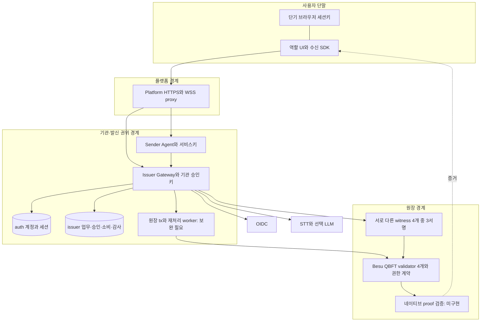
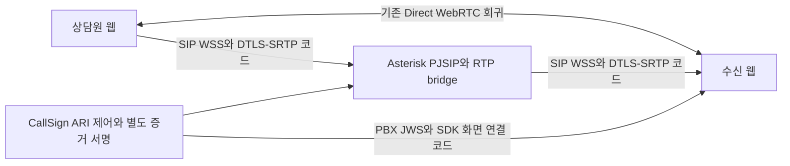
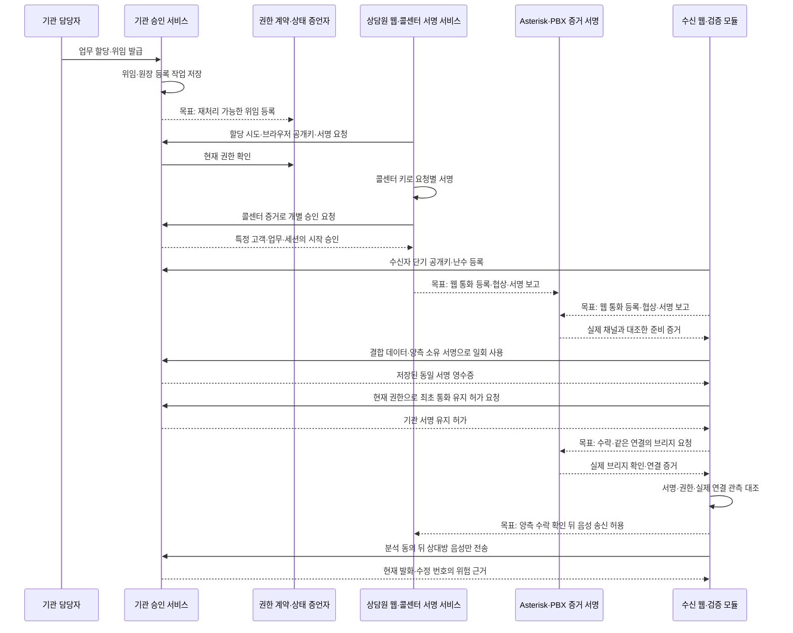
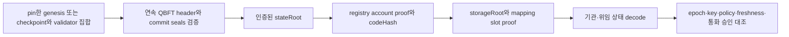
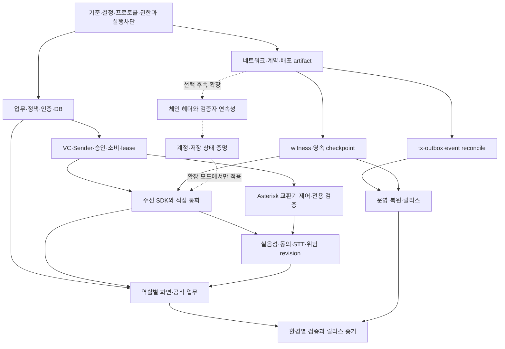
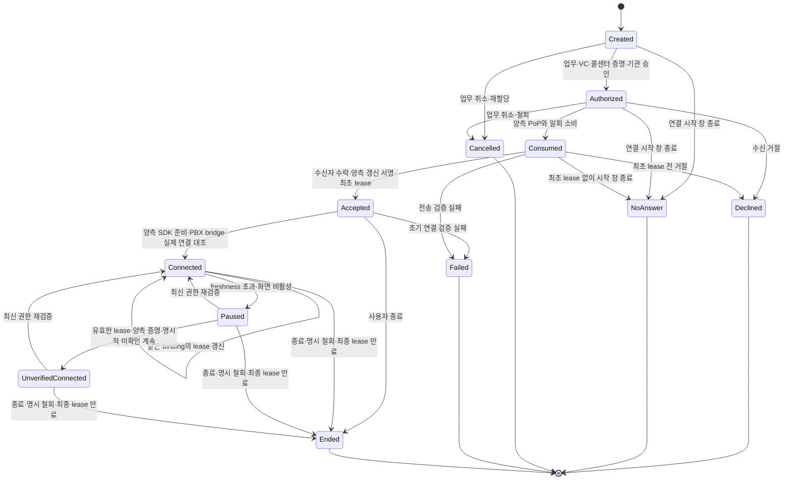
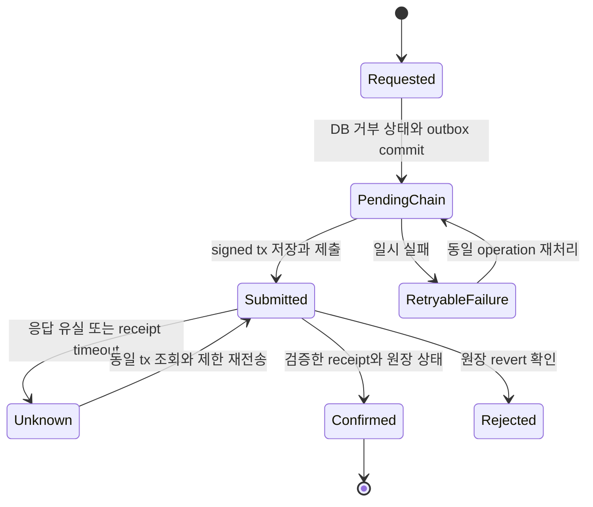

# CallSign 전체 개발 명세

## 서비스 설계 원칙

기본 서비스의 식별·권한·통화·분석·운영 경계다. 기존 초기 시연·역할 분리 직접 통화의 두 형식 코드와 증거는 보존하고, 현재 구현 상태는 개발 현황에서 관리한다.

- 기본 서비스는 등록 기관 URI/콜센터 URI·등록 Ed25519 키와 VC 2.0 JOSE를 사용한다. DID는 선택 호환 기능이며 기본 발신의 필수 조회 경로가 아니다. 고객 DID/지갑은 요구하지 않는다.
- 개별 연락의 연결 시작 유효기간은120초다. 최초 소비와 진행 통화 통화 유지 허가·현재 상태 freshness를 분리한다. 진행 중 만료/상태 확인 불가는 ‘사기/철회’가 아니다. 명시 철회는 종료, 확인 불가는 표시와 pause/종료/명시적 미확인 계속 선택을 제공한다.
- 기본 미디어는 웹↔Asterisk PJSIP/WSS+ARI↔웹이다. Asterisk가 SIP·DTLS-SRTP/RTP·bridge를 담당하고 CallSign이 권한/채널·bridge 사건/세션 결합 증거를 담당한다. Janus·외부 미구현 Edge API는 기본 경로의 의존성이 아니다. Direct WebRTC와 초기 시연·역할 분리 직접 통화의 두 형식은 회귀로 보존한다.
- QBFT4·Witness3/4·관리 승인2/3은 서로 다른 정책이다. 자기 기관의 단독 긴급 정지만 허용하고 해제·교체·복구는 공동 승인이 필요하다. VC 상태는 단일 계약 원장에 연결하고 DB는 pending 의도/검증한 projection만 유지한다.
- 네이티브 proof(PROOF-001~004)는 기존 후속 확장으로 보존하되 이번 기본 서비스 완료 gate에서 제외한다. 독자 합의/새 체인 클라이언트도 추가하지 않는다.
- 상태 최대 수명은 시계오차를 포함10초. 검증 p95≤500ms는 network/witness 포함 목표, 철회 표시는 chain 확정 후 p95≤5초 목표다. 현재 달성값/SLA가 아니다. 사건+1초 polling의 중복·역순·재연결을 처리한다.
- B2B2C이며 usage/quota/비용 제어를 구현하되 가격·결제·토큰/수익 배분을 확정하지 않는다. 시연 시나리오/발표 순서는 이번 개발에서 결정하지 않는다.

> 조사·설계 기준 문서 · 조사·후속 구현 반영일 2026-10-27(KST). 이 문서는 최종 목표, 현재 코드, 남은 개발과 완료 증거를 구분한다. 실행을 승인하는 문서가 아니다.

총 18개 영역의 74개 요구사항을 정의한다. 개별 작업은 [전체 요구사항 색인](#requirements-index)에서 찾고, 구현 순서는 §14, 결정 책임은 §15.1, 검증 환경과 증거는 §12를 함께 적용한다.

## 0. 문서 목적·조사 기준·실행 제한

**개발 에이전트는 이 문서의 요구사항 ID를 작업 단위로 삼고, 실제 호출 경로와 검증 증거를 갖춰 완료해야 한다.** 목적은 기존 초기 시연 경로을 보존하면서 모의 금융기관 이상거래 연락의 업무 권한, 재사용 위임, 개별 승인, 실제 연결, 음성 위험 분석, 공동 운영을 연결하는 전체 시스템이다. Besu를 재사용하더라도 네트워크·원장 정합성·증명 검증·운영까지 개발 책임에 포함한다.

- 저장소: <https://github.com/0u-Y/CallSign>. 경로는 저장소 루트를 기준으로 표기한다.
- 최초 조사 HEAD: `7aa26d90b9156c245e160283b1477360a6697cec`. 당시에는 미커밋 변경이 있어 이 시작 커밋만으로 구현을 재현할 수 없었다. 이후 사용자의 명시적 커밋·push 요청에 따라 기능별로 보존했으며, 이후 코드·시험 기준은 `ab0ec1cc55de26b9be832aa874d786beb9c8921c`였다. 이번 연결 작업 시작은 `a9d67f0b4b50a022b0e20de1e4071ec49cdcbd8a`이며 현재는 미커밋 코드·문서 변경을 포함한다. 이번에 커밋·push하지 않았다. 당시 검증 artifact의 미커밋 표시는 그 실행 시점의 provenance로 보존한다.
- 조사 근거는 코드·라우트·설정·시험 소스와 저장된 결과다. 이전 보고서의 ‘구현 완료’를 그대로 승계하지 않았다. 초기 명세 작성에서는 파일 읽기·검색·공식 문서 조사·문서 작성만 수행했다. 이후 사용자의 구현 요청으로 진행한 오프라인 개발은 §2.1에 별도 반영한다. 서비스·실환경 실행 제한은 그대로 유지한다.
- 환경 목표: RAM 64GB 서버컴에서 개발 후 동일 소스·이미지·구조로 GCP VM 이전. 64GB는 실측 자원 요구나 병렬 부하 허가를 뜻하지 않는다.
- [AGENTS.md](../AGENTS.md)의 제한을 유지한다. 별도 사용자 요청 전 Besu/Anvil/Hardhat, DB/witness/API/웹 전체 스택/Asterisk/TURN/Media Edge 기동, Compose up/down, 이미지 pull/build, migration·체인 초기화·계약 배포·seed, 통합·실통화·장애·부하 시험, STT/LLM 호출·모델 다운로드·추론, GCP 변경을 하지 않는다. 기존 프로세스·컨테이너·볼륨·키·증거를 변경/삭제하지 않고 다른 터미널·원격·CI로 우회하지 않는다.
- 원본 PPTX의 slide XML을 읽어 기획 내용과 후속 변경을 대조했다. PDF·렌더·기존 영상의 존재와 문서상 provenance를 확인했으며 이번에 재생·렌더·시연 검증하지 않았다. **3회차 멘토링 원문과 최신 제출 양식은 원문 확인 필요**다.

문서 권위: 사용자 지시와 AGENTS가 실행 범위를 정한다. 이 명세는 전체 제품 요구와 완료 조건의 기준이고, [진행표](FINALS-IMPLEMENTATION-PLAN.md)는 작업 로그, [과거 결과 보고서](archive/2026-10-26/FINALS-DEVELOPMENT-REPORT.md)는 2026-10-26 개발 특정 블록의 상태 묶음, [runbook](RUNBOOK.md)은 현행 절차의 근거다. 과거 보고서·초안은 날짜별 archive에 보존하고, 원본 기획서와 시험 증거는 유지한다. 충돌은 §3에 명시하고, 앞으로 개발 시 관련 문서를 같은 요구사항 ID로 갱신한다.

### 0.1 상태와 범위 읽는 법

각 요구사항은 **구현 / 검증 / 범위**를 별도 기록한다.

| 축 | 허용 값과 의미 |
|---|---|
| 구현 | 없음 / 인터페이스만 있음 / 부분 구현 / 코드 구현 완료. 호출 경로가 끊기거나 보안 조건이 남으면 부분 구현이다. |
| 검증 | 미검증 / 정적 검사 / 단위 검증 / 통합 검증 / 실환경 검증. 좁은 helper 검증을 영역 전체로 확장하지 않는다. |
| 범위 | 기존 필수 / 이번 요청으로 추가할 목표 / 신규 제안 / 범위 결정 필요. 권장 설계와 필수 기능을 구별한다. |

검증 결과에는 실행 날짜와 시험 범위를 붙인다. 최신 결과는 §2.4와 진행표의 이번 오프라인 검증을 따른다. §2.2의 18개 파일·82개 단위 시험은 이전 구현 이력이다. §12.2의 44개 시험은 초기 개발 당시의 기록이다. 최초 문서 정리에서는 시험을 재실행하지 않았다. 이번 연결 작업의 새 오프라인 검사는 §2.3에 기록하며 현재 서비스 전체의 통합·실환경 검증은 없다. 2026-09-14 실행은 초기 시연 코드의 과거 증거다.

세부 항목의 15필드는 다음처럼 묶어 적는다. ①기능·목적 ②이유·위협 ③현재 상태 ④근거 ⑤최종 동작 ⑥입출력 ⑦권한 ⑧정상 순서 ⑨실패·경합·재시작 ⑩의존·영향 ⑪구현 작업 ⑫완료 조건 ⑬검증·환경 ⑭증거 ⑮미결정·권장안. 공통 검증은 `TV-*`, 공통 증거는 `E-*`, 공통 규칙은 `RULE-*`로 참조한다. ‘작성 필요’인 경로는 현재 실행 가능한 명령으로 해석하지 않는다.

### 0.2 구현 경로와 용어

초기 시청 시연 코드는 `version=1`, 보존한 역할별 직접 통화 화면은 `version=2`·`/v2`, 기본 `/service` 화면은 `version=3`·`/v3`로 최초 연결·진행 통화·PBX·분석을 연결한다. 본문은 각각 **초기 시연 경로**, **역할 분리 직접 통화 경로**, **통화 유지·PBX 경로**라고 부른다. 통신 형식 번호는 호환성 식별값이며 제품 등급이 아니다. 현재 기본 화면과 배포는 통화 유지·PBX 경로를 사용하지만 실환경 성공은 미검증이다.

VC는 기관이 콜센터에 주는 업무 위임 증서이고, 개별 연락 승인은 이번 고객·업무·통화 시도만 허용한다. ‘소비’는 승인 ID를 특정 세션에 일회 사용했다고 고정하는 것이다. nonce는 일회성 난수, binding은 승인·양측 키·수신자·실제 연결의 결합, lease는 같은 통화를 갱신하며 유지하는 허가다. 상태 최신성과 120초 최초 연결 기한은 별개다.

Witness는 원장 상태를 서명하는 증언자다. 기존 P0 표기는 이 증언자 서명 검증, P1은 중앙 방식과의 비교 실험, P2·native proof는 아직 구현하지 않은 체인 자체 증명 확장을 가리킨다. 후속 작업 보관함(outbox)은 처리 의도를 DB에 남기는 구조이며 백그라운드 처리기(worker)가 실제 재처리를 맡는다. 전체 데이터·통화·보안 용어와 정확한 형식 대응은 [통신·서명 규약의 용어표](PROTOCOL.md#protocol-profiles)를 함께 적용한다.

| 기술 용어 | 개발 명세에서 읽는 방법 |
|---|---|
| Issuer / Sender / Platform | 기관 승인 서명 서비스 / 콜센터 서명 서비스 / 인증 요청 중계 서비스. 서로 다른 키·DB 접근 책임이다. |
| OIDC / IdP / JWKS / audience·scope | 외부 로그인 규약 / 로그인 제공자 / 제공자의 공개키 목록 / 토큰 수신 대상·로그인 용도. 이름이 비슷해도 일반·공식 로그인을 혼용하지 않는다. |
| CSRF / IDOR / replay | 사용자가 원치 않는 변경 요청 유도 / 다른 사람 객체 ID로 접근 / 유효했던 서명·토큰 재사용 공격이다. |
| transaction·commit / idempotency | DB 작업과 저장 확정 / 동일 요청을 반복해도 같은 결과를 주는 성질. 외부 호출이 한 번만 일어난다고 가정하지 않는다. |
| 체인 transaction nonce | 서명 요청의 무작위 challenge와 달리 송신 계정의 트랜잭션 순번이다. 동시 제출 때 충돌·응답 유실을 복구해야 한다. |
| outbox·cursor·tombstone | 후속 작업 보관함 / 이벤트를 어디까지 처리했는지의 위치 / 철회됐음을 지우지 않고 남기는 기록이다. |
| recovery gate·anchor | 승인 사용 이력을 신뢰할 수 없을 때 신규 발급·연결을 막는 검사 / 복원 대상 밖에서 보관한 최신성 비교 기준이다. |
| SDP·fingerprint / DTLS·SRTP / codec | 통화 협상 문서·인증서 지문 / 전송 보안·음성 보호 / 음성 압축·인코딩 방식이다. 실제 브라우저 관측과 서명 내용을 대조한다. |
| SIP·PJSIP·ARI·PBX leg | 통화 제어 규약 / Asterisk 통화 드라이버 / 제어·사건 인터페이스 / 교환기의 한 통화 채널이다. 제어 응답과 실제 음성 전달은 별개다. |
| manifest·image digest / readiness·liveness | 배포 구성 기록·이미지 내용 해시 / 기능 제공 준비·프로세스 생존이다. 포트 열림만으로 원장 최신성을 판단하지 않는다. |
| STT·LLM / partial·final·segment | 음성 전사·언어 모델 / 임시 전사·확정 전사·발화 구간이다. 수정 번호와 동의 세대를 검사한다. |
| p95 / SLO·SLA / oracle·gold | 표본 95%가 그 이하인 지연 / 운영 목표·보장 수준 / 독립 비교 구현·사람이 판정한 정답이다. 목표와 측정 결과를 구별한다. |

## 1. 전체 목표·역할·구성

연락 표시명이나 VC 하나만으로 정상 통화를 선언하지 않는다. **업무 승인 → 서비스·상담원 권한 → 수신자와 현재 미디어 연결 → 최신 권한 유지 → 독립적인 대화 위험 안내 → 별도 공식 업무**가 제품 흐름이다. 정상 권한의 상담원도 위험 요구를 할 수 있다. 경고가 없거나 분석이 불가능하다는 사실은 안전의 증거가 아니다. 실제 금융기관·통신사·전화번호 소유 인증 서비스라고 표현하지 않는다.

| 역할 | 목표·허용 업무 | 현재 코드와 차이 |
|---|---|---|
| 기관 담당자 | 모의 FDS 업무 작성, 등록 수신자·소속 상담원 할당, 취소, 진행 확인 | `institution`에 업무와 관리자 권한이 합쳐져 있다. |
| 상담원 | 자신에게 할당된 업무의 시도·세션 허가 요청, 발신, 통화·종료 | 코드 role은 `gateway`. 서비스 장기키는 Sender 소유다. |
| 수신자 | 자기 연락 확인·거절·수락, 검증 상태 확인, 분석 동의/철회, 공식 업무 | 자기 세션키만 보유한다. |
| 기관 관리자 | 서비스 등록/중지, 위임 정책·키 수명 관리, 정지·복구 제안 | permission 기반 관리 화면/API를 연결했다. 실제 OIDC/SQL 권한 검증 전이다. |
| 공동 승인자 | 등록/복구/directory 변경 내용을 검토하고 독립 키로 승인 | 기본 경로는 등록/복구/정책·목록 제안·독립 서명·제출/확정 상태를 표시한다. 실제 체인 검증 전이다. |
| 시스템 운영자 | 배포·모니터링·백업·복원, 키 파일 접근 정책 | 제품의 기관 승인·서명 권한을 자동 부여하지 않는다. 전용 화면 없음. |

### 1.1 서비스·키·DB·신뢰 경계

Platform에는 기관/서비스 개인키와 issuer DB 쓰기 권한이 없어야 한다. 기본 배포에서 Issuer는 기관 승인키/PBX 증거키를, 별도 worker는 원장 관리자·정지키를 읽는다. 이전 호환 profile의 직접 원장 관리 함수는 기본 변경 경로에서 차단한다. DB projection 쓰기 권한을 가진 worker는 여전히 신뢰 경계이며 실제 계정 격리는 검증 전이다. 독립 물리 운영, HSM/KMS 도입은 현재 사실이 아니다.

기본 PBX 경로의 미디어 종단은 Asterisk다. CallSign은 채널·Call-ID·bridge·세션 결합을 검증·증언하고 PBX 내부 경로 전체나 개인 신원을 증명하지 않는다. 이전 Janus/별도 외부 Edge 설계는 대체됐다. `media.ts`의 기존 client helper는 회귀 코드일 뿐 현재 기본 구성의 서버가 아니다.

### 1.2 주요 정상 처리 순서

아래는 **교환기 경유 통화의 최종 목표 순서**다. 기존 직접 통화의 데이터 채널 절차와 교환기 채널 증거를 혼동하지 않는다. 업무·서명·일회 사용·양측 갱신·PBX·원격 오디오·회수·원장 worker를 코드로 연결했다. 실환경 성공은 미검증이다. 실제 계약은 §7.2를 따른다.

### 1.3 비정상·운영 사용자 흐름

| 상황 | 요구되는 흐름·표시 | 관련 ID |
|---|---|---|
| 거절·부재 | 수락 전 음성 0, declined/no-answer 종료 사유 기록, 업무는 자동 취소하지 않음 | CALL-002, MEDIA-002 |
| 재시도 | 새 attempt/session/세션키/승인, 과거 승인·세션 결합·영수증 재사용 금지 | CALL-002, CALL-005 |
| 잘못된 할당 | 담당자가 취소 또는 재할당 이력을 남김. 이전 시도·허가는 즉시 무효 | BUSINESS-002 |
| VC·승인 복사 | 다른 상담원/수신자/목적/세션/브라우저키/transport 재사용 거절 | IDENTITY-003, CALL-001~004 |
| 통화 중 취소·철회·기관 정지 | 개별 DB 상태와 체인 상태를 구분해 전달, 검증 표시 철회·송신 중단, 철회 요청/원장 확정 각각 표시 | LEDGER-002, CALL-006 |
| 상태 확인 불가·정족수 부족 | ‘철회됨’이나 ‘안전’으로 단정하지 않고 확인 불가로 표시하고 신규 연결 차단. 진행 중은 정지·종료·명시적 미확인 계속 선택 | STATE-002, CALL-006 |
| 권한 있는 상담원의 위험 요구 | 인증은 독립 표시, 원문·revision의 위험 경고와 공식 경로 안내 | AI-003, UI-001 |
| 분석 동의 거절·철회·장애 | 통화 정책상 계속 가능한 경우 통화 유지, 분석만 중단/불가. 보류 데이터와 늦은 응답 폐기 | AI-001, AI-004 |
| 키 교체·공동 복구 | 정지→독립 2/3 승인→새 epoch/key 원장 확인→DB 활성화→trust 갱신→새 VC | GOVERNANCE-001~003 |
| 재시작·복원 뒤 새 통화 | 세션 재개 금지, 최고 관측 상태 기록·체인·키·취소 정합성 확인 후 새 시도 | STATE-003, OPS-005 |

## 2. 영역별 상태와 이행 이력

현재 상태는 §2.4다. 아래 §2.0~2.2는 이번 연결 전의 코드·검증 기준을 보존한 이력이며 현재 미구현 목록으로 재사용하지 않는다.

| 영역 | 구현 | 검증 근거와 한계 |
|---|---|---|
| Besu 네트워크·계약 | 기존 구성·계약 코드, 허가 노드·계정 관리와 운영 안전 보완 필요 | 초기 시연 실행 기록만 존재. 현재 구성 실환경 미검증 |
| 원장 변경·복구 | 등록·철회·정지·복구 요청 코드와 후속 작업 저장 구조 | 재처리 처리기·이벤트 읽기 위치 관리·트랜잭션 복구 미완성 |
| 상태 증언·수신 검증 | 동일 블록·상태의 4개 중 3개 서명 확인, DB 기준 상태 저장 코드 추가 | 서명·메모리 상태 단위 검증. 실제 DB·재시작·복원·체인 자체 증명 미검증/미구현 |
| 업무·정책·VC | 업무·할당 검사, 정책 해시, 직접 통화용 DID 및 등록 주소 기반 위임·승인 코드 | 역할 세분화·재할당·정책 변경·원장 등록 재처리 미완성 |
| 인증·DB | 역할별 서버·별도 로그인 용도, 세션 회수·재사용 방지, 기관 행 잠금 | 단위 검증. 실제 DB 권한·경합·로그인 제공자 연결 미검증 |
| 직접 통화 | 역할 화면·마이크·신호 교환·연결 관측·상대 음성 경로 연결 | 코드·단위·정적 검사. 현재 브라우저 실통화 미실행 |
| PBX 교환기 통화 | Asterisk 채널·브리지 제어/서명, SIP 브라우저 모듈·별도 수신 검증 코드 | 화면·사건 구독·자동 회수·실제 설정/배포·전체 시험 미완성 |
| STT·AI | Deepgram·Anthropic 호출 코드, 전사 수정·규칙·동의·예산 서버 경로 | 제공자 미호출. 새 화면 연결·비용 정산·삭제·한국어 품질 평가 미완성 |
| 화면 | 역할별 직접 통화·공식 업무 조회 연결, 모의 업무 응답 서버 API 추가 | 통화 유지·PBX 전환과 공식 응답 UI·접근성·실사용 검증 남음 |
| 운영·GCP | Compose·Dockerfile·Terraform·DB 백업/복원 코드 | 현재 서버 확장 배포 연결·일관된 전체 백업·운영 검증 남음 |
| 외부 전달 산출물 | 원본 기획·초기 시연 증거·과거 검토 초안 보존 | 현재 릴리스의 실환경 증거와 최신 검토 원문은 별도 필요 |

2026-10-26의 [44개 시험 결과](../artifacts/finals-light-results.json)와 [당시 환경 기록](../artifacts/finals-validation.json)은 보존한다. 실행 당시 변경은 미커밋 상태였고, 시작 커밋만으로 전체 실행 소스를 재현할 수 없었다. 후속 인증 단계 66개, 서비스 확장 단계 82개는 각각 별도 결과이며 세 수치를 합산하지 않는다.

### 2.1 후속 구현: 인증·조회·연결 폐기 경계

2026-10-27 구현에서는 AUTH-002의 용도 분리/선택 로그아웃, BUSINESS-001의 workspace 반환 범위, CALL-006/MEDIA/AI의 로컬 세션 폐기와 현재 DB 권한 재검사, GOVERNANCE-002의 private/public key 대응 검사를 보완했다. `0002_session_scopes.sql`은 **작성만 했고 적용하지 않았다.** 기존44개 증거는 보존하며, 새 light 결과와 한계는 [후속 검증 기록](../artifacts/master-implementation-20261027-auth.json)과 [진행표](FINALS-IMPLEMENTATION-PLAN.md)에 남긴다.

후속 최종 `pnpm light`는 타입·소스 검사와 **15개 파일66개 테스트(기존 회귀 포함)**를 통과했다. 실제 PG 시험은 타입 검사만 포함했으며 실행하지 않았다. 실제 IdP/JWKS 검증은 fake로 대체한 경계 시험이고, 실제 JWT 제공자 연결 성공을 뜻하지 않는다.

- 현재 세션에는 legacy/work/official purpose와 OIDC issuer/client/audience/authenticatedAt를 저장·검사한다. 이전 구현은 `authenticatedAt`에 iat를 대체 사용했다. 이번에는 auth_time이 없으면 재인증 근거를 주지 않으며 주요 작업에서 최근 인증을 요구한다.
- logout은 해당 scope의 CSRF로 session row만 삭제하고 같은 scope cookie를 지운다. `oidc_login_uses`는 별도로 남아 logout 뒤 같은 ID token으로 다시 세션을 만들지 못한다. 만료된 login-use는 이후 로그인 transaction에서 정리한다.
- 연결은 로컬 로그아웃에 즉시 폐기하고, 다른 프로세스의 폐기/만료·membership/업무/VC/key 변경은 1초 간격 DB 검사와 검사당 2초 timeout으로 검증할 수 없으면 허용하지 않는 처리 처리하는 코드를 추가했다. 이는 실측 철회 지연 SLO나 onchain 상태 최신성 검증의 대체물이 아니다.
- UI는 실제 연결된 attempt에 분석/종료를 고정하고 logout 이후 늦은 workspace/official 응답을 폐기한다. 실제 브라우저 렌더·경합·통화 검증은 미실행이다. lease/native proof/PBX 전체 연결·영속 quota의 실제 보장·검증한 기준 상태 복원과 후속 작업 보관함 worker는 여전히 남는다.

### 2.2 2026-10-27 서비스 결정 이행 현황

이 단계 당시 검증은 `pnpm light` 18개 파일·82개 통과였다. URI VC·별도 시작 승인·통화 유지 허가·종료 확정 전이·PBX ARI 증거·SIP parser/digest의 순수 단위/타입 범위이며 실제 DB/체인/통화/AI 성공이 아니다. [진행표](FINALS-IMPLEMENTATION-PLAN.md#service-20261027)와 [당시 증거](../artifacts/master-implementation-20261027-service.json)를 따른다.

- IDENTITY-001/003, CALL-001~005: 통화 유지·PBX 서버 API·서명·메모리 대체 객체의 순차 전이 작성. DID 없는 기본 준비/화면·양측 현재 transport·갱신 연결은 부분 구현.
- CALL-006/PBX-001~003: ARI 실채널 조회·별도 증언·consume 검사·새 verifier·브라우저 SIP 모듈 작성. UI 호출·ARI 사건·지속 회수·SDK 변조 시험·배포 구성 미완성.
- DB-001~003/STATE-003: 공통 소비 식별 범위·후속 작업 보관함·사용 한도·검증한 기준 상태·recovery gate SQL/저장 경로 작성. 실제 PG·백그라운드 처리기·독립 복원 anchor/해제·보관·삭제 정책·전체 복구 보장 미완성.
- AI-001~004: 통화 유지·PBX 경로 서버 오디오·동의 generation·영속 사용 한도 경로 추가. 새 UI·호출/삭제/제공자 계약·품질 실검증 미완성.
- UI/OPS/GOVERNANCE의 기본 profile 전환·통화 강제 회수·재인증·권한 세분화·관리키 경계·백그라운드 처리기·전체 배포는 여전히 코드 미구현이 있다. 실행 대기만으로 표시하지 않는다.

개별 요구의 근거에는 보존한 직접 통화 코드도 포함한다. 추가 서버의 구현·연결 범위는 이 절과 §7.2를 함께 적용한다. 자세한 완료 조건은 그대로 유지하며 helper/타입 통과를 전체 완료로 승계하지 않는다. 서비스 설명은 [가이드](guide/README.md)에 정리하며, 요구사항과 완료 기준은 이 명세를 따른다.

### 2.3 이전 제품 연결 시점의 기록

기본 `/service`→`/v3` 경로에 등록 URI·콜센터 요청 서명·개별 승인·수신 nonce·양측 binding PoP·일회 소비/영수증·양측 lease 갱신·PBX 검증/음성 허용·remote audio·공식 업무·회수를 연결했다. `/finals` 및 초기 시연 회귀는 보존한다. 신규 `0004_worker_recovery.sql`은 작성만 했고 적용하지 않았다.

| 요구 ID | 이번 구현·연결 | 검증 축과 한계 |
|---|---|---|
| IDENTITY-001/003, CALL-001~006 | [기본 화면](../apps/web/src/pages/Service.tsx), [통화 제어](../apps/web/src/lib/serviceCall.ts), [승인/유지](../services/api/src/service-authority.ts), [SDK](../packages/verifier/src/service.ts), URI 키/trust 준비 | 서명·chain/registry·nonce·세대·binding·PBX/양측 SDK·정족수·오래된/상충 상태 단위 검증. 실통화/DB 미실행 |
| PBX-001~003, MEDIA-001~004 | [SIP](../apps/web/src/lib/pbxSip.ts), [ARI runtime](../services/api/src/pbx-runtime.ts), [PBX API](../services/api/src/pbx-routes.ts), Asterisk TLS/ODBC/RTP·배포 | dialog ACK/CANCEL/BYE·중복 사건·timeout·회수 재시도 단위 검증. 실제 이미지/드라이버·DTLS/음성/브라우저 미실행 |
| LEDGER-001~003, DB-002 | [worker](../services/api/src/service-worker.ts), [원장 처리](../services/api/src/worker-ledger.ts), [사건 cursor](../services/api/src/ledger-events.ts) | 저장된 raw tx/hash 복구·재시도·claim 유실 단위 검증. 실제 nonce/GRANT/DB 경합/체인 미실행 |
| DB-001/003/004, STATE-003, OPS-005 | [SQL](../services/api/drizzle/0004_worker_recovery.sql), [quota](../services/api/src/quota.ts), [독립 anchor](../services/api/src/consumption-anchor.ts), [retention](../services/api/src/retention.ts), 암호화 backup/restore | 예약/정산 실제 PG 시험은 작성·타입 검사만. anchor 충돌·변조 단위 검증. 외부 anchor 진행/DB 불명 commit은 자동 해제하지 않음 |
| BUSINESS-001/002, AUTH-002, GOVERNANCE-001/002 | [관리](../services/api/src/service-management.ts), 명시적 permission·최근 auth_time·재할당/비활성 회수·2-of-3 등록/복구·기관/콜센터 키 교체 | 키 목록 공동 서명은 복구 서명과 별도다. 실제 계약/로그인/새 trust rollout 미실행 |
| AI-001~004, UI-001~005/007 | remote stream·동의/전사 revision·provider/규칙·경고·철회/중단·공식 업무 호출 연결 | 단위/타입/웹 빌드. 실제 제공자·한국어 품질·보관/청구·접근성 미검증 |
| OPS-001~007, TEST-001~004 | 기본 Compose/GCP/역할별 key mount/readiness, 작업/사용량 조회, 새 DB/PBX 시험 소스, guard 회귀 | YAML·셸·타입 검사. 실제 인프라·부하·복구 미실행. 가격/전체 알림·릴리스 자동화는 남음 |

이전 연결 시점의 `pnpm light`는 **34개 파일·148개 테스트 통과**였다. [이번 원본 출력·소스 hash](../artifacts/product-connection-20261027.json), [ID별 진행/남은 코드](FINALS-IMPLEMENTATION-PLAN.md#service-20261027), [구체적 실행 절차](RUNBOOK.md)를 따른다. 이전 82/66/44개 시험을 합산하거나 현재 증거로 재사용하지 않는다. 당시 개발 fixture 9개도 독립 평가가 아니며 현재 확장은 §2.4를 따른다.

중요한 정책: 120초는 attempt 생성부터의 최초 연결 창이다. 30초 lease·4시간 최대 통화는 `CALL_LEASE_SECONDS`/`CALL_MAX_SECONDS`의 초기값이며 확정 성능값이 아니다. 같은 binding·이전 lease hash·nonce·순번에 양측이 서명해야 갱신한다. 명시 철회와 freshness 만료를 구분하며 최초 bridge는 현재 권한/양측 검증 준비를 요구한다. 진행 중 조회 실패는 기본 음성·분석 정지와 명시적 미확인 계속 선택으로 표시한다.

PBX의 ARI 채널/Call-ID/bridge 관측과 설정 인증서 pin을 브라우저 실제 DTLS 관측에 대조한다. 서버의 독립 DTLS handshake 수집이라고 표현하지 않는다. Asterisk가 RTP 종단이며 외부 미구현 Edge는 기본 의존성이 아니다. SIP는 직접 Asterisk WSS 수신 dialog로 한정하며 proxy/PSTN/자동 전환·새 연결의 무검증 재사용을 거절한다.

독립 anchor는 VM 백업 밖의 HTTPS 권위 서비스다. 동일 백업으로 함께 복원하면 보장이 없다. 소비 SQL namespace/journal·권한 세대/외부 root가 다르면 gate를 닫는다. 신규 독립 anchor·기존 배포 이력 기준선·실제 일관 chain snapshot은 운영자가 검토해 준비해야 하며 파일 존재나 fake 일치만으로 신뢰하지 않는다.

### 2.4 2026-10-27 실행 전 마무리 기록

이 절은10월27일 당시 기록이며 현재 기준은 §2.5다. 당시 HEAD는 `a9d67f0b4b50a022b0e20de1e4071ec49cdcbd8a`이며 재현에는 미커밋 파일도 필요하다. 요구 ID별 코드·시험·남은 경계는 [현재 진행표](FINALS-IMPLEMENTATION-PLAN.md#pre-execution-20261027), 실제 검사 출력·파일 hash는 [이번 증거](../artifacts/pre-execution-20261027.json)를 기준으로 한다. 당시 light는 38개 파일·171개 시험, 웹 빌드/runtime 타입 검사는 PASS다. 설정이 주입되지 않은 preflight는 38개 BLOCKED와 환경 확인 3개 SKIPPED를 보고했다. 계약 시험·서비스·migration·배포는 실행하지 않았다.

| 요구 | 현재 구현·연결 | 검증과 완료 전 경계 |
|---|---|---|
| CONTRACT-001~005, GOVERNANCE-001/002, BUSINESS-003 | 새 `ServiceRegistry`의 공동 configuration 변경, EIP-712·독립 서명 수집·관리 UI/API·작업 제출·확정 event+state 대조·최신 Witness 확인 뒤 활성화 | 실제 서명 경계 단위 시험, 계약과 계약 시험 소스 오프라인 컴파일. 실제 계약 시험·새 배포·trust 전환 필요 |
| STATE-001~003, CALL-006 | registry profile·policyHash를 동일 블록 증언/SDK에 결합. 정책 변경은 epoch 증가·구 권한/통화 무효화, 공식 경로 표시명만 변경하면 유지 | signed snapshot 변조/강등/정책 회수 단위 시험. 실제 체인·철회 전파 대기 |
| AUTH-001/002, BUSINESS-001/002, UI-003/004 | 외부 issuer/subject 사전 연결·내부 계정/역할 관리 양식·최근 인증/CSRF·SQL 권한 경계·세션 세대·통화/분석 회수 | 일반 관리자는 공동 승인자 생성 불가. 실제 OIDC·SQL GRANT·경합 미검증 |
| DB-001~004, LEDGER-001~003, OPS-005 | 기관별 worker·서명자 lease/fencing·복구 검사의 긴 행 잠금 제거·권한 metadata checkpoint·독립 anchor CAS·인증된 백업 manifest·복원 세션 폐기 | PG/독립 anchor 시험 소스 작성. 결과 불명 CAS/DB commit은 gate 차단; 자동 새 기준 채택 없음 |
| CALL-002/005, MEDIA-002/003, PBX-001~003, UI-001/002/007 | 수락/숨김/기한과 비동기 track 경합 방어, 양방향 수신 차단, PBX 절대 timeout·DB 장애 채널 음소거, 업무 새로고침·동일 요청 재시도 | 실제 Asterisk/TURN/RTP·브라우저 미실행. transport 제어 지연을 뺀 짧은 기한이 적용될 수 있음 |
| AI-001~005, OPS-006, TEST-001~004 | 영속 웹 알림·읽음/설정·만료, 고정 차원 지연/오류·worker/자원 계측, 36개 합성 개발 회귀, offline preflight/증거 수집 | 외부 알림 채널 미선택. provider·독립 사람 평가·실측 지연/비용·브라우저 캡처 미실행 |

**새 배포 경계:** 기존 계약은 upgrade 구조가 없다. 기본 서비스는 새 `ServiceRegistry` 주소·code hash·초기 policyHash·3승인자·배포 블록 및 새 trust를 명시적으로 채택한다. 구 계약/fixture는 보존한다. `0005_account_management.sql`은 작성만 했다. authority checkpoint가 없는 구 DB를 flag 수정만으로 채택하지 않으며, 검토한 새 배포 또는 독립 이력 대조를 포함한 별도 이행이 필요하다. 앱 정책 JSON 숫자만 변경해 활성화하지 않는다.

코드가 남은 범위와 실환경 미검증을 구별한다. 당시에는 단계 runner가 없었다. 현재 자동/수동 범위는 §2.5와 RUNBOOK을 따른다. 외부 알림 공급자·실제 이미지 digest·IdP·DNS/인증서·독립 anchor 배치·제공자 보관/예산은 외부 결정/설정이다. native proof·일반 SIP/PSTN·자동 transfer·무중단 진행 통화 복원은 기본 범위 밖이다. §2.4 이후의 개별 항목에서 §2.3을 참조하는 검증 범위는 이 절의 최신 근거도 함께 적용한다.

### 2.5 2026-10-29 실행 준비·검증 체계 — 현재 기준

HEAD는 여전히 `a9d67f0b4b50a022b0e20de1e4071ec49cdcbd8a`이고 미커밋 변경을 포함한다. §2.4의171개 시험/preflight38차단은 과거 결과다. [최신 진행표](FINALS-IMPLEMENTATION-PLAN.md#execution-readiness-20261029)와 [최종 오프라인 증거](../artifacts/execution-validation-rechecked-20261029.json)를 현재 기준으로 한다. 전체74개 요구 ID와 완료 조건은 유지하며 새 연구/외부 채널을 추가하지 않는다.

| 요구 | 현재 추가한 연결·완료 조건 | 실제 확인/남은 것 |
|---|---|---|
| OPS-001~005/007, TEST-001/004 | 준비 도구는 기본 dry-run, 기존 대상 충돌·역할별 비밀 참조·부분 산출물 보존; 앱→키/DB→계약/PBX→trust→웹→독립 anchor→등록 순서. 실제 LOGIN 최소권한 SQL과 초기 blocked gate | 소스·단위·YAML/셸 검사. 실제 provisioning/등록/GRANT·인증서·이미지/driver·anchor는 대기 |
| TEST-001~004, OPS-005/006 | 고정 argv runner 8단계, test 배포 identity·기존 guard·시간/출력 제한·실패 전파·resume 재검사·증거 redaction. 자동 assertion과 MANUAL 관측을 구분 | light42파일191시험, 웹 build/runtime 타입 PASS. 실제 환경 단계는 dry-run만 SKIPPED. MANUAL은 PASS로 바꾸지 않음 |
| GOVERNANCE-001/002, BUSINESS-003, UI-003/004 | 현재/제안 정책·공식 경로 비교, 기관/chain/계약/action/nonce/기한/digest, 제안 내보내기/서명 가져오기·등록 signer/중복/만료 검증. 내용 변경은 구 서명 무효 | 로컬 실제 EIP-712 서명/변조 단위·타입/build. 실제 브라우저·공동 운영·체인 시험 미실행 |
| CALL-001/004/006, STATE-003 | 게시 trust/pin/issuer/service키·정책이 현재 권한과 다르면 신규 발급/연결 차단, 확정→trust/웹 게시 중에는 관리·복구 유지; 최초 계정 등록은 복구 gate를 열지 않음 | 경계 단위 검증. 실제 새 zero anchor/정책·키 rollout·오래된 탭·부분 replica 실패 대기 |
| DB-001/003, CALL-004, PBX-001/003, MEDIA-002 | 독립 SQL 연결 commit 후 응답 유실의 같은 영수증 복구, migration hash/GRANT 검사, 실제 test 배포 identity와 양방향 decoded audio/RTP 관측 | 통합/미디어 소스·타입 검사만. 실제 DB 원자성·미디어 성공 아님 |
| TEST-003, OPS-006 | 실제 단일 monotonic 관측·100표본/실패수·nearest rank; 철회 확정 관측 지연 상한을 더해 목표 판정 | 계산·거절 단위 시험만. 한국어/음성/성능 실측·독립 정답은 미준비 |

runtime preflight **BLOCKED62·PASS14·SKIPPED1**이다. [항목별 원인·주체·입력·절차](../artifacts/execution-preparation-rechecked-20261029.json)에 C43(사용자·외부 설정)와 D19(나중 생성값)를 기록한다. B의 기존 실제 ABI/hash·PBX 고정 IP를 이용해 과거38차단 중2개를 해소하고 누락 검사를 보완했다. E의 실제 네트워크/기동 확인은 SKIPPED이며 오프라인 PASS로 대체하지 않는다. DID/native proof 등 선택 확장은 준비의 필수 의존성이 아니다. STT/LLM은 필수 기능이며 bootstrap에서만 보류한다.

이 단계의 ‘구현’은 설정/runner/선택 자동 시험과 수동 증거 계약의 코드 연결을 말한다. 실제 Besu 장애·TURN/철회/동의 전체 경로·실제 복원·실측 수집·GCP의 자동 시험은 MANUAL 절차로 남는다. 실환경 성공이 필요한 RULE-03을 충족했다고 선언하지 않는다. 다음 실행은 [RUNBOOK](RUNBOOK.md#단계별-검증과-판정)의 새 시험 환경/입력/guard 승인 후 수행한다.

### 2.6 실행 준비 후속 정합성 — 최신 기준

§2.5 이후 method/execution/verdict/review를 독립 기록하고 수동 실관측 검토의 PASS/FAIL을 지원했다. 과거 MANUAL을 통과로 추정하지 않는다. 첫 DB 단계는 전체 서비스 설정이 아닌 현재 소스 검사 통과와 DB 전용 설정/guard/격리를 요구한다. 신뢰 전환·anchor·정책 보장은 생략하지 않았다. 재현 identity에는 sourceFiles와 선택 계약 artifact를 포함하고 보호 env/키를 제외한다.

요구 ID TEST-001/004·OPS-001~007·DB-001의 현재 변경/검증은 [최신 진행표](FINALS-IMPLEMENTATION-PLAN.md#readiness-refinement-20261029), 입력/이전/실행 조건은 [RUNBOOK](RUNBOOK.md#실행-전-정합성-보완--2026-10-29-후속)에 둔다. light42파일193시험·웹 build/runtime 타입은 통과했지만 전체 설정/실환경 완료는 아니다. 74개 요구와 기존 완료 조건을 낮추지 않는다.

### 2.7 첫 격리 PostgreSQL 검증

사용자 한정 허가 후 로컬 checkpoint와 자원 확인을 수행했다. DB-001/003·CALL-004·LEDGER-002·AUTH-002의 선택된 실제 SQL 경계15시험이 PostgreSQL17.6에서 통과했다. session fixture 문맥과 outbox 정리를 수정하고 auth 실제 금지 SQL을 확인했다. 전체 역할·disk 장애·독립 anchor·chain/통화는 미검증이다. 코드/시험 시점과 commit 관계 및 자원 제한은 [최신 기록](FINALS-IMPLEMENTATION-PLAN.md#postgres-validation-20261029)을 따른다. 이전 DB 미실행 표시는 당시 기록이다.

### 2.8 로컬 EVM 권한·서명 검증 — 2026-10-30

CONTRACT-001/003/004·GOVERNANCE-001/002·BUSINESS-003·TEST-002의 선택된 계약 상태 전이를 실제 프로세스 내부 EVM에서 실행했다.21시험 PASS(실패/skip0), fuzz32회×2성공 전이, 앱 typed-data/calldata·서명·event bytes 호환을 확인했다. 현재 light43파일194시험·웹 build/API runtime 타입은 통과했다. 계약 본체와 기존 ABI/bytecode는 변경하지 않았다.

기존 미공개 checkpoint는 복구 ref를 만든 뒤 코드/설정·증거·문서로 재구성했으며 원본 tip과 tree가 같음을 확인했다. 과거 증거의 HEAD/결과는 보존했다. [최신 진행 기록](FINALS-IMPLEMENTATION-PLAN.md#contract-validation-20261030)이 실제 시험 HEAD·도구·원본 실패·커밋 대응의 기준이다. 온체인 회수 전이 확인과 실제 VC/브라우저/통화 회수 전파는 구분하며 Besu/QBFT/Witness는 여전히 미검증이다.

## 3. 우선 해결할 충돌·차단 요인

| 확인된 사실 | 최종 명세에서의 처리 |
|---|---|
| 결과 보고서 A~E/G/H의 넓은 ‘완료’와 실제 미완성 생성·변경·종료 흐름 | 요구 ID별로 부분 구현 판정. helper 단위 성공과 전체 경로를 분리한다. |
| 제품 기준과 과거 시청 시연 설명이 혼재 | 루트 제품 기준은 모의 금융 업무·웹 교환기 통화 목표를 따른다. 시청 설명은 과거 기록으로 보존한다. |
| `FinalsAuthority.authorize`가 permit 만료에 승인 만료를 묶고 SDK가 통화 중에도 permit/auth/binding expiry 검사 | 최초 연결 기한과 통화 유지 허가를 분리한 서버 API를 추가했다. 기존 기본 화면·배포 전환과 양측 갱신을 이번에 연결했다. 실환경 검증은 남아 있다. |
| `SessionBinding.recipientNonce`를 현재 sender가 생성 | 새 `/v3/enroll`은 수신자의 공개키·일회성 난수를 저장한다. 기존 직접 통화 화면의 생성 위치와 서명 전 협상 대조는 별도 보완이 필요하다. |
| 후속 구현에서 official cookie 대입을 제거하고 DB purpose/issuer/client/audience를 검사 | cookie 전용·다른 scope·legacy 전용 시험 통과. 실제 DB/IdP 검증은 여전히 필요하다. |
| 후속 `workspaceFor`는 recipient의 승인에 연결된 VC만 반환, approver에게 개인 업무/VC 미반환 | 다른 기관·할당 서비스·불일치 승인 관계를 제외하는 단위 검증을 추가했다. 기본 경로에 permission·계정 비활성·재할당·연결 회수를 추가했다. 등록 OIDC issuer/subject의 내부 계정 관리 UI/API와 SQL 함수·세대 회수를 §2.4에 연결했다. 외부 IdP 계정 생성은 포함하지 않는다. |
| 후속 역할 분리 직접 통화 경로 auth에 `/auth/me`·`/auth/logout`와 연결 폐기·별도 replay 기록 추가 | 선택 scope logout/CSRF·late response 차단 코드, 실제 DB 삭제/role/WS·UI 경합 검증 대기. |
| `/v2/state`는 `SignedStateSnapshot version=1` 사용 | 통화 형식의 `version=2`와 별개인 상태 증언 형식이다. 모든 서명 객체가 같은 번호라는 뜻으로 설명하지 않는다. |
| `MediaEdgeAdapter` 응답 `mappingJws`와 `verifyPbxMapping`의 HMAC 계약 상이 | PBX-003에서 내부 HMAC과 수신 공개키 JWS를 분리·정의하고 실제 발급자를 구현한다. |
| 키 회전 확인은 기존 credential 하나로 특정 블록의 상태 묶음 조회, 서비스키 교체 경로 없음 | 무위임 기관 상태 조회, 서비스키 회전, trust 게시 순서·지속 상태를 완성한다. |
| `RegistryOperations.submit`는 RPC 대체 처리+wait뿐, chain DB 재시도 백그라운드 처리기 없음(이전 경로) | 기본 worker가 raw tx·nonce·claim·cursor를 보존한다. timeout은 unknown/pending이며 기존 helper를 기본 경로에서 쓰지 않는다. |
| `NETWORK_ID` env와 compose의 hard-coded network-id 20260914, RPC `QBFT` 포함·host allowlist=* | 배포 manifest에서 불일치를 거절하고 관리 RPC를 분리한다. 내부망만으로 permissioning 완료라 하지 않는다. |
| `generate-besu.sh`는 일부 기존 파일이 없으면 copy 경로로 진입 | 부분 손상에 자동 재생성/덮어쓰기 금지. CHAIN-001/OPS-003의 검증할 수 없으면 허용하지 않는 처리 사전 검사 필요. |
| `deploy-registry.ts`는 알려진 local demo 키·시청 기관·초기 시연 경로 key 경로 | 공개 서비스 배포 도구가 아님. 안전한 새 기관 등록/배포 경로를 별도 완성한다. |
| `scripts/restore.sh`의 빈 DB는 운영자 확인값이며 실제 빈 DB 조회는 없음 | OPS-005에서 대상 ID·빈 상태·manifest 검증을 강제한다. |
| `scripts/backup.sh`는 DB dump만 제공 | 전체 DB·체인·키·trust 일관 snapshot/복원 검증은 미구현이다. |
| 현행 light의 PG 시험은 저장소 primitive만, 미디어 시험도 일부 경로만 | 역할 분리 직접 통화 경로 실제 권한 엔진 경합·권한 GRANT·두 방향 audio·장애·중단 검증 추가. |
| 체인 자체 증명 확장 native proof는 과거 후속 범위였고 현재 코드 없음 | 후속 확장으로 보존하고 기본 서비스 완료 조건에서 제외한다. witness로 대체 완료하지 않는다. |

## 4. 공통 개발 계약

### RULE-01. 경계·오류·상태

모든 객체 조회/변경은 인증 사용자, 기관 소속, 역할 permission, 소유자/할당, 등록 서비스, 업무 상태, 정책 버전, epoch/key version을 서버에서 확인한다. 요청 body의 institution/recipient/role을 신뢰하지 않는다. 객체 미존재/권한 없음의 응답은 열거 공격을 억제한다. `401` 재인증, `403` 권한/CSRF, `404` 접근 가능한 객체 없음, `409` 상태·승인·세션 결합 충돌, `429` 사용 한도, `503` 의존성/상태 불가를 구분한다. 공개 응답·로그에 비밀값/원문 음성/전체 전사를 포함하지 않는다. 실제 오류는 correlationId와 요구사항 ID로 추적한다.

### RULE-02. 서명·시간·버전

strict schema, 중복 JSON key·비 UTF-8·초과 크기·알 수 없는 버전/알고리즘/필드 거절, 서명 type/kid/domain/network/registry 검사, JCS UTF-8 SHA-256 lowercase hex를 기본으로 한다. 배열 순서는 의미가 있다. chain key는 `keccak256(UTF8 id)`다. VC digest와 JWS token hash는 구분한다. 초기 시연 경로 fixture를 수정하지 않으며 자동 fallback하지 않는다. schema 의미가 달라지면 새 명시적 profile/version과 migration·거절 벡터를 작성한다. wall clock은 발급/만료, monotonic clock은 현재 프로세스 deadline이다. 재시작 뒤 이전 monotonic 값을 복구하지 않는다.

### RULE-03. 최종 완료 정의

코드·호출자·서버 권한·UI·설정·migration·실패 처리·회귀가 연결돼야 ‘코드 구현 완료’다. 전체 제품 완료는 TV 검증 환경별 실제 실행과 독립 증거까지 갖춘 상태다. 이번 문서 작업에서 테스트 미실행은 개발 범위 제외가 아니다. 모델/fixture/제어 adapter만 구현한 상태를 실통화나 실제 media bridge로 세지 않는다. 테스트 skip·NOT-RUN을 PASS에 합산하지 않는다.

### RULE-04. 증거 규격

새 검증은 `artifacts/releases/<release-id>/<TV-ID>/`에 저장하는 **목표 규격**이다. 아직 디렉터리/명령이 없는 항목은 작성 필요다. 기존 artifact는 보존한다.

| ID | 남겨야 할 증거 |
|---|---|
| E-01 | source commit/tree 또는 미커밋 patch+untracked 파일 hash manifest, 명령/시각/종료코드, 도구 버전, raw 결과, skip/실패·변경 범위 |
| E-02 | E-01 + 서명 공개 고정 시험 데이터, 변조 입력, 예상/실제 오류, 독립 hash/header/proof 벡터 출처. 개인키는 시험 전용만, 공개 운영키 미포함 |
| E-03 | E-01 + DB schema/role GRANT, 경합 interleaving·commit/rollback·응답 유실·재시작 기록, 정합성 query 결과의 비식별본 |
| E-04 | E-01 + chain/genesis/registry/code/layout hash, validator/witness 공개 ID, tx/receipt/block/proof raw 자료, 중단 범위와 복구 기록 |
| E-05 | E-01 + 브라우저/OS/기기/네트워크/codec, 두 방향 native getStats·DTLS/ICE/track 상태, 동의·종료 시각, 비식별 캡처 |
| E-06 | E-01 + provider/model/API version, 데이터셋/정답 수정 번호, request ID/usage/비용, 지연 분해·오탐/미탐. 민감 원문은 접근통제·보관 동의 |
| E-07 | E-01 + image digest/release manifest/설정 hash, backup/checkpoint/checksum, 복원 격리·승인·최신성 확인·rollback 기록 |

### RULE-05. 향후 변경·제안의 취급

필수 결과를 위한 구현 선택은 각 항목에서 ‘권장안’으로 구체화한다. 사용자가 요구하지 않은 자체 합의 엔진·새 체인 클라이언트·자동 무중단 transfer·외부 금융기관 실제 연동·스마트폰 기본 전화앱/통신망 통합·범용 VC 인증·다국어 확대를 몰래 필수로 넣지 않는다. 후보는 §15의 범위 결정 또는 신규 제안으로 남긴다.

## 5. 블록체인 코어·네트워크·권한 계약

### 5.1 구현 책임과 현재 프로파일

| 계층 | 재사용하는 기능 | CallSign이 완성할 기능 |
|---|---|---|
| Besu 엔진 | QBFT round/commit, EVM 실행·tx pool, Ethereum P2P/동기화, 체인·상태 저장과 RPC | 검증한 버전 고정·빌드 생성 시점·출처, 네트워크 설정·permissioning·노드 운영·RPC 경계·관측 |
| 애플리케이션 원장 | OpenZeppelin EIP-712/ECDSA, viem client | 권한 계약 상태 기계, 독립 승인, tx 생성·변경·종료 흐름, DB 정합성·실제 상태와 재대조, 배포/code/layout 검증 |
| 수신 신뢰 | 암호·RLP/trie 라이브러리 후보 | witness 정책·상태 최신성·영속 검증한 기준 상태, native header/seal/account/storage proof와 최종 승인 연결 |

현재 저장소에 Besu fork/source는 없다. 현 요구를 충족하기 위해 Besu 합의 코드를 수정해야 한다는 근거도 발견하지 못했다. **엔진 재사용은 코어 개발의 제외가 아니다.** source 수정은 CHAIN-005의 별도 필요성 판정 이후만 추진한다.

현재 image는 `hyperledger/besu:26.8.1`이고 공식 [26.8.1 release](https://github.com/besu-eth/besu/releases/tag/26.8.1)를 확인했다. 선택 이유는 기존 실험과의 연속성 및 QBFT/표준 EVM 도구 재사용이며 최신·가장 안전한 버전이라는 주장은 아니다. 공개 전 알려진 문제·릴리스 변경·image 내용 해시 검토가 필요하다.

| 설정 | 현재 값·상태 | 최종 규칙 |
|---|---|---|
| chain ID / network ID | genesis `20260914`, Compose P2P `20260914` | 배포 manifest에서 각각 고정·대조. 같은 숫자여도 역할이 다르다. |
| 초기 validator | operator generator로 4개 key/extraData 생성 | genesis hash·validator 주소·node pubkey를 공개 manifest에 고정 |
| 합의 시간 | blockperiodseconds=2, requesttimeoutseconds=4, epochlength=30000 | 측정 전 성능 보장 아님. timeout/epoch 변경은 체인 규칙 변경 관리 |
| EVM/gas | Berlin/London block0, Shanghai/Cancun time0, zeroBaseFee, minGasPrice0, 큰 gasLimit | 배포 chain fork schedule·gas cap을 고정. 무료 gas가 DoS 방어를 제공하지 않음 |
| 초기 계정 | 공개 dev deployer balance | 공개 배포용 새 역할키·자금 정책. 알려진 키 사용 거절 |
| P2P | node1 bootnode, 10.203.0.11~14, port30303 | node1 장애 후 재접속 경로·고정 peer/다중 bootnode와 허가 목록 필요 |
| permissioning | node/account 옵션 없음 | validator 자격·peer 접속 허가·tx sender 허가는 별개로 구성 |
| RPC | 내부 8545, ETH/NET/QBFT/WEB3, host allowlist=* | 관리 식별 범위 제한, 내부 인증/ACL, 요청 크기·율·timeout |
| health | TCP open만 검사하는 Besu healthcheck | chain/genesis, syncing/peer, 최근 block 진행을 readiness와 별도 관측 |

QBFT의 4-validator 프로파일에서는 블록 확정에 3개 validator 서명이 필요한 운영 가정을 사용한다. witness는 별도 Ed25519 키 4개 중 같은 상태 3개다. 숫자가 같아도 합의 서명과 상태 증언은 대체 관계가 아니다. 네트워크 정책과 `epochlength`의 의미는 [공식 QBFT 설명](https://docs.besu-eth.org/private-networks/how-to/configure/consensus/qbft)을 적용하되 정확한 hash/seal은 고정 버전 소스로 검증한다. 단일 서버의 네 컨테이너는 전원·디스크·관리자 장애를 분리하지 못한다.

### CHAIN-001 — 재현 가능한 genesis·노드 identity·데이터 수명

- **①목적·②이유:** 같은 배포가 재시작 때 다른 체인이나 validator가 되는 사고를 막는다.
- **③상태·④근거:** 구현=부분 구현 / 검증=정적 검사 / 범위=기존 필수. `infra/besu/network-config.json`, `scripts/generate-besu.sh`, `infra/deploy/compose.yml`의 genesis/key/volume mount. generator는 Docker를 호출하며 현재 실행 금지다.
- **⑤동작·⑥입출력·⑦경계:** 새 배포 입력은 deploymentId, chain/network ID, fork schedule, validator/node 공개 ID와 새 보호 디렉터리다. 출력은 genesis·hash·개별 node key·checksum manifest. 운영자만 초기 준비, 각 validator는 자기 개인키·자기 data volume만 읽는다.
- **⑧순서·⑨예외:** 새 경로 사전 검사→명시적 생성→hash/extraData 검증→immutable 설정 저장→기동. 일부 key/genesis만 남아 있으면 손상으로 중단하고 복원 절차로 보낸다. 일반 시작은 생성기를 호출하지 않는다.
- **⑩의존·⑪작업:** OPS-001/003에 선행. 기존 copy 재진입 경로에 no-overwrite·부분 상태 검사·deployment manifest 추가, demo alloc와 공개 배포 분리, 권한/UID 검사 구현.
- **⑫완료·⑬검증·⑭증거·⑮결정:** 재시작 전후 genesis/node ID/데이터가 같고 부분 손상을 자동 초기화하지 않아야 한다. TV-01/02의 파일 fake 후 TV-05/09, E-04/07. 새 chain ID 재사용 여부는 배포 단위로 결정; 권장 새 trust deploymentId도 함께 구별한다.

### CHAIN-002 — P2P·permissioning·validator 관리

- **①·②:** 허가되지 않은 peer/transaction sender와 단일 bootnode 의존을 통제하고 validator 교체 절차를 정의한다.
- **③·④:** 구현=부분 구현 / 검증=정적 검사 / 범위=기존 필수. 공개키 4개 기반 고정 peer/local node allowlist 생성 도구와 discovery 비활성·기본 Compose mount를 연결했다. 계정 allowlist/validator·승인자 집합 변경은 기본 고정 배포 범위와 별도다. 실제 P2P 검증 전이다.
- **⑤·⑥·⑦:** enode allowlist, tx account allowlist, active validator set, 승인된 변경 계획을 입력으로 받는다. 단순 peer 접속 허가가 validator 권한이 되지 않으며 read RPC client도 tx 송신 권한을 얻지 않는다.
- **⑧·⑨:** 초기 허가목록 배포→peer mesh 확인→동기화→validator 정족수 관측. 단절/재접속 시 동일 ID로 복귀; 허가목록 버전 불일치는 readiness 실패. validator add/remove는 합의 투표와 공개 변경 증거가 필요하다.
- **⑩·⑪:** CHAIN-001, GOVERNANCE-001, PROOF-002. node1 외 bootstrap 경로, node/account permissioning 정책·파일, 재접속 시험을 작성한다. 동적 validator 운영 자체는 범위 결정 D-02; 고정4라도 변경 감지·거절은 필수다.
- **⑫~⑮:** 허가되지 않은 peer/계정 거절, node1 단절 뒤 기존/재시작 peer 연결, validator 집합 일치. TV-05/09, E-04. 권장 초기 고정4+계획된 교체만 허용; UI의 임의 증감은 신규 제안이다.

### CHAIN-003 — RPC와 네트워크 관리 접근 경계

- **①·②:** 원장 읽기와 관리·서명 제출 권한이 외부 웹 공격으로 확장되는 것을 방지한다.
- **③·④:** 구현=부분 구현 / 검증=정적 검사 / 범위=기존 필수. `compose.yml`은 DB/RPC host port 없음, ledger network에 issuer/worker/witness만 접근. RPC는 ETH/NET/WEB3와 노드별 Host 목록으로 제한하고 관리 QBFT/PERM namespace를 공개하지 않는다. Host 목록은 사용자 인증을 대신하지 않으며 내부망 운영자를 신뢰한다.
- **⑤·⑥·⑦:** read/tx/admin endpoint profile, 인증 자격·허용 method·CIDR·요청 한도를 고정한다. witness는 읽기, tx worker는 제출, 운영자는 별도 관리 경로; 공용 웹에 QBFT/admin/debug/personal 노출 금지.
- **⑧·⑨:** config 검증→네트워크/identity별 ACL 적용→필수 RPC만 readiness. 잘못된 genesis·RPC 응답·크기 초과·timeout은 상태 불가, 다른 RPC의 성공 문자열로 우회하지 않는다.
- **⑩·⑪:** OPS-001/002, LEDGER-001. 허용 method proxy 또는 Besu 제공 인증/개별 endpoint 선택, egress/ledger망 노출 검토, 관리 포트 firewall 추가.
- **⑫~⑮:** 비인가 method/host/account 차단과 허가된 읽기/제출을 각각 TV-03/05에서 증명, E-04/07. 권장 내부 firewall+인증된 관리 통로; CORS는 인증 수단이 아니다.

### CHAIN-004 — 동기화·블록 진행·정상 종료·관측

- **①·②:** 포트가 열려 있어도 과거 체인에 머무는 노드를 정상으로 취급하지 않는다.
- **③·④:** 구현=부분 구현 / 검증=정적 검사 / 범위=기존 필수. TCP healthcheck·Witness head와 관리 `/v3/management/health`에 노드별 genesis/chain/블록 시각·sync·peer 관측을 연결했다. 운영 관측은 권한 증언이 아니다. 실제 경보/장애 검증은 미실행이다.
- **⑤·⑥·⑦:** 노드별 chain/genesis/head/hash/timestamp/peer/sync·round·disk 지표를 입력으로 ready/degraded/stalled/unknown을 낸다. 운영 관측과 수신자의 암호 검증을 혼용하지 않는다.
- **⑧·⑨:** identity→sync→최근 진행 확인→witness 제공. 한 노드 지연은 후보에서 제외 가능, 정족수 stale은 상위 확인 불가. SIGTERM에 DB flush/종료를 기다리고 강제 종료는 별도 사고로 기록한다.
- **⑩·⑪:** STATE-001/002, OPS-004/006. readiness 분리, timestamp/height 진행 창·경보·재접속/재시작 runbook 구현. 합의 정지의 원인을 stale 증거만으로 확정하지 않는다.
- **⑫~⑮:** node 지연/단절/전체 진행 정지와 복귀를 TV-05/09에서 구분, E-04/07. 관측 주기/경보 임계값은 부하 시험 뒤 확정; 2초 설정을 실측 latency로 쓰지 않는다.

### CHAIN-005 — Besu 수정 필요성 판정과 업그레이드

- **①·②:** 코어 요구를 RPC wrapper로 축소하지 않으면서 불필요한 독자 클라이언트 개발도 막는다.
- **③·④:** 구현=없음 / 검증=미검증 / 범위=범위 결정 필요. Besu source fork 없음. 공식 26.8.1 소스의 codec/hash 함수는 조사했다.
- **⑤·⑥·⑦:** 요구→공식 기능/설정/plugin 지원→재현 가능한 결함→필요한 patch의 판단 기록을 출력한다. 합의 규칙 변경은 모든 운영자의 검토·새 profile·migration 승인이 필요하다.
- **⑧·⑨:** 먼저 설정·공식 RPC/증거로 충족→부족 부분 최소 재현→upstream issue/확장 검토→필요할 때만 patch. 실패하면 미충족으로 남기고 임의 합의 구현으로 우회하지 않는다.
- **⑩·⑪:** CHAIN-001, PROOF-001~003. 현재 권장 결정은 Besu 수정 없음; proof 수집 RPC/버전 호환을 대조해 근거 ADR 작성. version bump는 저장 데이터·genesis/fork·proof codec 호환까지 검증한다.
- **⑫~⑮:** 수정/무수정 판단이 요구별로 추적되고 이미지 내용 해시·source tag/commit이 고정돼야 한다. TV-01/05, E-04/07. 별도 새 합의 알고리즘·새 클라이언트는 기존 필수에 포함하지 않는다.

### 5.2 계약 상태와 전이의 정확한 기준

보존한 호환 계약 [InstitutionRegistry.sol](../contracts/src/InstitutionRegistry.sol)은 Solidity 0.8.30, OpenZeppelin EIP712/ECDSA를 사용한다. institution의 `epoch`는 계약 권한 세대이며 application `approvalKeyVersion`과 같지 않다. 이 호환 계약에는 `policyVersion` 갱신 메서드가 없다. 기본 서비스의 새 [ServiceRegistry.sol](../contracts/src/ServiceRegistry.sol)은 `policyHashes`와 공동 `updateConfiguration`을 추가한다. 아래 표는 호환 계약의 동작이며 새 기본 계약에서는 legacy directory 변경을 거절하고 위임 철회도 administrator로 제한한다. DID/VC 원문·목적 policyHash는 직접 storage에 없고 재사용 VC digest로 위임 범위를 간접 결합한다. 기관 승인 공개키 bytes32가 실제 키이고 버전 숫자는 offchain이다.

| 메서드 | 호출자·사전 조건 | 상태 변화·이벤트 | 실패·주의 |
|---|---|---|---|
| constructor | 새 배포, 서로 다른 nonzero approver3 | immutable 운영 집합의 mapping/배열 | 중복/zero 거절. 집합 회전 메서드 없음 |
| registerInstitution | 누구나 제출 가능, 등록 승인자2의 EIP-712 서명, 새 ID·nonzero admin/key/stopper·policyVersion>0, 유효 nonce/deadline | Active, epoch1, key/directory/policy 저장; InstitutionRegistered | 기존 ID, replay, 서명 부족 거절. directoryHash/version의 초기 nonzero 검사는 없음 |
| grantDelegation | 해당 administrator, Active, expectedEpoch 일치, 새 delegationId, nonzero key/mask, validFrom<validUntil 및 미래 만료 | 위임과 사용 ID 고정; DelegationGranted | 재사용 ID 영구 거절. validFrom 미래는 허용, VC status와 DB 일치 별도 검사 |
| revokeDelegation | admin 또는 stopper, 존재·미철회·institution/delegation expectedEpoch 일치 | revoked=true; DelegationRevoked | 구 epoch는 실패. 이미 inactive와 철회됨을 동일시하지 않음 |
| suspendInstitution | stopper만, Active·expectedEpoch | Suspended, 권한 세대+1; InstitutionSuspended | 반복 정지 실패. admin은 stopper와 별도 권한 |
| recoverInstitution | 누구나 제출 가능, Suspended·expectedEpoch, 새 nonzero 역할/key, 승인자2 서명·nonce/deadline | Active, admin/key/stopper 교체, 권한 세대+1; InstitutionRecovered | 과거 위임 권한 세대 불일치로 비활성. 현재 계약은 새 key가 구 key와 같아도 허용 |
| updateDirectory | 제출자는 무관, Active·expectedEpoch, 증가 version/nonzero hash, admin 서명+admin과 다른 approver1 | directoryHash/version 변경; DirectoryUpdated | action/domain/nonce/deadline 검사; 역할 분리 직접 통화 경로 API/UI 연결 없음 |
| isDelegationActive | 공개 조회, purposeBit·atTime | 읽기만: 존재·미철회·Active·권한 세대·기간·mask | 보안 caller는 purposeBit=0을 허용하지 않고 trusted now 사용. 조회값만으로 현재 chain proof 아님 |

EIP712 domain은 `CallSign Registry`, version `1`, chainId, verifyingContract다. request에는 actionType, institutionId, expectedEpoch(등록 제외), 일회성 난수, deadline을 결합한다. nonceUsed는 계약 전체 mapping이다. `_requireQuorum`은 threshold2에 도달하면 return하므로 **앞의 두 유효 서명 뒤 추가 서명 전부를 검증하지 않는다.** application 검증과 이 차이를 명시적으로 처리한다.

### CONTRACT-001 — 기관 등록·신뢰 정보·공식 경로 목록

- **①·②:** 기관명 대신 등록된 관리자·승인키·공식 경로의 변경 권한을 신뢰 근거로 삼는다.
- **③·④:** 구현=부분 구현 / 검증=미검증(현행 계약 미재실행) / 범위=기존 필수. `registerInstitution`, `updateDirectory`, `hashRegistration`, `hashDirectoryUpdate`, 계약 test5건; 기본 등록 API·공동 서명·worker는 연결했다. 기존 관리자+승인자 1명 경로는 새 `ServiceRegistry`에서 거절한다. 공동 `updateConfiguration`·API·worker·event·UI와 명시적 새 배포 이행은 §2.4에 구현했다. 실제 체인 동작은 검증 전이다.
- **⑤·⑥·⑦:** 기관 ID와 등록 URI/key 승인·세션 결합(선택 DID 호환), directory canonical document/hash/version, policyVersion, admin/stopper·approver를 입력. 공개 metadata만 원장에 기록, 연락처/수신자/업무 원문은 기록하지 않는다. 제출 계정과 승인 서명권을 분리한다.
- **⑧·⑨:** 요청 생성→독립 서명→chain/domain 검증→tx 제출/확정→DB/trust 반영. 응답 유실은 nonce/tx/상태로 복구하며 동일 등록 재실행이 새 기관을 만들지 않는다.
- **⑩·⑪:** GOVERNANCE-001, LEDGER-001/002. 역할 분리 직접 통화 경로 등록·directory route/UI·공식 경로 hash 대조, 등록 입력 완전성·directory 초기값 정책과 이벤트 조회용 상태 작성.
- **⑫~⑮:** 다른 기관/다른 chain·contract·서명자/과거 directory 거절, 적법 변경만 공식 링크 반영. TV-02/03/05, E-02/04. DID 전체 JSON을 chain에 저장할 필요는 없으며 metadata hash 승인·세션 결합 방식을 D-03에서 고정한다.

### CONTRACT-002 — 재사용 위임·VC 내용 해시·정책 범위

- **①·②:** VC 복사와 목적 확장, 매 통화 onchain 쓰기를 방지한다.
- **③·④:** 구현=부분 구현 / 검증=단위 검증(오프체인 결합만) / 범위=기존 필수. `grantDelegation/revokeDelegation/isDelegationActive`, `RegistryOperations.grantCredential`, protocol `vcDigest`, verifier `assertLedgerBinding`.
- **⑤·⑥·⑦:** 현재 키 규칙 `delegationKey=keccak256(UTF8(lowercase vcDigest))`, institutionKey 동일 ID hashing, purpose FRAUD_CONFIRMATION mask4. VC payload는 정책hash·서비스키/version·epoch를 포함. 원장 상태와 VC 전체를 함께 대조한다.
- **⑧·⑨:** VC 발급 pending→1회 등록→같은 내용 해시 재사용 통화→철회/만료. 이미 등록 응답 유실은 상태 read로 복구; 같은 ID에 다른 key/기간/mask는 conflict. 철회한 ID 재활성 금지.
- **⑩·⑪:** IDENTITY-003, BUSINESS-003, LEDGER-001. 역할 분리 직접 통화 경로 등록의 idempotent read-before/reconcile, policyVersion/hash 갱신을 위한 계약 변경 여부·범위 검증을 완성한다.
- **⑫~⑮:** 여러 통화에서 grant tx가 추가되지 않고 VC·policy·서비스키를 바꾸면 거절. TV-02/05, E-02/04. 기본 새 계약은 policyHash를 직접 보관하고 profile과 함께 증언한다. 호환 계약의 VC 내용 해시 간접 결합도 회귀로 보존한다.

### CONTRACT-003 — 철회·기관 정지·권한 세대·실제 키 교체

- **①·②:** 구키·구위임이 복구 뒤 살아나는 것과 반복 정지 권한 세대 남용을 막는다.
- **③·④:** 구현=부분 구현 / 검증=단위 검증(새키 활성화/오프체인) / 범위=기존 필수. 계약 suspend/recover, `FinalsAuthority.activateKey`, `/v2/governance/*`. 초기 시연 경로 역사 시험은 Ed25519 키 유지했으므로 실제 key rotation 증거가 아니다.
- **⑤·⑥·⑦:** 새 admin·stopper·approval key, expectedEpoch·nonce/deadline·2서명. 권한 세대 증가와 별도 keyVersion 증가를 연계하며 old authorization/permit/VC는 신규 소비·통화 갱신에 쓸 수 없다.
- **⑧·⑨:** stop→chain suspend→독립 복구→fresh 증거→새키 활성화→trust 게시→신규 VC. 체인만/DB만 변경된 중간 상태는 신규 승인 차단. trust 갱신 실패 시 구 trust로 정상 표시하지 않는다.
- **⑩·⑪:** GOVERNANCE-002/003, STATE-003, OPS-005. onchain key 동일 허용과 app 새키 강제 차이를 정리, key activation query·실제 상태와 재대조·서비스키 회전 구현.
- **⑫~⑮:** 구키/epoch/위임·소비표시가 회전/재시작/복원 뒤 무효. TV-02/04/05/09, E-03/04/07. 정기 회전을 정지+복구로 할지 별도 협의 회전 메서드를 둘지 D-04; 현 권장안은 검증된 기존 정지·복구 유지다.

### CONTRACT-004 — 공동 서명·replay·조회·오류의 일관성

- **①·②:** 동일 승인자의 중복·타 체인/계약/동작 서명 전용과 경계 시간 오류를 거절한다.
- **③·④:** 구현=부분 구현 / 검증=단위 검증(EIP-712 app), 계약은 미검증 / 범위=기존 필수. `_checkDeadlineAndNonce`, `_requireQuorum`, `verifyRecoveryApprovers`, testRegistrationQuorumAndDomainReplayFail.
- **⑤·⑥·⑦:** nonzero 일회성 난수, domain/action·expectedEpoch·유효 deadline, 정확한 allowlisted signer 집합 검증. append된 추가 잘못된 서명을 허용할지 계약/app 규칙을 맞춘다. 수신자는 proof가 없는 RPC 조회를 최종 근거로 삼지 않는다.
- **⑧·⑨:** typed data 공개→각 signer 확인→서명 집합 검사→일회성 난수 소모 tx→receipt/state 확인. duplicate/outside/malformed/high-s/domain 변경·expired·재사용은 실패, timeout은 일회성 난수 상태 재조회.
- **⑩·⑪:** GOVERNANCE-001, LEDGER-001. 계약의 deadline `< now`와 app `<= now`, 최대600초/uint64 입력 범위, 2서명 후 early return을 명세·시험으로 정렬.
- **⑫~⑮:** 각 부정 벡터와 만료 경계의 예상 error가 계약·API에서 고정. TV-02/05, E-02/04. 권장 signature 배열은2~3개 전부 검증하거나 정확히2개만 허용하는 명시 profile; 임의 threshold 변경 금지.

### CONTRACT-005 — 계약 산출물·저장 구조·재배포·개인정보

- **①·②:** 잘못된 ABI/layout/code를 정상 registry로 해석하거나 재배포로 철회를 초기화하지 않는다.
- **③·④:** 구현=부분 구현 / 검증=미검증 / 범위=기존 필수. `foundry.toml`/계약 소스, `docs/PROTOCOL.md`의 수기 slot 설명, `deploy-registry.ts`의 초기 시연 경로 demo. 조사 시 `contracts/out/...json` artifact는 없었다.
- **⑤·⑥·⑦:** solc/OpenZeppelin/compiler flags·ABI·runtime codeHash·storageLayout hash·deploy tx/block·chain/genesis를 release manifest에 고정. recipient/intent/transcript/authorization 원문은 onchain 금지. digest도 상관관계 metadata임을 기록한다.
- **⑧·⑨:** source build→layout/code 검토→새 주소 배포→2/3 등록→승인된 trust 변경. 자동 upgrade proxy 없음. 새 계약은 이전 취소/epoch를 잊은 채 운영하지 않는다.
- **⑩·⑪:** PROOF-003, OPS-003. artifact 수집·검증, state migration manifest와 구 계약 폐기/읽기 정책, event/index 성장·nonceUsed/delegationIdUsed 무한 증가의 저장/가스 측정 작성. 현재 수기 institutions slot2/delegations3은 compiler artifact로 재확인 전 상수로 신뢰하지 않는다.
- **⑫~⑮:** 다른 code/layout/registry 증거 거절, 주소 변경은 명시 trust 릴리스만 가능. TV-01/05/10, E-04/07. pruning으로 권한 replay 방지가 사라지지 않아야 한다. 재배포 이관 도구는 작성 필요다.

## 6. 트랜잭션·오프체인 정합성·상태 증명·공동 운영

### LEDGER-001 — 영속 트랜잭션 생성·변경·종료 흐름

- **①·②:** 제출 timeout/응답 유실 때 중복 쓰기·일회성 난수 충돌·거짓 실패를 방지한다.
- **③·④:** 구현=부분 구현(기본 경로 코드 연결) / 검증=정적 검사·관련 순수 단위 검증 / 범위=기존 필수 또는 확정 서비스 변경. `service-worker.ts`/`worker-ledger.ts`에 signed raw tx 저장→동일 hash 조회/재전송·nonce 직렬화·claim fencing·실패/재처리를 연결했다. §2.4의 검증 범위를 적용한다.
- **⑤·⑥·⑦:** `TxOperation{id, deploymentId, institution, action, idempotencyKey, signer, nonce, signedTxHash, state, receiptBlock, retryAt}`. prepared/submitted/unknown/confirmed/reverted 구분. signer key는 해당 원장 권한만 사용한다.
- **⑧·⑨:** DB operation 예약→송신 계정별 트랜잭션 순번(nonce) 원자 예약→raw 서명/hash 먼저 영속화→전송→receipt+block 정합성→확정. RPC 전환 시 동일 raw tx 재전송, timeout unknown; replacement는 동일 nonce와 승인 정책·이력 필요. 재시작은 pending을 조회한다.
- **⑩·⑪:** CONTRACT-001~004, DB-002, OPS-002. durable queue/outbox·일회성 난수 통화 유지 허가·receipt poller·timeout 복구·실제 chain/genesis/code 체크 구현, tx status API/UI 추가.
- **⑫~⑮:** 이중 요청·서로 다른 operation 경쟁·응답 유실에도 의도한 변경1회, 미확정은 성공 표시 없음. TV-02/04/05/09, E-03/04. viem fallback만으로 Byzantine RPC·확정 보장을 주장하지 않는다.

### LEDGER-002 — DB·체인 단계별 처리와 철회 우선 규칙

- **①·②:** DB 취소는 반영됐지만 chain 실패한 상태를 잃거나 오래된 chain 조회로 활성화하지 않는다.
- **③·④:** 구현=부분 구현(기본 경로 코드 연결) / 검증=정적 검사·관련 순수 단위 검증 / 범위=기존 필수 또는 확정 서비스 변경. pending/revocation 의도→worker 확정→projection 반영을 연결하고 구 epoch/철회를 다시 활성화하지 않는다. §2.4의 검증 범위를 적용한다.
- **⑤·⑥·⑦:** `revocation_requested/pending_chain/confirmed/failed_retryable` 및 operationId를 기록. DB 업무 취소와 개별 승인 취소는 issuer 권위, 공유 위임 철회는 onchain 상태까지 별도 추적. 거부 권한은 먼저 적용하고 활성 권한은 확정 뒤만 허용한다.
- **⑧·⑨:** §11.2대로 외부 journal에 취소 의도 durable ack→공통 DB transaction에서 취소+audit+후속 작업 보관함 commit→백그라운드 처리기 tx→원장 증거→chain operation 확정. 외부 ack 전 로컬 거부는 pending-durability, DB 취소 확정과 원장 확정도 별도 표시한다. 실패·프로세스 종료에도 pending 유지. chain revoke가 선행하면 event reconcile로 DB에 반영하고 역방향 활성화 금지.
- **⑩·⑪:** LEDGER-001/003, CALL-004/006. persistent tombstone/최대 권한 세대, 후속 작업 보관함 retry/backoff/dead-letter·운영 재처리, 반환 schema와 UI pending 표시 구현.
- **⑫~⑮:** 모든 실패 지점에 재시작해도 철회 의도가 유실/반전되지 않음. TV-02/04/05/09, E-03/04. 분산 DB+chain 단일 ACID를 주장하지 않으며 보수적 saga로 처리한다.

### LEDGER-003 — 이벤트 읽기 위치·중복·재시작 재처리

- **①·②:** 외부에서 제출된 정지·복구와 오래된 DB를 일치시키고 권한 부활을 막는다.
- **③·④:** 구현=부분 구현(기본 경로 코드 연결) / 검증=정적 검사·관련 순수 단위 검증 / 범위=기존 필수 또는 확정 서비스 변경. `ledger-events.ts`에 영속 cursor·블록 hash 대조·event 중복 억제·기관/위임 회수 반영을 연결했다. §2.4의 검증 범위를 적용한다.
- **⑤·⑥·⑦:** cursor는 deploymentId+registry+block/hash/logIndex, event unique는 chain/txHash/logIndex. 기관 projection의 lastBlock/epoch·revocation tombstone은 단조 증가. chain 확정 상태와 DB 요청 의도를 구분한다.
- **⑧·⑨:** 검증한 범위 logs 조회→중복 제거→상태 전이·감사 commit→cursor 같은 transaction 갱신. 재시작 overlap 재조회, 같은 높이 hash 충돌은 격리·운영 경보. cursor ahead/백업 손상은 자동 rewind 활성화 금지.
- **⑩·⑪:** DB-002, STATE-003, CONTRACT-005. event decoder/version 고정, checkpoint/snapshot 보정·dead-letter·미처리 상태 API 구현.
- **⑫~⑮:** 중복·역순·미처리·복원 후 재처리에서 승인/철회 결과 동일. TV-02/04/05/09, E-03/04. 원장 event를 수신자 신뢰 proof 자체로 대신하지 않는다.

### STATE-001 — witness 데이터·서명·후보 집계

- **①·②:** 단일 RPC/가장 느린 witness 하나가 전체 판단을 지배하지 못하게 한다.
- **③·④:** 구현=코드 구현 완료(현행 증언자 서명 검증 방식 집계 로직) / 검증=단위 검증 / 범위=기존 필수. witness `/head`·`/snapshot`, `aggregateWitnesses`, `verifyStateBundle`, `tests/unit/witness.test.ts`. 실제 독립 운영 미검증.
- **⑤·⑥·⑦:** snapshot은 network/genesis/registry/policyVersion/blockNumber/hash/timestamp/institutionState/delegationState/directory를 서명. `callsign/SignedStateSnapshot+jws`, kid·Ed25519, 특정 블록의 상태 묶음 version1을 **증언자 서명 검증 방식 상태 증거 profile**로 명시한다. 각 witness는 자기 full node의 같은 블록 고정 read를 신뢰한다.
- **⑧·⑨:** 각각 head 제안→후보 최대4개 교차 특정 블록의 상태 묶음→각 서명 먼저 검증→전체 canonical bytes 같은 그룹3개→즉시 반환/나머지 abort. 지연·오류·bad signature·별칭 key는 quorum을 만들지 못한다.
- **⑩·⑪:** CHAIN-001/004, IDENTITY-001, CALL-006. 현재 로직 보존, response streaming size 제한·head strict schema·키 교체/공개 trust 검증·상태 profile 버전 문서/시험 보강. count를 성공 RPC 수로 계산하지 않는다.
- **⑫~⑮:** 같은 chain/genesis/block/state의 등록된 서로 다른3서명만 인정, 혼합/중복 거절. TV-02/05/09, E-02/04. 이는 witness 공모·공통 full-node 결함을 제거하지 않는다.

### STATE-002 — 최신성 만료·과거 상태·진행 정지 구분

- **①·②:** 오래된 블록을 방금 서명했다는 이유로 최신 권한으로 재사용하지 않는다.
- **③·④:** 구현=부분 구현 / 검증=단위 검증 / 범위=기존 필수. verifier `verifyStateBundle`, `MonotonicStateGuard.limitDeadline/accept`, aggregator stale 오류. 기본 통화는 화면 비활성 시 즉시 송신/분석을 정지하고 다시 열면 재검증한다. 실제 브라우저 타이머와 background 동작은 미검증이다.
- **⑤·⑥·⑦:** 통화 유지·PBX 경로 관측 age<8초, 미래 허용1초로 시계 오차를 포함한10초 상한을 목표로 한다. 기존 초기 시연·역할 분리 직접 통화의 두 형식의12초/2초는 회귀 정책이다. 같은 block deadline 연장 금지. lower height·same-height 다른 hash/payload·known revoke 이전 상태는 거절. 정족수 부족/유효하지만 stale/미래시각/명시 철회/충돌을 다른 결과로 낸다.
- **⑧·⑨:** wall age 계산→최초 monotonic deadline 고정→주기 갱신→만료 시 정상 표시와 송신 차단. background 복귀는 먼저 표시 숨김, fresh 재검증 후만 복귀. clock 급변·poll 중첩/늦은 응답이 deadline을 늘리지 않는다.
- **⑩·⑪:** CALL-005/006, STATE-003, UI-001. structured code·min deadline 타이머·visibility hook·동시 poll generation·시간 테스트 구현. stale 원인으로 ‘QBFT 정지 확정’을 표시하지 않는다.
- **⑫~⑮:** 동일 블록 재서명·clock rollback·지연 응답·취소 후 정상 복귀 거절. TV-02/05/06/09, E-02/04/05. 통화 유지·PBX 경로 목표10초와 초기 시연·역할 분리 직접 통화의 두 형식 회귀12/2를 혼용하지 않는다. 목표 달성은 시계 가정·실환경 검증이 필요하다.

### STATE-003 — 최고 관측 상태의 영속 기록·재시작·복원

- **①·②:** 프로세스/브라우저 재시작·오래된 backup으로 과거 권한을 되살리는 공격을 막는다.
- **③·④:** 구현=부분 구현(기본 경로 코드 연결) / 검증=정적 검사·관련 순수 단위 검증 / 범위=기존 필수 또는 확정 서비스 변경. 기관 DB checkpoint와 별도 HTTPS anchor·소비 journal 검증·restore gate를 연결했다. 외부 저장소의 실제 독립성/복구는 미검증이다. §2.4의 검증 범위를 적용한다.
- **⑤·⑥·⑦:** `{deploymentId, chain, genesis, registry, height, blockHash, epochByInstitution, revocationTombstones, trustVersion, checkpointVersion}`를 서버 보호 DB와 수신자 보호 저장소에 보존. wall freshness는 별도, monotonic deadline은 재생성한다. 같은 사이트 JS가 바뀌면 저장소도 변경 가능하다는 신뢰 한계 명시.
- **⑧·⑨:** 검증한 새 검증한 기준 상태 원자 저장→판단. 시작 시 integrity·deployment·trust 검사→현재 fresh quorum/native proof와 대조→사용 허용. 손실/손상/구 backup이면 검증 불가로 잠근다. **모든 노드/DB/watermark를 함께 과거로 복원하면 내부 비교만으로 최신성을 알 수 없다.** OPS-005의 복원 대상 밖 최소 검증한 기준 상태·철회 journal과 대조하고, 이를 확보하지 못하면 새 통화를 공개하지 않는다.
- **⑩·⑪:** OPS-005, PROOF-001, LEDGER-003. persist/load 인터페이스·schema/migration·브라우저 IndexedDB·서버 검증한 기준 상태·복원 tombstone 검증·운영 재신뢰 절차 구현.
- **⑫~⑮:** 저장 상태를 다시 읽는 재시작·저장소 삭제·구 backup·동일높이 충돌 시험에서 silent 정상 복귀 없음. TV-02/04/06/09, E-03/04/07. 최초 기동은 배포에 pin한 trusted genesis/checkpoint가 필요하며 네트워크 첫 응답으로 TOFU하지 않는 권장안이다.

### 6.1 native-qbft 상태 증명 목표

**PROOF-001~004는 2026-10-27 확정 결정에 따라 기본 서비스 완료 gate에서 제외한 후속 확장이다.** 초기 설계 결정 ADR 0001과 당시 결과 보고서는 체인 자체 증명 확장을 후속 확장/현재 profile 밖으로 두었다. 이력은 보존하되 체인 자체 증명 확장 개발·검증은 별도 확장 완료 조건으로만 남긴다. 증언자 서명 검증은 계속 지원하되 UI·릴리스 manifest에 선택 profile을 명시한다. 체인 자체 증명 확장 실패를 증언자 서명 검증 방식으로 조용히 downgrade하지 않는다.

증언자 서명 검증 방식는 승인된 witness 집합의 정직성을 추가 신뢰한다. 체인 자체 증명 확장은 validator quorum과 검증한 헤더의 state root에 상태를 연결해 **RPC 응답의 상태 해석을 직접 검증**한다. 체인 자체 증명 확장도 승인된 validator 집합·검증한 기준 상태·브라우저 배포·시계의 신뢰가 필요하고, 단독으로 현재성이나 개인 신원을 증명하지 않는다.

### PROOF-001 — QBFT 헤더 해석·해시·확정 서명

- **①·②:** 서명된 state root를 직접 얻어 witness 상태 서명과 다른 보장 계층을 만든다.
- **③·④:** 구현=없음 / 검증=미검증 / 범위=신규 제안(후속 확장, 기본 완료 gate 제외). `docs/KNOWN-LIMITATIONS.md`의 체인 자체 증명 확장 NOT-RUN, 실제 proof 모듈 없음.
- **⑤·⑥·⑦:** pin한 Besu26.8.1/fork profile, trusted 검증한 기준 상태, raw header/extraData/seals를 입력해 authenticated header/hash/stateRoot/height/validatorSetId를 출력. RPC가 준 hash를 신뢰하지 않는다.
- **⑧·⑨:** bounded RLP decode→fork별 header field 검증→extraData vanity/validators/vote/round/seals decode→onchain hash·seal preimage 각각 계산→중복 없는 유효 현재 validator 정족수 확인→parent/checkpoint 연속성. malformed/비canonical RLP·중복 seal·잘못된 signer/root/다른 chain은 거절한다.
- **⑩·⑪:** CHAIN-001/005, PROOF-002. 공식 고정 소스의 codec/hash 규칙을 port하고 독립 벡터를 확보한다. **일반 Ethereum의 raw-header hash나 IBFT 규칙을 가정하지 않는다.** Besu `BftBlockHashing`은 commit seal 계산과 onchain reference hash에서 extraData 제외 규칙이 다르다.
- **⑫~⑮:** golden raw header의 hash·recovered signer·stateRoot가 고정 버전 Besu와 일치하고1byte 변조 거절. TV-02/05, E-02/04. 새 crypto/RLP 의존은 설치 전 기존 viem 제공 기능·검증 수준을 평가; 자체 secp256k1 구현은 하지 않는 권장안이다.

적용 근거: [26.8.1 QbftExtraDataCodec](https://raw.githubusercontent.com/besu-eth/besu/26.8.1/consensus/qbft/src/main/java/org/hyperledger/besu/consensus/qbft/QbftExtraDataCodec.java), [26.8.1 BftBlockHashing](https://raw.githubusercontent.com/besu-eth/besu/26.8.1/consensus/common/src/main/java/org/hyperledger/besu/consensus/common/bft/BftBlockHashing.java). 현재 프로젝트에서 이 알고리즘을 구현했다는 뜻이 아니다.

### PROOF-002 — 검증자 집합의 연속성·기준 상태 신뢰

- **①·②:** 공격자가 제출한 validator 집합으로 자기 서명을 정상 quorum처럼 만드는 것을 막는다.
- **③·④:** 구현=없음 / 검증=미검증 / 범위=신규 제안(후속 확장, 기본 완료 gate 제외). 현재 trust는 witness 공개키만 고정한다.
- **⑤·⑥·⑦:** checkpoint는 genesisHash/height/hash/stateRoot/validatorSet·합의 규칙·승인 생성 시점·출처 포함. 다음 집합은 이전 신뢰 집합이 정당화한 변경만 인정; header의 validators 필드를 무조건 신뢰하지 않는다.
- **⑧·⑨:** trusted genesis→각 header 검증→고정4 유지 또는 검증된 vote/epoch 전이→새 검증한 기준 상태 보존. chain gap은 증거 요청, 중복/비승인 추가/집합 축소는 실패. 저장소 손실은 STATE-003 재신뢰 절차.
- **⑩·⑪:** CHAIN-002, PROOF-001, STATE-003. 고정 집합 profile부터 구현하고 validator 변경 허용 여부 D-02에 맞춰 투표·권한 세대 또는 승인 검증한 기준 상태 전이를 완성한다. 임의 jump 검증한 기준 상태 API 금지.
- **⑫~⑮:** wrong set·old 정족수·중복 signer·다른 검증한 기준 상태·미검증 gap 거절. TV-02/05/09, E-02/04. 변경 기능을 허용하면 연속성 검증도 필수; 미지원 변경은 명시 차단하고 단순 무시하지 않는다.

### PROOF-003 — 계정·저장 상태 증명과 계약 해석

- **①·②:** 정상 header에 다른 계약/slot/위임 값이 끼워지는 것을 방지한다.
- **③·④:** 구현=없음 / 검증=미검증 / 범위=신규 제안(후속 확장, 기본 완료 gate 제외). `eth_getProof` parser/trie verifier 없음; 수기 storage 설명만 존재.
- **⑤·⑥·⑦:** header stateRoot+registry address의 accountProof→account storageRoot/codeHash→요청 mapping slot storageProof→기관/위임/directory 상태. EIP-1186 응답의 balance/value/storageHash를 proof 없이 믿지 않는다. expected registry codeHash와 compiler storageLayout hash는 pin한다.
- **⑧·⑨:** account key/address 경로→MPT inclusion/non-inclusion→codeHash 대조→`keccak256(abi.encode(bytes32 key, mappingBaseSlot))`와 packed offsets→요청 모든 slot 검증→typed 상태 재구성. proof root·계약·slot·value 불일치/누락/과대 증거는 실패. 없는 기관/위임은 명시 inactive.
- **⑩·⑪:** CONTRACT-005, PROOF-001. compiler artifact를 확보해 상속/packing 포함 layout 고정, MPT/RLP parser bounds·중복 node·extension/leaf path·zero/nonexistent 값 처리·독립 벡터 구현.
- **⑫~⑮:** 정상/부재 proof가 Besu와 동일 decode, 다른 root/code/contract/slot·1byte 변조 거절. TV-02/05, E-02/04. [EIP-1186](https://eips.ethereum.org/EIPS/eip-1186)은 proof 응답 형식 참고이며 현재 Stagnant 상태; 구현 지원은 해당 Besu에서 별도 확인한다. slot 규칙은 [Solidity0.8.30 storage layout](https://docs.soliditylang.org/en/v0.8.30/internals/layout_in_storage.html) 적용.

### PROOF-004 — 증거 수집·전송·캐시·수신 SDK 연결

- **①·②:** native 검증이 라이브러리 내부에서만 끝나거나 무제한 증거로 브라우저가 멈추는 것을 방지한다.
- **③·④:** 구현=없음 / 검증=미검증 / 범위=신규 제안(후속 확장, 기본 완료 gate 제외). 현행 `/v2/state`는 witness bundle만 반환한다.
- **⑤·⑥·⑦:** versioned proof bundle은 chain/registry/height/hash/checkpoint/profile·headers/account/slots/layoutId와 요청 institution/VC 내용 해시 포함. 수집 서버는 불신 전달자, 수신 SDK가 최종 root/상태/freshness를 검증한다.
- **⑧·⑨:** 특정 블록의 상태 묶음 선택→같은 block proof 수집→bounded cache→SDK 백그라운드 처리기 검증→CALL 상태 대조. 동일 높이 다른 hash 캐시 혼합 금지, timeout/초과/부분 proof는 unavailable. hard limit은 D-07 권장안부터 측정한다.
- **⑩·⑪:** PROOF-001~003, CALL-006, UI-001. 수집 API·schema·streaming 크기 제한·브라우저 Worker·캐시 eviction·profile negotiation·큰 gap catch-up 구현. 서버 전용 검증 결과를 브라우저 직접 증명으로 표현하지 않는다.
- **⑫~⑮:** 실제 receiver 경로가 proof를 검증하고 가짜 서버 성공 응답을 거절. TV-02/03/05/06/10, E-02/04/05. 초기 권장 browser Worker, 메모리/시간 한도 측정 뒤 별도 모듈 선택 가능; 네이티브 검증 위치 결정 D-07.

### GOVERNANCE-001 — 독립 승인자와 등록·복구·directory 처리 절차

- **①·②:** 플랫폼 운영자 한 명이 모든 공동 승인 서명을 생성하는 구조를 피한다.
- **③·④:** 구현=부분 구현(기본 경로 코드 연결) / 검증=정적 검사·관련 순수 단위 검증 / 범위=기존 필수 또는 확정 서비스 변경. 최초 등록/복구 요청의 2-of-3 서명·worker 제출, 자기 기관 긴급 정지와 관리 화면을 연결했다. directory 변경 전체 workflow는 남는다. §2.4의 검증 범위를 적용한다.
- **⑤·⑥·⑦:** proposal에 전체 typed fields·내용 해시·action·chain/registry·기한·expectedEpoch·signer별 공개 ID·서명/승인 상태를 저장. signer 환경에는 자기 개인키 하나만, 플랫폼/issuer에 승인자 개인키 mount 금지.
- **⑧·⑨:** 요청 검토→서로 다른2명 서명→내용 불변 확인→한 번 제출→확정/실패 표시. 만료·변경·거절·중복·submit crash는 기록하고 새 proposal에는 새 nonce를 쓴다.
- **⑩·⑪:** CONTRACT-001/004, LEDGER-001, UI-004. 등록/directory의 독립 서명 도구·proposal persistence·거절/만료·승인자 identity→address 승인·세션 결합 완성. 초기 시연 경로 ‘서명 버튼’ 동작을 독립 signer 증거로 재사용하지 않는다.
- **⑫~⑮:**2/3 없이 변경 불가, signer별 key 접근 분리와 duplicate/replay 거절이 실제 환경에서 확인. TV-02/03/05/09, E-02/04/07. 승인자 집합 회전은 GOVERNANCE-003의 별도 결정이다.

### GOVERNANCE-002 — 키 준비·활성화·trust 릴리스

- **①·②:** 새 private key가 존재한다는 사실만으로 활성화하거나 구키 승인과 새 trust가 섞이는 사고를 막는다.
- **③·④:** 구현=부분 구현(기본 경로 코드 연결) / 검증=정적 검사·관련 순수 단위 검증 / 범위=기존 필수 또는 확정 서비스 변경. 새 키/세대 원장 확인 후 활성화·구 VC/승인/통화 무효화, 콜센터 키 목록의 별도 공동 서명을 연결했다. §2.4의 검증 범위를 적용한다.
- **⑤·⑥·⑦:** 기관/서비스/witness/keyVersion·kid·publicKey·활성 권한 세대·trustVersion의 registry를 관리. DB 키 등록과 실제 private/public 대응 확인, 원장 최신 승인키·위임과 등록 URI/선택 DID 관계·웹 pin을 모두 대조한다.
- **⑧·⑨:** 새 key 보호 저장→원장 전이→fresh 상태 확인→DB 활성화/old 무효→DID/trust 게시→고정 hash 웹 릴리스→새 VC. 파일 없음·대응 불일치·trust 미배포면 검증할 수 없으면 허용하지 않는 처리; 구키 자동 생성 금지.
- **⑩·⑪:** CONTRACT-003, STATE-003, OPS-002/003. 기관-only 특정 블록의 상태 묶음 query, deterministic keypair correspondence challenge, service key rotation·witness key trust 변경·versioned manifest와 운영 rollback 제약 구현.
- **⑫~⑮:** 새키로만 새 승인, 구키/VC/permit/receipt가 혼합되면 거절, 배포 중간 상태 복구 가능. TV-02/05/06/09, E-02/04/07. 보관한 구키는 감사/재현 목적만, 현재 승인에 재활성하지 않는다.

### GOVERNANCE-003 — 공동 운영 참여자 변경과 책임 한계

- **①·②:** 승인자·validator·witness 집합 변경을 같은 정책으로 오인하지 않는다.
- **③·④:** 구현=없음(운영 집합 변경) / 검증=미검증 / 범위=범위 결정 필요. 계약 approvers는 constructor 고정, witness trust는 정적 파일, validator는 genesis/header voting 기능에 의존한다.
- **⑤·⑥·⑦:** 각각 변경 주체·정족수·effective height/version·신구 중첩·긴급 손실 절차를 정의. 2/3 governance, 3/4 witness, QBFT validator quorum의 서로 다른 key/address를 혼용하지 않는다.
- **⑧·⑨:** 변경안→기존 신뢰 기반 승인→새 집합 공개→연속성 검증→전환. 정족수 key 손실이 나면 임의 threshold 축소 대신 승인된 재배포/checkpoint 재신뢰 절차로 간다.
- **⑩·⑪:** CHAIN-002, PROOF-002, OPS-005. D-02/05 결정과 ADR, 집합 재배포/회전 도구·거절 벡터 작성. 자동 긴급 super-admin 추가는 신규 제안으로도 기본 채택하지 않는다.
- **⑫~⑮:** 변경 또는 미지원 정책이 코드·UI·runbook에서 일치, 잘못된 집합의 서명 거절. TV-02/05/09, E-04/07. 초기 권장 고정 집합+명시 trust 릴리스이며 장기 consortium membership 자동화는 별도 합의가 필요하다.

## 7. 업무·등록 식별자·위임 증서·인증·승인·DB

### 7.1 데이터 모델과 API 기준

현재 `InstitutionRecord` 한 JSONB에 아래 객체를 map으로 저장한다. 최종 모델에서도 객체 간 식별·권한·상태는 유지하되 저장 방식을 바꿀 수 있다. **아래 ‘추가’ 필드는 목표 데이터이며 현재 schema에 있다는 뜻이 아니다.**

| 객체 | 현재 핵심 필드 | 최종 추가·제약 |
|---|---|---|
| Institution | id/did/status/epoch/approvalKeyVersion/kid/key/policy | deploymentId, membership permissions, trust/key history, 조회용 상태 검증한 기준 상태 |
| Membership·Service | members[userId].role/serviceDid, services[did].key/version/active | 사용자 소속 생성·변경·종료 흐름·담당자/관리자 분리, service-key rotation·폐기 기록 |
| ContactIntent | 기관/수신자/상담원/serviceDid/purpose/policyHash/expiresAt/status/source | source event ID, assignment 수정 번호, cancel/completion reason, 불변 audit |
| PurposePolicy | id/version/FRAUD_CONFIRMATION/allowedQuestions/forbiddenRequests/followUpPath | policy 생성·변경·종료 흐름·발효 시점·구 정책 승인 무효화, 공식 document hash 연계 |
| DelegationCredential | VC2/JOSE payload·jws/digest/revoked | ledger operation/status와 철회 tombstone·서비스키 이력 |
| CallAttempt | id/intentId/sessionId/agentId/status/expiresAt | declined/no-answer/failed 사유·통화 유지 허가·connection generation·시도 제한 |
| ContactAuthorization | 기관·수신자·목적·intent/attempt/session·policy/VC/permit/browser hash·epoch/key/time | firstConsumeBy와 통화 통화 유지 허가 구분, 변경은 protocol profile bump |
| Receipt | auth/binding/session/recipient/keyVersion/consumedAt/expiry와 JWS | 영수증 복구 기간·현 통화 유효성 분리, exact retry 결과 |
| SessionStatus | nonce/status/binding/keyVersion/issuedAt/expiresAt | 통화 유지 허가·권한 세대·credential 상태/생성 순서, 인증 scope와 독립 |
| Audit·Outbox | append-only audit 테이블, JSON event | 추가 서버에 후속 작업·사용량·기준 상태·동의 기록 일부 작성. 수신 중복 제거·원장 처리·이벤트 위치·복원 재개는 미구현 |

현행 public HTTP는 nginx/Vite `/api` prefix 뒤 Platform `/v2/*`로 전달한다. 아래 목록은 **코드에서 확인한 endpoint**이며 제안 endpoint와 구별한다.

| API | 현재 권한·호출자 | 요청→응답·주의 |
|---|---|---|
| POST `/v2/auth/start`, `/auth/callback` | origin+platform token, browser | official flag/state/code→OIDC redirect/session. 일반/공식 로그인 용도 구분 코드, 실제 제공자 검증 필요 |
| POST `/v2/login` | 비공개 개발 모드만 | ID token→세션. 공개 배포404 |
| GET `/v2/auth/me`, POST `/v2/auth/logout` | platform token+선택 purpose 세션, logout은 해당 CSRF/Origin | scope별 세션 확인·회수. 다른 scope cookie/세션은 유지 |
| GET `/v2/workspace` | role membership | CSRF/actor/policy/업무/시도/VC/승인. 역할별 반환 범위 단위 시험, 전체 역할 관리 보완 필요 |
| GET `/v2/public-trust` | role membership | bundle→브라우저 build에 pin한 hash와 대조 |
| POST `/v2/intents`, `/attempts` | 기관 / 할당 상담원+CSRF | FDS 입력 / intentId→업무 / 새 attempt |
| POST `/v2/credentials`, `/credentials/register-ledger`, `/revoke` | 기관+CSRF | serviceDid/digest→VC/pending, tx receipt, DB revoke+ledger status |
| POST `/v2/sender/permit` | 상담원 세션·CSRF를 Sender→Issuer에서 검사 | attempt/digest/browserKey→Sender JWS |
| POST `/v2/sender-context` | Sender 전용 token+원래 사용자 세션 | 외부 proxy에서 차단. permit payload만 반환 |
| POST `/v2/authorizations`, `/enroll`, `/consume` | 상담원 / 수신자 / 수신자+CSRF | permit→승인, session+key→enrollment, 승인·세션 결합+2PoP→저장 영수증 |
| POST `/v2/cancel`, `/end` | 기관 / 해당 시도 당사자+CSRF | intent/attempt→취소/종료. idempotent 종료 확정 처리 보완 |
| POST `/v2/turn` | 해당 통화 당사자+CSRF | attempt→단기 TURN credentials |
| WS `/v2/signaling`, `/audio` | origin·role session·attempt | 신호 / remote-only 동의·binary audio. 지속 상태 재검사 강화 필요 |
| GET `/v2/state` | 등록 credential를 가진 기관 member | 내용 해시→witness 증언자 서명 검증 방식 bundle |
| POST `/v2/authorization-status` | 해당 시도 당사자+CSRF | auth+일회성 난수→최대5초 signed status |
| POST `/v2/governance/suspend`, `/activate-key` | 기관+CSRF | 현재 권한 세대 정지 / version+권한 세대 활성화 |
| POST `/v2/governance/recovery-digest`, `/recover` | 기관 또는 공동 승인자+CSRF | typed request / signatures→내용 해시 / tx |
| GET `/v2/official-tasks`, `/official/:intentId` | official cookie+recipient·owner | 조회만. 금융 거래나 이상거래 응답 처리 구현은 없음 |
| GET `/health`, `/readiness` | 서비스 내부 관측 | alive / dependency/key/db 검사. chain은 작업별 검증 |

`/v2/operations/:id`와 `/v2/governance/proposals`는 **현재 없음**이다. 기본 `/v3/*` API 계약과 이번 연결은 §2.3·§7.2에서 구별한다. `/v2/auth/me`·`/v2/auth/logout`는 후속 구현에 추가했다. 서명 시간 의미를 바꾸는 통화는 새 profile로 구현하며 기존 역할 분리 직접 통화 경로 expiry 의미를 조용히 바꾸지 않는다.

### BUSINESS-001 — 기관·소속·역할·객체 접근

- **①·②:** 다른 기관/다른 상담원의 연락과 관리 권한 전용을 서버에서 막는다.
- **③·④:** 구현=부분 구현(기본 경로 코드 연결) / 검증=정적 검사·관련 순수 단위 검증 / 범위=기존 필수 또는 확정 서비스 변경. 명시적 담당/관리 permission·소속 계정 활성/비활성·API 객체 경계·현재 연결 회수를 연결했다. 신규 로그인 계정은 provisioning이다. §2.4의 검증 범위를 적용한다.
- **⑤·⑥·⑦:** 기관별 membership·service affiliation·permissions·disabledAt을 서버 신뢰 저장소로 관리. caller ID→소속→객체 소유/할당을 모든 HTTP/WS/worker 경계에서 반복한다. UI 숨김은 접근통제가 아니다.
- **⑧·⑨:** OIDC subject 매핑→계정 활성→소속/role 확인→객체 policy→동작. 소속 해제·잘못된 service·기관 정지 후 기존 세션도 권한 갱신 실패. 재시작 시 account provisioning을 덮어쓰지 않는다.
- **⑩·⑪:** AUTH-001, DB-001, UI-002/003. 담당자/관리자 permission 분리와 관리 처리 절차, 최소 반환 DTO, workspace/credential·공동 승인자 조회 범위 검증, cross-tenant 시험 추가.
- **⑫~⑮:** 타 기관·타 수신자·미할당 상담원·해제 계정의 모든 object 경로 거절. TV-02/03/04, E-02/03. 단일 기관 instance를 유지해도 cross-instance trust와 object 검사 생략 불가; SaaS 다기관 동시 운영은 신규 제안 D-10이다.

### BUSINESS-002 — 모의 CRM/FDS·할당·업무 상태

- **①·②:** 실제로 존재하는 연락 업무만 허가하며 담당자가 잘못된 할당을 안전하게 고칠 수 있게 한다.
- **③·④:** 구현=부분 구현(기본 경로 코드 연결) / 검증=정적 검사·관련 순수 단위 검증 / 범위=기존 필수 또는 확정 서비스 변경. 모의 FDS 생성/할당·취소·수신자 고정 상담원 재할당과 기본 업무 화면을 연결했다. §2.4의 검증 범위를 적용한다.
- **⑤·⑥·⑦:** mock source임을 고정 표시, sourceEventId/idempotencyKey와 불변 recipient/purpose, assignment revision을 둔다. 기관 담당자가 등록 recipient/소속 counselor/service만 선택, 상담원은 수정 불가.
- **⑧·⑨:** source validation→중복 event 처리→할당→시도→통화 outcome→공식 확인/완료. 잘못된 할당은 현재 시도/허가를 취소하고 이력 있는 재할당 또는 새 intent. no-answer는 업무 취소와 별개다.
- **⑩·⑪:** BUSINESS-001/003, CALL-002, UI-002. source adapter contract·중복 import·재할당 수정 번호·outcome·completion·감사/API/UI 완성. 실제 금융 FDS 호출은 요구가 아니다.
- **⑫~⑮:** 생성→재할당→구 상담원 거절→새 시도→부재/재시도/완료가 연결됨. TV-02/03/04/06, E-02/03/05. 업무 세부 거래 정보는 합성·최소 필드만, 실제 개인정보 전제하지 않는다.

### BUSINESS-003 — 목적 정책·hash·공식 경로 생성·변경·종료 흐름

- **①·②:** 허용 질문을 넘어선 목적 확장과 승인된 정책의 바꿔치기를 막는다.
- **③·④:** 구현=부분 구현 / 검증=단위 검증 / 범위=기존 필수. `bankPolicy/policySchema/policyHash`, fixed `/official`, policy vector. 새 ServiceRegistry의 정책 편집 제안·2-of-3·worker·확정 event/state·최신 Witness 확인·활성화 경로를 §2.4에 연결했다. 실제 원장·trust 이행 검증 전이다.
- **⑤·⑥·⑦:** immutable `{id,version,purpose,allowedQuestions,forbiddenRequests,followUpPath}`와 JCS hash. FDS 확인은 본인 거래 시도 여부/시각·가맹점 확인, OTP·송금·원격제어·비밀 요구 금지. 공동 승인·확정 상태를 확인한 기관 관리자만 새 정책 발효, 발신자는 hash를 선택 변조할 수 없다.
- **⑧·⑨:** 새 정책 검토→version/hash→원장/신뢰 metadata 일치→새 VC/업무·승인. 변경 시 구 승인/통화에 적용할 취소 정책 명시, 다른 버전 혼합은 거절. 공식 링크는 고정 origin/경로·directory hash에서만 얻는다.
- **⑩·⑪:** CONTRACT-001/002, IDENTITY-003, AI-003, UI-005. policy history·발효/철회·directory 검증·모든 허용 질문과 위험 이벤트의 policyHash 연결 구현.
- **⑫~⑮:** 배열 순서/문구/목적/경로 변조가 hash를 바꾸고 기존 승인 사용 거절. TV-02/03/05/06, E-02/04. policyVersion 갱신은 새 `updateConfiguration`의 exact old/new hash/version·2-of-3·epoch 변경과 최신 증언/신뢰 설정 게시를 요구한다. 단순 앱 숫자 변경은 활성화가 아니다.

### IDENTITY-001 — 등록 기관 주소·키와 최초 신뢰 설정

- **①·②:** 임의 URI·DID 해석 결과만으로 기관 권한을 부여하지 않는다. 고객 DID/지갑은 요구하지 않는다.
- **③·④:** 구현=부분 구현(기본 경로 코드 연결) / 검증=정적 검사·관련 순수 단위 검증 / 범위=기존 필수 또는 확정 서비스 변경. `prepare-finals.ts`가 등록 URI·기관/Sender/PBX/Witness 공개 manifest와 certificate pin trust를 생성하고 `Service.tsx`가 배포 hash를 대조한다. §2.4의 검증 범위를 적용한다.
- **⑤·⑥·⑦:** 등록 기관/서비스 URI·kid·공개키/버전, chain/genesis/registry·세대·정책·Witness·checkpoint를 trust에 결합. URI가 HTTPS여도 임의 원격 문서·키를 신뢰하지 않는다. 개인키는 Issuer/Sender 밖으로 전달하지 않는다.
- **⑧·⑨:** 기관·서비스 사전 등록→키·원장 대조→versioned trust 배포→요청별 서비스 challenge 서명·SDK 검사. domain/key/세대 변경은 새 trust 검토와 구권한 무효화를 거친다. unknown URI/key는 fail-closed.
- **⑩·⑪:** CALL-001/006, OPS-002/003. URI manifest·환경 schema·키 준비·trust/SDK pin·기본 UI를 연결한다. 선택 DID는 IDENTITY-002로만 해석한다.
- **⑫~⑮:** DID resolver 없이 등록 URI의 전체 발신이 동작하고 unknown URI/동명 기관/구키·세대가 거절된다. TV-02/05/06, E-02/04/05. 범용 DID/지갑 인증은 목표가 아니다.

### IDENTITY-002 — 선택 DID 문서 조회의 접근 제한

- **①·②:** DID로 SSRF·무제한 다운로드·stale key·redirect 우회를 하지 못하게 한다.
- **③·④:** 구현=부분 구현 / 검증=단위 검증 / 범위=기존 필수. `DidResolver.resolve/validate`: local first, 고정 remote pin HTTPS/2초/32KiB/redirect금지, ASCII did:web subset. cache 상태 최신성·DNS/IP egress 정책 보완 필요.
- **⑤·⑥·⑦:** 등록한 DID→정확한 HTTPS origin/path만 조회, controller/key relationships·duplicate ID 검사. 개발 `.invalid/.example`은 사전 문서만 사용. GCP는 소유 domain·TLS/게시 문서와 별도 신뢰 설정.
- **⑧·⑨:** pin 검사→허용 public egress/DNS 검사→bounded stream→strict document→등록키 비교→기간 한정 캐시. timeout·과대·redirect·private IP·문서 교체는 unavailable/explicit mismatch. local stale doc이 key rotation을 무한 가리지 않게 한다.
- **⑩·⑪:** IDENTITY-001, OPS-001/003. TTL/keyVersion invalidation·response type·IP/DNS 정책·테스트 벡터·금지 port/encoding 설명 보완. 일반 resolver 라이브러리로 임의 주소 해석을 열지 않는다.
- **⑫~⑮:** remote allowlist·크기·기한·DNS rebinding 경계와 회전 갱신 시험. TV-02 및 후속 TV-03(외부 DID); E-02/07. did:web은 커뮤니티 사양, 범용 메서드 지원은 신규 제안이다.

### IDENTITY-003 — VC 발급·검증·기간·철회·소유 증명

- **①·②:** 재사용 위임을 개별 통화 승인과 분리하고 복사 VC 단독 발신을 차단한다.
- **③·④:** 구현=부분 구현(기본 경로 코드 연결) / 검증=정적 검사·관련 순수 단위 검증 / 범위=기존 필수 또는 확정 서비스 변경. 기본 화면의 VC 발급/조회·원장 worker·철회·Sender PoP·SDK를 연결했다. DID 조회 없이 실행하는 코드 경로다. §2.4의 검증 범위를 적용한다.
- **⑤·⑥·⑦:** 기존 직접 통화 VC는 `@context=[credentials/v2,{@vocab:urn:callsign:v2:}]`, type `[VerifiableCredential,DelegationCredential]`; issuer, service subject/controller/publicKey/serviceKeyVersion, purpose/policyHash, validFrom/Until, 전용 status(network/registry/epoch/approvalKeyVersion). compact JWS alg EdDSA/typ vc+jwt/cty vc/kid 등록 method. JWT vc wrapping·SD-JWT·COSE·범용 status-list 구현이 아니다. 새 등록 주소 기반 VC의 실제 형식은 §7.2.2처럼 `CallCenterDelegation`·별도 어휘를 사용한다.
- **⑧·⑨:** 기관 등록 URI·키·권한 확인→VC 서명/저장 pending→계약 내용 해시 등록→매 발급/소비/유지 때 범위·기간·키·철회 대조→Sender 소유 서명과 browser PoP. VC 사본만 제출하면 거절; unknown/expired/rotation/revoke는 새 발신 불가.
- **⑩·⑪:** BUSINESS-003, CONTRACT-002, CALL-001/004/005. ledger status 생성·변경·종료 흐름·실제 만료/회전·등록 실패 복구·issuer/subject/controller key consistency를 end-to-end 연결. `validUntil<=validFrom` 등 semantic schema 검증도 고정.
- **⑫~⑮:** 전체 VC/policy hash 벡터·상호 버전 혼동·copied VC·wrong issuer/subject/kid 상태 거절. TV-02/03/05/06, E-02/04. 적용 원문 [VC2](https://www.w3.org/TR/2025/REC-vc-data-model-2.0-20250515/), [JOSE/COSE REC2026-10-13](https://www.w3.org/TR/2026/REC-vc-jose-cose-20261013/). 범용 적합성 인증은 별도 신규 제안이다.

### AUTH-001 — 외부 로그인·계정 준비·서비스 간 인증

- **①·②:** 요청에 실린 role이나 service token만으로 사용자 업무를 승인하지 않는다.
- **③·④:** 구현=부분 구현 / 검증=단위 검증 / 범위=기존 필수. `OidcLoginFlow`, `finishLogin/actorFor/authenticate`, `provision-finals.ts`, Platform `forward`. 실제 IdP/DB/service 연결 미검증.
- **⑤·⑥·⑦:** code+S256 PKCE+state-cookie+일회성 난수, issuer/JWKS/audience/alg/exp/iat 검증→`issuer|sub` 계정·기관 소속 매핑→짧은 서버 세션. Platform→Issuer와 Sender→Issuer token 구분, 원래 사용자 cookie/CSRF/origin도 Issuer가 확인. 장기키를 browser에 주지 않는다.
- **⑧·⑨:** start→redirect→callback state 일회 소모→code exchange→JWT→provisioned account→session. 일회성 난수·state replay·code 오류·JWKS timeout·disabled account는 실패. 현재 pending Map은 재시작/다중 instance에 공유되지 않아 실패 후 재로그인이 필요하다.
- **⑩·⑪:** BUSINESS-001, DB-001/003, OPS-002. issuer/key/audience config 강검사, pending persistence·cleanup·response streaming limit·proxy forwarded security headers·service credential rotation 구현.
- **⑫~⑮:** 실제 IdP 양 role·위조 세션·wrong audience/origin/token/CSRF·재시작·issuer 장애 검증. TV-02/03/04/09, E-02/03/07. 현 client auth method none(PKCE public client)을 IdP와 합의, confidential client가 필요하면 명시 추가; [OIDC Core errata2](https://openid.net/specs/openid-connect-core-1_0.html) 적용.

### AUTH-002 — 공식 업무 별도 인증·로그인 용도·로그아웃

- **①·②:** 통화용 로그인/승인/opaque ID가 민감한 공식 업무 접근권한으로 전용되지 않게 한다.
- **③·④:** 구현=부분 구현(기본 경로 코드 연결) / 검증=정적 검사·관련 순수 단위 검증 / 범위=기존 필수 또는 확정 서비스 변경. 공식 purpose/객체 소유·scope logout·CSRF에 최근 auth_time 검사를 연결했다. iat로 재인증을 대체하지 않는다. §2.4의 검증 범위를 적용한다.
- **⑤·⑥·⑦:** session에 purpose(work/official)·OIDC issuer/client/audience·인증 시각을 저장하고 각 route에서 purpose를 검사. 회수는 row 삭제로 구현하고 token replay 기록은 별도 테이블에 보존한다. official_session 이름만 바꿔 전달된 work token은 거절. 공식 업무는 recipient owner와 정책 허용 action을 다시 검사한다.
- **⑧·⑨:** 별도 로그인→official scope 세션→owned intent 조회/확인→logout/revoke. logout은 DB revoke/delete+두 cookie 정책을 명시, 열린 WS/분석도 만료 상태를 재확인한다. stale/expired official auth는 재로그인.
- **⑩·⑪:** AUTH-001, DB-001, UI-005. 작성한 migration/실제 LOGIN 권한·동시 로그인/회수·열린 WS·UI 지연 응답을 TV-04/06에서 검증하고, 공식 업무 재인증 주기를 확정한다. `finals-session-scopes.test.ts`는 실제 PG 시험용으로 작성했으나 미실행이다.
- **⑫~⑮:** work cookie/token·다른 recipient·종료 세션으로 official 접근 불가, 로그아웃 뒤 HTTP/WS 접근 종료. TV-02/03/04/06, E-02/03/05. 별도 인증이 항상 MFA라는 뜻은 아니며 MFA/step-up 강도는 D-08.

### CALL-001 — 콜센터 발신 허가·업무 근거 승인 발급

- **①·②:** 장기 service key를 보유한 Sender가 인증된 상담원·할당·새 browser key만 짧게 허가한다.
- **③·④:** 구현=부분 구현(기본 경로 코드 연결) / 검증=정적 검사·관련 순수 단위 검증 / 범위=기존 필수 또는 확정 서비스 변경. `Service.tsx`→challenge→Sender proof→기관 승인 호출을 연결했다. 장기키는 브라우저에 전달하지 않는다. §2.4의 검증 범위를 적용한다.
- **⑤·⑥·⑦:** permit에 institution/intent/attempt/agent/service/version/browser key/session/policy/VC·기간, authorization에 recipient/purpose/epoch/approvalVersion와 permit/browser hash. Platform은 서명 권한이 없다.
- **⑧·⑨:** 할당 attempt→최신 VC/등록 URI·키/ledger 확인→Sender 장기키 서명→Issuer 재검사→승인 저장. 다른 assignee/changed purpose/expired intent/forged permit은 실패. 발급 응답 유실 시 동일 request 결과 조회 또는 명시 새 attempt, 무조건 중복 발급하지 않는다.
- **⑩·⑪:** BUSINESS-001~003, IDENTITY-003, AUTH-001, CALL-005. request idempotency·approval status API·키 대응 검사·만료 분리 구현. 기관/서비스 개인키가 payload/UI/build에 섞이지 않는지 검사한다.
- **⑫~⑮:** 복사 VC/다른 browser/service/agent/session 불가, 변경 시 발급·소비 모두 거절. TV-02/03/04/05, E-02/03/04. permit 최대60초는 현재 발급 허가, 전체 통화 유지시간으로 쓰지 않는다.

### CALL-002 — CallAttempt 상태·거절·부재·재시도

- **①·②:** 거절/통화 종료와 업무 취소를 구분하고 이전 세션을 재활용하지 않는다.
- **③·④:** 구현=부분 구현(기본 경로 코드 연결) / 검증=정적 검사·관련 순수 단위 검증 / 범위=기존 필수 또는 확정 서비스 변경. 종료·거절·부재·취소·오류·만료 감시·재할당/로그아웃 회수와 terminal 중복 처리를 연결했다. §2.4의 검증 범위를 적용한다.
- **⑤·⑥·⑦:** attempt outcome은 declined/no-answer/failed/**ended**와 reason·endedAt, session generation 포함. **completed는 ContactIntent의 업무 완료 상태**이며 attempt outcome과 구분한다. 당사자만 수락/거절/종료, 기관만 업무 취소·재할당. 종료 확정 상태는 멱등, cancelled를 ended로 되돌리지 않는다.
- **⑧·⑨:** 생성→승인→ringing→승인·세션 결합 원자 소비→verified→명시 수락·초기 통화 유지 허가·양측 ACK→accepted→ended 또는 거절/부재. 소비는 수락이 아니다. 새 시도는 새 attempt/session/key/auth. 발신 제한·무응답 timeout·일시 API 장애 시 pending outcome 재전송, local track cleanup은 서버 성공과 무관하게 즉시 수행.
- **⑩·⑪:** BUSINESS-002, CALL-004/005, MEDIA-002, DB-002. 명시 transition table·outcome endpoint·서버 timer·중복 ringing/parallel attempt 정책·감사/UI 작성.
- **⑫~⑮:** 종료 확정 재호출·취소/종료 경합·부재 후 재시도에서 원 상태와 리소스 불변. TV-02/03/04/06/09, E-02/03/05. 동시 시도 수/재시도 간격은 quota와 연결해 D-09에서 확정한다.

### CALL-003 — 양측 challenge·SDP·transport 승인·세션 결합

- **①·②:** 승인서를 다른 상대/수신자/SDP/연결로 전용하지 못하게 한다.
- **③·④:** 구현=부분 구현(기본 경로 코드 연결) / 검증=정적 검사·관련 순수 단위 검증 / 범위=기존 필수 또는 확정 서비스 변경. 수신 nonce·브라우저 공개키 등록, 양측 서명 binding과 실제 PBX DTLS/Call-ID 대조를 연결했다. §2.4의 검증 범위를 적용한다.
- **⑤·⑥·⑦:** 수신자가 nonce/key를 제시하고 binding은 authorization hash+session+recipient key hash+양 SDP hash/fingerprint+transport profile·generation. 양측 PoP와 같은 datachannel의 fresh receiver/gateway nonce를 연결한다. 송신 메시지 type/role/상태도 검증한다.
- **⑧·⑨:** 인증 방→enroll→offer/answer→수신 challenge→승인·세션 결합 양측 검토/서명→consume→datachannel challenge→native transport 대조. duplicate/reordered offer·다른 SDP·일회성 난수·key·session은 거절/종료. 새 PC는 새 승인이다.
- **⑩·⑪:** CALL-001/004/006, MEDIA-001/003. receiver-generated 일회성 난수·sign-before-compare 금지·strict signaling payload/sequence·mutual media activation ACK·SDK 호출 조건 구현.
- **⑫~⑮:** copied proof/nonce/fingerprint·다른 PeerConnection·replay/reorder 거절, 실제 DTLS와 승인 SDP 일치. TV-02/03/06, E-02/05. 최종 승인·세션 결합 schema 변경은 명시 버전 필요, 초기 시연 경로 고정 시험 데이터 그대로 보존한다.

### CALL-004 — 원자 소비·취소·멱등성·영수증 복구

- **①·②:** 동시 소비·다른 승인·세션 결합 재사용·commit 후 응답 유실에서1회 승인 의미를 유지한다.
- **③·④:** 구현=부분 구현(기본 경로 코드 연결) / 검증=정적 검사·관련 순수 단위 검증 / 범위=기존 필수 또는 확정 서비스 변경. 공통 SQL 소비 namespace·동일 binding 영수증·취소 경계·외부 journal CAS와 오류 시 gate를 연결했다. 실제 PG 원자성은 미검증이다. §2.4의 검증 범위를 적용한다.
- **⑤·⑥·⑦:** issuer 권위 DB transaction에서 업무/권한/취소·현재키·2PoP 검증, auth당 첫 binding과 receipt를 함께 고정. 같은 binding은 exact stored JWS, 다른 binding409. 재조회 권한은 해당 recipient. 취소 뒤 receipt가 존재해도 현 상태는 cancelled다.
- **⑧·⑨:** row lock→상태 재확인→proof 검증→기존 결과 분기→서명/소비/audit commit→응답. cancel 먼저면 거절, consume 먼저면 저장 receipt 유지+후속 취소 표시. DB rollback은 receipt 결과도 유효화하지 않는다.
- **⑩·⑪:** DB-001/002, LEDGER-002, CALL-005/006. 전체 authority PG 경합·실제 role tests·commit/disconnect 복구·읽기전용 receipt recovery endpoint와 first-consume expiry/retry 기간 분리. 현재 retry도 fresh PoP/VC·active intent를 요구하므로 영구 복구 보장 아님.
- **⑫~⑮:**20개 동시 승인·세션 결합 중1개, 동일 retry exact JWS, cancel/rotate 경합·process crash/응답 유실 예상 결과. TV-02/04/09, E-03. 메모리 fake는 DB atomicity 증명이 아니며 실제 PostgreSQL 전 완료 검증으로 쓰지 않는다.

### CALL-005 — 시간 모델·통화 통화 유지 허가·갱신

- **①·②:**60초 발신 permit 만료로 정상 통화가 매번 종료되거나 단순 TTL 연장으로 권한 회수를 늦추지 않게 한다.
- **③·④:** 구현=부분 구현(기본 경로 코드 연결) / 검증=정적 검사·관련 순수 단위 검증 / 범위=기존 필수 또는 확정 서비스 변경. 양측 LeaseRenewalProof의 이전 lease hash/nonce/순번과 동일 binding을 검사하고 화면·PBX·분석 기한 감시를 연결했다. §2.4의 검증 범위를 적용한다.
- **⑤·⑥·⑦:** 최초 소비용 permit/auth와 유지용 signed lease를 분리. lease는 소비 receipt/binding/connectionGeneration/epoch/key/policy/VC 및 최대 callEndBy·fresh 권한 상태에 결합. 기존 미디어 위에서 fresh 양측 PoP와 현재 권한으로만 연장한다.
- **⑧·⑨:** 짧은 permit→first consume→initial 통화 유지 허가→deadline 전 갱신→최대 통화/업무/VC 만료·취소 때 중단. 갱신 timeout은 기존 통화 유지 허가 deadline까지만, old permit을 재서명해 새 통화를 만들지 않는다. browser/process restart는 통화 유지 허가 재개 대신 새 attempt.
- **⑩·⑪:** IDENTITY-003, CALL-003/004/006, STATE-002, DB-003. explicit time fields/profile bump·통화 유지 허가 issuance/renewal·race/late reply·UI countdown·TURN/STT 별도 budget 구현.
- **⑫~⑮:** permit expiry 뒤 이미 소비된 적법 통화는 통화 유지 허가·권한에 따라 유지, 최초 미소비는 실패; 철회는 통화 유지 허가 연장 불가. TV-02/04/05/06/09, E-02/03/05. 초기 통화 유지 허가 길이/최대 통화는 D-06의 권장안이며 실측 성능 숫자가 아니다.

| 시간 개념 | 현재 값·결합 | 신규 연결 | 기존 통화 | 재연결·재승인 | 분석 영향·최종 규칙 |
|---|---|---|---|---|---|
| 콜센터 업무 위임 VC | 기존 직접 통화는 1시간, 새 서버는 24시간의 임시 발급값 | 만료·철회 시 금지 | 유지 허가 갱신에서도 현재 상태·기간 확인 | 새 위임·승인 필요 | 음성 분석 동의로 만료를 우회하지 않음 |
| 요청별 발신 허가 | 기존 `SenderSessionPermit` 최대 60초. 새 `CallCenterProof`는 해당 시도의 시작 기한 안에서 유효 | 할당 업무·브라우저 키로 이번 승인 발급 | 적법하게 시작한 통화를 이 허가 만료만으로 끊지 않는 목표 | 새 시도에는 새 허가 | 분석 예산과 별개 |
| 개별 승인 최초 소비·초기 연결 | 새 `firstConsumeBy`는 시도 생성 때 정한 120초 시작 창 이내 | 기한 내 한 번만 고정 | 소비·초기 허가 후에는 별도 유지 허가로 판단 | 같은 결과 조회와 새 발신을 구분 | 분석 시작 허가로 단독 사용하지 않음 |
| 연결 유지 허가·최대 통화 | 새 서버 임시 30초·최대 4시간, 업무·VC 기한 이내 | 초기 허가 필요 | 현재 권한과 같은 연결을 확인해 갱신 | 새 연결·전환에는 새 시도 | 종료 시 오디오 수신 중단; 전체 종료 전파는 남은 구현 |
| 현재 권한 증거의 최신성 | 새 서버 관측 8초 미만·시계 오차 각 1초로 총 10초 상한 목표. 기존 시연 12초/2초는 과거 정책 | 최신 증거 필수 | 명시 철회는 종료. 확인 불가는 정상 표시를 숨기고 정지·종료·명시적 미확인 계속을 구분 | 먼저 재검증 | 분석 정상 여부로 권한 증거를 연장하지 않음 |
| TURN 중계 자격 | 기존 기본 120초·30~300초 제한 | 중계 서버 접속용 | 실제 중계 연결 수명과 별도 | 새 자격·연결 재검증 | 분석 인증·동의와 무관 |
| 음성 분석 예산 | 기존 연결 5분/12MB·분석기당 LLM 20회·출력 700토큰. 새 서버 공유 예약 코드 추가 | 동의·사용 한도 확인 | 소진은 분석만 중단 | 재접속으로 누적 한도 초기화 금지 | 실제 과금 정산과 공유 경합 검증 필요 |
| 일반·공식 로그인 | 현재 서버 세션 1시간·로그인 진행 상태 5분 | 용도·역할·현재 인증 검사 | 로그아웃·만료·소속 해제 처리 | 재인증 후 새 시도 | 분석 동의는 로그인 만료를 대체하지 않음 |

### CALL-006 — 수신 SDK·현재 권한·신뢰 표시 철회

- **①·②:** 서버 `success`나 연결됨 플래그만으로 검증 완료를 표시하지 않는다.
- **③·④:** 구현=부분 구현(기본 경로 코드 연결) / 검증=정적 검사·관련 순수 단위 검증 / 범위=기존 필수 또는 확정 서비스 변경. 기본 브라우저가 서버 boolean 대신 서명·VC·영수증·lease·3-of-4 상태·실제 DTLS·PBX 증거를 직접 검증한다. §2.4의 검증 범위를 적용한다.
- **⑤·⑥·⑦:** VC/permit/auth/receipt/status 서명, 모든 hash/context·role/keyVersion/epoch/policy, fresh state와 실제 DTLS certificate·datachannel PoP를 SDK가 직접 확인. 출력은 structured authentication/connection/authority status·deadline·officialPath. unsupported는 unverifiable.
- **⑧·⑨:** pin trust→package→native media→fresh status/state→수락 가능→지속 재검증. cancel/revoke/suspend/key change→정상표시 철회·track 차단·분석 종료; quorum/timeouts는 확인 불가. 늦은 정상 응답이 종료 확정 상태를 덮지 않는다.
- **⑩·⑪:** STATE-001~003, CALL-003/005, UI-001(선택 체인 자체 증명을 채택할 때만 PROOF-004 추가). SDK error union·visibility·poll singleflight/generation·최소deadline scheduling·native profile 선택·sender 측 현재권한 검증/accept ACK 보완.
- **⑫~⑮:** forged server status·unsupported browser·stale witness·다른 receipt·현재 취소가 모든 UI/송신에서 거절. TV-02/03/05/06/09, E-02/04/05. 운영자가 앱+trust를 교체하는 공격까지 막았다고 표현하지 않는다.

### DB-001 — 저장 구조·인덱스·잠금·최소 권한

- **①·②:** Platform DB 쓰기·동시 소비 중복과 기관 데이터 교차 접근을 막는다.
- **③·④:** 구현=부분 구현 / 검증=정적 검사 / 범위=기존 필수. `0001_finals_authority.sql`, `0002_session_scopes.sql`, `finals-store.ts`, `schema.ts`. issuer_v2 institutions PK+JSON object id check/revision, audit PK+FK, `SELECT FOR UPDATE`; group roles NOLOGIN. 후속 purpose/OIDC metadata CHECK·만료 인덱스·login-use unique 추가. actual GRANT/lock/DDL 미검증.
- **⑤·⑥·⑦:** issuer만 aggregate SELECT/UPDATE와 audit INSERT, auth만 users SELECT·sessions 쓰기, migrator만 DDL/provisioning. Platform/Sender DB 로그인 없음. DB query·export·worker도 institution/object scope 적용. shared DB라 해도 credential 분리.
- **⑧·⑨:** institution lock→상태/규칙 검사→서명·감사·state update commit. 네트워크 요청이 lock 안에서 길어지는 현재 비용을 측정하고, 밖에서 증거 수집 시 commit 시점 revision/validity를 재확인한다. lock timeout/deadlock/serialization 실패는 bounded retry·멱등키 처리.
- **⑩·⑪:** CALL-004, BUSINESS-001, OPS-003. auth scope migration·role login 검사·table grants/default privileges·schema version ledger, audit `(institution_id,recorded_at,id)`와 session expiry 인덱스, aggregate record 상한/retention 구현. 정규화는 무조건 선행하지 않고 위험·규모 근거로 계획한다.
- **⑫~⑮:** 최소 role로 정상 사용, 다른 role 쓰기 실패·transaction rollback·races 통과. TV-01/04/09, E-03. JSONB가 무제한 운영 가능하다고 쓰지 않으며 분할 기준 D-09를 측정한다.

### DB-002 — 감사·후속 작업 보관함·이벤트 배달·멱등 요청

- **①·②:** 보안 상태 변경과 후속 chain/WS 작업의 유실을 막고 조사 가능한 이력을 남긴다.
- **③·④:** 구현=부분 구현(기본 경로 코드 연결) / 검증=정적 검사·관련 순수 단위 검증 / 범위=기존 필수 또는 확정 서비스 변경. outbox 실제 worker·서명 tx·event cursor·claim/fence·backoff·운영자 재처리·감사 경로를 연결했다. §2.4의 검증 범위를 적용한다.
- **⑤·⑥·⑦:** audit는 actor/object/action/time/institution/correlation/stateVersion/result, outbox는 eventId/type/payloadRef/seq/status/retryAt. 민감 원문 대신 최소 ID/hash. append 권한과 보관·삭제 정책 관리자 분리.
- **⑧·⑨:** 일반 이벤트는 권위 transaction에 상태+audit+후속 작업 보관함→commit→consumer별 dedup/inbox→ack. 취소·정지·구키 무효화는 §11.2의 외부 의도 durable ack를 확정 transaction 전에 추가한다. 전달 실패/중복/역순·백그라운드 처리기 crash는 재시도, event seq gap은 특정 블록의 상태 묶음 재동기화. 취소·철회 우선이며 늦은 create로 부활하지 않는다.
- **⑩·⑪:** LEDGER-002/003, CALL-002/006, AI-001. migration·claim/lease 백그라운드 처리기·idempotency unique index·dead-letter·운영 재전송 API·SSE/WS 최소 상태 event 구현. event 전달만으로 수신 SDK 검증을 대체하지 않는다.
- **⑫~⑮:** commit 전/후 crash·중복·경합에서도 변경 이력과 후속 처리 소실 없음. TV-02/04/09, E-03/04. audit 무한보관·위조불가능성 주장 대신 실제 권한/보관 규칙을 명시한다.

### DB-003 — 공유·영속 사용 한도·비용 예약

- **①·②:** 재시작·다중 연결·재로그인으로 요청/분석 한도를 우회하지 못하게 한다.
- **③·④:** 구현=부분 구현(기본 경로 코드 연결) / 검증=정적 검사·관련 순수 단위 검증 / 범위=기존 필수 또는 확정 서비스 변경. `quota.ts`의 공유 SQL 예약/동일 정산/한도·사용 초/요청/입력 바이트를 연결했다. 실제 제공자 청구/가격 정산은 구현하지 않았다. §2.4의 검증 범위를 적용한다.
- **⑤·⑥·⑦:** call/user/institution/global별 기간/단위/limit/reserved/used를 DB 원자 예약. STT seconds/bytes, LLM input/output tokens·금액, attempts/TURN allocations·동시 stream을 분리. 기관 관리자도 global hard cap 초과 불가.
- **⑧·⑨:** 권한·동의→최악 사용량 reserve→provider call→실제 usage settle→취소 잔여 release. timeout/응답 유실은 보수적 reserved 유지·실제 상태와 재대조, reconnect는 동일 call budget 공유. provider console hard cap도 병행.
- **⑩·⑪:** AUTH-001, AI-001/004, LEDGER-001. 사용 한도 schema·동시 예약·TTL cleanup·unknown charge·backoff·rate keyed identity·cost accounting/UI 작성.
- **⑫~⑮:** 병렬/재시작/재연결 시 한도 우회 불가, 소진은429/분석불가 표시·동의철회 중단. TV-02/04/07/09/10, E-03/06. 가격·월 예산은 D-09의 운영 입력, 실제 견적/과금 전 수치 확정하지 않는다.

### DB-004 — 보관·삭제·민감정보 최소화

- **①·②:** 음성·전사·업무 정보·동의 데이터를 필요 이상 축적하거나 backup에 무기한 남기지 않는다.
- **③·④:** 구현=부분 구현(기본 경로 코드 연결) / 검증=정적 검사·관련 순수 단위 검증 / 범위=기존 필수 또는 확정 서비스 변경. 통화 종료/동의 철회의 메모리 삭제·retention worker를 연결하고 SQL 소비 hash namespace/journal은 보존한다. §2.4의 검증 범위를 적용한다.
- **⑤·⑥·⑦:** 데이터별 owner/purpose/보관 기한/삭제 방법/backup 만료를 config로 정의. 기본 raw audio/transcript 영구 저장 off; 민감 로그 금지. 감사·영수증 보관은 원문/비밀값 최소화, onchain immutable metadata는 삭제 가능하다고 약속하지 않는다.
- **⑧·⑨:** 동의→메모리 처리→종료 시 release→기한 job→보관/삭제 audit. legal hold/증거 보존 예외는 운영 정책으로 별도 승인, 삭제 중 장애는 재시도·pending 표시. provider 저장/학습 조건은 계정별 확인.
- **⑩·⑪:** DB-002, AI-001/005, OPS-005. 보관·삭제 정책 schema/job·비식별 export·provider data policy·deletion request·backup 생성·변경·종료 흐름·메모리 상한/cleanup 작성.
- **⑫~⑮:** 종료/철회 뒤 원문 비노출·삭제 job 멱등·backup 만료/복원 뒤 삭제 재적용 검증. TV-02/04/07/09, E-03/06/07. 보관 일수는 D-09 미결정; 임의 ‘법정 보관기간’을 만들어 쓰지 않는다.

### 7.2 통화 유지·교환기 연동의 현재 통신 계약과 남은 작업

이 절은 [실제 데이터 형식](../packages/protocol/src/service.ts), [업무·승인 API](../services/api/src/service-routes.ts), [교환기 API](../services/api/src/pbx-routes.ts)를 기준으로 한다. **서버 코드가 있다는 사실과 제품 전체 연결 완료는 다르다.** 이전 초안의 `/v3/sessions/:sessionId/accept`, `/renew`, `/receipts/recover`, `SessionLease`는 채택된 API·객체가 아니다. 현재는 `/v3/lease`·`CallLease`를 사용한다. 구체적인 필드가 필요하면 아래 계약과 소스 schema를 함께 확인한다.

#### 7.2.1 공통 검증·요청 재시도

- 통화 서명 데이터의 공통 필드는 `protocol=callsign`, `version=3`, `networkId`, `registryAddress`, `type`이다. 현재 공통 schema에 `deploymentId/genesisHash`는 없다. 원장 신뢰 설정의 체인 식별 검사를 유지하고, 추가 결합이 필요하면 호환성 검토와 시험을 함께 작성한다.
- 선택 경로는 `direct-webrtc-v3`(직접 통화), `asterisk-webrtc-v3`(교환기 경유)다. 실패 시 같은 시도를 이전 통신 형식으로 바꾸지 않는다. VC 표준의 `2.0`과 통화 형식의 `3`은 다른 버전이다.
- 변경 요청은 `idempotency-key` 헤더를 사용한다. 기관 DB 잠금 안에서 사용자·요청 ID와 입력 해시를 저장한다. 같은 요청·입력은 저장 결과, 같은 요청 ID의 다른 입력은 `IDEMPOTENCY_CONFLICT`다. 현재 요청 기록은 7일·10,000개 제한이며 임시 구현 정책이다. 실제 DB 경합·재시작 보장은 검증하지 않았다.
- 모든 경계에서 등록 키·기관 소속·할당·객체 소유·입력 크기·유효기간을 검사한다. 오류 응답의 code를 유지하며 하위 서비스 오류를 정상 성공으로 바꾸지 않는다. 모든 운영 로그·상관 ID·외부 알림을 통합한 관측은 추가 작업이다.

#### 7.2.2 데이터와 서명 관계

| 실제 객체 | 핵심 데이터·서명자 | 검사·남은 구현 |
|---|---|---|
| `CallCenterDelegation` | 기관 URI·콜센터 URI/키·정책 범위·기간·권한 세대·기관키 버전. 기관이 VC JSON을 JWS로 서명 | `@vocab=urn:callsign:delegation:v1:`이며 이전 VC의 어휘와 다르다. 전체 payload의 JCS 해시를 원장 위임에 연결한다. worker가 서명 raw transaction을 보존하고 같은 hash로 재조회·재처리 |
| `CallCenterProof` | 서버 challenge ID·난수·업무·상담원·시도·세션·브라우저 공개키·위임/정책 해시·통화 경로. 콜센터가 서명 | Issuer가 저장한 challenge와 일치해야 하고 발급에 사용하면 재사용 불가 |
| `ContactStartAuthorization` | 기관/고객·업무/시도/세션·콜센터/기관키 버전·권한 세대·난수·브라우저 키/위임/정책/서비스 증거 해시·`firstConsumeBy/callEndBy`. 기관 서명 | 처음 연결하는 기간과 전체 통화 상한을 구분. 시도 생성 때 시작 창을 정하므로 승인 발급 뒤 항상 120초가 추가되는 것은 아님 |
| `ServiceSessionBinding` | 승인 해시·세션·연결 세대·수신자/공개키 해시/난수·양측 SDP 해시/지문·통화 경로·기간 | 수신자의 최초 키/난수 등록과 일치해야 한다. 양측은 각자의 실제 협상과 대조한 뒤 서명해야 함 |
| `ServicePossession` | 역할·승인 ID·세션·결합 해시·난수·기간. 각 브라우저 단기키 서명 | 최초 소비는 양측 증명을 검사. 새 연결에 옛 서명을 전용할 수 없어야 함 |
| `ServiceConsumptionReceipt` | 기관·승인 ID/해시·결합 해시·세션·수신자·`consumedAt/recoverUntil`. 기관 서명 | 최초 소비 결과를 저장. 동일 결합 재시도에 동일 JWS를 반환한다. 결과 복구는 새 발신·현재 통화 허가가 아님 |
| `CallLease` | 기관·승인 ID·결합 해시·세션/연결 세대·권한 세대/키·정책/VC 해시·순번·난수·현재 권한 상태·`expiresAt/callEndBy`. 기관 서명 | 현재 API·저장소·브라우저가 양측 증명·이전 허가/영수증 hash·서버 round nonce·순번·권한을 검사한다. 만료한 허가를 다시 활성화하지 않음 |

서명 전 JSON을 JCS(RFC 8785의 일관된 직렬화 규칙)로 정규화해 SHA-256 해시를 계산한다. 서명 토큰 문자열의 해시와 서명 전 VC 내용 해시는 구별한다. 변경되지 않은 이전 형식의 고정 시험 데이터도 보존한다.

#### 7.2.3 현재 API와 상태 전이

모든 URL은 Platform의 인증 전달을 거치며 변경에는 사용자 세션·CSRF 검사가 적용된다. `sender-context`는 Sender 전용 요청 경계다.

| 실제 API | 권한·핵심 입력 | 결과·제약 |
|---|---|---|
| GET `/v3/workspace` | 기관 소속 역할 | 자기 업무·시도·연결된 승인/VC만 반환. SIP 비밀 자격은 목록에서 제거 |
| POST `/v3/intents`, `/v3/credentials` | 기관, 업무 입력 / 콜센터 URI | 모의 업무 / 원장 등록 대기 VC·후속 작업 저장 |
| POST `/v3/revoke` | 기관, VC 내용 해시 | 즉시 신규 사용 차단·관련 시도 취소, 원장 반영은 대기 |
| POST `/v3/attempts` | 할당 상담원, 업무 ID·경로 | 새 시도·세션·연결 세대. 기존 진행 시도 중복 금지 |
| POST `/v3/challenge`, `/v3/sender-context`, `/v3/authorizations` | 상담원·Sender, 위임 해시·브라우저 키·challenge·서비스 서명 | 저장 challenge 대조 뒤 기관 개별 승인 |
| POST `/v3/enroll` | 해당 수신자, 시도·공개키·난수 | 최초 수신 키/난수 고정. 교체 거절 |
| POST `/v3/claim`, GET `/v3/call-context` | 당사자의 로그인 세션·통화 ID | 당사자별 소유 세션 고정·scope 별 공개 문맥. 브라우저는 로그인 업무의 기대 수신자/상담원·시도를 고정하며 바뀐 응답 거절 |
| POST `/v3/binding`, `/v3/possession` | 현재 당사자·같은 통화 협상·단기키 서명 | 승인/수신 nonce/양측 협상에 묶인 binding과 서명 저장 |
| POST `/v3/lease-challenge`, `/v3/lease-proof`, `/v3/ready` | 수신 갱신 과제·양측 갱신 서명·양측 검증 준비 서명 | 기존 lease hash·nonce·순번에 결합. 최초 브리지 전 양측 준비 필요 |
| POST `/v3/consume` | 해당 수신자, 시도·결합 데이터·양측 서명 | 같은 결합의 저장 영수증. 다른 결합 재사용 거절. 교환기 경로는 준비 증거 필요 |
| POST `/v3/lease` | 해당 수신자, 시도·순번·서버 nonce·양측 서명·`choice=pause\|continue` | 최초 연결 또는 갱신 허가. 초기 권한 불가는 거절, 진행 중 확인 불가는 선택을 저장. 만료한 허가 자동 부활 금지 |
| POST `/v3/outcome` | 당사자 또는 기관, 시도·종료 종류·사유 | `ended/declined/no-answer/failed/cancelled`. 취소는 기관, 거절은 수신자, 부재는 시작 창 종료 뒤만. 같은 종료 결과 재시도 허용·상충 결과 거절 |
| POST `/v3/consent` | 해당 수신자, 시도·동의 여부 | 분석 동의 세대·사용량 예약. 철회 후 늦은 분석 결과 폐기 필요 |
| POST `/v3/official/confirm` | 별도 공식 세션의 소유 수신자, 업무·`recognized\|not-recognized` | 모의 업무 응답·완료 기록과 관련 시도 취소. 외부 금융기관 변경 없음. 기본 공식 화면·관련 통화 회수에 연결, 소유권/회수 단위 검증. 실제 IdP·DB 미검증 |

시작 기한은 시도 생성부터 계산하며 승인 발급 때 다시 120초를 더하지 않는다. 실제 저장 상태는 `created → authorized → consumed → accepted`와 종료 상태다. 화면의 ‘연결 검증됨’은 수신 검증 모듈의 관측 결과이며 서버 상태명만으로 만들지 않는다. ‘승인 소비됨’은 음성 수락·분석 동의를 뜻하지 않는다. 최초 유지 허가 전 소비 상태에서도 수신 거절이 가능하며 허가 발급 후 최종 연결을 거절하면 종료로 정리해야 한다. 현재 원장 조회 불가 때는 유효한 진행 허가 안에서만 미확인 갱신을 허용하고, 허가 만료·기관 서비스 단절을 사용자 계속 선택으로 우회하지 않는다. 자동 부재 처리·양측 media-ready 서명·마이크 송신 허용·PBX 종료 감시를 기본 화면과 runtime에 연결했다. 실제 송신량·부분 장애·재시작은 미검증이다.

#### 7.2.4 PBX 준비·연결 증거·정리

현재 `/v3/pbx/endpoint`, `/dial`, `/report`, `/evidence`, `/cleanup`은 작성돼 있다. endpoint는 당사자별 SIP 자격을 제공하고 DB에는 인증 해시, 기관 저장 데이터에는 AES-GCM으로 암호화한 비밀을 둔다. 브라우저는 자신의 자격만 받는다. 실제 Asterisk DB schema·TLS·자격 수명과 자동 회수는 검증하지 않았다.

양측은 `PbxBrowserReport`에 시도·세션·연결 세대·Call-ID·실제 협상 문서·수신 난수를 서명한다. 서버는 Asterisk ARI의 실제 채널·통화 식별자와 대조해 별도 PBX 키로 `AsteriskSessionEvidence`를 서명한다. 증거에는 양측 채널/Call-ID·브리지·협상 해시·브라우저/PBX 지문·수신 난수·결합 해시·순번·시각과 `prepared/bridged/ended` 상태를 포함한다.

준비 단계에서는 두 채널을 음소거하고 서로 연결하지 않는다. 최초 소비에는 `prepared` 증거가 필요하며, 수락·현재 유지 허가 후 브리지 멤버를 확인해 음소거를 해제한다. **브라우저 마이크는 마지막 연결 증거 검증과 양측 수락 확인 전까지 송신하지 않아야 한다.** 화면·양측 media-ready 서명·ARI 사건 수신/재구독·재시작 종료·철회/로그아웃 감시·영속 cleanup에 연결했다. `/cleanup`은 종료 확정 뒤 재호출할 수 있다. 실제 Asterisk·이미지/ODBC·브라우저 검증은 하지 않았다. 서버는 고정 PBX 인증서와 ARI를 대조하고, 실제 DTLS 인증서 관측은 브라우저가 수행한다.

## 8. 실제 통화·PBX·미디어

### MEDIA-001 — 인증된 통화 신호·협상·직접 연결

- **①·②:** 인증된 당사자만 같은 통화방의 SDP를 교환하고 검증된 연결로 음성을 보낸다.
- **③·④:** 구현=부분 구현(기본 경로 코드 연결) / 검증=정적 검사·관련 순수 단위 검증 / 범위=기존 필수 또는 확정 서비스 변경. 기본 Asterisk WSS 등록·ARI 발신·인증된 통화 매핑을 연결하고 Direct WebRTC 회귀를 보존했다. §2.4의 검증 범위를 적용한다.
- **⑤·⑥·⑦:** WS handshake는 session+origin+attempt·두 당사자, 매 message는 state/role/generation/seq·payload schema·크기·rate 검사. SDP audio+datachannel BUNDLE, 양측 fingerprint 단일성·DTLS certificate를 같은 PC에서 대조한다.
- **⑧·⑨:** WS ready→offer→answer→binding/PoP/receipt→datachannel challenge→양측 ready ACK→수락→audio. proxy-ready 전 message/peer 교체/WS close/backpressure·malformed SDP는 명시 재시도/새 시도로 종료. 상대 state 확인 전에 audio 활성화 금지.
- **⑩·⑪:** CALL-003/006, AUTH-001/002. message별 strict schema·finite state machine·중복/역순 suppression·socket 세션 만료/권한 해제 재검사·양측 accept ACK 구현.
- **⑫~⑮:** 비당사자/role 전용 메시지 거절, 두 browser 실제 DTLS·datachannel 일치, 비정상 순서에서 송신0. TV-02/03/06/09, E-02/05. browser WebRTC API는 [W3C REC2025-03-13](https://www.w3.org/TR/2025/REC-webrtc-20250313/) 기준; native certificate API 지원은 브라우저별 실제 측정한다.

### MEDIA-002 — 실제 마이크·수락·음소거·정리

- **①·②:** 검증/수락 전 도청과 종료 뒤 마이크·원격 track·분석 잔존을 막는다.
- **③·④:** 구현=부분 구현(기본 경로 코드 연결) / 검증=정적 검사·관련 순수 단위 검증 / 범위=기존 필수 또는 확정 서비스 변경. 검증 전 track 미부착·수락/음소거·종료/철회/오류 정리와 SDK 확인 후 양측 음성 허용을 연결했다. §2.4의 검증 범위를 적용한다.
- **⑤·⑥·⑦:** local microphone과 remote MediaStream 분리, preaccept sender.track=null·mic disabled. 명시 수락과 검증 양쪽 충족 후 replaceTrack, mute는 track enabled 통제, reject/hangup/error/unmount/revoke에 stop+peer/socket/recorder 정리. 장기키 없음.
- **⑧·⑨:** permission prompt→mic 준비/차단→peer 검증→accept ACK→양방향 오디오→mute/end. 권한 거절·장치 없음/해제·autoplay 차단은 구체 상태와 조치. API end 실패여도 local cleanup 즉시, 비동기 getUserMedia 완료가 종료 후 새 track을 남기지 않는다.
- **⑩·⑪:** CALL-002/006, MEDIA-001, AI-001. 양측 수락 시점·audio playback gesture·track 교체 상태·unmount tests·decline/no-answer 연결, cleanup의 idempotency 보완.
- **⑫~⑮:** 수락 전 두 방향 native RTP0, 수락 뒤 양방향 증가/청취, mute 송신 정지, 모든 종료 경로 track ended. TV-02/06/09, E-05. 생성 음원/가상 마이크 시험과 실제 장치 시험을 별도 표기한다.

### MEDIA-003 — ICE·TURN·HTTPS/WSS·재검증

- **①·②:** 외부 기기/NAT 환경에서 연결하고 네트워크 변화로 이전 binding을 우회하지 못하게 한다.
- **③·④:** 구현=부분 구현(기본 경로 코드 연결) / 검증=정적 검사·관련 순수 단위 검증 / 범위=기존 필수 또는 확정 서비스 변경. 단기 TURN·같은 origin WSS proxy·공개/내부 IP·새 연결 재검증 거절 정책을 구성했다. 실제 ICE/relay는 미검증이다. §2.4의 검증 범위를 적용한다.
- **⑤·⑥·⑦:** HTTPS same origin/WSS, TURN urls+bounded expiry/session/user-derived username/HMAC secret. relay server는 transport를 전달할 뿐 기관/상담원을 인증하지 않는다. credential 발급은 살아 있는 할당 통화 당사자만, TURN 자체 quota/peer ACL도 필요.
- **⑧·⑨:** 권한/attempt 검사→credential→ICE gathering/relay→DTLS 검증. 새 PC·ICE restart·DTLS identity/SDP 변경은 current evidence 무효화→새 generation/승인. 현재 안전 기본은 종료 후 새 attempt. transfer는 새 상담원 할당/permit/승인 없으면 거절.
- **⑩·⑪:** CALL-005/006, OPS-001/003. explicit generation·network-change handling·단기 credential 재발급·relay-only 시험·TLS/UDP/TCP 대체 처리·대역폭/연결 사용 한도 구현. Coturn 설정 secret/realm/publicIP/cert를 배포 변수에서 생성하고 모의 값 거절.
- **⑫~⑮:** 별도망 기기의 강제 relay 성공·credential 만료·오류·재연결 시 재검증·transfer 거절. TV-02/06/09, E-05/07. TURN REST는 만료 Internet-Draft 참고 방식이며 정식 RFC 준수 인증이라고 쓰지 않는다.

### MEDIA-004 — 브라우저·기기·음성 형식·지원 불가

- **①·②:** API 미지원/codec 불일치를 정상 인증이나 무음 통화로 감추지 않는다.
- **③·④:** 구현=부분 구현 / 검증=정적 검사 / 범위=기존 필수. native certificate 요구는 `chromium-dtls-certificate-v1`, audio recorder는 `audio/webm;codecs=opus`만, runtime 매트릭스 없음.
- **⑤·⑥·⑦:** capability probe는 secure context/getUserMedia/Ed25519/WebRTC/certificate/datachannel/MediaRecorder·codec를 검사. 인증 지원과 분석 지원을 분리: recorder 미지원은 통화 인증 실패와 다를 수 있다. 미지원이면 이유·안내, 검증 완료 표시 금지.
- **⑧·⑨:** 기능 탐지→지원 profile 선택→SDP codec 협상→remote playback→분석 포맷 선언. Bluetooth/장치 교체/모바일 background/permission revoke는 generation·cleanup 정책 적용. codec/sample rate를 잘못 추정해 raw bytes를 STT로 보내지 않는다.
- **⑩·⑪:** UI-007, AI-002, PBX-002. Chromium desktop·Android·iOS/Safari·Firefox 후보의 실제 지원 매트릭스와 fallback을 작성, format negotiation/errors 구현. 지원 제품/버전은 시험 후 확정.
- **⑫~⑮:** 각 기기에서 supported/unverifiable/analysis-unavailable 구분, sample format 오류 탐지. TV-02/06/07, E-05/06. 새 PCM AudioWorklet fallback은 D-01/11 구현 선택이며 현재 코드 없음.

### 8.1 PBX 구현 선택과 책임

기존 `media.ts`의 `AsteriskAdapter`와 `MediaEdgeAdapter`는 이전 설계의 제어 도우미다. 외부 `/v2/legs` 서버는 저장소에 없으며 이 호출 성공을 실제 미디어 구현으로 볼 수 없다. 새 `asterisk.ts/pbx-routes.ts/pbxSip.ts`는 Asterisk 자체를 음성 종단으로 선택한 제어·서명·브라우저 코드다. 전체 연결 상태는 PBX-001~003으로 구별한다.

**확정 구성 D-01:** 양측 웹이 Asterisk PJSIP/WSS에 등록·협상하며 Asterisk가 DTLS-SRTP/RTP 종단과 bridge를 제공한다. CallSign은 기존 Node/Fastify/ws/jose로 ARI 제어·채널·Call-ID/bridge 확인·증거 JWS를 담당한다. 별도 Janus나 외부 Edge API는 기본 의존성이 아니다. SIP SHA-256 digest는 Asterisk/PJProject 지원 버전과 실제 realtime schema·TLS/codec 설정을 대조해 배포해야 한다. 현재 이미지·설정은 완성되지 않았고 설치하지 않았다.

### PBX-001 — Asterisk 웹 통화와 ARI 상태 기계

- **①·②:** 실제 PBX 채널과 승인 세션을 연결하고 helper 요청 성공을 통화 성공으로 오인하지 않는다.
- **③·④:** 구현=부분 구현(기본 경로 코드 연결) / 검증=정적 검사·관련 순수 단위 검증 / 범위=기존 필수 또는 확정 서비스 변경. `PbxRuntime`의 ARI 사건 재구독·채널 매핑·자동 만료/세션 회수·cleanup 재시도와 UI를 연결했다. §2.4의 검증 범위를 적용한다.
- **⑤·⑥·⑦:** 양측 WebRTC/PJSIP WSS endpoint·ARI channel/bridge·Call-ID·attempt/session/generation을 고정. PBX 증거키와 기관 승인키를 분리한다. 미디어는 Asterisk, CallSign은 권한과 제어를 담당한다.
- **⑧·⑨:** 단기 endpoint→브라우저 등록→ARI originate→양측 signed SDP 보고→실채널 조회→mute/준비 증거→consume/초기 lease/수락→bridge/unmute. 부분 성공/종료/철회/logout·재시작은 양측 채널·bridge·credential 회수. 이벤트 중복·역순·응답 유실은 stable ID와 조회 reconciliation으로 처리한다.
- **⑩·⑪:** CALL-001~006, OPS-001/002. 실제 Asterisk TLS/WSS/realtime ODBC·dialplan·ARI 설정/이미지, 사건 consumer·반대 leg 종료·timeout watchdog·UI/SIP/verifier 연결·deferred 시험을 완성한다. 빈 외부 Edge 호출로 대체하지 않는다.
- **⑫~⑮:** 실제 웹↔Asterisk↔웹의 거절/수락/종료·재시작 검증과 증거 대조 통과. TV-02/03/06/09, E-05/07. 현재 완료 아님. PSTN/전화 단말은 별도 범위다.

### PBX-002 — 음성 종단·코덱·상대방 채널

- **①·②:** 제어 성공 뒤 one-way audio·잘못된 화자 분석·수락 전 송신을 막는다.
- **③·④:** 구현=부분 구현(기본 경로 코드 연결) / 검증=정적 검사·관련 순수 단위 검증 / 범위=기존 필수 또는 확정 서비스 변경. Asterisk를 DTLS-SRTP/RTP 종단으로 고정하고 realtime ODBC·Opus/PCMU·ICE host mapping·배포를 연결했다. 실제 오디오는 미검증이다. §2.4의 검증 범위를 적용한다.
- **⑤·⑥·⑦:** 양측 웹 Opus/48kHz 우선, 지원 codec은 실제 Asterisk 구성으로 고정. 음성 DTLS-SRTP 종단은 Asterisk다. 수신 브라우저 remote stream만 STT로 보내고 자기 마이크/bridge mix를 상대 발화로 혼동하지 않는다.
- **⑧·⑨:** SDP·codec 대조→DTLS·실제 remote certificate 관측→수락 전 null/disabled sender→lease/양측 수락→송수신. 장치 오류·ICE 변경·부분 종료는 즉시 track 정리와 서버 outcome/자원 회수를 동반한다.
- **⑩·⑪:** PBX-001/003, MEDIA-004, AI-001/002. Asterisk RTP/ICE/TURN/TLS와 포트·codec 설정, UI remote audio·mute/end·분석 stream·native stats·deferred 통화 시험을 연결한다.
- **⑫~⑮:** 양방향 음성·수락 전0·잘못된 채널 거절·실제 종료 전파 통과. TV-06/07/09/10, E-05/06. API 성공이나 fake track은 실환경 증거가 아니다.

### PBX-003 — PBX 전용 JWS와 수신 verifier

- **①·②:** 다른 채널·session·일회성 난수·SDP·브리지를 승인 통화로 전용하지 못하게 한다.
- **③·④:** 구현=부분 구현(기본 경로 코드 연결) / 검증=정적 검사·관련 순수 단위 검증 / 범위=기존 필수 또는 확정 서비스 변경. 준비/bridge 증거 JWS와 양측 SDK, 실제 browser certificate/Call-ID 대조를 연결했다. 설정 인증서 pin을 독립 handshake 관측으로 주장하지 않는다. §2.4의 검증 범위를 적용한다.
- **⑤·⑥·⑦:** 기관 승인/서비스 proof/양측 세션 PoP/receipt/lease/Witness와 별도 PBX 증언을 대조한다. 증언은 실제 채널 ID·Call-ID·bridge·승인·세션 결합·generation·SDP hash/브라우저와 PBX fingerprint·수신 일회성 난수·state/순번·시각을 포함한다. PBX 서명은 운영자의 연결 사실 증언이지 개인 신원 증명이 아니다.
- **⑧·⑨:** 브라우저 signed report→ARI 조회와 대조→prepared JWS→최초 consume→현재 lease/수락→bridge 멤버 확인→bridged JWS→수신 local SIP Call-ID/DTLS 관측·모든 서명 대조. stale·변조·다른 leg·새 PC·지원 불가는 검증 표시 금지.
- **⑩·⑪:** CALL-003/006, PBX-001/002. 등록 PBX trust 준비·native transport 관측·SDK 단위/통합 벡터·양측 UI의 현재성 표시/철회/수락 ACK를 완성한다. 기존 직접 통화 datachannel 조건을 완화하지 않는다.
- **⑫~⑮:** wrong Call-ID/bridge/root/key/binding/nonce·오래된 증언·거짓 성공 응답을 거절. TV-02/03/06/09, E-02/05. witness와 PBX는 서로 다른 신뢰 계층이다.

## 9. STT·목적 기반 AI 위험 분석

목표 파이프라인은 **상대 remote audio → 동의/권한/quota → bounded 오디오 수신 → streaming provider → transcript 수정 번호 → policy rules/선택 LLM → 최신 근거 risk event → 수신 화면**이다. local mic는 분석 source가 아니다. PBX라면 해당 leg의 상대방 채널을 분리해야 하며 bridge 전체 mix를 상담원 발화로 오인하지 않는다.

현재 browser는 Opus WebM32kbps,250ms chunk를 WSS로 보내고 Deepgram adapter는 container bytes를 전달한다. ‘32kbps’는 recorder 설정 요청값이고 네트워크 실측이 아니다. Deepgram은 `start`를 segmentId로 삼아 수신 순서에 따라 revision을 생성하므로 provider가 의미상 오래된 결과를 늦게 보냈을 때 완전한 역순 판정이 되는 것은 아니다.

### AI-001 — 동의·권한·오디오 오디오 수신·중단

- **①·②:** 동의 전/철회 뒤 음성 전송과 취소된 통화의 분석을 차단한다.
- **③·④:** 구현=부분 구현(기본 경로 코드 연결) / 검증=정적 검사·관련 순수 단위 검증 / 범위=기존 필수 또는 확정 서비스 변경. 기본 통화 remote stream만 새 분석 WS로 보내고 동의/권한/기한·중단·late result 폐기를 연결했다. §2.4의 검증 범위를 적용한다.
- **⑤·⑥·⑦:** consent는 사용자/attempt/session/generation/source/provider/policyVersion/time에 연결, 거절/철회는 독립 상태. 서버는 alive 통화 유지 허가·recipient·current auth·consent·budget 모두 충족할 때만 음성 수신. browser source label만으로 화자 진위를 보장하지 않는다.
- **⑧·⑨:** 동의 설명→명시 선택→사용 한도 예약→provider ready→recorder 시작→오디오 수신→철회/종료 시 recorder/socket/STT/LLM abort·buffer/전사 폐기. 늦은 callback/닫힌 stream·권한 취소는 결과 표시 금지.
- **⑩·⑪:** AUTH-002, CALL-005/006, DB-003/004. consent persistence/최소 audit·연결당 consent generation·지속 권한/lease 검사·동시 start race·server event 중단·buffer release 구현.
- **⑫~⑮:** 거절시 byte0·철회/취소 뒤 정해진 cutoff 이후 provider 송신0·늦은 이벤트 무시. TV-02/03/04/06/07/09, E-03/05/06. 통화 동의와 외부 provider 데이터 처리 동의를 구분한다.

### AI-002 — 스트리밍 전사 제공자 연결·수정 정합성

- **①·②:** 실음성을 전사하면서 중복·역순·수정·연결 오류를 추적한다.
- **③·④:** 구현=부분 구현(기본 경로 코드 연결) / 검증=정적 검사·관련 순수 단위 검증 / 범위=기존 필수 또는 확정 서비스 변경. 기존 Deepgram 호출 경로를 연결하고 partial/final·중복 final·late partial·revision 처리와 stream 격리를 검사한다. 실제 제공자는 미호출이다. §2.4의 검증 범위를 적용한다.
- **⑤·⑥·⑦:** frame은 streamId/attempt/generation/channel/source/seq/mime/codec/sampleRate metadata와 bytes, revision은 segmentId/start/end/revision/final/text/providerSequence. 서비스키는 서버만 보유, server route는 local source 거절.
- **⑧·⑨:** 선언 format 검증→provider 연결→ready→monotonic chunk seq→partial/final 수정 번호 normalize→중복/과거 event 무시. reconnect는 새 stream generation·정확한 resume policy, 오디오 gap 표시, final→partial rollback 금지. provider error messages를 무시해 계속 분석중으로 남기지 않는다.
- **⑩·⑪:** MEDIA-004/PBX-002, DB-003, AI-001/003. streaming format contract·Deepgram protocol Error/metadata·재연결 보정·segment split/merge·final correction·source tests·budget 지속 구현.
- **⑫~⑮:** fixture와 실제 소량 한국어 stream에서 revision/format/gap/error·중단을 구분. TV-02/03/07, E-02/06. [Deepgram Live Audio](https://developers.deepgram.com/reference/speech-to-text/listen-streaming) 적용, 실제 model compatibility는 키가 있어도 별도 실행 승인 전 호출하지 않는다.

### AI-003 — 정책 규칙·LLM·근거·경고 수정 번호

- **①·②:** 정상 안내·인용·자기정정을 단순 위험 키워드로 확정하거나 model 지시를 실행하지 않는다.
- **③·④:** 구현=부분 구현 / 검증=단위 검증 / 범위=기존 필수. `risk.ts`, `RevisionAnalyzer.accept/rules`, `analyzeWithAnthropic`, Ollama adapter(초기 시연 경로). 단일 segment 규칙과 LLM, partial는 경고 없음, 전후 문맥/정책 전체 위반 검증 범위 보완 필요.
- **⑤·⑥·⑦:** rule은 deterministic 고신뢰 금지요구·부정/인용/정정 처리, LLM은 bounded 문맥의 보조 분류. risk event는 stream/segment/revision/policyHash/category/severity/evidence offsets·원문·상태/engine. LLM은 인증·통화 수락·공식 링크/도구 실행 권한 없음.
- **⑧·⑨:** 수정 번호 normalize→규칙 즉시 계산→선택 final LLM→strict output+원문/offset 검증→현재 generation/revision과 일치할 때만 update. correction은 warning 수정/철회, stale response 폐기. rules/LLM 불일치는 provenance와 한계 표시; 실패를 empty safe로 바꾸지 않는다.
- **⑩·⑪:** BUSINESS-003, AI-002/004/005, UI-001. segment 간 문맥/정정 연결·LLM category와 policy filtering·span offsets·event schema·prompt version·정책 목적 일탈 기준 구현. ‘OTP를 알려주지 마세요’, 인용된 사기 예시, ‘송금하…아니 하지 마세요’ 회귀 포함.
- **⑫~⑮:** 정확한 최신 근거만 노출, injection/환각 evidence·구 수정 번호 경고 거절·철회, auth state 영향 없음. TV-02/03/07/08, E-02/06. 숫자 위험확률은 보정된 평가가 없으므로 임의 생성하지 않는다. 기존 Ollama는 선택 provider profile로 유지하되 역할 분리 직접 통화 경로 연결 상태를 별도 추적한다.

### AI-004 — timeout·처리 지연 시 입력 제한·재연결·비용·대체 처리

- **①·②:** 느린 provider로 memory/비용이 무제한 증가하거나 분석 오류가 안전처럼 보이는 것을 막는다.
- **③·④:** 구현=부분 구현(기본 경로 코드 연결) / 검증=정적 검사·관련 순수 단위 검증 / 범위=기존 필수 또는 확정 서비스 변경. provider timeout/취소·backpressure·영속 예약/정산·unknown outcome 보수 계측·재동의를 연결했다. 청구서 정산은 별도 남는다. §2.4의 검증 범위를 적용한다.
- **⑤·⑥·⑦:** per-call/user/institution/global 사용 한도, bounded concurrent LLM+queue·input/output limits·deadline·cancel·provider rate errors. 실패 시 rules-only 또는 unavailable를 engine/reason으로 표시, 고정 시험 데이터 자동 대체 금지.
- **⑧·⑨:** budget reserve→bounded STT→최신 final만 분석 queue→deadline/abort→usage settle. superseded revision의 queued request 취소,429/5xx는 제한 backoff·공유 예산 유지. socket close/consent withdraw는 즉시 stop, retry해도 누적 budget 리셋 불가.
- **⑩·⑪:** DB-003, AI-001~003, OPS-006. concurrency gate·queue eviction·누적 예산·provider usage+unknown 비용·in-flight abort·재시도 사용자 표시·상태 event 작성.
- **⑫~⑮:** 느린/무응답/과대/429·철회·재시작·병렬 연결에서 한도 준수, 대체 처리 구별. TV-02/04/07/09/10, E-03/06. 설정 값은 보호 정책이지 throughput/정확도/운영비 측정치가 아니다.

### AI-005 — 한국어 평가·개인정보·독립 정답

- **①·②:** 몇 개 작성자 fixture를 실제 탐지 정확도나 피해 예방 효과로 보고하지 않는다.
- **③·④:** 구현=부분 구현(기본 경로 코드 연결) / 검증=정적 검사·관련 순수 단위 검증 / 범위=기존 필수 또는 확정 서비스 변경. 36개 합성 한국어 개발 fixture와 오프라인 규칙 평가 도구를 작성했다. 독립 음성/사람 정답·실제 품질 평가는 남는다. §2.4의 검증 범위를 적용한다.
- **⑤·⑥·⑦:** 동의받은 합성/비식별 한국어 음성 corpus, 화자·기기·잡음·사투리·유사 발음·부정·인용·정정·위험/정상 업무를 포함. gold는 transcript 수정 번호+금지 요구/요청성/정확 evidence span을 최소2명 독립 판정하고 이견 기록. 모델 생성 정답을 그대로 채점 정답으로 쓰지 않는다.
- **⑧·⑨:** data manifest/license/consent→train/dev/holdout를 화자·대본군 기준 분리→규칙/모델/STT별 blind 평가→오탐/미탐·경고 지연·전사 오류·철회 지연·비용 보고. provider 실패/미전사는 분모에서 숨기지 않고 별도 coverage로 남긴다.
- **⑩·⑪:** AI-001~004, TEST-003, SUBMISSION-003. dataset·annotation guide·정답 수정 번호·offline replay runner·metrics/report·privacy retention/access 구현. threshold는 dev에서 정하고 holdout 오염 시 새 세트로 재평가한다.
- **⑫~⑮:** 동일 manifest로 결과 재현, independent gold와 실패 raw 기록, 실제 provider 결과와 fixture/rules 구분. TV-07/08/10, E-06. 목표 오탐/미탐/지연 수치는 D-12에서 사용자 승인 또는 평가 근거로 고정; 현재 실측치를 만들지 않는다.

## 10. 제품 화면별 상세 명세

공통 성공 근거: 계정 인증은 용도 맞는 유효 session+membership, ‘승인 발급’은 issuer JWS, ‘최신 권한 확인’은 SDK가 검증한 현재 증거, ‘현재 연결 확인’은 native DTLS+session 키 소유 증명, ‘통화 중’은 수락 ACK+미디어 상태, ‘분석 중’은 동의+provider-ready+최근 stream 상태, ‘원장 변경 완료’는 receipt와 검증한 새 상태다. 버튼 클릭/HTTP200/빈 risk list만으로 이를 대신하지 않는다.

### UI-001 — 수신자 연락·검증·통화·경고 화면

- **①·②:** 수신자가 어떤 근거로 수락 가능한지와 내용상 위험을 혼동 없이 판단한다.
- **③·④:** 구현=부분 구현(기본 경로 코드 연결) / 검증=정적 검사·관련 순수 단위 검증 / 범위=기존 필수 또는 확정 서비스 변경. 수신자 기본 화면·서명/연결/분석/위험 분리·수락/거절/종료/동의·공식 업무 호출을 연결했다. §2.4의 검증 범위를 적용한다.
- **⑤·⑥·⑦:** 진입은 recipient work session·owned intent/attempt. 기관·목적·허용 질문·공식 경로, 승인/기관권한/연결/분석/위험을 분리 카드로 표시. 알림/시도 선택·거절/수락·mute/hangup·분석 consent/withdraw·official 이동. API는 workspace/trust/turn/enroll/consume/state/status/signaling/audio/end.
- **⑧·⑨:** 목록→연락 선택→검증 진행/이유→수락 가능→통화→위험 최신 근거→공식 업무/종료. loading/연락 없음/권한부족/API오류·상태불가·연결재검증/분석장애를 별도 표시, retry는 안전한 새 시도. 버튼 enable은 structured verified state에서만.
- **⑩·⑪:** CALL-002~006, MEDIA-001~004, AI-001~004, UI-007. structured state enum/expiry·취소 push·위험 수정/철회·자동재생 조치·mobile layout·PBX 별도 인증표시 구현.
- **⑫~⑮:** 위조/미지원/취소 상태에서 verified/accept 불가, 인증 정상이어도 위험 경고 노출, 동의거절/철회 정확. TV-02/03/06/08, E-02/05. 위험 경고를 근거 없이 통화 강제 종료 명령으로 확대하는 기능은 신규 제안이다.

### UI-002 — 상담원 업무·시도·발신·종료

- **①·②:** 상담원이 할당받은 목적만 수행하고 실패 시 승인/통화 상태를 정확히 파악한다.
- **③·④:** 구현=부분 구현(기본 경로 코드 연결) / 검증=정적 검사·관련 순수 단위 검증 / 범위=기존 필수 또는 확정 서비스 변경. 할당 목록·새 시도·개별 승인·PBX 등록/발신·현재 연결 시도 고정·종료·로그아웃을 연결했다. §2.4의 검증 범위를 적용한다.
- **⑤·⑥·⑦:** 소속 상담원 로그인→내 업무·배정 수정 번호·정책·유효 위임·attempt outcome. 새 시도/permit+승인/발신·취소 요청·mute/end, 권한 없는 기관 관리 버튼 없음. API workspace/attempts/sender permit/authorizations/turn/signaling/end.
- **⑧·⑨:** 할당 업무→새 attempt/key→승인→ringing→검증/수락 ACK→통화→outcome. 상대 부재/거절·expired VC·잘못된 배정·keyRef 손실·페이지 refresh는 이유와 새 시도 조치. 발급 성공을 상대 수락으로 표시하지 않는다.
- **⑩·⑪:** BUSINESS-002, CALL-001/002/005, MEDIA-001/002, UI-007. 실업무 중심 선택 UI·역할별 라우트/단계·busy disable·pending tx·부재/거절·권한 변경 알림·송신 상태 근거 구현.
- **⑫~⑮:** 다른 assignee의 업무 발신이 UI/API 모두 거절, refresh/중복 클릭/실패 retry 안전, 현 attempt와 audio 정확 매핑. TV-03/06/08, E-05. 장기 service key 브라우저 저장/수동 붙여넣기 금지다.

### UI-003 — 기관 담당자·관리자의 업무·정책·위임 관리

- **①·②:** 기관이 실제 연락 근거·할당·취소·위임 범위를 관리하고 원장 pending을 완료로 착각하지 않는다.
- **③·④:** 구현=부분 구현(기본 경로 코드 연결) / 검증=정적 검사·관련 순수 단위 검증 / 범위=기존 필수 또는 확정 서비스 변경. 업무 생성/취소·위임 발급/철회·permission·재할당과 관리 API를 연결했다. 정책 편집·일반 관리 양식은 남는다. §2.4의 검증 범위를 적용한다.
- **⑤·⑥·⑦:** 진입은 담당자/관리자 permission. 업무 검색·수신자/상담원/서비스 선택·허용 질문·정책버전·시도 이력, 위임의 issued/pending-ledger/active/revoked/expired, audit/tx status 표시. API intents/cancel/credentials/register-ledger/revoke/governance/state/operations.
- **⑧·⑨:** 등록 계정으로 업무 작성→배정→위임 필요 시 발급/등록→진행 조회/재할당/취소. invalid membership·empty list·pending tx·RPC unavailable·duplicate submit·철회 확인 대기 상태를 제공한다.
- **⑩·⑪:** BUSINESS-001~003, LEDGER-001/002, GOVERNANCE-002, UI-007. role permission 구분·업무 상세/수정 가능한 범위·위임/서비스키 생성·변경·종료 흐름·감사 필터·operation retry·읽기/변경 권한 UI 완성.
- **⑫~⑮:** API가 거절한 작업을 성공 toast로 표시하지 않고 pending/confirmed/failed를 추적. TV-03/04/05/06/08, E-03/04/05. 실제 금융 FDS 연동 화면이 아니라 모의 CRM/FDS임을 상시 표시한다.

### UI-004 — 공동 승인자·복구·키 변경 화면

- **①·②:** 서명자가 무엇을 승인하는지 이해하고 독립 signer와 실제 실행을 구분한다.
- **③·④:** 구현=부분 구현(기본 경로 코드 연결) / 검증=정적 검사·관련 순수 단위 검증 / 범위=기존 필수 또는 확정 서비스 변경. 공동 등록/복구·키 활성화·계정 권한 회수·작업 조회/재처리 API를 연결했다. 구조화 입력 중심의 관리 UI는 개선 여지가 있다. §2.4의 검증 범위를 적용한다.
- **⑤·⑥·⑦:** 승인자 로그인→proposal 목록/전체 typed 요청·chain/registry/expectedEpoch·신구 공개키/관리자/기한·내용 해시·서명자 상태. 승인/거절/서명 import/제출/결과 보기. private key 입력란 없음. 등록/directory/recovery·관리자 activate 권한 분리.
- **⑧·⑨:** 읽을 수 있는 변경 diff→자기 환경 서명→signature 제출→정족수→tx→fresh 상태→별도 trust 배포. invalid/중복/만료·변경 제안·pending/unknown·new trust 미게시·키 활성화 실패를 각각 표시.
- **⑩·⑪:** GOVERNANCE-001~003, LEDGER-001, UI-007. proposal API·persistence·typed form·signer address verification·등록/directory UX·operation history 작성.
- **⑫~⑮:** 실제2명 서명이 없는 경우 submit 불가, UI/서버/계약 모두 전용·replay 거절, key 활성화와 웹 trust 배포를 별도 단계로 표시. TV-02/03/05/06/08, E-02/04/05. wallet extension 자동연동은 선택 신규 제안이며 파일 서명 import도 허용한다.

### UI-005 — 공식 업무·별도 인증·업무 확인

- **①·②:** 전화에서 OTP/송금 등을 수행하지 않고 인증된 안전한 후속 경로로 이동한다.
- **③·④:** 구현=부분 구현(기본 경로 코드 연결) / 검증=정적 검사·관련 순수 단위 검증 / 범위=기존 필수 또는 확정 서비스 변경. 별도 공식 로그인·본인 업무 조회/거래 인지 응답·완료 후 통화/분석 회수를 연결했다. §2.4의 검증 범위를 적용한다.
- **⑤·⑥·⑦:** separate official login→owned task 목록→정책 허용 합성 거래 정보·허용 질문→‘내가 시도함/아님/확인 어려움’ 같은 모의 FDS 확인 결과 제출·receipt. **이 응답 action의 구체 범위는 D-08에서 확정**, 실제 송금/금융거래 실행은 범위 밖. 전화 승인/opaque ID만으로 접근 불가.
- **⑧·⑨:** pin한 official path→별도 용도 세션→owner/intent 현재상태→상세→허용 action+CSRF→idempotent completion/audit. unauthorized·타 recipient·취소/만료·중복 응답·세션 만료는 재인증/조회 또는 명시 conflict. 응답이 연락 업무 종료에 미치는 전이를 고정한다.
- **⑩·⑪:** AUTH-002, BUSINESS-002/003, DB-002, UI-007. fixed directory 검증·confirmation API/schema·최소 합성 데이터·응답 receipt·권한/상태 검사·completion UI 작성.
- **⑫~⑮:** work token/타인 task/변조 링크로 접근·쓰기 불가, 허용 action만 수행·중복 멱등. TV-02/03/04/06/08, E-03/05. 신규 금융 기능을 조용히 필수로 추가하지 않으며 모의 확인의 범위를 결정 기록으로 남긴다.

### UI-006 — 시스템 운영·시연·증거 화면

- **①·②:** 운영자는 서비스 건강을 확인하고 발표자는 fixture/과거 녹화/현재 실행을 구분한다.
- **③·④:** 구현=부분 구현 / 검증=정적 검사 / 범위=기존 필수. `/demo`, `/evidence`, `/compare`, 초기 시연 경로 Operations의 과거 artifacts 표시·browser loopback. 기본 관리 화면의 작업·사용량·노드 진행/동기화/peer·gate 조회를 연결했다. 과거 시연 증거는 별도 표시한다.
- **⑤·⑥·⑦:** 시연 화면은 mode badge·source 수정 번호·실행 시각·fixture/recorded/live·검증 profile·미실행 항목 제공. 시스템 운영자는 health/sync/queue/quota/backups/release를 read-only 기본으로 확인. key/reset/fault 관리 기능은 공개 사용자에 노출하지 않는다.
- **⑧·⑨:** 시연 mode 명시→해당 입력/증거 검증→결과/한계 표시→raw evidence 링크. backend unavailable은 error, recorded/live 자동 대체 금지. 증거 누락·hash 불일치·과거 환경은 명시 만료/검증불가.
- **⑩·⑪:** OPS-004/006, TEST-004, SUBMISSION-002/003, UI-007. current evidence manifest·legacy route fencing·진단 read API·운영자 auth·presentation state 작성. 복잡한 새 대시보드 자체는 신규 제안 D-13이며 CLI/read-only 상태 페이지로 요구를 충족할 수 있다.
- **⑫~⑮:** 화면 label과 실제 경로·artifact 시점이 일치, 공개 reset/demo login/fault 접근 불가. TV-03/06/08, E-05/07. 과거 공개 URL 접속 가능 여부는 이번 작업에서 확인하지 않았다.

### UI-007 — 반응형·키보드·접근성·실패 시 사용자 동작

- **①·②:** 통화·경고·취소가 모바일/보조기기에서도 조작 가능하고 문자열 판정 오류가 없게 한다.
- **③·④:** 구현=부분 구현 / 검증=정적 검사 / 범위=기존 필수. 기존 CSS/labels/aria-live·role alert, Finals 기본 busy/error/empty. 이전 초기 시연 경로 접근성 PASS는 역할 분리 직접 통화 경로 증거 아님.
- **⑤·⑥·⑦:** 모든 role 화면에 명확한 loading/empty/403/dependency failure/retry, focus 관리·키보드 순서·44px 조작 목표·색 외 text/icon, 축소/확대·390/768/1440 layout·screen reader label. 원문 경고/철회는 필요한 정보만 live announce.
- **⑧·⑨:** route 진입→auth/load→상태별 주동작→오류 조치→focus 복귀. 반복 경고 spam·동시 action·네트워크 지연 중 중복 submit 방지. 전화 종료는 busy 상태여도 접근 가능, input validation은 label과 연결한다.
- **⑩·⑪:** UI-001~006. structured 상태 model·component 공통 error/empty·모바일 폼/긴 DID 줄바꿈·민감값 masking·키보드/screen-reader·대비 시험 작성.
- **⑫~⑮:** TV-06/08의 role별 viewport·200% zoom·keyboard·screen reader 수동 확인과 자동 검사, E-05. WCAG 목표 수준·지원 browser는 D-11, 인증 준수라고 미리 발표하지 않는다.

## 11. 서버컴→GCP·배포·운영

### 11.1 프로세스·환경·volume·network·port 기준

| 프로세스 | 필수 설정·비밀 | 영속 경로/권한 | 네트워크·공개 |
|---|---|---|---|
| web/nginx+Caddy | image 내용 해시, domain, build된 protocol/trust hash | 정적 bundle, Caddy 인증서 volume | 외부80/443, web host127.0.0.1:8080, Platform으로만 proxy |
| Platform | SERVICE_ROLE, WEB_ORIGIN, Issuer/Sender URL, platform token | issuer DB/key mount 없음 | application 내부, port4100; 공개는 proxy만 |
| Issuer | institution/network/registry/trust, issuer/auth DB별 URL, issuer key dir, sender/platform token, OIDC, TURN, provider key/model | 기관 승인키·trust RO, 현재 admin/stopper도 RO | application/ledger/egress,4101 비공개 |
| Sender | service DID, 자기 key path, sender/platform token, issuer URL | 서비스 key 한 개 RO, DB 없음 | application,4102 비공개 |
| Postgres17.6 | DB name·migrator 별도 secret·runtime login | postgres-data; DDL과 issuer/auth role 분리 | application,5432 host publish 없음 |
| Besu1~4 | genesis/network/peer/RPC flags·각 node key | 자기 data volume·자기 key만, 공통 genesis/boot pubkey RO | ledger,8545/30303 내부; host RPC 없음 |
| witness1~4 | ID·port4201~4204·자기 RPC·key/deployment path | 자기 signing key와 공개 deployment metadata만 RO | ledger; 브라우저는 집계 API로 받음 |
| coturn | 고정 image, TURN secret/realm/publicIP·TLS·relay range | operator가 렌더한 RO config·cert | 선택 media profile;3478UDP/TCP·5349TCP·49160~49200UDP |
| Asterisk/Edge | 선택 image/version, SIP/ARI/Edge auth·endpoint allowlist | PBX/Edge별 config·state·signing key 분리 | 현재 overlay만 있음. SIP/ARI 내부, Edge WebRTC/NAT 포트 설계 필요 |
| tx/outbox/quota/관측 | operation DB 권한, 최소 signer access·metrics auth | 아직 process/job 구현 필요 | 별도 process가 필수라는 뜻은 아님. 현재 스택에 최소 worker로 배치 가능 |

`.env.example`에는 비밀값이 없지만 runtime 실제 입력과 다르며 full deployment schema는 아니다. `finals-config.ts`는 passthrough를 사용하고 OIDC/TURN/provider/DB 필드 다수를 `required()`로 늦게 읽는다. 최종 운영에서는 startup 검증과 선택 기능 unavailable 상태를 구분한다. shared service secrets는 방향별로 다르고32자 이상, secret path·실제 값은 Git/채팅에 넣지 않는다.

### OPS-001 — 공통 실행 구성·환경 검증·공개 접근 경계

- **①·②:** 서버컴/GCP 환경 차이가 소스 fork·포트 노출·잘못된 origin으로 이어지지 않게 한다.
- **③·④:** 구현=부분 구현(기본 경로 코드 연결) / 검증=정적 검사·관련 순수 단위 검증 / 범위=기존 필수 또는 확정 서비스 변경. 기본 service Compose와 Asterisk 구성·URI/lease/PBX 환경·HTTPS/WSS·GCP 같은 실행 구조를 연결했다. 실제 기동은 미실행이다. §2.4의 검증 범위를 적용한다.
- **⑤·⑥·⑦:** 공통 서비스 구조+환경 overlay, typed per-role schema가 required/optional/provider-disabled·public/demo·network/trust metadata consistency 검사. DB/관리RPC/SIP/ARI는 비공개, HTTPS/WSS·TURN만 명시 공개.
- **⑧·⑨:** 비밀 없는 env template→보호 secret file→정적 config 검증→준비된 이미지/키/데이터 확인→명시 시작. domain/origin/chain/trust 불일치·모의 secret·누락 key는 startup fail, optional AI 미설정은 분석불가.
- **⑩·⑪:** CHAIN-001/003, AUTH-001, MEDIA-003, PBX-001. role별 전체 env validator·local/GCP overlay·TURN renderer·PBX network·static network conflict 검사·least capabilities/UID 파일권한·readiness 보완.
- **⑫~⑮:** 같은 revision/image 구조에서 환경값만 바꿔 동작, 잘못된 public/demo/insecure origin/DB port 노출 거절. TV-01/03/06/09, E-07. 현재 Compose config parse는 이미지 존재/호환·서비스 성공 증거가 아니다.

### OPS-002 — 키·비밀·최소 권한·관리 분리

- **①·②:** 한 프로세스 침해가 모든 기관/서비스/공동 승인자·원장 관리키 탈취로 확대되는 것을 줄인다.
- **③·④:** 구현=부분 구현(기본 경로 코드 연결) / 검증=정적 검사·관련 순수 단위 검증 / 범위=기존 필수 또는 확정 서비스 변경. 기본 배포에서 Issuer/Sender/PBX/Witness/관리 승인 키와 원장 worker key mount를 분리했다. 실제 계정/파일 권한은 미검증이다. §2.4의 검증 범위를 적용한다.
- **⑤·⑥·⑦:** 각 역할에 필요한 파일/DB/네트워크 권한만, key file0600/dir0700·runtime UID 검증. 관리자/정지 작업은 별도 보호 관리 경로 또는 key service로 제한, 공동 signer는 배포 외부 각 소유자. 공개 demo deterministic key 금지.
- **⑧·⑨:** 소유자별 생성→공개키 등록→용도별 mount→접근 검사→회전/철회. 누락·손상·keypair mismatch는 실패, 자동 생성 금지. secret 회전은 old/new overlap·서비스 인증 영향을 추적한다.
- **⑩·⑪:** GOVERNANCE-001/002, AUTH-001, OPS-001/003. threat별 key inventory·관리API 접근 auth·권한 검사·readSigningKey의 실제 pair 대응 검증·로그 redaction·mount assertions 보완.
- **⑫~⑮:** Platform/Sender/다른 witness/validator가 타 key·issuer DB를 읽거나 쓰지 못함, 독립 signer 증명. TV-01/03/04/09, E-03/07. HSM/KMS 도입은 신규 제안 D-14; 파일키로도 보안 경계 검증은 필수다.

### OPS-003 — 릴리스 구성 기록·초기 설치·일반 재시작 분리

- **①·②:** VM reboot/컨테이너 재생성 때 체인·계약·키·DB가 초기화되는 사고를 막는다.
- **③·④:** 구현=부분 구현 / 검증=정적 검사 / 범위=기존 필수. Dockerfile·`prepare-finals/provision-finals/migrate-finals.ts`·`deployment.sh`·systemd. app은 source TS/tsx runtime, 웹 service profile 고정. `release-manifest.ts`는 clean Git·고정 이미지 digest·trust/deployment·동일 release evidence를 파일로 고정하며 네트워크를 호출하지 않는다. 현재 미커밋 변경은 릴리스 manifest를 생성한 상태가 아니다.
- **⑤·⑥·⑦:** releaseId/source commit+tree, lockfile hash, app/web/Besu/witness/PBX/TURN 내용 해시·compiler/ABI/code/layout hash·DB schema·chain/genesis/registry/deploy block·trust/key/policy version·config hash를 배포 manifest에 기록. 비밀은 path/ID만.
- **⑧·⑨:** 새 배포 승인→새 키·genesis→체인 초기화→계약 배포/공동 등록→trust/웹 pin→migration/LOGIN GRANT→계정 provisioning→readiness→서비스 공개. 일반 start/restart는 `--no-build --pull never`, 준비물 없으면 실패. 위 절차는 현재 실행 금지다.
- **⑩·⑪:** CHAIN-001/005, CONTRACT-005, DB-001, OPS-001/002. demo deploy를 공개 경로와 분리한 안전 배포 도구·read-only preflight·manifest 생성/검증·이미지 내용 해시 pin·same source build·migration retry/version 체크 구현.
- **⑫~⑮:** 재시작 시 DDL/deploy/seed/key generation0회, 다른 source/trust/image 조합 거절, 새 배포 과정 재현 가능. TV-01/04/05/09, E-07. root build/lifecycle 실행 여부는 하위 scripts 확인 후에만 판단한다.

### OPS-004 — 생존·기능 준비 상태·정상 종료·의존 장애

- **①·②:** DB/RPC/provider 장애가 정상 인증 표시·불완전 재시작·리소스 누수로 이어지지 않는다.
- **③·④:** 구현=부분 구현(기본 경로 코드 연결) / 검증=정적 검사·관련 순수 단위 검증 / 범위=기존 필수 또는 확정 서비스 변경. PBX 관측·신뢰 pin/정책·기관키·복원 gate readiness, 정상 종료와 재시작 통화 정리를 연결했다. §2.4의 검증 범위를 적용한다.
- **⑤·⑥·⑦:** liveness는 process/event loop, readiness는 제공 가능한 기능별 DB/key/auth/witness·schema/trust consistency. STT optional 장애는 분석 degraded로 독립, 권한증거 부재는 신규 인증 불가. 운영 endpoints는 내부/인증된 접근.
- **⑧·⑨:** shutdown readiness off→새 요청 중단→WS 사용자 unavailable/end→provider abort/track 안내→inflight tx/outbox 지속화→DB flush/close. timeout시 pending 재시작 실제 상태와 재대조; 재시작이 기존 통화 검증 완료를 복구하지 않는다.
- **⑩·⑪:** CHAIN-004, CALL-006, AI-001/004, LEDGER-001/003. job/socket registry·drain deadline·retry/backoff·chain capability health·startup retry 한계·crash runbook 작성.
- **⑫~⑮:** DB/Issuer/Sender/witness/provider 중 하나 장애 시 기능별 실패/중단이 정확하고 정상 종료/재시작 후 pending 유실 없음. TV-03/04/05/06/07/09, E-03/04/05/07. health HTTP200을 통화 성공으로 보고하지 않는다.

### OPS-005 — 일관 백업·새 환경 복원·소프트웨어 되돌리기·데이터 손실

- **①·②:** 오래된 권한/누락 키/일부 DB 복원이 정상 배포로 공개되는 것을 막는다.
- **③·④:** 구현=부분 구현(기본 경로 코드 연결) / 검증=정적 검사·관련 순수 단위 검증 / 범위=기존 필수 또는 확정 서비스 변경. 새 대상 전용 암호화 DB/config/chain snapshot bundle·복원 gate·외부 anchor 대조를 작성했다. 실제 일관 백업/복원은 미실행이다. §2.4의 검증 범위를 적용한다.
- **⑤·⑥·⑦:** backup manifest는 source/image/schema/deploymentId/DB dump/각 chain volume/노드·기관·서비스·witness·관리키의 암호화 backup/trust/DID/env 참조/high-watermark/cursor·tx pending을 하나의 checkpoint에 연결. 복구 비밀은 최소 승인자만 접근, backup과 원본 삭제 없음.
- **⑧·⑨:** 허가된 maintenance에서 신규 발신/worker quiesce→pending 확정/unknown 기록→DB·체인 정상 정지 검증한 기준 상태→snapshot/checksum/encrypt→격리 restore 검증. 새 VM/빈 DB·빈 disk에 복원→genesis/key/epoch/tombstone와 **복원 대상 외부의 승인된 최소 checkpoint/journal** 대조→재동기화→새 통화. 부분 손상/구키·ahead cursor·손실 watermark는 quarantine.
- **⑩·⑪:** STATE-003, LEDGER-001~003, DB-004, OPS-003/007. manifest 도구·일관 snapshot/empty target query·checksum 자동 확인·키 복원·RPO/RTO 측정·권한 rollback 방지·정기 복원 drill 구현.
- **⑫~⑮:** 모든 component 일관성·구 backup의 revoke 부활 금지·재시작 새 통화·checksum/키 손상 거절. TV-04/05/06/09, E-03/04/07. 이미지 rollback은 schema 호환 소프트웨어 변경, 권한 rollback은 별도 금지/최신 chain 실제 상태와 재대조; 자동 down migration·old chain 정상 공개 금지.

#### 11.2 복원 최신성의 독립 기준

완전한 과거 복원본 안의 노드·DB·trust·watermark끼리 일치한다는 것은 최신성 증거가 아니다. STATE-003/OPS-005의 최종 완료에는 **복원 대상과 별개 수명으로 보존한 recovery anchor**가 필요하다. 이것은 새 합의 프로토콜이 아니라 복원 보장의 필수 신뢰 입력이다. HTTPS 조건부 갱신 anchor 서버·별도 SQL 저장소·역할 구성과 소비/권한 checkpoint 호출 코드는 있다. 실제 독립 배치·계정 권한·복원 동작은 미검증이다.

- anchor payload 기준안: deploymentId/chain/genesis/registry·height/hash·기관별 최소 epoch/keyVersion·철회 tombstone journal sequence/hash·policy/trust version·confirmed tx cursor·recordedAt/anchorVersion. 승인된 canonical payload에 독립 서명하고, 최신 승인 anchor와 증가 journal을 **동일 VM/디스크/backup 세대 밖**에 보존한다. 복구 책임자 검토+공동 승인자2/3 서명은 기존 공동 운영 정책을 재사용하는 **신규 설계 제안**이며, anchor 승인 주체/정족수는 D-05에서 확정한다.
- 저장 매체 선택은 OPS-007 운영 결정이다. 예를 들어 권한이 분리된 versioned object store 또는 운영자 보관 서명 원장이 가능하다. GCP resource를 이번에 생성하거나 새 SaaS 의존을 자동 추가하지 않는다. 외부성은 별도 컨테이너라는 뜻이 아니라 복원/손상/권한 변경 실패 경계가 달라야 한다는 뜻이다.
- onchain 상태 변경뿐 아니라 offchain 개별 취소·정지 의도를 journal에 포함한다. chain cursor만 저장하면 DB 취소 유실을 복원할 수 없다. outbox는 journal ack/미확정 구간을 기록하고, 복원 시 마지막 backup 이후 모든 연속 sequence를 재적용한다. journal gap이나 불명확한 마지막 확정 구간이 있으면 신규 발신/현재권한 표시는 차단한다.
- 취소·정지·구키 무효화의 확정 경로는 **권한 검증/operationId 부여→외부 journal에 해당 의도 durable append·ack→공통 DB 잠금 경계에서 상태/audit commit→확정 응답** 순서로 고정한다. 외부 ack 전에도 로컬 송신/신규승인은 즉시 보수적으로 차단할 수 있지만 `pending-durability`로 구분하고 확정 성공을 반환하지 않는다. 단순 비동기 outbox만 남긴 채 확정 응답하는 경로는 금지한다. 외부 append 뒤 DB commit 전 전손이면 복원 시 그 의도를 재적용하고, 동시성/권한 충돌로 적용 불가하면 운영 확인 전 검증할 수 없으면 허용하지 않는 처리 pending으로 유지한다. 동일 operationId 재전송은 중복 append/재활성화를 만들지 않는다.
- 운영자는 anchor 자체의 생성 시점·출처·최신 version·서명자·폐기 이력을 외부 보관 기준으로 확인하고, restored chain은 anchor보다 낮거나 같은 높이 다른 hash면 공개하지 않는다. 필요하면 surviving 독립 노드에서 sync 후 native proof/승인 checkpoint로 대조한다. 모든 노드가 사라졌다면 임의 재생성으로 같은 chain을 자칭하지 않는다.
- 외부 anchor/journal이 유실되거나 완전성을 확인할 수 없으면 ‘최신 복원 성공’으로 처리하지 않는다. 공동 승인자의 명시적 재신뢰 절차·새 deployment/trust 전환과 기존 권한 전부 무효화가 필요하며, 이는 동일 배포의 검증된 복원과 별도 사고 결과다. backup만으로 모르는 철회를 자동 추정했다고 주장하지 않는다.

완료 증거는 external anchor→복원본 대조→journal replay→현재 권한/새 통화 허용 순서와, 일부 sequence 누락 시 공개 차단 결과다. 비교 기준이 복원본에서 다시 생성됐다면 독립 검증으로 인정하지 않는다.

### OPS-006 — 로그·메트릭·알림·자원·API 비용

- **①·②:** 무음 장애·권한증거 노후·사용 한도 누수·과금 증가를 개인정보 없이 관측한다.
- **③·④:** 구현=부분 구현 / 검증=정적 검사 / 범위=기존 필수. finals logger=false, witness basic logger, 예외 코드. 영속 작업/사용량 조회와 노드·복구 gate 관리 관측/실패 경고를 연결했다. 외부 알림 전송·전체 자원/지연·실제 청구 측정은 미구현/미측정이다.
- **⑤·⑥·⑦:** request/error/correlation·issuer lock/tx 후속 작업 보관함 lag·RPC sync/head age·witness 정족수 age·active call/ICE/media·STT gaps/queue/token/비용·사용 한도·backup age/disk/memory/CPU. raw transcript/audio/JWS/cookie/token은 로그 금지. 진단 접근은 시스템 운영자.
- **⑧·⑨:** 구조화 최소 event→metrics 집계→임계값/연속 실패 경보→운영 조치→근거 보존. telemetry unavailable을 서비스 안전으로 바꾸지 않고 민감 정보 유출 경보·log retention을 적용한다.
- **⑩·⑪:** DB-003/004, CHAIN-004, AI-004, OPS-004/005. metrics endpoint·redaction·alerts/runbook·provider usage 실제 상태와 재대조·자원/비용 report·대시보드 또는 CLI 구현.
- **⑫~⑮:** 실패/비용 이상이 측정되고 민감값 미노출, 알림 오탐/누락·log rotate 검증. TV-03/07/09/10, E-06/07. 도구는 기존 인프라에 맞춰 선정; 새 관측 플랫폼 도입 자체는 신규 제안 D-13이다.

### OPS-007 — GCP 새 배포·동일 배포 이전·도메인

- **①·②:** 로컬 개발키를 공개 demo에 복사하거나 새 VM에서 chain trust를 자동 바꾸지 않는다.
- **③·④:** 구현=부분 구현 / 검증=미검증(Terraform 도구 검증도 없음) / 범위=기존 필수. `infra/gcp/main.tf`: provider6.49.0·VM/data disk200GB·deletion protection/OSlogin/firewall·선택 TURN, `callsign.service`는 자동 bootstrap 없음.
- **⑤·⑥·⑦:** project/zone/machine exact OS image/service account/VPC/operator CIDR/public IP/DNS/TLS/OIDC/DID/TURN/image digest를 명시. **새 배포**는 새 key/genesis/registry/trust, **기존 이전**은 일관 backup/checkpoint+같은 key/chain을 복원. Terraform state·backup secret 접근 통제.
- **⑧·⑨:** 승인된 plan 검토→persistent disk mount→기존 소스/이미지→새 준비 또는 복원→preflight→internal 검증→DNS/HTTPS 공개. domain 변경은 DID identifier/VC/trust pin/OIDC redirect/Origin/TURN realm 영향 분석→새 발급 또는 계획된 이관. 부분 복원·DNS 전환 실패는 원본 보존/격리 복구.
- **⑩·⑪:** OPS-001~006, IDENTITY-001/002, GOVERNANCE-002. static IP·disk mount·권한별 IAM/terraform vars·state backend/lock·새/복원 runbook·자동 시작의 mount 검증·config/env 일치·방화벽 test 작성.
- **⑫~⑮:** VM reboot/container recreate 후 동일 chain/key/state·무 bootstrap, 외부 HTTPS/WSS/TURN·도메인 trust 정상. TV-01/05/06/09/10, E-07.64GB VM 사양/200GB disk 적정성·비용은 미측정이며 검증 뒤 산정한다. 이 문서 작성 중 validate/plan/apply도 실행하지 않는다.

## 12. 테스트·CI·증거 개발

### 12.1 TV 검증 카탈로그

아래 명령은 **후속 작업용 설명**이다. 이번 문서 작성에서는 아무 명령도 실행하지 않았다. 무거운 범주는 사용자의 명시적 대상/범위 승인과 전용 격리 환경을 모두 갖춘 뒤만 실행한다. `CALLSIGN_ALLOW_EXTERNAL_EXECUTION`을 문서 작성자가 임의로 설정하지 않는다.

향후 오프라인 코드 개발의 기본 검증 진입점은 **하위 hook을 읽은 뒤 `pnpm light`**다. TV-01/02의 개별 명령은 그 구성을 설명하거나 승인된 좁은 검증을 위한 것이며, 이번 문서 작업의 실행 명령이 아니다.

| ID·환경 | 대상·입력 | 예상 결과 | 현재 명령/작성 필요 | 증거 위치·한계 |
|---|---|---|---|---|
| TV-01 정적 | 모든 ID의 schema/types/config/source, lockfile·policy/protocol profile | type 오류/충돌 없음, env·route·버전/권한 일치 | `pnpm lint`, `pnpm typecheck`, `pnpm light`; 웹 `pnpm --filter @callsign/web build`(기본 service), 호환 빌드는 `VITE_PROTOCOL_PROFILE=finals`를 명시; 셸 `bash -n scripts/*.sh`; Compose parser와 Terraform static 검증은 하위 동작 확인 뒤. Terraform 검증 명령 절차 작성 필요 | E-01/07. 기존 `artifacts/finals-validation.json`; lint는 ESLint가 아닌 hygiene/mjs 문법, bundling≠runtime |
| TV-02 순수 단위 | CONTRACT/CALL/STATE/IDENTITY/AI의 정상·1필드 변조·fake clock/store/RPC/provider, 독립 hash/proof 벡터 | 정확한 거절·전이·deadline·경고 수정 번호 | `pnpm test:light`; 계약 짧은 pure test `pnpm test:contracts`는 별도 chain guard/도구 확인 후, 현재 미실행. native proof unit은 작성 필요 | E-01/02. light raw는 `artifacts/finals-light-results.json`, 새 결과는 releases 경로. network 자동기동 금지 |
| TV-03 서비스 계약 | Platform/Sender/Issuer/Edge/auth/provider boundary, invalid token/role/body/WS seq | 인증·strict schema·오류전파·미완성 서비스 실패·공식 scope 거절 | 일부 Fastify inject `tests/unit/platform.test.ts`, 외부 없는 주입은 test:light. 실제 다중 process·WS·Edge 계약 suite/명령 작성 필요 | E-01/02/05. fake inject와 실제 process를 별도 기록 |
| TV-04 PostgreSQL | CALL-004/DB/AUTH/LEDGER, 최소 LOGIN·migration·20 concurrent binding/cancel/rotate·disconnect/crash |1회 commit·동일 JWS 재조회·rollback·권한 거절·outbox/cursor 일치 | `pnpm test:integration`(integration guard). 자동 postgres 기동/migration 하위 hook 있음. `finals-store.test.ts`·`finals-session-scopes.test.ts`·`service-runtime.test.ts`는 공통 소비/로그인/공유 quota/claim을 포함. 실제 authority kill-after-commit과 전체 복구 시험 보완 필요 | E-03, `artifacts/releases/<release-id>/TV-04/`. 현재 runner는 `artifacts/integration-results.json` 과거 파일을 덮을 수 있어 TEST-004 수정 전 사용 주의 |
| TV-05 Besu·계약·witness | CHAIN/CONTRACT/LEDGER/STATE/PROOF/GOV, pinned Besu4·witness4·새 contract·서명자·tampered proof | chain identity·상태 전이·정족수·실제 key 교체·native proof Besu 대조 | `pnpm test:contracts`; `pnpm test:witness-failover`는 **초기 시연 경로 API와 기존 컨테이너를 직접 stop/start**하므로 승인돼도 격리 전 수정 필요. `scripts/check-ledger.ts` 초기 시연 경로 점검. 역할 분리 직접 통화 경로 chain/native 생성·변경·종료 흐름 runner 작성 필요 | E-04. 기존 foundry/governance/ledger/witness artifacts는2026-09-14 역사 범위 |
| TV-06 브라우저·TURN·PBX | CALL/MEDIA/PBX/UI, 두 역할의 실제 기기·HTTPS·native stats·relay-only·실제 PBX | 수락전 양방향0/후 양방향 음성·mute·정리·현재 연결·PBX leg mapping | 역할 분리 직접 통화 경로 `pnpm test:media`(media guard)와 `playwright.finals.config.ts`, 필수 env/storage 없으면 skip. 초기 시연 경로 `pnpm test:e2e`는 webServer가 dev 스택 기동. PBX `tests/media/service-pbx.spec.ts` 작성·타입 검사. TURN/멀티기기/완전한 실패 경로 시험 보완 필요 | E-05. 신규 suite는 trace/video off, 필요한 비식별 증거 collector 작성 필요 |
| TV-07 실제 STT·LLM | AI-001~005, 소량 동의된 한국어 audio·지정 model·정답 수정 번호·사용 한도 | format/partial/final·risk 근거·timeout·withdraw·usage/비용·privacy | `pnpm test:providers stt|llm INPUT NEW_RESULT`는 media guard와 별도 consent 확인값을 요구하는 실제 provider smoke 소스다. 작성·타입 검사만 했다. 독립 품질 runner/정답은 추가 필요. 키 존재만으로 호출 금지. 현재 단위는 mock, Ollama 실제 inference도 미실행 | E-06, `artifacts/releases/<release-id>/TV-07/` |
| TV-08 공격·제품·접근성 | 교차기관/공식scope/copy/다운그레이드/prompt injection, 모바일/keyboard/reader | 각 boundary 거절·정상 상태 오표시 없음·접근성 동작 | 단위 부정 시험 일부 light. 역할 분리 직접 통화 경로 공격+role UX/접근성 browser suite와 명령 작성 필요, 초기 시연 경로 `tests/e2e/accessibility-layout.spec.ts` 보존 | E-02/05/06. 자동 검사만으로 모든 접근성 완료 아님 |
| TV-09 장애·재시작·복원 | RPC/witness 지연/중단·DB response loss·key/volume 일부 손실·old backup·provider close | pending 복구·철회 부활 금지·상태 최신성 중단·새 통화 | 역할 분리 직접 통화 경로 isolated fault/restart/restore harness·명령 작성 필요. 기존 failover script는 재사용 전 격리 안전성 수정 | E-03/04/05/07. 기존 실행 중 process/container 대상 금지 |
| TV-10 성능·자원·비용 | 승인/소비/증거/native proof/media/STT/LLM 전 구간, 제한된 동시수 단계·장시간 시나리오 | p50/p95/p99·오류율·peak memory/CPU/disk/net·gas/provider usage 보고·목표 대비 | 현재 `pnpm test:benchmark`는 로컬 verifier n100 위주, 성능 전체 아님. 역할 분리 직접 통화 경로 bounded load·end-to-end delay/resource/cost runner·명령 작성 필요 | E-01/04/05/06/07. 목표·환경·표본/제외 조건과 raw 기록, 실제 수치는 실행 뒤만 |

공통 시험 입력에는 정상1건만이 아니라 다른 기관·다른 수신자·다른 역할/목적·미할당·만료·철회·키 교체·race·replay·네트워크 불가·재시작이 포함된다. 사용자가 실행을 허용해도 **기존 운영 데이터/컨테이너를 시험 대상으로 자동 선택하지 않는다.** 대상 deploymentId와 isolated resource 이름을 검사해야 한다.

### 12.2 2026-10-26 저장된 light 증거의 정확한 검증 범위

| 파일 | 저장된 test 수 | 현재 확인 범위 |
|---|---:|---|
| `tests/unit/finals.test.ts` |12| 위임 증서와 초기/직접 통화 형식 혼동·객체권한·양측PoP·취소/철회·SDK package·key activation·hash vector, fake store/ledger |
| `tests/unit/revisions.test.ts` |11| 수정 번호·늦은 LLM·동의·처리 지연 시 입력 제한·규칙/기밀 요구, fake provider |
| `packages/protocol/src/index.test.ts` |6| JCS/JWS·중복key·크기·시간·fingerprint/SDP |
| `packages/verifier/src/index.test.ts` |4| witness3서명·mixed/duplicate/stale/future·메모리 guard |
| `tests/integration/risk.test.ts` |4| 폴더 이름과 달리 외부 없는 규칙/Ollama fake 회귀 |
| `tests/unit/media.test.ts` |3| TURN·PBX HMAC·fake track 정리. 실제 TURN/PBX 아님 |
| governance/oidc/platform/witness 단위 파일 |각1, 합4| signer 중복/domain·PKCE state·inject proxy·hung fourth fake |
| 합계 |44|10개 파일. 신규 테스트44개가 아니라 기존 회귀 포함 |

### TEST-001 — 가벼운 검사·실환경 시험 분리와 기본 차단

- **①·②:** 단위검사 이름 아래 infra/provider가 자동 실행되지 않도록 한다.
- **③·④:** 구현=부분 구현(기본 경로 코드 연결) / 검증=정적 검사·관련 순수 단위 검증 / 범위=기존 필수 또는 확정 서비스 변경. light의 fetch/TCP/listen/UDP 차단과 worker 2 제한을 유지하고 이를 검사하는 회귀를 추가했다. §2.4의 검증 범위를 적용한다.
- **⑤·⑥·⑦:** light는 source/type/small unit만, network/fetch/listen/UDP 금지·maxWorkers2. integration/chain/media/performance와 provider 별도 실행 gate, 상위/하위hook 동작 명세. 패키지 설치 시 자동 실행 스크립트·다운로드 범위 사전 확인.
- **⑧·⑨:** command graph 정적 확인→범주 승인/대상 검사→격리 환경→검증→증거. gate missing은 실행 전 차단, skip은 NOT-RUN. shell/직접 tsx·test setup에서 우회 실행하지 않는다.
- **⑩·⑪:** 모든 TV, OPS-003. 명령별 효과 manifest·하위 hook 회귀·provider 별도 gate·과거 demo/bootstrap 배포 분리·삭제 없이 모든 heavy suite 보존.
- **⑫~⑮:** light에 infra/model/image/provider 호출0, heavy 기본 차단, child process 우회 없음. TV-01/02와 실행 없는 command graph audit, E-01. 현재 작업에서는 light도 실행하지 않았다.

### TEST-002 — 자동 검사·서비스 계약·실환경 시험 분리

- **①·②:** 일반 PR이 DB/chain/유료 provider/GCP를 시작하거나 거짓 성공을 발행하지 않는다.
- **③·④:** 구현=부분 구현(기본 경로 코드 연결) / 검증=정적 검사·관련 순수 단위 검증 / 범위=기존 필수 또는 확정 서비스 변경. 신규 SQL quota/claim·PBX 브라우저 시험은 작성·타입 검사만 했다. 모든 실환경 fixture/장애 자동 시험이 완성된 것은 아니다. §2.4의 검증 범위를 적용한다.
- **⑤·⑥·⑦:** push/PR light·read-only default permission, manual heavy는 protected environment+명시 입력+isolated resources/secret scope+cost/timeout. 승인 없는 fork PR에 secret/배포권한 제공 금지. 같은 test group에서 skip을 성공으로 합산하지 않는다.
- **⑧·⑨:** 검증한 commit 선택→승인→환경 확인→suite→raw artifact upload even failure→cleanup 자기 resource만. 취소/timeout은 미완료, 외부 process 중지 금지.
- **⑩·⑪:** TEST-001/004, OPS-003, TV-03~10. manual group별 workflows·환경권한 문서·artifact preservation·safe teardown·service contracts suite 작성. 일반 CI를 통해 현재 실행 제한을 우회하지 않는다.
- **⑫~⑮:** default workflow에 services/heavy downloads 없고 manual 무승인 시작 불가·실패 raw 보존. TV-01/후속 CI 실행, E-01/07. GitHub 보호 설정은 repo 파일만으로 적용 완료라 하지 않는다.

### TEST-003 — 독립 시험값·공격·성능 평가 설계

- **①·②:** 작성자와 검증기가 같은 가정을 공유하는 시험을 실제 보안·품질 입증으로 오인하지 않는다.
- **③·④:** 구현=부분 구현 / 검증=단위 검증(고정 hash vector) / 범위=기존 필수. 두 JSON vector는 독립 Python 정렬 hash 범위, 범용 JCS/native proof/한국어/지연 ground truth 없음.
- **⑤·⑥·⑦:** 각 보장별 독립 oracle: PG가 실제 race, Besu official implementation이 header/seal/proof, native browser stats가 media, 독립 라벨러가 AI gold. signer/subject/authority 침해 가정을 명시하고 negative corpus를 보존한다.
- **⑧·⑨:** acceptance/error expected 먼저 고정→독립 정상/변조 벡터→통합/실환경→raw/실패 포함 보고. benchmark cache/no-network 결과를 end-to-end 지연으로 바꾸지 않는다. 자기 생성 gold/수동 성공 flags는 독립 결과가 아니다.
- **⑩·⑪:** AI-005, PROOF-001~004, CALL-004, TV-08~10. lineage/license·gold 생성 시점·출처·표본/환경·confidence/coverage·중단 상한·비교 하네스 작성.
- **⑫~⑮:** 재현 가능한 input/output·타 구현 대조·실패 raw·분모/제외 기준으로 보장 경계 설명 가능. TV-02/04~10, E-02~07. C1/C2/B 비교는 기존 대안 비교 실험 후속이므로 신규 전체 필수로 조용히 넣지 않고 D-15에서 결정한다.

### TEST-004 — 릴리스 증거·과거 기록 보존

- **①·②:** 미커밋 worktree·과거 artifact·다른 환경 결과가 현재 릴리스 PASS로 섞이지 않게 한다.
- **③·④:** 구현=부분 구현(기본 경로 코드 연결) / 검증=정적 검사·관련 순수 단위 검증 / 범위=기존 필수 또는 확정 서비스 변경. 이번 실행 출력·미커밋 소스 hash를 새 artifact로 보존한다. 과거 결과를 덮거나 현재 성과로 재사용하지 않는다. §2.4의 검증 범위를 적용한다.
- **⑤·⑥·⑦:** RULE-04 E 규격과 TV별 status: pass/fail/blocked/not-run/skip·코드/환경/이미지/키 공개 버전·명령·raw hash·측정범위를 release manifest에 연결. immutable 새 디렉터리, 공개본 민감값 제거.
- **⑧·⑨:** 깨끗한 commit 또는 patch+untracked hash 특정 블록의 상태 묶음→새 evidence dir→test output→integrity manifest→report/영상 링크. 실패도 보존, rerun은 새 run ID. 기존 artifact를 소리 없이 새 값으로 대체하지 않는다.
- **⑩·⑪:** OPS-003, SUBMISSION-002/003. root/test scripts output directory 옵션·wx/no-overwrite·evidence collector·PDF/video 생성 시점·출처·tamper check·report generator 작성.
- **⑫~⑮:** 같은 릴리스 source+증거 범위 재구성 가능, 날짜·환경 불일치/누락은 완료 표시 거절. TV-01/모든 후속TV, E-01~07. 이번 조사 HEAD만으로 전체 worktree 재현 가능하다고 쓰지 않는다.

## 13. 기획 변경·외부 검토·발표 자료

이 절의 SUBMISSION-001~003은 기존 요청에 따른 외부 전달 산출물이다. 기관 업무·권한·통화·분석·운영의 서비스 완료 조건과 구분한다. 특정 멘토링 회차나 대회 일정은 제품 기능의 우선순위·완료 판정을 대신하지 않는다. 기존 요구 ID와 원본 자료는 추적을 위해 보존한다.

### 13.1 원본 대비 확인한 변경

원본은 `submission/CallSign_기획제안서.pptx`/PDF의11쪽 자료다. slide XML에서 기관별 개별 승인·현재 DTLS/datachannel·별도 공식 업무·2/3 중요변경·3/4 witness·합성 전사/선택 Ollama·증언자 서명 검증 방식 한계를 확인했다. 원본을 새 내용으로 덮어쓰지 않는다.

| 기준 기획 내용 | 전체 목표의 변경·구체화 | 근거·남은 작업 |
|---|---|---|
| 시청 모의 사례·일반 위임/개별 승인 | 금융 FDS 업무·소속/할당·정책·DID/위임VC 추가 | BUSINESS/IDENTITY, 기존 사례는 회귀 유지 |
| 단일 API 안 issuer 코드 경계 | Platform/Issuer/Sender process·DB/key role 분리 | AUTH/OPS, 실제 격리 검증 필요 |
| 생성 음원과 합성 전사문 | 실제 microphone·remote-only streaming STT/LLM·수정 번호 | MEDIA/AI, 실제 provider 품질 미검증 |
| localhost Chromium WebRTC | 외부 HTTPS/WSS/TURN·SIP/PBX/Edge 별도 경로 | MEDIA/PBX, Edge 서버 없음 |
| 증언자 서명 검증 방식 witness, 체인 자체 증명 확장 미구현 | 증언자 서명 검증 방식 유지, native-qbft proof는 후속 확장으로 보존 | PROOF, 기존 완료 주장에 포함하지 않음 |
| 본선 통합/공격/규칙-LLM 비교 계획 | 영속 quota/checkpoint·복원·릴리스 증거·GCP | OPS/TEST, 실행·측정 대기 |

원본 표지 LIVE·본문의 수치/시험 PASS와 현재 상태는 다른 snapshot이다. `submission/REQUIREMENTS-CHECK.md`, `application-ko.md`, `pitch-*`, 기존 영상·스크린샷은 당시 범위를 설명하며 현행 역할 분리 직접 통화 경로의 실통화/배포 결과로 재인용하지 않는다. 대회 일정·발표시간·양식은 원본의 과거 확인값이고 최신 원문 확인 전 현재 확정 사실로 쓰지 않는다.

### SUBMISSION-001 —3회차 반영표·4회차 멘토링 요청

- **①·②:** 멘토 의견을 발명하지 않고 개발 판단·증거·미결정을 연결한다.
- **③·④:** 구현=부분 구현 / 검증=정적 검사 / 범위=기존 필수. `docs/archive/2026-10-26/FINALS-ROUND4.md`의 과거 초안, 멘토 원문 없음. 현재 표는 사용자 요구에 대한 판단이지 실제3회차 인용 아님.
- **⑤·⑥·⑦:** 원문이 확보되면 내부 추적 기록에 요구ID·변경·증거를 연결한다. 서비스 개요·구조·통화·보안·현황은 docs/guide에서 관리하고, 멘토링 질문은 docs/mentoring에만 둔다. 채택/미채택 목록이나 추가 질문을 검토 폴더에 만들지 않는다. 개인정보는 동의된 제출 범위만.
- **⑧·⑨:** 원문 확보→사실 인용→현재 코드 대조→판단·작업·증거 갱신→멘토링 자료. 원문 없으면 ‘원문 확인 필요’와 사용자 요구 근거를 유지, 빈칸을 추정 발언으로 채우지 않는다.
- **⑩·⑪:** 본 명세 ID 전체, SUBMISSION-002. 반영표·변경대조·질문·남은 결정·제출양식 매핑 작성. 지금 원문이 없어도 나머지 개발을 막지 않는다.
- **⑫~⑮:** 모든 인용에 원문 생성 시점·출처, 변경마다 ID와 검증 상태, 미검증/미완성 누락 없음. TV-01/문서 검토, E-01.4회차 양식/멘토 원문은 외부 정보 필요다.

### SUBMISSION-002 — 최종 보고서·발표·대본·Q&A

- **①·②:** 최종 제품의 가치와 신뢰 가정을 실제 구현/시험 범위 안에서 설명한다.
- **③·④:** 구현=부분 구현 / 검증=정적 검사 / 범위=기존 필수. 기존 slides/pitch8·10min/demo3min/judge-qa·PPTX/PDF·결과보고/4회차 초안, 전체 목표 최종본 아님.
- **⑤·⑥·⑦:** 보고서는 문제/업무흐름/아키텍처/프로토콜/체인/AI/화면/검증/실패/운영/원본변경/역할분담/한계/참고자료. 발표는 mock 기관 명시·권한/연결/내용3축·증언자 서명 검증과 체인 자체 증명의 차이·실제 증거·남은 한계.8/10분 원고는 양식 확정 뒤 선택한다.
- **⑧·⑨:** 릴리스 evidence 선택→자료의 모든 주장에 ID/run 연결→스크린샷/영상 배치→용어/수치/환경 대조→QA. 미완성은 계획/부분 구현, NOT-RUN은 미검증. 과거 영상의 LIVE badge를 현재 실시간으로 표시하지 않는다.
- **⑩·⑪:** TEST-004, SUBMISSION-001/003, UI-006. finals architecture/protocol diagram·시연 정상/공격/취소/위험/복구 대본·예상질문(왜 chain/공모/실통화/개인정보/비용/원장-DB 경합) 작성·PPT/PDF 일치 검수.
- **⑫~⑮:** source/image/환경/실행범위/한계가 최종 보고서·슬라이드·README·데모 UI와 일치. TV-01/문서·렌더 검토, E-01/07. 생성 도구는 원본 overwrite 위험을 먼저 점검하고 별도 finals output 경로로 개선한다.

### SUBMISSION-003 — 실제 시연 영상·스크린샷·시험 결과

- **①·②:** 발표의 성공 화면을 재현 가능한 실제 실행 근거에 연결한다.
- **③·④:** 구현=부분 구현(과거 초기 시연 경로 증거) / 검증=미검증(최종 역할 분리 직접 통화 경로) / 범위=기존 필수. `artifacts/demo-video`, screenshots·governance/webrtc/witness JSON은 기존 기록. 새 역할 분리 직접 통화 경로 통합 영상/스크린샷 없음.
- **⑤·⑥·⑦:** 정상/거절/복사공격/철회·정지/위험발화·경고수정/동의철회/키교체·복원 후 새 통화의 실제 run ID·source/image·환경·mode를 영상/캡처 metadata로 남김. consent/개인정보·key/cookie masking 필수.
- **⑧·⑨:** 승인된 환경→TV 검증→대본 실행→화면/증거 동시 수집→편집본/원본 hash·재현순서. 실패·고정 시험 데이터 대체·skip을 숨기지 않고 영상에 표시, 녹화가 중단되면 새 run으로 기록.
- **⑩·⑪:** TV-04~10, TEST-004, SUBMISSION-002. capture runner·양방향 stats overlay/증거 export·비식별 검수·실패 영상 보존·릴리스 묶음 작성. 이번에는 촬영/실통화/제공자 실행 금지다.
- **⑫~⑮:** 릴리스 검증 run의 실제 연결/권한/AI·운영 변화가 artifact와 대조 가능하고 과거와 구분됨. E-01/04/05/06/07. 영상 성공만으로 성능·장애내성·AI 정확도를 입증하지 않는다.

## 14. 의존관계와 권장 구현 순서

| 순서 | 개발 범위·요구 ID | 완료해서 다음 단계에 넘길 산출물 |
|---|---|---|
|1| RULE, TEST-001/004, §15 D-01~15의 필수 결정 | source 특정 블록의 상태 묶음·현재 상태표·time/profile·권한/스키마·실행경계 고정. 결정을 기다리는 동안 독립 코드/fixture 작업 계속 |
|2| BUSINESS/AUTH/DB, IDENTITY | 최소권한 계정·업무·정책 생성·변경·종료 흐름·official scope·persistent audit/quota의 코드/작은 unit |
|3| CHAIN/CONTRACT, GOVERNANCE, OPS-002/003 | 안전한 초기 생성/재시작 구분·계약 artifact/layout·관리 signer·등록/회전/철회 profile |
|4| LEDGER/STATE, CALL-001~005 | durable tx/outbox/cursor/checkpoint·원자 소비/취소·통화 유지 허가·response loss 복구의 코드/계약·경합 시험 소스 |
|후속 확장| PROOF-001→002→003→004 | 고정 버전 native 증거 수집·검증·독립 벡터·증언자 방식/체인 자체 증명 방식 분리. Besu 실대조만 후속 실행 |
|6| CALL-006/MEDIA/PBX | 직접 SDK/양방향·지원 probe·TURN, 실제 Edge 제어/미디어·PBX mapping·수신 UI 코드 |
|7| AI/UI/DB-003~004 | consent→remote audio→STT/revision→rules/LLM→위험 UI·공식 후속 flow, quota/privacy/한국어 평가 |
|8| OPS-001/004~007, TEST-002/003, SUBMISSION-001/002 | 전체 배포/env·관측·일관 backup/restore·GCP·수동 검증 경로·릴리스 문서 준비 |
|9| 사용자 실행 승인 뒤 TV-04→03 실제→05→06→07→08/09→10 | 격리된 실제 환경 증거·실패 보정·릴리스 source/image 고정·SUBMISSION-003 최종 캡처/영상 |

이 표의 단계는 기능 누락 허가가 아니다. 예를 들어 PBX 구현이 어렵거나 credential이 없어도 코드·계약·고정 시험 데이터·운영 절차를 진행하고 실제 연결 시험만 보류한다. 단위 검증을 끝낸 모듈은 후속 실환경에서 결함이 드러나면 같은 ID로 재개한다.

도식의 화살표는 **해당 profile의 최종 통합 의존관계**이며 모든 독립 개발의 착수 차단을 뜻하지 않는다. 증언자 서명 검증 방식 직접 통화 개발은 witness 경로로 진행할 수 있다. 체인 자체 증명 확장 수신 검증은 native proof 경로까지 필요하며, 기본 서비스는 증언자 서명 검증 방식 witness 경로로 완료 판정하고 체인 자체 증명 확장은 별도 후속 검증이다. PBX는 PBX profile에서 별도로 통합하고 증언자 서명 검증 방식 직접 통화의 datachannel 조건으로 대체하지 않는다.

### 14.1 목표 상태 기계의 핵심

`Consumed`는 음성 수락/분석 동의가 아니다. `Connected/Paused/UnverifiedConnected`는 SDK·화면의 관측 상태이고 DB는 그동안 `accepted`를 유지한다. 새로운 시도는 새 상태 기계이며 종료 확정 상태를 되돌리지 않는다. `no-answer` 등 종료 결과는 CALL-002에 영속 구현했다. diagram의 단순화를 위해 모든 비종료 상태에서 가능한 취소/만료 화살표는 일부 생략했으며 **전이 규칙은 CALL-002/004/005가 우선**한다.

chain 실패/unknown 중에도 DB의 철회 의도는 유지한다. ‘전체 취소를 rollback해 활성화’하는 보정은 허용하지 않는다.

## 15. 미결정 사항·추천 결정·신규 제안

아래는 조용히 확정하지 않은 결정 목록이다. **기능 목표의 제외가 아니라 구현 선택/확장 범위의 미결정**이다. 다음 개발자는 기존 코드와 이 표를 근거로 ADR을 남기고 권장안대로 독립 개발을 진행할 수 있지만, 외부 설치·배포·계정 사용 권한까지 얻는 것은 아니다.

| ID | 결정·범위 | 권장안·근거 | 영향·판정 조건 |
|---|---|---|---|
| D-01 | 실제 Media Edge 제품·version·의존성 / 범위 결정 필요 | 확정: 양측 웹↔Asterisk PJSIP/WSS+ARI. Asterisk가 media edge 종단, CallSign이 제어·증거 서명. Janus 불필요 | PBX-001~003/MEDIA-004. version/image/license·Opus/SRTP/ARI event·DTLS 관측 지원을 고정. 채택 전 mock 완료 금지 |
| D-02 | validator 동적 증감 / 범위 결정 필요 | 초기4고정+승인된 교체 절차; 무승인 변경은 detect/reject. 운영 증감 허용 시 체인 자체 증명 확장 validator transition도 필수 | CHAIN-002/PROOF-002. 집합 관리 profile·연속성 벡터 작성 |
| D-03 | DID/VC/policy hash 원장 metadata 표현 / 기존 필수의 설계 선택 | 결정: 새 ServiceRegistry에 policyHash/profile과 2-of-3 configuration 변경을 명시. hash 변경은 epoch 증가, 표시명 변경은 유지. 새 주소/trust로 전환, 실제 배포는 보류 | CONTRACT-001/002/005, BUSINESS-003. 새 ServiceRegistry에 policyHashes/updateConfiguration 구현; 구 배포를 수정한다고 가정하지 않음 |
| D-04 | 정기 approval key 회전 / 기존 필수의 설계 선택 | 우선 기존 정지→2/3 복구→새key/version·권한 세대→trust 릴리스. 무중단 전용 rotate method는 신규 제안 | CONTRACT-003/GOVERNANCE-002. 구키/승인 invalidation·중간상태 확인 |
| D-05 | 공동 승인자·witness key 집합 갱신 / 범위 결정 필요 | 정적 집합 유지+고정 version trust 릴리스부터, signer 손실은 명시 재신뢰/재배포. 임의 threshold 축소 없음 | GOVERNANCE-003/STATE-003. 변경 authority·신구 overlap·체인 연속성 결정 |
| D-06 | firstConsumeBy·통화 유지 허가·최대통화·상태 최신성 / 이번 요청으로 추가할 목표 | 확정: 시작 승인120초, 별도 renewable lease와 callEndBy, 최대 상태 수명은 시계오차 포함10초. 역할 분리 직접 통화 경로 12/2 정책은 회귀에만 유지 | CALL-005/STATE-002. 권장 통화 유지 허가 길이·최대 통화 숫자는 아직 미정, 정책 승인과 TV-06/10 근거로 고정. 임의 TTL 늘리기 금지 |
| D-07 | native verifier 위치·증거 budget / 후속 확장 | 브라우저 Worker 순수 module+독립 oracle. 시작 제한 권장 proof bundle≤1MiB/header chain chunk≤128·개별 timeout 후 검증할 수 없으면 허용하지 않는 처리, 실제 proof 크기/시간으로 확정 | PROOF-001~004. **숫자는 신규 설계 제안이며 실측/확정값 아님**. 정당한 증거가 초과하면 검증을 생략하지 않고 chunk/checkpoint 설계 보정 |
| D-08 | 공식 후속 업무 action·재인증 강도 / 범위 결정 필요 | 모의 이상거래에 대해 본인 시도/아님/판단불가 확인+감사 receipt, actual 금융거래 실행 없음. session scope 필수, MFA는 IdP 정책 별도 | AUTH-002/UI-005. 응답 데이터·완료 전이/일회성·민감정보·인증 주기 확정 |
| D-09 | 데이터 보관·운영규모·재시도·공유 비용 예산 / 기존 필수의 정책 입력 | 기본 audio/transcript 비영구, 필수 audit/receipt 보관 기간 별도. 기관행 JSONB부터 측정하고 lock/크기 기준 넘어 분할 | DB-001~004/OPS-006. 기간/월예산/동시 call·재시도 간격은 운영자가 정하고 load/usage 증거로 갱신 |
| D-10 | 다기관 SaaS 동시 운영·외부 실제 FDS/telco / 신규 제안 | 현 배포의 institution isolation·registered identity는 필수. 실제 기관 onboarding·전국 전화망·기본전화앱 연동을 현재 완료 조건에 추가하지 않음 | BUSINESS-001/IDENTITY-001. 별도 사용자 요구·계약/연동조건이 생기면 ID 신규 발급 |
| D-11 | 지원 browser/기기·접근성 수준 / 기존 필수의 지원정책 | native certificate 되는 Chromium부터 실검증하고 다른 기기는 capability probe/fail-closed. WCAG2.2 AA를 검토 목표로 권장, 실제 평가 전 준수 선언 금지 | MEDIA-004/UI-007. 통화 지원과 STT recorder 지원을 따로 공개 |
| D-12 | AI 품질·지연·운영 SLO / 기존 필수의 평가 입력 | 독립 Korean holdout과 현 환경 표본을 먼저 수집, dev에서 목표 정한 뒤 holdout 고정 | AI-005/TV-10. 오탐/미탐/coverage/경고철회/latency·p95 등 목표는 미결정, 성공 수치 창작 금지 |
| D-13 | 관측 dashboard/Prometheus 등 도구 / 신규 제안 | 필요한 metrics·alerts·read-only 운영 확인은 필수, 특정 도구·별도 대시보드 제품을 강제하지 않음 | UI-006/OPS-006. 기존 로그/endpoint·간단 UI로 충족 가능 |
| D-14 | HSM/KMS·무중단 rolling deploy·자동 call transfer / 신규 제안 | 최소 파일권한/독립 signer·명시 재연결 정책을 먼저 완성. HSM·무중단 회전/transfer는 별도 비용/보장 평가 | OPS-002/GOVERNANCE-002/MEDIA-003. transfer 자체는 새 할당/승인 없으면 거절 |
| D-15 | 기존 대안 비교 실험 C1/C2/B 비교 harness / 범위 결정 필요 | 원장 증분 가설을 설명하고 같은 공격/신뢰조건으로 비교하는 후속 실험을 권장. native 체인 자체 증명 확장와 별도이며 기존 구현 없음 | TEST-003/SUBMISSION-002. 비교 실험을 필수로 채택할지 결정. 중앙 대안을 의도적으로 약화하지 않음 |

native 체인 자체 증명 확장은 과거 전체 명세에 편입됐으나 **2026-10-27 후속 결정으로 기본 필수에서 제외한 확장**이다. 구현 profile/위치/집합 변경 지원은 후속 결정이다. Besu source fork나 독자 합의 알고리즘은 필요성 입증 전 필수 범위로 추가하지 않는다.

### 15.1 결정권·정책 미정 상태의 작업 경계

‘권장안으로 진행 가능’은 보안/예산/제품 정책을 개발자가 숨겨 확정할 수 있다는 뜻이 아니다. 다음 분류를 따른다. 결정 전에도 인터페이스·검증·테스트 소스·안전한 disabled 상태를 구현할 수 있다. 외부 설치·실행 권한은 여전히 별도 사용자 요청이 필요하다.

| 결정 ID | 결정 책임·잠정 결정 가능 범위 | 결정 전 가능한 개발 | 확정 전 완료 불가 항목 |
|---|---|---|---|
| D-01/07 | 개발 담당자가 기술 권장안 ADR로 잠정 고정, 운영자는 image/license/resource 승인 | Edge/proof module·schema·fake contract·bounds 구현 | 실제 이미지/음성 형식/API 호환·선택 체인 증명/통화 검증 완료 |
| D-02/04/05 | 공동 운영 정책 결정. developer는 고정집합/정지복구 검증할 수 없으면 허용하지 않는 처리 기본 구현 가능 | 허가되지 않은 변경 거절·typed requests·전이 벡터 | 동적 membership·신뢰 재설정·회전 운영 완료 |
| D-03 | 프로토콜/계약 개발 담당자 설계 ADR, 기관 정책 책임자가 scope 승인 | 현재 내용 해시 승인·세션 결합·새 hash/version contract proposal/시험 | policy update/migration·범위 변경 완료 |
| D-06 | 기관·제품 책임자 통화정책 결정, 운영자가 clock/지연 한계 검토 | §7.2 wire/lease FSM·config 검증·fake clock·short-expiry 거절 | firstConsume/lease/callEnd/ringing 및 AUTH_STOP_MAX_MS·CONSENT_STOP_MAX_MS 실환경 합격 |
| D-08 | 제품·기관 업무 책임자 action/완료 전이 결정, IdP 관리자가 auth 강도 결정 | read-only 공식 업무·scope/owner·idempotency schema·disabled confirmation | 실제 confirmation 활성화·업무완료·재인증 강도 충족 |
| D-09 | 기관 데이터 책임자·시스템 운영자 retention/규모/비용 설정 | 영속 quota/예약·삭제job·bounded aggregate·fail-on-missing config | 실제 서비스 예산·보관정책·규모 한계/복원 검증 |
| D-10/13/14/15 | 사용자/프로젝트 책임자가 신규 제안·확장 채택 결정 | 현 필수 경계·간단 관측·명시 unsupported 구현 | 새 외부연동·특정 observability 제품·HSM/무중단/비교 실험. 미채택 시 필수로 세지 않음 |
| D-11/12 | 제품 책임자가 지원·접근성/품질 목표, 평가 책임자가 gold/측정법 확정 | capability probe·a11y 구조·독립 dataset·eval runner | 지원 브라우저·WCAG 준수·AI/SLO 합격 선언 |

운영 정책 입력은 versioned 파일/DB에 값·단위·책임자·적용 시각·요구 ID를 기록한다. 임시 테스트 정책값은 fixture에만 둘 수 있고 공개 서비스 기본값으로 승격하지 않는다. 필수 정책 누락은 구성 오류 또는 해당 기능 disabled로 표시하며, 보수적 fail-closed도 ‘전체 제품 완료’의 대체 증거로 세지 않는다.

## 16. 기존 문서·코드·시험 추적표

아래 표는 조사한 자료의 역할을 통합한 것이다. 기존 파일을 읽는 일이 본 명세의 핵심 요구를 대신하지 않는다. 각 요구 ID의 더 좁은 함수/route는 본문에 기재했다.

| 요구 ID | 코드·설정 근거 | 시험·증거/기존 문서 | 미완료 판단 |
|---|---|---|---|
| CHAIN-001~005 | [network-config.json](../infra/besu/network-config.json), [generate-besu.sh](../scripts/generate-besu.sh), [compose.yml](../infra/deploy/compose.yml) | check-ledger.ts, ledger-readiness.json·ARCHITECTURE/WHY-BLOCKCHAIN | permissioning·운영 안전·현행 실제 chain·버전/identity 검증 보완 |
| CONTRACT-001~005 | [InstitutionRegistry.sol](../contracts/src/InstitutionRegistry.sol), [foundry.toml](../foundry.toml), deploy-registry.ts | [계약 테스트](../contracts/test/InstitutionRegistry.t.sol), foundry-results.log·PROTOCOL | 역할 분리 직접 통화 경로 등록/directory·정책 변경·artifact/공개 배포·현재 계약 시험 필요 |
| LEDGER-001~003 | [governance-v2.ts](../services/api/src/governance-v2.ts), legacy ledger.ts, finals-server.ts | tests/unit/governance.test.ts·GOVERNANCE 역사 JSON | worker-ledger/service-worker/ledger-events에 저장·재조회·claim·cursor 연결. 실제 RPC/DB 재시작 대기 |
| STATE-001~003 | [witness server](../services/witness/src/server.ts), [집계](../services/api/src/witness-aggregate.ts), [verifier](../packages/verifier/src/index.ts) | witness.test.ts·verifier/index.test.ts·witness-failover 역사 | 영속 기준·독립 anchor·기본 SDK 연결. 실제 정족수/chain 정지·복원 대기 |
| PROOF-001~004 | 현재 구현 없음. 기본 완료 조건과 별도인 선택 후속 검증 모듈 | KNOWN-LIMITATIONS/THREAT-MODEL·ADR0001·체인 자체 증명 확장 NOT-RUN | codec/seal/validator/account/storage/root/SDK 전부 신규 구현 필요 |
| GOVERNANCE-001~003 | sign-recovery.ts, prepare-finals.ts, finals-authority.ts·server.ts | governance/finals unit·ADR0002·RUNBOOK | 2-of-3 등록/복구·별도 serviceKeys 공동 서명 연결. directory/policy 변경·승인자 집합 교체 workflow는 남음 |
| BUSINESS-001~003 | [model](../services/api/src/finals-model.ts), [authority](../services/api/src/finals-authority.ts), [protocol](../packages/protocol/src/finals.ts) | finals.test.ts·policy vector·PRODUCT(초기 시연 경로)·FINALS-IMPLEMENTATION-PLAN | 기본 permission·재할당·공식 업무 완료·회수 연결. 정책 version 변경은 범위 결정/구현 필요 |
| IDENTITY-001~003 | [did.ts](../services/api/src/did.ts), protocol/finals.ts, prepare-finals.ts | finals.test.ts·VC vector·STANDARDS/PROTOCOL | 기본 URI/trust 준비 연결. DID는 선택 호환이며 remote cache 추가 방어·실제 chain 검증 별도 |
| AUTH-001~002 | [oidc-flow.ts](../services/api/src/oidc-flow.ts), [finals-server.ts](../services/api/src/finals-server.ts), auth.ts/schema.ts | oidc/platform unit·api-auth 초기 시연 경로 integration | 로그인 용도·최근 auth_time·로그아웃/세션 재검사·회수 연결. 실제 IdP/DB 미검증 |
| CALL-001~006 | authority/store, [verifier/finals](../packages/verifier/src/finals.ts), [finalsCall](../apps/web/src/lib/finalsCall.ts) | finals.test.ts·finals-store.test.ts·finals-call.spec.ts | service-authority/serviceCall/verifier-service의 nonce·양측 갱신·lease·영속 guard 연결. 실제 PG/transport 미검증 |
| DB-001~004 | [migration](../services/api/drizzle/0001_finals_authority.sql), [store](../services/api/src/finals-store.ts), schema.ts | finals-store primitive·consumption 초기 시연 경로·RUNBOOK | outbox worker·quota 예약/정산·retention·독립 복원 gate 연결. 실제 DB 권한·경합·복구 미검증 |
| MEDIA-001~004 | [liveMedia](../apps/web/src/lib/liveMedia.ts), rtc.ts·finalsCall.ts·server.ts·media.ts | media.test.ts fake·tests/media/finals-call.spec.ts·webrtc 초기 시연 경로 | 실제 기기/양방향/TURN·협상 race/재검증 미확인 |
| PBX-001~003 | [media.ts](../services/api/src/media.ts), [PBX overlay](../infra/deploy/compose.pbx.yml) | media.test.ts HMAC·ARCHITECTURE | 화면·ARI 사건/재구독·회수·실제 설정/배포·통합 시험 소스 연결. 실제 실행 미검증 |
| AI-001~005 | [transcription.ts](../services/api/src/transcription.ts), risk.ts·server audio·liveMedia | revisions/risk unit·STANDARDS | remote stream·동의/늦은 결과 취소·영속 공유 예산 연결. 36개 합성 규칙 개발 fixture만 검증, 실provider/재연결 품질 미검증 |
| UI-001~007 | [Finals.tsx](../apps/web/src/pages/Finals.tsx), App/config/api/styles·Experience/Operations(초기 시연 경로) | legacy layout/evidence specs·DESIGN-QA(초기 시연 경로) | Service.tsx 기본 역할·official action·상태/오류 연결. 관리 JSON 입력 UX·실제 render/a11y 보완 필요 |
| OPS-001~007 | [infra/deploy](../infra/deploy/compose.yml), [GCP](../infra/gcp/main.tf), deployment/prepare/provision/migrate/backup/restore scripts | finals-validation 정적 기록·RUNBOOK | 역할별 키 격리·전체 암호화 backup/복원 gate·작업 조회 연결. 전체 알림/릴리스 자동화·실제 운영 미검증 |
| TEST-001~004 | [package.json](../package.json), vitest/playwright configs·restricted/offline·CI | [finals JSON](../artifacts/finals-light-results.json), TEST-RESULTS 역사 | 새 suite·격리·증거 불변 경로·현행 실환경 모두 필요 |
| SUBMISSION-001~003 | [과거 4회차 초안](archive/2026-10-26/FINALS-ROUND4.md), proposal PPTX/PDF·application/slides/pitch/demo/judge-qa·generate-submission.ts | REQUIREMENTS-CHECK/SELECTED-EVIDENCE/TEAM-INPUTS·기존 영상/캡처 | 멘토 원문/최신양식·현재 릴리스 보고/시연 증거 대기 |

같은 사실을 다르게 적은 자료의 처리: 현재 구현은 코드와 이 명세 §3을 대조하고 진행표의 ID별 상태를 따른다. 과거 결과는 생성 시점에 고정해 날짜별 archive에서 보존한다. 검토용 요약은 이 명세와 진행표를 참조하며 독립적인 완료 기준을 만들지 않는다.

## 17. 노드 실행 전 가능한 작업과 실행 승인 후 검증

### 17.1 후속 개발 범위와 이번 이행

아래 목록 중 기본 화면/worker/PBX/공유 quota/anchor/백업 연결은 §2.3에서 구현했다. 남은 코드·외부 정책 입력·실환경 검증은 진행표의 구분을 적용한다. 실행 금지를 구현 제외로 해석하지 않는다.

이번 작업 범위는 명세 작성뿐이지만, 이후 코드 개발 요청을 받으면 infra 실행 없이 다음을 진행할 수 있다.

1. 업무/권한/공식 session scope·로그아웃·assignment/policy/attempt 상태 기계·strict schema·통화 유지 허가 설계 및 코드.
2. migration **파일**·JSONB/정규화 전환 설계·outbox/cursor/quota/checkpoint·tx idempotency 코드와 fake 경합/재시작 시험.
3. **선택 후속 확장:** 고정 Besu 소스를 참고한 증명 codec·secp signature/MPT verifier·공개 golden 고정 시험 데이터·bounded 수집 API. 실제 Besu 생성/대조는 보류.
4. Sender/Issuer/Platform·PBX Edge controller/SDK·ARI/PJSIP WSS client·RTP/codec 설정·role UI·STT adapter/AI 수정 번호·eval runner를 구현. 실제 peer/provider와 제품 설치는 보류.
5. Dockerfile/Compose/GCP/IAM/env/운영/backup·restore·계약배포 도구와 테스트/CI·submissions를 작성하고 command graph를 검토.
6. 별도 코드 개발 계약에서만 허용된 작은 light·type/static compile을 사용. 이번 문서 요청에서는 실행하지 않는다. 설치가 필요하면 pnpm lock/lifecycle/download 범위를 먼저 확인한다.

### 17.2 이후 필요한 외부 설정·자격 증명 종류

| 종류 | 필요한 값의 종류·용도 |
|---|---|
| domain/DNS/TLS | web/issuer/service DID·OIDC redirect·TURN의 소유 domain, 공인IP·TLS 인증서/갱신 |
| OIDC | issuer/JWKS/authorization/token URL·일반/official 별도 client/audience·role 계정/subject, 인증 정책 |
| DB | migrator/issuer/auth 별도 LOGIN secret·URL, backup/restore 계정과 보호 저장소 |
| 키 | 기관 approval version·Sender·witness별 Ed25519, validator node, 관리자/stopper·독립 approver EVM, 선택 Edge JWS 키·서비스채널 token |
| chain/trust | genesis/validator pubkeys/network/registry/deploy metadata·ABI/code/layout·승인된 검증한 기준 상태·trust bundle hash |
| media | TURN URLs/secret/realm/cert·NAT/relay 범위, Asterisk/PJProject version·SIP endpoint/ARI/Edge auth·port 정책 |
| AI | STT/LLM 계정/API key/model/version·한국어 capability·budget/usage·데이터 처리/보관 동의, 선택 Ollama 모델/실행정책 |
| GCP/release | project/IAM/service account/zone/VM/VPC/disk/IP·terraform state·image registry/digest·secret/backup 위치 |
| 제출 | 멘토링 원문/날짜·최신4회차/본선 양식·제출 방법·발표시간 |

**실제 비밀값은 이 문서·채팅·Git에 넣지 않는다.** 필요 종류와 준비 책임만 기록하고 보호된 배포 설정으로 전달한다.

### 17.3 명시적 실행 요청 뒤의 검증 순서

1. 실행 대상 deploymentId·새 격리 자원·승인 범주·budget·중단/복원 계획 확정, source/image/설정·evidence 경로 pin. 기존 live 프로세스/컨테이너 대상으로 시험 금지.
2. TV-04: 별도 Postgres에 migration/LOGIN GRANT·official scope·실제 authority의 소비/취소/rotation races·commit 응답 유실·outbox/quota/checkpoint 검증.
3. TV-03 실제 process: Platform/Sender/Issuer auth·OIDC·CSRF/WS/정상 종료·공식 업무 소유 검사. provider는 끈 상태로 시작.
4. TV-05: 안전한 새 genesis 또는 검토한 기존 배포 read-only 시작→contract 등록/위임/철회/정지/새키·DB saga/cursor→witness3/4·stale/rollback까지 검증한다. 체인 자체 증명은 확장을 채택한 경우에만 별도 Besu 대조 시험을 수행한다.
5. TV-06: HTTPS 별도 기기 직접 WebRTC·수락전0/양방향·거절/음소거/장치오류/lease·background/재접속·강제 TURN relay. 이후 실제 Asterisk+Edge PBX leg·codec·수신 profile 검증.
6. TV-07/08: 동의된 소량 audio로 STT/LLM 실제 API·format/revision·경고 근거/철회·prompt injection·예산·usage/개인정보 확인, Korean holdout 평가·모바일/키보드/reader 검수.
7. TV-09: 승인한 격리 환경에만 노드/DB/provider 지연·단절·restart·부분복원/old 검증한 기준 상태·key 손상, 권한 부활/리소스누수 점검.
8. TV-10: 성공/실패 포함 제한된 부하·장시간·resource/cost 측정, 기준 미충족 수정·재검증. GCP plan/apply·재부팅/복원은 별도 대상 승인 후 같은 절차로 대조.
9. TEST-004/SUBMISSION: 릴리스 기준 commit·image 내용 해시·환경·검증 범위 고정, 실제 영상/스크린샷·보고/발표/Q&A의 주장과 raw 결과 연결.

## 18. 최종 완료 체크리스트

아래는 **서비스 완료와 별도 확장·외부 산출물을 구별하는 체크리스트**이며 현재 완료 체크가 아니다. 각 체크는 해당 요구 ID가 코드 완료이고 필요한 TV·E 증거를 가진 뒤만 한다. 범위 결정 필요/신규 제안은 결정 기록 없이 완료 gate에 몰래 추가하거나 제외하지 않는다.

- [ ] CHAIN: 동일 genesis/identity/data 유지, permissioning/RPC 경계·peer/restart/sync/블록진행 관측, 버전/source 수정 필요성 결정.
- [ ] CONTRACT/GOVERNANCE: 독립 등록·위임·철회·정지·복구·directory·새키/구키 무효화, domain/replay·권한/오류·artifact/migration 확인.
- [ ] LEDGER/DB: tx nonce/응답유실·outbox/cursor·DB/chain 보정·cancel 우선·actual PG lock/GRANT·audit/quota/retention 검증.
- [ ] STATE: distinct3/4·same 특정 블록의 상태 묶음·freshness/deadline·stale/quorum/conflict 구분, 영속 최고 관측 상태 기록·cold restart/restore fail-closed.
- [ ] PROOF **선택 후속 확장, 기본 서비스 완료 조건 제외**: 실제 QBFT header/seals·validator 연속성·stateRoot→account/storage→contract/layout·tamper vector·수신 SDK 연결, official Besu 대조.
- [ ] BUSINESS/IDENTITY/AUTH: 소속·할당·정책·VC/DID/키/기간·service 키 소유 증명, 용도별 login/official owner·logout·key/DB 분리.
- [ ] CALL: 양측 challenge와 현재 transport, first-consume·exact receipt retry·취소/경합·시간 통화 유지 허가 분리·통화 중 권한 재검증.
- [ ] MEDIA: 실제 마이크 양방향·수락전0·mute/거절/종료/장치오류·TURN/HTTPS/WSS·새PC/ICE/transfer 재승인·지원표.
- [ ] PBX: 실제 Edge API/미디어 bridge·ARI/SIP/RTP/codec·leg attestation·PBX 전용 SDK/UI·내부경로 보장 한계 검증.
- [ ] AI: remote-only·동의/철회·format/revision/역순·문맥/부정/인용/정정·LLM output/근거·비용/동시성·privacy·독립 Korean 평가.
- [ ] UI: 모든 역할·공식/운영/시연의 실제API·권한·상태·오류/빈화면/재시도·모바일/keyboard/접근성·mode provenance.
- [ ] OPS: source/image/config manifest·키최소권한·재시작 무초기화·readiness/drain·전체 backup/restore/rollback·관측/비용·서버/GCP 동등성.
- [ ] TEST: light/heavy·manualCI 격리, 실제 서비스/PG/체인/media/provider/공격/장애/복원/성능 검증, 실패·skip·원본증거 보존.
- [ ] SUBMISSION **외부 전달 산출물, 서비스 완료 조건과 별도**: 3회차 원문 대응·기획 변경·4회차 요청·최종 결과보고/발표/대본/Q&A·실제 영상/캡처·릴리스 환경·검증한계 일치.

### 18.1 명세 갱신·검토 기준

코드 파일의 존재만으로 완료 처리하지 않는다. 실제 호출자·서버 권한·저장소·서명·통화·제공자·화면·시험을 대조하고 구현 상태와 검증 상태를 각각 갱신한다. 체인 자체 증명은 선택 확장, 외부 검토·발표 자료는 서비스 완료와 별도다. 44개·66개·82개 시험은 해당 실행 시점의 결과이며 현재 문서 편집으로 재검증된 것이 아니다.

갱신 시 74개 요구 ID·명시적 링크 앵커·색인·코드 근거·검증 범주를 유지한다. 실제 PostgreSQL, Besu, 브라우저 관측, 독립 한국어 정답 데이터처럼 보장에 맞는 검증 근거가 필요하다. 메모리 대체 객체의 결과만으로 실환경을 입증하지 않는다. 도구·내부 단계명은 독자에게 뜻을 설명하고 코드 식별자·명령·서명 형식은 정확히 보존한다.

## 19. 공식 참고자료·적용 버전

아래는 2026-10-27에 공식 원문/공식 source를 조회한 자료와 적용 범위다. latest 문서는 이동할 수 있어 source tag·날짜가 있는 규격을 우선했다. 문서 조회는 실제 RPC/DID/provider 호출·모델 추론 시험이 아니다. 존재하지 않거나 열리지 않은 URL을 구현 근거로 사용하지 않았다.

| 자료 | 적용 버전·범위·주의 |
|---|---|
| [Besu26.8.1 release](https://github.com/besu-eth/besu/releases/tag/26.8.1) | 현재 image tag와 연결. 최신/무결함 주장 없음, 배포 때 digest/보안 변경 검토 |
| [Besu QBFT](https://docs.besu-eth.org/private-networks/how-to/configure/consensus/qbft) | 설정/validator/round/epoch 개념. latest 설명과26.8.1 지원 차이는 source와 실제 검증으로 결정 |
| [26.8.1 QbftExtraDataCodec.java](https://raw.githubusercontent.com/besu-eth/besu/26.8.1/consensus/qbft/src/main/java/org/hyperledger/besu/consensus/qbft/QbftExtraDataCodec.java) | extraData RLP·validators/vote/round/seals와 제외 인코딩 |
| [26.8.1 BftBlockHashing.java](https://raw.githubusercontent.com/besu-eth/besu/26.8.1/consensus/common/src/main/java/org/hyperledger/besu/consensus/common/bft/BftBlockHashing.java) | commit seal signing hash와 onchain reference hash의 차이·signer recovery |
| [EIP-1186](https://eips.ethereum.org/EIPS/eip-1186) | eth_getProof·account/storage proof 형식. Stagnant, 지원 여부/정확 root 검증은 별도 |
| [Solidity0.8.30 storage layout](https://docs.soliditylang.org/en/v0.8.30/internals/layout_in_storage.html) | mapping·struct packing·상속 layout. artifact 확인 전 수기 slot 숫자 신뢰 금지 |
| [EIP-712](https://eips.ethereum.org/EIPS/eip-712) | domain/action/chain/registry typed data. nonce/replay 정책은 계약/application 책임 |
| [VC Data Model2.0 REC2025-05-15](https://www.w3.org/TR/2025/REC-vc-data-model-2.0-20250515/) | 위임 VC JSON 모델. 실제 기관 신뢰·업무/통화 approval는 별도 |
| [VC JOSE/COSE REC2026-10-13](https://www.w3.org/TR/2026/REC-vc-jose-cose-20261013/) | JSON VC compact JWS typ=vc+jwt/cty=vc, EdDSA local profile. SD-JWT/COSE/범용 status 미구현 |
| [DID Core1 REC2022-07-19](https://www.w3.org/TR/2022/REC-did-core-20220719/)·[did:web community spec](https://w3c-ccg.github.io/did-method-web/) | controller/verification relationship와 고정 HTTPS did:web subset. did:web을 W3C REC라 부르지 않음 |
| [RFC8785](https://www.rfc-editor.org/rfc/rfc8785) | JCS bytes hash. 현재 간단 벡터가 전체 적합성 증거는 아님 |
| [OIDC Core1 errata2](https://openid.net/specs/openid-connect-core-1_0.html) | code/token/nonce/issuer/audience. purpose별 서버세션·계정 권한은 CallSign 책임 |
| [WebRTC REC2025-03-13](https://www.w3.org/TR/2025/REC-webrtc-20250313/) | PeerConnection·DTLS/media API. native cert/recorder 지원은 실제 browser별 검증 |
| [TURN REST draft00](https://datatracker.ietf.org/doc/html/draft-uberti-behave-turn-rest-00) | ephemeral HMAC credential 참고. 만료 Internet-Draft, 정식 RFC 아님 |
| [Asterisk External Media/ARI](https://docs.asterisk.org/Development/Reference-Information/Asterisk-Framework-and-API-Examples/External-Media-and-ARI/)·[WebRTC 설정](https://docs.asterisk.org/Configuration/WebRTC/Configuring-Asterisk-for-WebRTC-Clients/) | ARI/control과 media/codec·WebRTC 설정 경계. 적용 Asterisk 버전/image는 선정 필요 |
| [Janus SIP plugin](https://janus.conf.meetecho.com/docs/sip.html) | 이전 대안 조사 출처. 확정 기본 구성의 의존성이 아님 |
| [Deepgram Live Audio](https://developers.deepgram.com/reference/speech-to-text/listen-streaming) | WSS Listen Token auth·Results/metadata/KeepAlive. 실제 한국어 model/format 시험 대기 |
| [Anthropic Messages 공식 API](https://platform.claude.com/docs/en/api/beta/messages/create) | `/v1/messages` input/output·system/messages·token limits 참고. 현 코드 anthropic-version2023-06-01, 실제 model 지정/호환 확인 필요 |
| [WCAG2.2 REC2024-12-12](https://www.w3.org/TR/2024/REC-WCAG22-20241212/) | 키보드/focus/상태/대비/대상크기 평가 기준. 목표AA는 D-11 권장안, 준수 검증 완료 아님 |

## 20. 요구사항 전체 색인

| ID | 기능 |
|---|---|
| [CHAIN-001](#chain-001) | 재현 가능한 genesis·노드 identity·데이터 수명 |
| [CHAIN-002](#chain-002) | P2P·permissioning·validator 관리 |
| [CHAIN-003](#chain-003) | RPC와 네트워크 관리 접근 경계 |
| [CHAIN-004](#chain-004) | 동기화·블록 진행·정상 종료·관측 |
| [CHAIN-005](#chain-005) | Besu 수정 필요성 판정과 업그레이드 |
| [CONTRACT-001](#contract-001) | 기관 등록·신뢰 정보·공식 경로 목록 |
| [CONTRACT-002](#contract-002) | 재사용 위임·VC 내용 해시·정책 범위 |
| [CONTRACT-003](#contract-003) | 철회·기관 정지·권한 세대·실제 키 교체 |
| [CONTRACT-004](#contract-004) | 공동 서명·replay·조회·오류의 일관성 |
| [CONTRACT-005](#contract-005) | 계약 산출물·저장 구조·재배포·개인정보 |
| [LEDGER-001](#ledger-001) | 영속 트랜잭션 생성·변경·종료 흐름 |
| [LEDGER-002](#ledger-002) | DB·체인 단계별 처리와 철회 우선 규칙 |
| [LEDGER-003](#ledger-003) | 이벤트 읽기 위치·중복·재시작 재처리 |
| [STATE-001](#state-001) | witness 데이터·서명·후보 집계 |
| [STATE-002](#state-002) | 최신성 만료·과거 상태·진행 정지 구분 |
| [STATE-003](#state-003) | 최고 관측 상태의 영속 기록·재시작·복원 |
| [PROOF-001](#proof-001) | QBFT 헤더 해석·해시·확정 서명 |
| [PROOF-002](#proof-002) | 검증자 집합의 연속성·기준 상태 신뢰 |
| [PROOF-003](#proof-003) | 계정·저장 상태 증명과 계약 해석 |
| [PROOF-004](#proof-004) | 증거 수집·전송·캐시·수신 SDK 연결 |
| [GOVERNANCE-001](#governance-001) | 독립 승인자와 등록·복구·directory 처리 절차 |
| [GOVERNANCE-002](#governance-002) | 키 준비·활성화·trust 릴리스 |
| [GOVERNANCE-003](#governance-003) | 공동 운영 참여자 변경과 책임 한계 |
| [BUSINESS-001](#business-001) | 기관·소속·역할·객체 접근 |
| [BUSINESS-002](#business-002) | 모의 CRM/FDS·할당·업무 상태 |
| [BUSINESS-003](#business-003) | 목적 정책·hash·공식 경로 생성·변경·종료 흐름 |
| [IDENTITY-001](#identity-001) | 등록 기관 주소·키와 최초 신뢰 설정 |
| [IDENTITY-002](#identity-002) | 선택 DID 문서 조회의 접근 제한 |
| [IDENTITY-003](#identity-003) | VC 발급·검증·기간·철회·소유 증명 |
| [AUTH-001](#auth-001) | 외부 로그인·계정 준비·서비스 간 인증 |
| [AUTH-002](#auth-002) | 공식 업무 별도 인증·로그인 용도·로그아웃 |
| [CALL-001](#call-001) | 콜센터 발신 허가·업무 근거 승인 발급 |
| [CALL-002](#call-002) | CallAttempt 상태·거절·부재·재시도 |
| [CALL-003](#call-003) | 양측 challenge·SDP·transport 승인·세션 결합 |
| [CALL-004](#call-004) | 원자 소비·취소·멱등성·영수증 복구 |
| [CALL-005](#call-005) | 시간 모델·통화 통화 유지 허가·갱신 |
| [CALL-006](#call-006) | 수신 SDK·현재 권한·신뢰 표시 철회 |
| [DB-001](#db-001) | 저장 구조·인덱스·잠금·최소 권한 |
| [DB-002](#db-002) | 감사·후속 작업 보관함·이벤트 배달·멱등 요청 |
| [DB-003](#db-003) | 공유·영속 사용 한도·비용 예약 |
| [DB-004](#db-004) | 보관·삭제·민감정보 최소화 |
| [MEDIA-001](#media-001) | 인증된 통화 신호·협상·직접 연결 |
| [MEDIA-002](#media-002) | 실제 마이크·수락·음소거·정리 |
| [MEDIA-003](#media-003) | ICE·TURN·HTTPS/WSS·재검증 |
| [MEDIA-004](#media-004) | 브라우저·기기·음성 형식·지원 불가 |
| [PBX-001](#pbx-001) | Asterisk 웹 통화와 ARI 상태 기계 |
| [PBX-002](#pbx-002) | 음성 종단·코덱·상대방 채널 |
| [PBX-003](#pbx-003) | PBX 전용 JWS와 수신 verifier |
| [AI-001](#ai-001) | 동의·권한·오디오 오디오 수신·중단 |
| [AI-002](#ai-002) | 스트리밍 전사 제공자 연결·수정 정합성 |
| [AI-003](#ai-003) | 정책 규칙·LLM·근거·경고 수정 번호 |
| [AI-004](#ai-004) | timeout·처리 지연 시 입력 제한·재연결·비용·대체 처리 |
| [AI-005](#ai-005) | 한국어 평가·개인정보·독립 정답 |
| [UI-001](#ui-001) | 수신자 연락·검증·통화·경고 화면 |
| [UI-002](#ui-002) | 상담원 업무·시도·발신·종료 |
| [UI-003](#ui-003) | 기관 담당자·관리자의 업무·정책·위임 관리 |
| [UI-004](#ui-004) | 공동 승인자·복구·키 변경 화면 |
| [UI-005](#ui-005) | 공식 업무·별도 인증·업무 확인 |
| [UI-006](#ui-006) | 시스템 운영·시연·증거 화면 |
| [UI-007](#ui-007) | 반응형·키보드·접근성·실패 시 사용자 동작 |
| [OPS-001](#ops-001) | 공통 실행 구성·환경 검증·공개 접근 경계 |
| [OPS-002](#ops-002) | 키·비밀·최소 권한·관리 분리 |
| [OPS-003](#ops-003) | 릴리스 구성 기록·초기 설치·일반 재시작 분리 |
| [OPS-004](#ops-004) | 생존·기능 준비 상태·정상 종료·의존 장애 |
| [OPS-005](#ops-005) | 일관 백업·새 환경 복원·소프트웨어 되돌리기·데이터 손실 |
| [OPS-006](#ops-006) | 로그·메트릭·알림·자원·API 비용 |
| [OPS-007](#ops-007) | GCP 새 배포·동일 배포 이전·도메인 |
| [TEST-001](#test-001) | 가벼운 검사·실환경 시험 분리와 기본 차단 |
| [TEST-002](#test-002) | 자동 검사·서비스 계약·실환경 시험 분리 |
| [TEST-003](#test-003) | 독립 시험값·공격·성능 평가 설계 |
| [TEST-004](#test-004) | 릴리스 증거·과거 기록 보존 |
| [SUBMISSION-001](#submission-001) | 3회차 반영표·4회차 멘토링 요청 |
| [SUBMISSION-002](#submission-002) | 최종 보고서·발표·대본·Q&A |
| [SUBMISSION-003](#submission-003) | 실제 시연 영상·스크린샷·시험 결과 |
