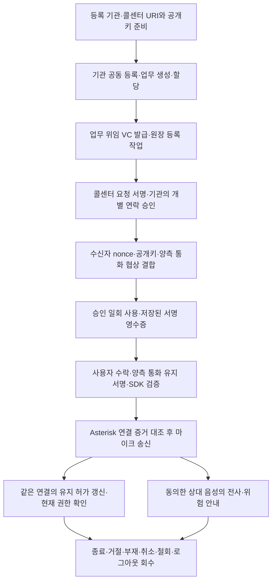

# CallSign 제품 경로 연결 작업 전체 정리

기준일: 2026-10-27(KST)

이 문서는 직전 개발 작업에서 수정한 코드·설정·시험·문서와 실제 검증 결과를 한곳에 모은 작업 기록이다. 새 개발 명세나 서비스 전체 완료 선언은 아니다. 이번 요약 작성에서는 기능 코드를 수정하거나 서비스를 실행하지 않았으며 시험도 재실행하지 않았다.

## 1. 조사·개발 기준

| 항목 | 확인한 상태 |
|---|---|
| 저장소 | [0u-Y/CallSign](https://github.com/0u-Y/CallSign) |
| 브랜치·HEAD | `main` · `a9d67f0b4b50a022b0e20de1e4071ec49cdcbd8a` |
| 개발 결과 위치 | HEAD 이후 미커밋 작업 트리. HEAD만으로 이번 결과를 재현할 수 없음 |
| 마지막 개발 검증 | `pnpm light`: **34개 파일·148개 테스트 통과** |
| 검증 원본 | [명령 출력·파일 해시·요구 ID별 상태](../artifacts/product-connection-20261027.json) |
| 사용자 기존 변경 | 이전 [WORK-SUMMARY.md](WORK-SUMMARY.md)를 수정하지 않고 보존 |
| Git 작업 | 이번 개발·요약에서 commit·push·저장소 재생성·이력 변경 없음 |

기존 40d490c 시점의 82개 테스트, 이전 66개·44개 테스트와 2026-09-14 실험은 각 시점의 기록이다. 이번 148개 결과와 합산하거나 현재 실환경의 성공 근거로 사용하지 않는다.

이번 요약을 쓰기 전에 검증 JSON에 기록된 124개 파일의 SHA-256을 현재 파일과 대조했고 모두 일치했다. 이 집계에는 보존한 기존 요약도 들어 있다. 이 문서 자체는 그 개발 검증 이후 추가한 설명 문서이므로 당시 해시 목록에는 포함되지 않는다.

## 2. 이번 작업의 핵심

기존에는 업무 화면이 이전 직접 통화 경로를 사용하고, 새 승인·검증·통화 유지·교환기 모듈은 따로 작성돼 있었다. 이번에는 이 모듈들을 기본 화면의 실제 호출 경로와 영속 처리기에 연결했다.



그림은 **코드에 연결한 흐름**이다. 실제 교환기 통화나 전체 서비스가 성공했다는 그림은 아니다.

통신 형식의 `v3`는 호환성을 검사하는 코드 식별값이다. 이 문서에서는 이를 등록 주소·교환기 기본 경로라고 부른다. 이전 `v2` 직접 통화는 `/finals`, 초기 `v1` 시연은 기존 코드와 시험 데이터에 보존했다. 기본 화면은 `/service`, 호출 API는 `/v3`다. 검증 실패를 이전 형식으로 우회하지 않는다.

CallSign은 모의 금융기관의 이상거래 확인 연락을 대상으로 한다. 기관의 연락 승인은 통화 내용의 안전 보장이 아니며 실제 금융기관·통신사와 연동한 서비스라고 표현하지 않는다.

## 3. 사용자 화면과 실제 API 연결

### 기관 담당자·관리자

- 등록된 콜센터를 선택해 수신자·상담원을 지정한 연락 업무를 생성하고 취소한다.
- 업무 위임 증서를 발급·조회·철회하고 원장 등록 대기 상태를 구분한다.
- 기존 수신자는 유지한 채 같은 콜센터의 다른 상담원으로 업무를 재할당한다. 이전 통화·승인·분석 작업은 회수한다.
- 사전 등록된 계정의 활성 상태·세부 권한·콜센터 소속을 변경한다. 자기 계정 변경과 허용되지 않은 역할 확장은 서버에서 거절한다.
- 기관 최초 등록·긴급 정지·공동 복구·새 키 활성화 요청을 제출하고, 원장 작업·사용량·노드 상태·복구 차단 상태를 조회한다.

계정 권한·재할당은 입력 양식으로 연결했다. 공동 승인 요청은 서명 대상 JSON과 외부에서 수집한 서명을 입력하는 방식이다. 승인자 개인키를 브라우저에 넣는 방식은 아니다.

### 상담원

- 자신에게 할당된 업무에서 새 통화 시도를 만든다.
- 브라우저에서 이번 통화용 단기 키를 만들고, 콜센터 서명 서비스의 요청별 증명과 기관의 개별 승인을 받는다.
- 마이크를 준비하되 송신을 차단한 상태로 SIP 등록을 하고 양측 웹으로 발신한다.
- 양측 검증·수락 후 통화하고 음소거·종료·로그아웃을 수행한다.
- 목록에서 선택한 시도와 실제 연결한 시도를 분리한다. 목록 선택으로 진행 통화가 바뀌지 않는다.

### 수신자

- 자신의 업무·통화만 조회하고 직접 생성한 일회성 난수와 단기 공개키를 등록한다.
- 기관 승인서의 수신자 값을 그대로 기대값으로 쓰지 않고 로그인 업무의 예상 수신자·상담원·시도를 고정한다.
- 위임·승인·영수증·현재 권한 증언·통화 유지 허가·PBX 연결 증거와 실제 브라우저 연결 관측을 검증한다.
- 통화를 수락·거절·종료하고, 현재 권한 확인 불가 상태에서는 음성 정지·종료 또는 제한된 미확인 계속을 선택한다.
- 상대 음성 분석에 별도로 동의하거나 동의를 철회한다.

### 공식 후속 업무

- 통화 업무와 별도의 로그인 용도·쿠키·대상 값을 사용한다.
- 자기 업무만 조회하고 거래 인지 여부를 응답한다. 완료 시 관련 통화·분석을 회수한다.
- 로그아웃·다중 탭·늦은 조회 응답으로 업무 목록이 다시 살아나지 않도록 처리했다.
- 반영 대상은 모의 CRM/FDS 업무이며 실제 금융기관 시스템을 변경하지 않는다.

공통으로 로딩·빈 목록·권한 부족·재인증·조회 장애·재시도 상태를 표시한다. 기관 승인, 현재 연결, 내용 위험, 분석 장애를 분리했고 종료 후 검증·분석 표시도 해제한다. 큰 버튼·포커스 표시·모바일 입력 영역·읽기 쉬운 상태명을 보완했지만 실제 브라우저 접근성 검증은 하지 않았다.

주요 파일: [기본 화면](../apps/web/src/pages/Service.tsx), [통화 제어](../apps/web/src/lib/serviceCall.ts), [라우팅](../apps/web/src/App.tsx), [서버 라우트](../services/api/src/service-routes.ts).

## 4. 승인·검증·통화 유지

### 등록 주소·키와 위임

기관과 콜센터는 사전 등록한 URI와 공개키를 사용한다. DID라는 분산 식별자나 고객 지갑은 기본 실행의 필수가 아니다. 임의 주소가 제시한 키를 기관 승인키로 받아들이지 않는다.

VC는 기관이 콜센터에 맡긴 업무 범위의 위임 증서다. 기관·콜센터 키, 정책·기간·위임 ID·권한 세대·상태 참조를 결합하고 기관이 JWS로 서명한다. 사본만으로 발신할 수 없으며 콜센터의 요청별 키 소유 증명과 특정 고객·업무의 개별 승인이 필요하다.

기관 승인키, 콜센터 장기키와 플랫폼의 역할을 분리했다. 브라우저에는 단기 통화키만 둔다.

### 이번 통화와 결합

승인은 수신자·업무·목적·시도·세션·콜센터 증명·단기키·난수·기관키 버전·권한 세대에 묶인다. 양측은 실제 협상 문서와 지문, 수신자 난수·키에 결합한 같은 데이터를 서명한다.

최초 소비는 기관·승인 ID의 결합을 저장하고 서명 영수증을 반환한다. 같은 결합 재시도는 저장된 결과를 복구하고 다른 결합은 거절한다. 서로 다른 통신 형식이 같은 승인을 중복 사용하는 것을 막는 공통 SQL 식별 범위를 유지했다. 실제 PostgreSQL 경합·원자성은 미검증이다.

수신 검증 모듈은 서버의 성공 boolean을 승인 근거로 쓰지 않는다. 서명·수신자·목적·정책·세대·난수·결합 관계, 서로 다른 Witness 3개의 같은 상태 서명을 직접 검사한다. 다른 체인/계약, 오래된 상태, 같은 높이의 상충 상태도 거절하는 시험을 추가했다.

### 시간과 통화 상태

| 구분 | 의미와 처리 |
|---|---|
| 최초 연결 창 | 통화 시도 생성부터 120초. 승인 발급 때 다시 120초를 더하지 않음 |
| 진행 통화 유지 허가 | 같은 연결의 양측 키가 이전 허가 해시·새 난수·순번에 서명해 갱신 |
| 유지 허가 초기값 | 30초. 설정 가능한 초기 정책이며 확정 운영값이 아님 |
| 최대 통화 초기값 | 4시간. 업무·위임이 먼저 만료되면 더 이른 시각이 상한 |
| 현재 권한 최신성 | 블록 상태 관측 8초와 시계 오차 가정으로 최대 10초를 목표로 함. 실측 보장 아님 |
| 명시적 철회·기관 정지·세대 변경 | 새 연결 차단과 해당 진행 통화·분석 회수 |
| 조회 장애·최신성 경과 | 새 연결 차단. 진행 중은 확인 불가와 기본 음성 정지, 유효한 기존 허가 안의 명시적 계속만 별도 허용 |
| AI 장애 | 분석 상태만 별도 표시. 권한 철회나 안전 판정으로 바꾸지 않음 |

거절·부재·취소·오류·종료의 영속 상태와 자동 기한 처리를 연결했다. 종료 확정 상태를 중복 사건이나 늦은 응답이 다시 활성화하지 못하게 한다. 재연결·전환·새 PeerConnection은 새 시도와 재검증을 요구한다. 화면이 비활성화되면 송신·분석을 멈추고 복귀 시 재검증한다.

주요 파일: [통신 형식](../packages/protocol/src/service.ts), [기관 승인 로직](../services/api/src/service-authority.ts), [상태 구조](../services/api/src/service-state.ts), [수신 검증 모듈](../packages/verifier/src/service.ts).

## 5. Asterisk 교환기와 실제 음성 경로의 코드

기본 경로를 상담원 웹 ↔ Asterisk PJSIP/WSS·ARI ↔ 수신자 웹으로 구성했다. SIP/WSS는 암호화된 통화 제어, ARI는 교환기 제어 API다. Asterisk가 브라우저 음성 암호화를 끝내고 두 음성 채널을 연결하는 종단이며, 외부에 미구현 Media Edge가 있다고 가정하지 않는다.

- 양측 SIP 등록, SHA-256 digest 인증, 수신 INVITE·ACK·CANCEL·BYE와 중복·잘못된 dialog 처리를 보완했다.
- 승인·통화 시도·SIP Call-ID·ARI 채널·브리지를 매핑한다.
- 준비 중 두 채널을 음소거하고 양측 SDK 검증 준비·수락·유효한 유지 허가를 확인한 뒤 연결한다.
- 각 브라우저는 최종 연결 증거를 대조한 뒤 마이크 track을 붙인다. 음소거·종료·장치 오류 시 track을 정리한다.
- ARI 사건 구독·재구독, 종료 전파, 만료·로그아웃·철회 감시, 부분 실패의 자원 정리 재시도를 연결했다.
- 서버 재시작 시 이전 통화를 정리하고 새 시도를 요구한다. 단기 브라우저 개인키를 서버가 복원하지 않는다.
- 종료된 통화의 늦은 endpoint 재요청은 기관 행 잠금 안에서 재검사해 SIP 자격이 다시 생기지 않도록 했다.
- TLS·WSS·ODBC realtime endpoint·RTP·고정 주소 매핑·TURN 설정과 PBX 배포 profile을 작성했다.

**관측의 한계:** ARI는 실제 채널·Call-ID·브리지를 조회한다. 서버의 PBX 인증서 지문은 배치한 공개 인증서에서 고정하며 브라우저가 실제 DTLS 종단에서 관측한 인증서와 대조한다. 서버가 DTLS handshake를 독립 수집했다고 주장하지 않는다. PBX 운영자와 증거 서명자는 신뢰 대상이고 상담원 개인의 신원이나 내부 경로 전체의 무침해를 증명하지 않는다.

자체 SIP 모듈은 직접 Asterisk에 연결하는 제한된 웹 수신 프로파일이다. 범용 SIP proxy·PSTN·임의 전환·재협상은 지원하지 않는다. 실제 Asterisk 이미지·ODBC driver·브라우저·음성·TURN 호환은 검증 전이다.

주요 파일: [SIP 모듈](../apps/web/src/lib/pbxSip.ts), [브라우저 관측](../apps/web/src/lib/rtc.ts), [마이크·원격 음성](../apps/web/src/lib/liveMedia.ts), [ARI](../services/api/src/asterisk.ts), [PBX API](../services/api/src/pbx-routes.ts), [PBX 감시](../services/api/src/pbx-runtime.ts).

## 6. 영속 작업·원장·사용량·복구

### 원장 작업 처리

- outbox라는 영속 작업 보관함의 실제 처리기를 구현했다.
- 작업 소유 token·처리 기한으로 중복 처리 결과의 반영을 막고 재시도·지수 backoff·영구 실패·운영자 재처리를 구분한다.
- 서명한 트랜잭션 원문·hash·서명자·nonce를 저장한 뒤 제출한다. 응답 유실 후 같은 hash를 조회하거나 같은 원문을 재전송한다.
- 복원한 원문이 다른 체인·계약·서명자·관리 명령·위임의 것인지 검사한다.
- 원장 확정 후에만 위임 등록 상태를 반영하고 철회 상태를 오래된 등록 결과로 되살리지 않는다.
- 원장 사건의 처리 위치와 블록 hash를 저장하고 중복 사건·재시작·상충 블록을 처리한다.
- 체인 사건 조회가 실패해도 독립적인 정리·보관 작업은 처리하도록 분리했다.

외부 호출과 DB 사이의 exactly-once를 가정하지 않는다. 결과가 불명확한 작업은 확인 대상으로 남기며, 실제 DB/체인 간 장애 복구 보장은 검증하지 않았다.

### 사용량과 보관

통화·사용자·기관·전체 범위의 분석 예약·정산을 연결했다. 중복 정산을 거절하고 호출 전 취소와 결과 불명의 사용량을 구분한다. 1초 통화 관측이 기존 IP당 120회/분 제한에 막히지 않도록 세션별 임시 제한·인증 후 영속 사용자 요청 한도·공개 진입점 IP 제한을 분리했다.

SQL 연결 pool·statement timeout·lock timeout을 설정했다. 종료된 통화의 민감 상태와 전사·분석 메모리를 정리하고, 보관 기간 뒤 신규 승인 영수증은 내용 hash로 최소화한다. 승인 ID·결합 hash·소비 journal은 재사용 차단을 위해 유지한다.

연결 초·요청·입력 바이트의 제한/계측을 구현한 것이며 실제 제공자 청구서·음성 길이 과금·월 지출 한도 보장은 아니다.

### 독립 복원 기준과 백업

같은 오래된 VM 백업 안의 DB·키·체인 값이 서로 맞는다는 이유만으로 발급을 재개하지 않는다. 별도 저장소의 HTTPS anchor라는 최신 기준과 소비 journal을 대조한다.

- 소비·권한 세대 변경을 순번과 이전 hash에 연결한다.
- 시작 시 journal 전체의 순번·hash 연결·세대, SQL 소비 식별 범위와 독립 anchor를 확인한다.
- 중간 이력이 유실되거나 독립 기준이 없으면 발급·연결 차단 상태를 유지한다.
- 외부 anchor만 전진하고 DB commit이 불명확하면 자동 해제하지 않는다.
- 백업은 DB 읽기 snapshot·키/trust/설정·별도로 정지한 체인 archive·보호된 실행 환경 파일을 암호화해 묶는다.
- 복원은 새 빈 DB·새 경로만 대상으로 하고 복구 차단을 유지한다. 기존 데이터·키·볼륨을 덮어쓰지 않는다.

독립 anchor 자체를 같은 VM 백업으로 되돌리면 보장이 없다. 최신 이력이 완전히 소실된 경우의 재신뢰 판단을 도구가 자동 해결하지 않는다. 실제 일관 백업·복원은 미실행이다.

주요 파일: [SQL migration](../services/api/drizzle/0004_worker_recovery.sql), [저장소](../services/api/src/finals-store.ts), [worker](../services/api/src/service-worker.ts), [원장 제출](../services/api/src/worker-ledger.ts), [사건 처리](../services/api/src/ledger-events.ts), [quota](../services/api/src/quota.ts), [anchor](../services/api/src/consumption-anchor.ts), [보관 처리](../services/api/src/maintenance.ts), [백업](../scripts/backup-bundle.ts), [복원](../scripts/restore-bundle.ts).

## 7. 인증·공동 관리·키 경계

일반 업무와 공식 업무의 로그인 용도·발급자·클라이언트·대상·쿠키를 분리하고 객체 소유권·CSRF를 검사한다. 주요 관리 작업은 5분 이내 실제 OIDC 인증 시각을 요구한다. 토큰 발급 시각을 재인증 시각 대신 사용하지 않는다. 실제 IdP/MFA 정책은 검증하지 않았다.

기관 담당·위임 관리·긴급 정지·복구·새 키 활성화·공동 승인 조회 권한을 세분화했다. 계정 비활성·소속 변경·재할당 시 기존 연결·동의를 회수한다. 기존 기관에 새 계정을 추가하는 운영자 도구도 작성했으며 기존 계정/역할은 덮어쓰지 않는다.

| 주체 | 보유·접근 범위 |
|---|---|
| Platform | 요청 중계. 기관·콜센터 개인키와 기관 업무 DB 쓰기 계정 없음 |
| Issuer | 기관 승인키·PBX 증거키, 기관 업무/소비와 별도 인증 DB 계정 |
| Sender | 콜센터 장기키. 브라우저 키·상담원·업무를 확인해 요청별 서명 |
| 원장 worker | 원장 관리자·긴급 정지 키. 기관 승인키·콜센터 키 없음 |
| Asterisk | TLS/DTLS 개인키와 제한된 PBX DB 계정 |
| Witness | 각자의 원장 조회 경로와 상태 증언키 |
| 관리 승인자 | 자기 승인키를 각자 보유. 서버에 공동 mount하지 않음 |
| 브라우저 | 이번 통화용 단기 개인키와 공개 신뢰 설정 |

Besu 검증자 4개, Witness 3-of-4, 주요 관리 승인 2-of-3은 서로 다른 정책이다. Witness는 별도 신뢰 계층이며 체인 자체 증명과 같지 않다. 한 서버의 여러 노드를 독립 기관 운영의 증거로 제시하지 않는다.

기관 최초 등록·자기 기관 정지·공동 복구·새 승인키 활성화를 API/worker/화면에 연결했다. 콜센터 키도 바꾸면 정렬한 키 목록의 hash에 별도 공동 서명을 요구한다. 기관 복구 서명을 콜센터 키 변경 승인으로 재사용하지 않는다. 새 세대 활성화 후 구 VC·승인·통화를 무효화한다.

기존 계약의 공식 경로 목록 변경은 관리자와 승인자 1명의 서명 방식이어서 최신 주요 관리 2-of-3 목표와 충돌한다. 정책 버전 변경 연산도 없어 이 변경 전체 흐름은 아직 미구현·설계 결정 대상이다.

주요 파일: [관리 API](../services/api/src/service-management.ts), [인증](../services/api/src/auth.ts), [로그인](../services/api/src/oidc-flow.ts), [공동 서명](../services/api/src/governance-v2.ts), [계정 추가](../scripts/provision-member.ts).

## 8. 상대 음성 분석

수신자 자신의 마이크 대신 현재 통화의 상대방 수신 stream을 분석 경로에 연결했다.

```text
상대 원격 음성 → 동의 기반 오디오 전송 → 서버 스트리밍 STT
→ 전사 구간·수정 번호 → 목적 정책 규칙·LLM → 실제 발화 근거의 위험 안내
```

Deepgram STT와 Anthropic LLM의 기존 호출 코드를 기본 통화에 연결했고 기존 Ollama 선택 코드는 보존했다. 키·설정이 없으면 분석 불가로 표시하며 fixture 결과로 자동 대체하지 않는다.

- 전사 구간·partial/final·수정·중복 final·역순·늦은 응답을 처리한다.
- 부정문·인용·자기정정과 수정된 전사에 따라 경고를 갱신·철회한다.
- 근거가 현재 원문에 있는지 검사하고 통화·stream·동의 세대를 구분한다.
- 전사문의 지시를 시스템 정책·도구 실행으로 연결하지 않는다. AI에는 통화 제어 권한이 없다.
- 동의 철회·종료·로그아웃·권한 회수·입력 과다 시 전송과 분석을 중단하고 늦은 결과를 버린다.
- 원음 영구 저장은 기본 비활성화하고 분석 장애를 안전 판정으로 표시하지 않는다.

한국어 수기 개발 fixture 9개와 오프라인 규칙 평가 도구를 준비했다. 별도 허가 후 실제 제공자 계약만 확인하는 이중 guard smoke 도구도 작성했지만 실행하지 않았다. 실제 STT/LLM 한국어 품질·오탐·미탐·지연·비용·보관 조건은 미검증이다.

주요 파일: [오디오 수신](../services/api/src/service-audio.ts), [전사·분석](../services/api/src/transcription.ts), [규칙 평가](../scripts/evaluate-risk.ts), [미실행 제공자 smoke](../scripts/provider-smoke.ts).

## 9. 서버·GCP·운영 구성

- 같은 소스 구조로 서버컴과 GCP VM의 배포를 준비했다. 실제 GCP 자원은 만들거나 변경하지 않았다.
- 기본 기동과 별도의 migration·계약 배포·계정 준비·검증을 분리했다.
- 내부 DB/RPC를 호스트에 공개하지 않으면서 일회 작업을 수행할 `operations` profile을 추가했다.
- migrator는 공개 manifest·계정 파일·전용 DB 자격만, deployer는 자기 배포키·검토 artifact·새 결과 폴더만 사용한다.
- 별도 `validation` profile은 시험 DB 자격으로 명시한 시험만 실행하도록 구성했다. 일반 기동에서 자동 실행하지 않는다.
- 앱 runtime 이미지가 웹 신뢰 해시 생성에 의존하지 않도록 Docker stage를 분리했다.
- 일반 재시작에는 체인 초기화·계약 재배포·키 재발급·migration·seed를 넣지 않는다.
- 공개 노드키에서 고정 peer·local node allowlist를 만들고 discovery를 끄도록 구성했다. RPC의 wildcard Host와 관리 namespace를 기본 구성에서 제거했다.
- 키·trust·DB·체인 영속 경로, HTTPS/WSS·TURN·PBX 주소, 정상 종료·readiness를 맞췄다.
- 운영 화면에 작업·사용량·노드 chain/genesis·블록 진행·동기화·peer·복구 차단 상태를 연결했다.
- clean Git·고정 이미지 digest·trust/deployment·같은 릴리스 증거를 묶는 오프라인 release manifest 도구를 작성했다. 현재는 미커밋 상태여서 릴리스 manifest를 만들지 않았다.

기본 Compose에 19개 서비스 정의, PBX overlay에 1개 정의가 있지만 이는 기동한 수가 아니다. 일회 작업과 검증 profile도 포함한 설정 수이며 이번 실제 기동은 0이다. 고정 peer·node allowlist는 합의 검증자 집합 변경이나 계정 allowlist를 구현한 것과 다르다.

주요 파일: [Compose](../infra/deploy/compose.yml), [PBX overlay](../infra/deploy/compose.pbx.yml), [Dockerfile](../infra/deploy/app.Dockerfile), [GCP](../infra/gcp/main.tf), [기동 스크립트](../scripts/deployment.sh), [릴리스 manifest](../scripts/release-manifest.ts), [운영 절차](RUNBOOK.md).

## 10. 검증 결과와 작성한 시험

아래는 직전 개발에서 실제 실행해 보존한 결과다. 이번 요약 작성으로 재검증했다고 주장하지 않는다.

| 실행한 검사 | 최신 결과·한계 |
|---|---|
| `pnpm light` | **34개 파일·148개 테스트 통과**, 실패 0. 소스 위생·타입·오프라인 시험 범위 |
| `pnpm --filter @callsign/web build` | 성공. 실제 브라우저·마이크·통화 성공 아님 |
| `pnpm exec tsc -p services/api/tsconfig.runtime.json --noEmit` | 성공. 실제 Docker 이미지 build 아님 |
| `pnpm exec tsx scripts/evaluate-risk.ts` | 개발 fixture 9개, 오탐 0·미탐 0·제공자 호출 0. 독립 품질 평가 아님 |
| Compose YAML 정적 파싱 | 기본 19개·PBX overlay 1개 정의 파싱. Compose 기동·이미지 호환 검증 아님 |
| `bash -n scripts/backup.sh scripts/restore.sh scripts/generate-besu.sh scripts/deployment.sh` | 4개 셸 문법 검사 성공. 스크립트 동작 실행 아님 |
| 문서·그림·변경 검사 | MASTER 74개 고유 ID/anchor, SVG XML, 수정 Markdown 13개의 상대 파일 링크, `git diff --check` 통과 |

`lint`는 소스 충돌·위생과 JavaScript 문법 검사이며 전체 ESLint 감사가 아니다. light의 fetch·TCP·UDP·listen 차단과 최대 worker 2 제한을 유지했다. 다섯 무거운 실행 범주의 무허가 차단도 회귀 시험으로 확인했다.

### 추가·보강한 오프라인 시험의 경계

| 시험 묶음 | 확인한 내용 |
|---|---|
| 승인·수신 검증 | 서명·수신자·목적·난수·권한 세대·결합·체인/계약 변조, 오래된/상충 상태, 유효 증언 정족수 |
| 제품 통화 제어 | 예상 수신자/업무 고정, 불명 POST의 같은 요청 ID 재시도 |
| PBX | SIP 인증·dialog·중복 ACK·취소·종료, ARI 사건·회수 재시도·부재·상태 조회 장애, 종료된 endpoint 자격 거절 |
| worker | 제출 전 원문 저장, 응답 유실·같은 원문 복구, 소유권 유실, 영구 실패, 다른 명령으로의 전용 거절 |
| 복구·보관 | anchor 충돌, journal 중간 유실·변조·세대 역행, 구 권한 무효화, 보관 대상 구분 |
| 인증·업무 | 재인증 시각, 타 기관/타 수신자/할당 접근, 권한 변경·재할당·공식 업무 완료와 회수 |
| 분석 | 전사 수정·중복·늦은 결과·근거와 부정/인용/정정. 실제 제공자는 대체 응답만 사용 |
| 배포·guard | 공개키 기반 고정 peer, 환경변수 예시 누락, 네트워크/서버 차단, 실행 범주 guard |
| 기타 | 백업 암호화 변조·다른 키·덮어쓰기 방지, 브라우저 Unicode JSON 처리 |

Node의 `punycode` deprecation과 기존 웹의 큰 chunk·효과 없는 동적 import 경고는 남아 있다. 브라우저 JSON 해석기의 Node Unicode 연산 의존은 대체했지만 경고가 전부 사라졌다고 표시하지 않는다.

### 작성·타입 검사만 하고 실행하지 않은 시험

1. [PostgreSQL 통합 시험](../tests/integration/service-runtime.test.ts): 공유 예약·정산, 작업 소유권·만료, 종료 뒤 SIP 자격 재생성 거절, 사용자 요청 한도·분 경계, 중간 journal 유실 시 복구 차단의 5개 시험.
2. [PBX 브라우저 시험](../tests/media/service-pbx.spec.ts): 양측 로그인·새 승인·PBX 등록·수락 전 송신 차단·검증 후 음성·로그아웃 회수. 분석 동의는 하지 않는 경로.
3. [실제 제공자 smoke](../scripts/provider-smoke.ts): 별도 실행 허가·동의 확인·입력/요청/연결 한도 아래 STT 또는 LLM의 실제 계약을 확인하는 소스.

기존 PostgreSQL·직접 통화·초기 시연 시험은 보존했다. 새 PostgreSQL 복구 시험의 독립 authority는 메모리 fixture이므로 나중에 이 시험을 실행해도 실제 독립 anchor 배포·전체 복원 성공과 동일하게 볼 수 없다.

## 11. 실행하지 않은 항목과 이유

사용자가 실환경 실행을 승인하지 않았으므로 다음은 전부 수행하지 않았다.

- PostgreSQL·Besu/Anvil/Hardhat·Witness·Asterisk·TURN·IdP·API/웹 서버 기동.
- Docker 이미지 pull/build, 컨테이너·Compose 실행.
- 실제 migration 적용, 체인 초기화·계약 배포·seed.
- 브라우저·마이크·실통화·실제 네트워크 통합 시험.
- STT/LLM 실제 호출, 모델 다운로드·추론.
- GCP·Terraform plan/apply·배포·자원 변경.
- 장애 주입·부하·장시간 시험·실제 백업/복원.

기존 프로세스·컨테이너·볼륨·키·데이터를 중단·삭제·초기화하지 않았다. guard를 해제하거나 다른 터미널·원격·CI로 우회하지 않았다. 코드 작성·정적 검사·메모리 대체 시험을 실제 DB 원자성·QBFT 내성·통화 성공으로 확대하지 않는다.

## 12. 문서 정합성과 요구사항 연결

기존 [MASTER](MASTER-DEVELOPMENT-SPEC.md)의 74개 ID와 완료 기준을 보존하고, [진행표](FINALS-IMPLEMENTATION-PLAN.md)·[아키텍처](ARCHITECTURE.md)·[프로토콜](PROTOCOL.md)·[위협 모델](THREAT-MODEL.md)·[한계](KNOWN-LIMITATIONS.md)·[RUNBOOK](RUNBOOK.md)·[서비스 가이드](guide/README.md)를 현재 코드에 맞췄다.

기존의 화면·worker·자동 회수 미연결 표시를 갱신했지만, 목표나 한계를 지워 완료로 보이게 만들지 않았다. 멘토링 중심의 별도 기준을 만들지 않고 서비스 문서와 실제 코드·검증을 연결했다.

| 요구 ID | 이번 작업 범위 |
|---|---|
| IDENTITY-001/003, CALL-001~006 | 등록 주소·키·VC·개별 승인·양측 증명·소비·유지·수신 SDK·회수 |
| BUSINESS-001/002, AUTH-002, GOVERNANCE-001/002 | 업무/할당·permission·최근 인증·공식 업무·등록/정지/복구/키 교체 |
| MEDIA-001~004, PBX-001~003 | 기본 웹/PBX 흐름·실제 관측 대조·음성 gating·정리·설정 |
| LEDGER-001~003, DB-001~004, STATE-003 | 원장 worker·cursor·공통 소비·quota·보관·독립 복원 gate |
| AI-001~005, UI-001~005/007 | 원격 음성·동의·전사 수정·근거 안내·역할 화면·개발 fixture |
| CHAIN-001~004, OPS-001~007, TEST-001~004 | 네트워크 설정·키/DB 경계·운영 도구·배포·검증 분리·증거 |

이 표는 관련 변경 범위이지 각 ID 전체의 완료 표시가 아니다. 74개 항목별 현재 구현·검증 상태는 MASTER 본문과 검증 JSON의 `requirements`에 기록했다. Besu 합의 엔진·Solidity 계약을 새로 구현했다고 주장하지 않으며 체인 자체 증명은 미구현 후속 확장이다.

## 13. 남은 코드와 외부 검증을 나누면

| 구분 | 남은 내용 |
|---|---|
| 코드 미구현·설계 결정 | 정책 버전·공식 경로 목록 변경의 공동 승인 전체 흐름. 기존 계약과 최신 승인 수 정책의 충돌을 해결해야 함 |
| 코드 미구현 | 신규 로그인 계정·기본 역할을 생성하는 관리 UI. 현재는 보호된 운영자 추가 도구로 수행 |
| 코드 미구현 | 외부 알림 전송, 전체 자원/지연 계측, 이미지·실환경 증거 자동 수집 |
| 시험 소스 보완 | 전체 공격·장애·재시작·복원 자동 시험. 현재 시험은 특정 경계만 다룸 |
| 외부 설정 필요 | 도메인/DNS·TLS, OIDC 기관·사용자/client/audience/auth_time, 역할별 DB LOGIN, 고정 이미지, TURN/PBX 주소·포트·ODBC |
| 키·신뢰 준비 필요 | 기관·콜센터·PBX·Witness·관리 승인자/deployer 키의 분리 준비, 실제 체인/계약 metadata, 웹 공개 신뢰 해시 |
| 독립 복구 환경 필요 | VM 백업 밖의 anchor·권위 DB·접근 자격·최신 이력 보관 |
| 제공자 정보·검증 필요 | STT/LLM 계정·선택 모델·보관/처리 조건·가격, 독립 한국어 음성·사람 정답·실제 비용/지연 |
| 실환경 검증 필요 | DB 동시성·GRANT, 체인·Witness·키 회전, PBX·TURN·브라우저·통화, 실제 AI, 일관 백업/복원·GCP |

비밀값을 채팅이나 Git에 넣도록 요청하지 않는다. p95 승인 검증 500ms, 체인 확정 뒤 철회 표시 5초, 상태 최대 수명 10초는 목표이며 달성 성능이나 SLA가 아니다.

## 14. 실행 허가 후 진행 순서

현재는 아래 작업을 실행하지 않는다. 승인 범주별 정확한 명령·환경변수·일회 컨테이너 호출은 [RUNBOOK](RUNBOOK.md)에 작성했다.

1. 소유 도메인·OIDC·역할별 계정·분리 키·검토 이미지·독립 anchor를 준비한다.
2. 새 배포에서 DB·체인만 명시적으로 준비하고 migration·계정 provisioning·체인 identity를 확인한다. 기존 배포는 재초기화하지 않는다.
3. 검토한 계약을 별도로 배포하고 실제 metadata·기관 공동 등록·위임 원장 등록·Witness 상태를 확인한다.
4. 공개 trust와 웹 해시를 고정한 뒤 기본 PBX 서비스와 readiness를 확인한다.
5. 별도 시험 DB에서 공유 소비·quota·작업 소유권·권한·복구 gate를 검증한다.
6. 양측 브라우저와 Asterisk/TURN에서 수락 전 송신 차단·양방향 음성·음소거·거절/부재/종료·철회·로그아웃·재연결 거절을 검증한다.
7. 제공자 호출까지 별도 승인한 소량 시험으로 STT/LLM 계약·동의 철회·보관·한국어 품질·비용을 확인한다.
8. 이후 별도 승인 범위에서 장애·부하·키 회전·일관 백업/복원·GCP 이전과 재시작을 검증한다.

## 15. 이 문서의 사용 범위

이번 작업 내용을 한 번에 읽기 위한 요약이다. 이후 기능 개발의 기준은 MASTER, 날짜별 실제 진행과 검증의 기준은 진행표, 명령의 기준은 RUNBOOK이다. 이 요약 때문에 기존 증거나 요구사항을 덮어쓰지 않는다.

이 요약 작성에서는 기존 파일과 증거를 읽고 해시·상대 링크·Markdown 구조를 확인했으며, 아래 변경 파일 목록을 포함한 이 Markdown 한 개만 새로 작성했다.

## 부록. 이번 개발 변경 파일 전체 목록

아래 목록은 개발 검증 JSON에 기록된 파일 중 보존한 기존 `docs/WORK-SUMMARY.md`를 제외하고 검증 JSON 자체를 더한 것이다. 이 요약 문서는 목록 집계에서 제외했다. 파일이 있다는 이유로 기능 전체나 실환경 검증을 완료로 분류하지 않는다.

<details>
<summary>변경 파일 124개 펼쳐 보기</summary>

### 웹 화면·통화 제어

- [apps/web/src/App.tsx](../apps/web/src/App.tsx)
- [apps/web/src/components/Shell.tsx](../apps/web/src/components/Shell.tsx)
- [apps/web/src/config.ts](../apps/web/src/config.ts)
- [apps/web/src/lib/liveMedia.ts](../apps/web/src/lib/liveMedia.ts)
- [apps/web/src/lib/pbxSip.ts](../apps/web/src/lib/pbxSip.ts)
- [apps/web/src/lib/rtc.ts](../apps/web/src/lib/rtc.ts)
- [apps/web/src/lib/serviceCall.ts](../apps/web/src/lib/serviceCall.ts)
- [apps/web/src/lib/unicodeEscapes.ts](../apps/web/src/lib/unicodeEscapes.ts)
- [apps/web/src/pages/Service.tsx](../apps/web/src/pages/Service.tsx)
- [apps/web/src/styles.css](../apps/web/src/styles.css)
- [apps/web/vite.config.ts](../apps/web/vite.config.ts)

### 프로토콜·수신 검증

- [packages/protocol/src/service.ts](../packages/protocol/src/service.ts)
- [packages/verifier/src/service.ts](../packages/verifier/src/service.ts)

### 서버·SQL·런타임 검사

- [services/api/drizzle/0004_worker_recovery.sql](../services/api/drizzle/0004_worker_recovery.sql)
- [services/api/src/anchor-server.ts](../services/api/src/anchor-server.ts)
- [services/api/src/asterisk.ts](../services/api/src/asterisk.ts)
- [services/api/src/auth.ts](../services/api/src/auth.ts)
- [services/api/src/backup-crypto.ts](../services/api/src/backup-crypto.ts)
- [services/api/src/consumption-anchor.ts](../services/api/src/consumption-anchor.ts)
- [services/api/src/db.ts](../services/api/src/db.ts)
- [services/api/src/finals-model.ts](../services/api/src/finals-model.ts)
- [services/api/src/finals-server.ts](../services/api/src/finals-server.ts)
- [services/api/src/finals-store.ts](../services/api/src/finals-store.ts)
- [services/api/src/governance-v2.ts](../services/api/src/governance-v2.ts)
- [services/api/src/ledger-events.ts](../services/api/src/ledger-events.ts)
- [services/api/src/ledger-health.ts](../services/api/src/ledger-health.ts)
- [services/api/src/maintenance.ts](../services/api/src/maintenance.ts)
- [services/api/src/oidc-flow.ts](../services/api/src/oidc-flow.ts)
- [services/api/src/operations.ts](../services/api/src/operations.ts)
- [services/api/src/pbx-routes.ts](../services/api/src/pbx-routes.ts)
- [services/api/src/pbx-runtime.ts](../services/api/src/pbx-runtime.ts)
- [services/api/src/quota.ts](../services/api/src/quota.ts)
- [services/api/src/retention.ts](../services/api/src/retention.ts)
- [services/api/src/service-audio.ts](../services/api/src/service-audio.ts)
- [services/api/src/service-authority.ts](../services/api/src/service-authority.ts)
- [services/api/src/service-management.ts](../services/api/src/service-management.ts)
- [services/api/src/service-routes.ts](../services/api/src/service-routes.ts)
- [services/api/src/service-routes.unit.test.ts](../services/api/src/service-routes.unit.test.ts)
- [services/api/src/service-state.ts](../services/api/src/service-state.ts)
- [services/api/src/service-worker.ts](../services/api/src/service-worker.ts)
- [services/api/src/session-scopes.unit.test.ts](../services/api/src/session-scopes.unit.test.ts)
- [services/api/src/transcription.ts](../services/api/src/transcription.ts)
- [services/api/src/worker-ledger.ts](../services/api/src/worker-ledger.ts)
- [services/api/tsconfig.runtime.json](../services/api/tsconfig.runtime.json)

### 준비·운영·검증 스크립트

- [scripts/backup-bundle.ts](../scripts/backup-bundle.ts)
- [scripts/backup.sh](../scripts/backup.sh)
- [scripts/besu-peers.ts](../scripts/besu-peers.ts)
- [scripts/deploy-service-registry.ts](../scripts/deploy-service-registry.ts)
- [scripts/deployment.sh](../scripts/deployment.sh)
- [scripts/evaluate-risk.ts](../scripts/evaluate-risk.ts)
- [scripts/generate-besu.sh](../scripts/generate-besu.sh)
- [scripts/migrate-finals.ts](../scripts/migrate-finals.ts)
- [scripts/prepare-besu-peers.ts](../scripts/prepare-besu-peers.ts)
- [scripts/prepare-finals.ts](../scripts/prepare-finals.ts)
- [scripts/prepare-pbx.ts](../scripts/prepare-pbx.ts)
- [scripts/prepare-service-network.ts](../scripts/prepare-service-network.ts)
- [scripts/provider-smoke.ts](../scripts/provider-smoke.ts)
- [scripts/provision-finals.ts](../scripts/provision-finals.ts)
- [scripts/provision-member.ts](../scripts/provision-member.ts)
- [scripts/release-manifest.ts](../scripts/release-manifest.ts)
- [scripts/restore-bundle.ts](../scripts/restore-bundle.ts)
- [scripts/restore.sh](../scripts/restore.sh)
- [scripts/service-worker.ts](../scripts/service-worker.ts)
- [scripts/sign-recovery.ts](../scripts/sign-recovery.ts)

### 인프라·배포 설정

- [infra/deploy/anchor-schema.sql](../infra/deploy/anchor-schema.sql)
- [infra/deploy/app.Dockerfile](../infra/deploy/app.Dockerfile)
- [infra/deploy/asterisk/ari.conf.example](../infra/deploy/asterisk/ari.conf.example)
- [infra/deploy/asterisk/extconfig.conf.example](../infra/deploy/asterisk/extconfig.conf.example)
- [infra/deploy/asterisk/extensions.conf.example](../infra/deploy/asterisk/extensions.conf.example)
- [infra/deploy/asterisk/http.conf.example](../infra/deploy/asterisk/http.conf.example)
- [infra/deploy/asterisk/modules.conf.example](../infra/deploy/asterisk/modules.conf.example)
- [infra/deploy/asterisk/odbc.ini.example](../infra/deploy/asterisk/odbc.ini.example)
- [infra/deploy/asterisk/pjsip.conf.example](../infra/deploy/asterisk/pjsip.conf.example)
- [infra/deploy/asterisk/res_odbc.conf.example](../infra/deploy/asterisk/res_odbc.conf.example)
- [infra/deploy/asterisk/rtp.conf.example](../infra/deploy/asterisk/rtp.conf.example)
- [infra/deploy/asterisk/sorcery.conf.example](../infra/deploy/asterisk/sorcery.conf.example)
- [infra/deploy/compose.pbx.yml](../infra/deploy/compose.pbx.yml)
- [infra/deploy/compose.yml](../infra/deploy/compose.yml)
- [infra/deploy/nginx.conf](../infra/deploy/nginx.conf)
- [infra/gcp/callsign.service](../infra/gcp/callsign.service)
- [infra/gcp/main.tf](../infra/gcp/main.tf)

### 시험·개발 fixture

- [tests/fixtures/korean-risk-evaluation.json](../tests/fixtures/korean-risk-evaluation.json)
- [tests/integration/service-runtime.test.ts](../tests/integration/service-runtime.test.ts)
- [tests/media/service-pbx.spec.ts](../tests/media/service-pbx.spec.ts)
- [tests/unit/asterisk.test.ts](../tests/unit/asterisk.test.ts)
- [tests/unit/backup-crypto.test.ts](../tests/unit/backup-crypto.test.ts)
- [tests/unit/besu-peers.test.ts](../tests/unit/besu-peers.test.ts)
- [tests/unit/browser-unicode.test.ts](../tests/unit/browser-unicode.test.ts)
- [tests/unit/deployment-config.test.ts](../tests/unit/deployment-config.test.ts)
- [tests/unit/durable-worker.test.ts](../tests/unit/durable-worker.test.ts)
- [tests/unit/ledger-health.test.ts](../tests/unit/ledger-health.test.ts)
- [tests/unit/light-guard.test.ts](../tests/unit/light-guard.test.ts)
- [tests/unit/pbx-endpoint.test.ts](../tests/unit/pbx-endpoint.test.ts)
- [tests/unit/pbx-runtime.test.ts](../tests/unit/pbx-runtime.test.ts)
- [tests/unit/platform.test.ts](../tests/unit/platform.test.ts)
- [tests/unit/reauth.test.ts](../tests/unit/reauth.test.ts)
- [tests/unit/registration.test.ts](../tests/unit/registration.test.ts)
- [tests/unit/revisions.test.ts](../tests/unit/revisions.test.ts)
- [tests/unit/service-authority.test.ts](../tests/unit/service-authority.test.ts)
- [tests/unit/service-controller.test.ts](../tests/unit/service-controller.test.ts)
- [tests/unit/service-fixture.ts](../tests/unit/service-fixture.ts)
- [tests/unit/service-recovery.test.ts](../tests/unit/service-recovery.test.ts)
- [tests/unit/service-verifier.test.ts](../tests/unit/service-verifier.test.ts)
- [tests/unit/sip-dialog.test.ts](../tests/unit/sip-dialog.test.ts)
- [tests/unit/sip.test.ts](../tests/unit/sip.test.ts)

### 문서·그림·개발 증거

- [artifacts/product-connection-20261027.json](../artifacts/product-connection-20261027.json)
- [docs/ARCHITECTURE.md](../docs/ARCHITECTURE.md)
- [docs/FINALS-IMPLEMENTATION-PLAN.md](../docs/FINALS-IMPLEMENTATION-PLAN.md)
- [docs/KNOWN-LIMITATIONS.md](../docs/KNOWN-LIMITATIONS.md)
- [docs/MASTER-DEVELOPMENT-SPEC.md](../docs/MASTER-DEVELOPMENT-SPEC.md)
- [docs/PROTOCOL.md](../docs/PROTOCOL.md)
- [docs/RUNBOOK.md](../docs/RUNBOOK.md)
- [docs/THREAT-MODEL.md](../docs/THREAT-MODEL.md)
- [docs/guide/02-ARCHITECTURE.md](../docs/guide/02-ARCHITECTURE.md)
- [docs/guide/03-CALL-FLOW.md](../docs/guide/03-CALL-FLOW.md)
- [docs/guide/04-TRUST-AND-SECURITY.md](../docs/guide/04-TRUST-AND-SECURITY.md)
- [docs/guide/05-IMPLEMENTATION-STATUS.md](../docs/guide/05-IMPLEMENTATION-STATUS.md)
- [docs/guide/README.md](../docs/guide/README.md)
- [docs/guide/assets/architecture.svg](../docs/guide/assets/architecture.svg)

### 공통 설정·명령

- [.env.example](../.env.example)
- [README.md](../README.md)
- [package.json](../package.json)
- [playwright.finals.config.ts](../playwright.finals.config.ts)
- [tsconfig.light.json](../tsconfig.light.json)

</details>

