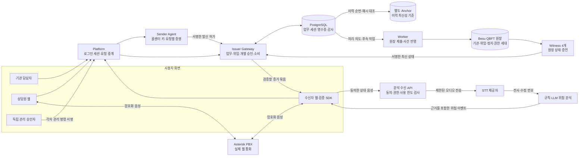

# CallSign 목표 서비스 아키텍처

> 이 문서는 CallSign이 설계해 온 **서비스의 목표 구조**를 설명한다. 현재 배포 상태, 기능 완성도, 시험 통과 여부를 뜻하지 않는다. 사례는 모의 금융기관의 이상거래 확인 연락이며 실제 금융기관·통신사 연동을 전제하지 않는다.

## 1. 서비스가 풀려는 문제

고객이 전화를 받을 때 확인해야 하는 것은 세 가지다. **기관이 이 업무를 위탁했는가**, **이번 고객에게 연락하도록 승인했는가**, **지금 연결된 상대와 승인이 일치하는가**. 이 세 가지가 맞더라도 통화 중 비밀번호·인증번호·송금 등을 요구할 수 있으므로 **대화 내용의 위험**은 별도로 판단한다. CallSign은 기관이 도입하고 고객이 확인하는 B2B2C 서비스를 목표로 한다. [서비스 개요](guide/01-SERVICE-OVERVIEW.md)

## 2. 전체 구조

Platform은 인증된 요청을 전달하지만 기관이나 콜센터의 개인키로 승인하지 않는다. Issuer, Sender, 원장 Worker, 관리 승인자, PBX 증거 서명자는 역할별 키와 접근권한을 분리한다. **원장은 연락의 권한 상태를 담고, 고객별 업무·음성·전사 원문은 담지 않는다.** [역할·키 경계](ARCHITECTURE.md#역할키저장소-경계) · [서비스 설계 원칙](MASTER-DEVELOPMENT-SPEC.md#서비스-설계-원칙)

## 3. 업무에서 통화까지

1. **기관 등록과 업무 준비:** 기관의 공식 주소·승인 공개키·정책을 등록한다. 기관 담당자는 고객·연락 목적·담당 상담원·유효기간이 있는 업무를 만든다. 로그인은 OIDC 계정을 기관·역할에 연결하고, 서버가 객체별 권한을 다시 검사한다.
2. **재사용 위임:** 기관이 콜센터에 업무 범위를 위임하는 VC를 발급하고, 그 내용 해시·기간·철회 상태를 원장에 등록한다. VC는 여러 연락에 재사용할 수 있지만 **VC만으로 특정 고객에게 발신할 수는 없다**.
3. **이번 연락의 개별 승인:** 할당된 상담원이 새 통화 시도를 만들면 Sender가 콜센터 키와 상담원·업무·브라우저 키를 결합해 발신 허가를 증명한다. Issuer는 현재 업무·위임·기관 상태를 다시 확인해 고객·목적·시도·세션에 묶인 개별 승인을 발급한다.
4. **수신자 검증과 승인 소비:** 수신자의 일회성 난수, 양측 통화별 키, 연결 협상 정보와 승인을 결합한다. 수신자 브라우저는 서명, 등록 키, 권한 세대, 최신 Witness 상태, PBX 연결 증거를 대조한다. 승인은 한 연결에 원자적으로 소비하고 영수증을 남긴다. 수신자의 **수락은 별도 행동**이다.
5. **실제 통화와 유지:** 기본 통화는 상담원 웹 ↔ **Asterisk PJSIP/WSS·DTLS-SRTP** ↔ 수신자 웹이다. CallSign은 PBX 채널·Call-ID·브리지와 승인 세션의 관계를 확인한다. **120초는 최초 연결 시작 창**이며, 연결 후에는 같은 세션·권한 세대에 묶인 짧은 통화 유지 허가를 현재 권한 확인 후 갱신한다. 종료·취소·철회 때 통화와 임시 자원을 회수한다.

기관 등록 URI·등록 Ed25519 키가 기본 식별 방식이고 DID 조회는 선택 호환 기능이다. 고객에게 DID나 지갑을 요구하지 않는다. 전화 단말·PSTN·휴대전화 OS 발신 표시 연동은 기본 웹 통화 범위 밖이다. [업무·인증·통화 요구](MASTER-DEVELOPMENT-SPEC.md#7-업무등록-식별자위임-증서인증승인db) · [PBX 선택](MASTER-DEVELOPMENT-SPEC.md#81-pbx-구현-선택과-책임)

## 4. 동의 후 음성 위험 분석

수신자가 분석과 외부 전송에 동의하고 권한·통화 유지 허가·사용 한도가 유효할 때만 **수신자 측에 도착한 상담원 remote audio**를 분석한다. 상담원 마이크를 통화와 별개로 STT에 보내거나 수신자의 마이크·혼합 음성을 상담원 발화로 취급하지 않는다.

음성은 스트리밍 STT에서 전사되고, segment·revision으로 정정과 중복을 관리한다. 정책 규칙과 선택적 LLM은 기관이 승인한 연락 목적 및 위험 요구를 평가한다. 결과는 위험 종류, 실제 전사의 근거 발언, 짧은 설명과 분석 상태로 수신자에게 보인다. LLM은 연락 권한을 발급하거나 통화를 허가하지 않는다. 설명의 원문 존재 검사는 의미적 정확성이나 모델 판단 과정의 충실성을 보장하지 않는다.

철회하면 신규 분석 음성 전송을 중단하고 늦은 전사·분석 결과를 화면에 다시 올리지 않으며, 일반 통화는 별도로 유지한다. 무음·전사 대기·분석 중·미탐지·판단 불가·제공자 OFF·실패를 구분한다. 민감한 후속 업무는 통화 중 요구하지 않고 등록된 공식 경로에서 별도 인증하도록 한다. [AI 요구](MASTER-DEVELOPMENT-SPEC.md#9-stt목적-기반-ai-위험-분석) · [공식 업무](guide/01-SERVICE-OVERVIEW.md#역할과-흐름)

## 5. 원장·긴급 정지·공동 복구

Besu QBFT 원장은 기관 등록, 위임 상태, 정책·키·권한 세대, 정지·복구를 기록하는 공동 권한 기준이다. **QBFT 합의**, **Witness 4명 중 3명의 동일 상태 증언**, **관리 승인자 3명 중 서로 다른 2명의 명령 서명**은 서로 다른 검증 단계다. Witness 증언을 원장 자체의 암호학적 상태 증명과 혼동하지 않는다.

등록된 정지 주체는 자기 기관의 발신을 긴급 정지할 수 있다. 복구·주요 변경은 독립 승인자 2명이 정확히 같은 명령·원장·계약·기한·권한 세대에 서명해야 한다. 명령 제출, 원장 확정, Witness 확인, 서비스 적용을 순서대로 확인한 뒤에야 새 발신을 허용한다. 복구는 이미 종료된 통화·취소된 업무·철회된 위임을 되살리지 않는다. 새 연락에는 현재 키·위임·업무·개별 승인이 필요하다. [계약 전이](MASTER-DEVELOPMENT-SPEC.md#52-계약-상태와-전이의-정확한-기준) · [공동 운영](MASTER-DEVELOPMENT-SPEC.md#governance-001)

## 6. 저장·운영의 신뢰 경계

PostgreSQL은 업무, 역할 세션, 승인 소비 영수증, 감사 기록과 원장 후속 작업을 관리한다. Worker는 DB에 남긴 처리 의도를 원장에 제출하고 결과를 재조회한다. 별도 HTTPS Anchor는 소비 이력의 순번·연속 해시를 DB 백업 수명과 분리해 보관한다. 복원 시 기존 소비·철회·권한 세대를 초기화하지 않고, 최신성을 확인하지 못하면 신규 승인을 막는다. 외부 원장과 DB 사이에 단일 원자 커밋이 있다고 가정하지 않는다. [원장·오프체인 정합성](MASTER-DEVELOPMENT-SPEC.md#6-트랜잭션오프체인-정합성상태-증명공동-운영)

브라우저의 고정 신뢰 정보, 기관·콜센터·PBX·Witness의 키, 실제 PBX 음성 종단, 웹 배포자, DB·Anchor 운영자는 각각 신뢰 대상이다. 권한 검증이 통화 상대의 모든 행동을 보증하지 않으며, 위험 경고가 없다고 통화가 안전해지는 것도 아니다. 독립 운영자가 없는 단일 호스트의 여러 노드는 조직적 독립성을 증명하지 못한다. [위협 모델](THREAT-MODEL.md)

## 7. 기본 범위와 후속 확장

**기본 서비스:** 웹 양측 통화, 기관 등록 키·VC 위임·개별 승인, 원장/Witness 최신 상태 확인, 동의 기반 STT·위험 설명, 긴급 정지와 공동 복구, 별도 인증한 공식 업무 화면.

**후속 선택지:** DID 원격 조회, 브라우저의 QBFT 헤더·계정 상태 직접 증명, PSTN·통신사 연동, 실제 금융기관 CRM/FDS 연동, 독립 사업자별 노드 운영, DSPy 같은 프롬프트 자동 최적화. 이들은 기본 경로의 필수 구성요소나 현재 적용 사실로 읽지 않는다. 성능 목표와 실제 달성값도 구분한다. [전체 요구와 확장 경계](MASTER-DEVELOPMENT-SPEC.md) · [현재 구현·검증 현황](guide/05-IMPLEMENTATION-STATUS.md)
