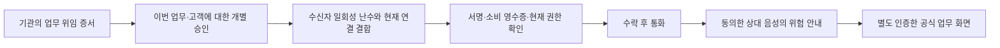

# 01. 서비스 개요

[서비스 가이드](README.md) · 다음: [핵심 아키텍처](02-ARCHITECTURE.md)

## 해결하려는 문제

금융기관이 콜센터에 업무를 맡겼더라도 고객은 이번 연락이 실제 기관 업무에 따른 것인지, 지금 연결된 상대에게 그 업무 권한이 있는지 확인하기 어렵습니다. 반대로 정상 권한을 가진 상담원도 비밀번호·인증번호·송금 등 업무 목적을 벗어난 요구를 할 수 있습니다.

CallSign은 **업무에 따른 연락 권한**, **현재 연결**, **대화 내용의 위험**을 나눠 안내합니다. 초기 도입 주체는 금융기관과 위탁 콜센터이고, 연락을 받는 고객은 무료로 확인하는 B2B2C(기관이 도입하고 고객에게 제공하는 서비스) 구조를 목표로 합니다.

현재 개발 사례는 **모의 금융기관의 이상거래 확인 연락**입니다. 실제 금융기관의 고객정보·FDS(이상거래 탐지 시스템)·통신사와 연결된 서비스는 아닙니다.

## 역할과 흐름

| 역할 | 하는 일 | 제한 |
|---|---|---|
| 기관 담당자 | 업무·수신자·목적을 정하고 상담원에게 할당, 개별 연락 승인·취소 | 다른 기관 객체를 다루지 않음 |
| 위탁 콜센터·상담원 | 위임 범위 안의 할당 업무로 발신, 자기 서비스키·브라우저 세션키의 소유 증명 | 위임 증서만으로 임의 고객에게 발신할 수 없음 |
| 수신자 | 연락 근거·현재 연결 확인, 수락·거절·종료, 분석 동의·철회 | 분산 식별자(DID)나 지갑 불필요 |
| 기관 관리자·공동 승인자 | 기관·키·위임 상태 관리, 주요 변경의 공동 승인 | 단독 긴급 조치는 자기 기관의 일시 정지만 허용하는 설계 |
| 시스템 운영자 | 배포·관측·백업·복구 | 운영자라는 이유로 기관 연락 승인 권한이 생기지 않음 |

VC(검증 가능한 자격 증명)는 기관이 콜센터에 맡긴 **재사용 가능한 업무 위임 증서**입니다. 개별 승인서는 이번 고객·업무·목적·통화 시도·세션에만 적용합니다. 민감한 후속 업무는 통화 중 말로 처리하도록 유도하지 않고, 정책에 등록한 공식 경로에서 별도 인증해 처리합니다. 현재 공식 업무는 모의 업무 상태를 다루며 실제 금융 거래를 수행하지 않습니다.

## 고객의 첫 진입과 도입 부담

고객은 기관이 사전에 안내한 **공식 웹 주소**로 들어가 별도 고객 계정으로 로그인하고, 자기에게 배정된 연락 업무를 확인하는 흐름을 목표로 합니다. 전화 중 제시된 임의 링크 자체를 신뢰 근거로 사용하지 않습니다. 현재 코드는 외부 로그인 표준인 OIDC의 사전 등록 계정과 업무 수신자 ID를 연결하고, 로그인한 화면의 ‘내 업무 새로고침’으로 확인합니다. 실제 고객 계정 연계·착신 알림·웹 진입 안내 수단은 아직 구현·확정되지 않았습니다.

기관은 업무/고객 계정 연계, 목적 정책·상담원 할당, 키·위임·철회 운영을 맡아야 합니다. 콜센터는 상담원이 웹에 로그인해 할당 업무로 발신하도록 절차를 바꾸고, 고객도 웹 로그인·수락 동작을 거칩니다. 현재 모의 시스템은 개발팀이 관리하지만 실제 도입 시 기관·콜센터·플랫폼의 운영 책임과 비용 부담 계약은 미확정입니다. 고객 확인은 무료인 B2B2C 목표이며 가격·과금 방식·도입 효과는 검증하지 않았습니다.

## 기존 인프라와의 관계

CallSign은 기존 전화망·SIP(통화 제어 프로토콜)·STIR/SHAKEN(전화 발신 신원 인증 체계)을 대체하는 새 통신 프로토콜이 아닙니다. 그 위에 기관의 **업무 위임과 개별 연락 승인·세션 연결 근거**를 더하는 애플리케이션입니다.

기본 목표 경로는 상담원 웹 ↔ Asterisk PBX(교환 시스템) ↔ 수신자 웹입니다. 두 사용자 모두 웹에서 사용하며 실제 전화 단말·PSTN(공중전화망) 연동과 휴대전화 OS 발신 표시 연동은 별도 범위입니다. 브라우저끼리 직접 통화하는 기존 WebRTC 코드와 초기 시청 시연 데이터는 기존 기능이 깨지지 않는지 확인하는 회귀 시험용으로 보존합니다. **PBX 제품 경로는 아직 화면·운영까지 완성되지 않았습니다.**

## 제공하려는 보장과 한계

| 확인하는 것 | 확인했다고 볼 수 없는 것 |
|---|---|
| 등록 기관·키가 특정 업무·고객·목적의 연락을 승인함 | 해당 기관이나 상담원의 모든 행동이 안전함 |
| 콜센터가 위임 키를 보유하고 할당 업무를 수행함 | 통화 상대 개인의 법적 신원·사람 본인 여부 |
| 승인·수신자 일회성 난수·세션키·연결 증거가 서로 맞음 | PBX 내부 경로 전체의 무침해나 종단 간 진실 |
| 최신 권한 증거의 유효 범위 안에서 기관·위임 상태를 확인함 | 상태 확인 실패가 곧 사기라는 판단 |
| 특정 발화와 그 수정 번호에 위험 요구의 근거가 있음 | 경고가 없거나 분석이 중단됐다는 이유로 안전함 |

설계 목표와 현재 코드의 차이는 [현황표](05-IMPLEMENTATION-STATUS.md)에 정리했습니다. 상세 기준: [MASTER §1·BUSINESS 요구사항](../MASTER-DEVELOPMENT-SPEC.md), [위협 모델](../THREAT-MODEL.md).
