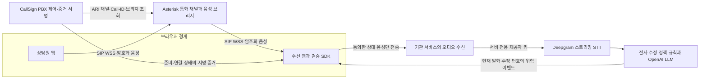

# 02. 핵심 아키텍처

[서비스 가이드](README.md) · 이전: [서비스 개요](01-SERVICE-OVERVIEW.md) · 다음: [통화 처리 흐름](03-CALL-FLOW.md)

## 전체 구조

기본 경로의 구성과 신뢰 경계는 [ARCHITECTURE](../ARCHITECTURE.md)가 기준입니다. 이 가이드는 사용자 관점의 연결을 설명하며 화살표가 실환경 성공을 뜻하지 않습니다. 실제 구성요소·fixture·남은 검증은 [현황표](05-IMPLEMENTATION-STATUS.md)에서 구분합니다.

| 구성요소 | 역할 |
|---|---|
| Issuer Gateway | 기관 업무·개별 승인·소비·권한 검사와 서명 |
| Sender Agent | 콜센터 장기키 보유, 할당/요청별 키 소유 증명 |
| Platform | 인증된 요청 전달. 기관/콜센터 개인키·기관 업무 DB 쓰기 계정 없음 |
| PostgreSQL·별도 Anchor | 업무·소비·세션·후속 작업과, 분리된 복원 기준 |
| Besu·Witness | 권한 계약과 서로 다른 키의 같은 블록/상태 증언 |
| 양측 웹·Asterisk | 서명·연결 대조, 실제 음성 종단·채널/브리지 제어 |
| 분석 경로 | 동의한 상대 음성·전사 수정·위험 근거. 독립 제공자 smoke와 실제 통화 경로를 구분 |

## 통화와 AI 경로

STT는 음성→문자 변환, LLM은 언어 모델입니다. 규칙·LLM은 연락 권한을 발급하거나 통화를 자동 제어하지 않습니다. 분석 서버가 수신자의 실제 상대 음성만 받도록 클라이언트에서 상대방 수신 오디오를 선택합니다. 악성 클라이언트가 오디오 자체를 바꾸는 것까지 서버가 증명하지는 못합니다.

**브라우저의 암호화 음성을 끝내고 다른 채널로 연결하는 미디어 종단(media edge)은 Asterisk입니다.** 별도 Janus나 외부 미구현 Edge API를 필수 종단으로 두지 않습니다. 기존 `MediaEdgeAdapter`는 이전 설계의 호출 도우미로 남아 있으며 새 경로의 구현 근거가 아닙니다. Asterisk ARI(HTTP 제어 인터페이스) 조회 성공은 실제 RTP(음성 패킷) 전달 성공이 아니므로 별도 통화 검증이 필요합니다. [Asterisk 공식 ARI 문서](https://docs.asterisk.org/Configuration/Interfaces/Asterisk-REST-Interface-ARI/)

SIP는 통화 제어, WSS는 암호화 웹소켓, DTLS-SRTP는 브라우저 음성 전송 보안 방식입니다. 브리지는 교환기에서 두 통화 채널을 연결하는 기능입니다.

## 개인키와 데이터의 경계

| 보유 주체 | 비밀·데이터 | 브라우저·온체인 전달 범위 |
|---|---|---|
| 기관 승인 서비스 | 기관 승인 Ed25519 개인키, 업무·고객·승인·소비 DB 접근 | 서명 객체만 전달, 기관 개인키는 전달하지 않음 |
| 콜센터 서명 서비스 | 서비스 Ed25519 개인키 | 세션 공개키에 대한 요청별 서명만 전달 |
| 상담원·수신 웹 | 통화별 단기 개인키, 마이크·상대방 음성 | 공개키·일회성 난수·소유 증명만 전달 |
| PBX 증거 서명 계층 | 별도 증거키, SIP 채널·브리지 매핑 | 세션에 결합한 JWS 증언. 상담원 개인 신원 증명이 아님 |
| Witness·관리 승인자 | 각자 자기 역할의 키 | Witness 상태 서명 또는 관리 명령 서명. 두 키 집합은 별개 |
| PostgreSQL | 고객 식별자·업무·권한·영수증·감사·로그인 세션 | 고객·통화 원문은 원장에 기록하지 않음 |
| Besu 계약 | 기관·위임 내용 해시·키·권한 세대·기간·철회 | 공개 검증에 필요한 권한 상태만 저장 |
| 분석 제공자 | Deepgram: 동의한 상대 음성·모델/언어 설정. OpenAI(선택 Anthropic): 전사·목적 정책(원음 제외) | 원음 기본 미보관은 CallSign 정책이며 제공자 보관 설정까지 보장하지 않음 |

원장 관리자·정지키는 별도 worker가 보유하며 기관 승인 API에 공유 mount하지 않습니다. 서비스 간 인증 비밀값과 웹 코드·신뢰할 공개키 목록(trust bundle)을 배포하는 운영자도 신뢰 대상입니다. 파일 접근을 나눴다는 이유만으로 완전한 격리를 달성한 것은 아닙니다.

## 현재 서버컴 운영과 후속 이전

현재 목표는 서버컴 전용 지속 backend와 공개 데모입니다. AWS 이전은 후속 범위이며, GitHub Release와 비공개 GHCR의 고정 자료는 전달 경로로 보존합니다. 실행 웹은 해당 환경의 실제 trust·PBX 인증서와 맞춰 생성합니다. [현재 배포 기준·수령 절차](../RUNBOOK.md#github-delivery-20261102)를 따릅니다. GCP는 과거 구성입니다.

한 호스트의 여러 Besu/Witness는 전원·디스크·관리자 장애를 공유합니다. 같은 호스트의 실제 통화·복구 시험과 AWS 외부 연결/독립 호스트 내성을 구별합니다.

상세 근거: [ARCHITECTURE](../ARCHITECTURE.md), [MASTER 서비스·키·DB 경계](../MASTER-DEVELOPMENT-SPEC.md), [운영·복구 runbook](../RUNBOOK.md).

## 원장 작업과 독립 복구 기준

원장 관리자·긴급 정지 키는 별도 worker가 보유합니다. 승인 API는 처리 의도를 DB에 저장하며 worker가 서명한 원장 요청을 저장한 뒤 제출·재조회합니다. 같은 요청을 새 nonce로 무조건 다시 만드는 방식이 아닙니다. 처리 위치와 실패 상태도 저장합니다.

소비 이력의 최신 기준은 백업 대상 밖 HTTPS anchor 서비스에 둡니다. 이 서비스는 소비 이력의 연속 해시와 순번·권한 세대의 전진만 허용합니다. 같은 VM·같은 백업에 함께 넣으면 독립 복구 기준이 되지 않습니다. 기준과 DB가 다르거나 외부 확정 결과가 불명확하면 신규 승인을 차단하며, 임의 차단 해제는 하지 않습니다. 같은 호스트의 별도 저장소·프로세스로 CAS/재시작/application 복원을 시험했지만 독립 호스트/운영자 내성이나 전체 체인 복원은 미검증입니다.

2026-10-27 당시의 미연결/미검증 표기를 포함한 [설계 그림 원본](assets/architecture.svg)은 과거 스냅샷으로 보존합니다. 현재 검증 상태로 해석하지 않습니다.
