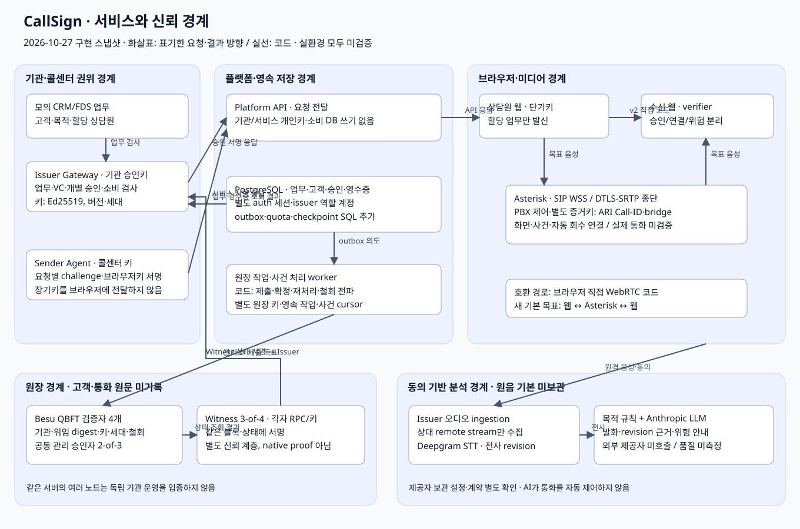
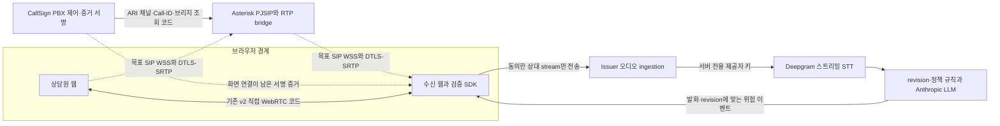

# 02. 핵심 아키텍처

[서비스 가이드](README.md) · 이전: [서비스 개요](01-SERVICE-OVERVIEW.md) · 다음: [통화 처리 흐름](03-CALL-FLOW.md)

## 전체 구조

**범례:** 실선은 해당 요청·검증·직접 통화 코드가 있는 경로이며 실환경 성공을 뜻하지 않습니다. 점선은 목표 구조 또는 제품 연결이 남은 경로입니다. PBX 제어·서명 코드는 추가됐지만 화면·사건 처리·자동 회수·배포 연결이 남아 있습니다.

| 구성 요소 | 책임 | 현재 상태 |
|---|---|---|
| 기관 업무 시스템·Issuer Gateway | 모의 CRM/FDS 업무 검사, 개별 승인 서명, 소비·취소 직렬화 | v2 API·화면, v3 API 코드. 실제 기관 연결 없음 |
| Sender Agent | 콜센터 장기키 보유, 서버 challenge·할당 업무·브라우저 공개키에 서명 | v2 permit와 v3 요청별 proof 코드 |
| Platform API | 인증된 사용자 요청과 서명 객체 전달 | 기관·서비스 개인키와 issuer DB 쓰기 계정 없음 |
| PostgreSQL | 업무·소비 영수증·감사·세션·재처리 의도 저장 | SQL·저장소 코드. migration·권한·경합 미검증 |
| 수신 웹·verifier | 서명·권한·세션·실제 연결을 직접 대조 | v2 직접 경로 화면 연결. v3 verifier는 호출부 연결·시험 보강 필요 |
| Asterisk·PBX 제어 | 웹 SIP·DTLS-SRTP 음성 종단, 채널·브리지 결합 증언 | ARI 조회·mute·bridge와 JWS 코드, 브라우저 SIP 모듈. 전체 제품 경로 미완성 |
| Besu 검증자 4개 | QBFT 합의와 권한 계약 실행 | 구성·계약 코드. 현재 코드의 실환경 검증 미실행 |
| Witness 4개 중 3개 | 각자 RPC 상태를 조회하고 같은 snapshot에 서명 | 집계·검증 코드와 fake 단위 시험 |
| STT·규칙·LLM | 원격 오디오 전사, 정책 위반 근거 생성·갱신·철회 | v2 호출 경로와 v3 서버 경로 코드. 제공자 미호출 |

## 통화와 AI 경로

STT는 음성→문자 변환, LLM은 언어 모델입니다. 규칙·LLM은 연락 권한을 발급하거나 통화를 자동 제어하지 않습니다. 분석 서버가 수신자의 실제 상대 음성만 받도록 클라이언트에서 remote stream을 선택합니다. 악성 클라이언트가 오디오 자체를 바꾸는 것까지 서버가 증명하지는 못합니다.

**media edge의 역할은 Asterisk가 맡는 것으로 확정했습니다.** 별도 Janus나 외부 미구현 Edge API를 필수 종단으로 두지 않습니다. 기존 `MediaEdgeAdapter`는 이전 설계의 호출 helper로 남아 있으며 새 경로의 구현 근거가 아닙니다. Asterisk ARI(HTTP 제어 인터페이스) 조회 성공은 실제 RTP 음성 전달 성공이 아니므로 별도 통화 검증이 필요합니다. [Asterisk 공식 ARI 문서](https://docs.asterisk.org/Configuration/Interfaces/Asterisk-REST-Interface-ARI/)

## 개인키와 데이터의 경계

| 보유 주체 | 비밀·데이터 | 브라우저·온체인 전달 범위 |
|---|---|---|
| 기관 Issuer | 기관 승인 Ed25519 개인키, 업무·고객·승인·소비 DB 접근 | 서명 객체만 전달, 기관 개인키 미전달 |
| 콜센터 Sender | 서비스 Ed25519 개인키 | 세션 공개키에 대한 요청별 서명만 전달 |
| 상담원·수신 웹 | 단기 세션 개인키, 마이크·원격 stream | 공개키·nonce·소유 증명만 전달 |
| PBX 증거 서명 계층 | 별도 증거키, SIP 채널·브리지 매핑 | 세션에 결합한 JWS 증언. 상담원 개인 신원 증명이 아님 |
| Witness·관리 승인자 | 각자 자기 역할의 키 | Witness 상태 서명 또는 관리 명령 서명. 두 키 집합은 별개 |
| PostgreSQL | 고객 식별자·업무·권한·영수증·감사·로그인 세션 | 고객·통화 원문은 원장에 기록하지 않음 |
| Besu 계약 | 기관·위임 digest·키·권한 세대·기간·철회 | 공개 검증에 필요한 권한 상태만 저장 |
| 분석 제공자 | 동의한 상대 음성·전사 | 원음 기본 미보관은 CallSign 정책이며 제공자 보관 설정까지 보장하지 않음 |

Issuer 코드가 원장 관리자·정지키도 읽는 기존 경계, 공유 service token, 웹 배포 코드·trust bundle 운영자 신뢰는 남은 위험입니다. 최소 파일 mount만으로 완전한 키 격리를 달성했다고 표현하지 않습니다.

## 서버컴과 GCP

현재는 64GB 서버컴에서 **오프라인 개발** 중입니다. 이후 같은 소스·이미지·Compose 구조를 GCP VM으로 옮길 계획이며, VM·DNS·인증서·OIDC·TURN·운영 키·이미지 digest를 별도로 준비해야 합니다. DB·체인 데이터·키·신뢰 설정은 영속 보관하고, 일반 재시작이 초기화·배포·재발급을 수행하지 않아야 합니다.

한 서버에 Besu·Witness를 여러 개 둬도 전원·디스크·호스트 관리자 장애가 공유됩니다. 독립 기관 분산 운영의 증거는 아닙니다. GCP 실제 생성·배포·재시작·복원도 아직 검증하지 않았습니다.

상세 근거: [ARCHITECTURE](../ARCHITECTURE.md), [MASTER 서비스·키·DB 경계](../MASTER-DEVELOPMENT-SPEC.md), [운영·복구 runbook](../RUNBOOK.md).
