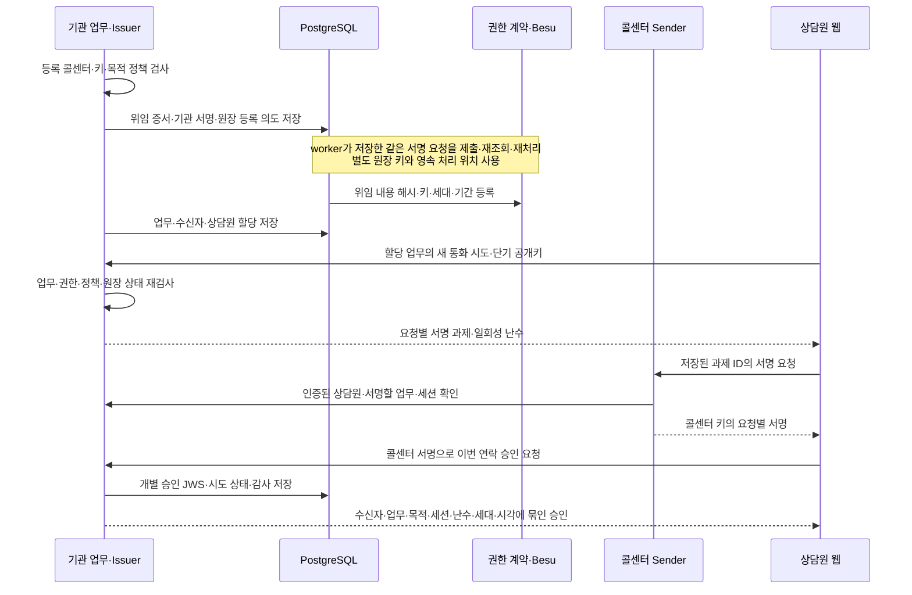
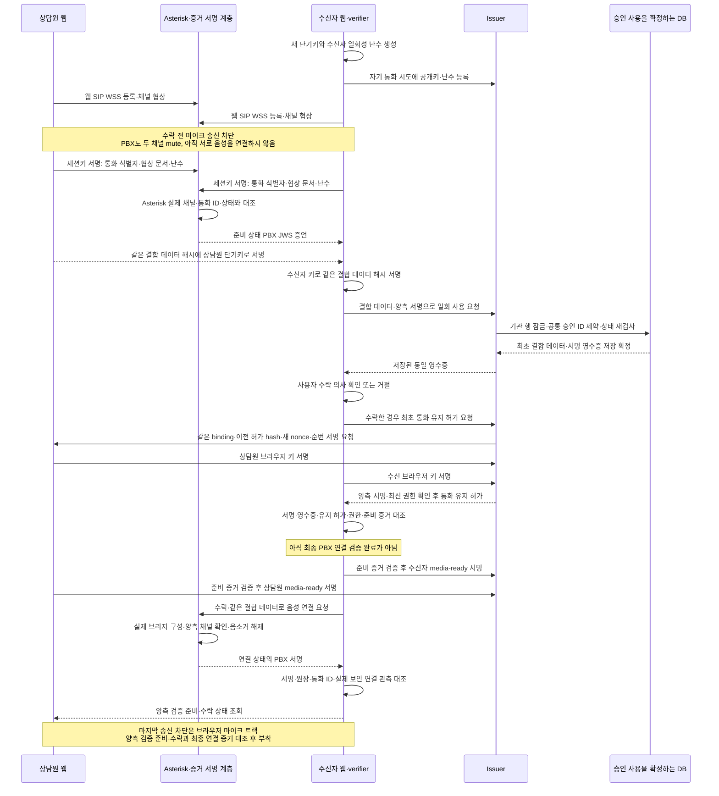
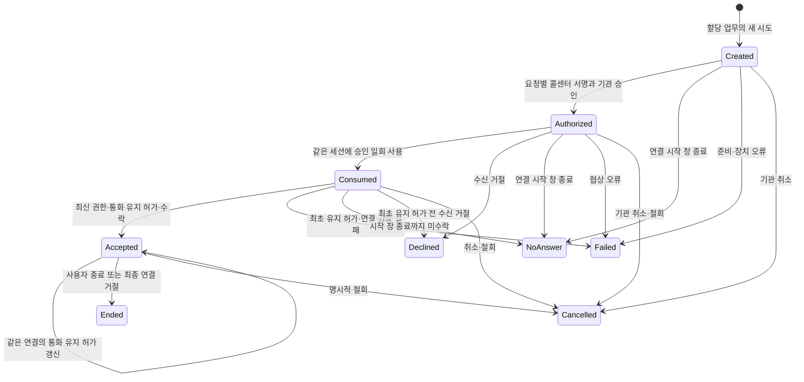

# 03. 통화 처리 흐름

[서비스 가이드](README.md) · 이전: [아키텍처](02-ARCHITECTURE.md) · 다음: [신뢰·보안](04-TRUST-AND-SECURITY.md)

아래는 기본 화면의 Asterisk 교환기 경로에 연결한 코드 흐름입니다. 실제 DB·교환기·브라우저 시험은 하지 않았으므로 연결 성공 기록으로 읽으면 안 됩니다. 이전 직접 통화 경로는 별도 호환 화면에 남아 있습니다.

기관 승인 서비스(Issuer)가 연락을 승인하고 콜센터 서명 서비스(Sender)가 위탁 발신 권한을 증명합니다. ‘통화 시도(attempt)’는 한 번의 발신, ‘세션(session)’은 그 연결입니다. ‘승인 소비’는 승인 ID를 이 세션에 한 번 사용했다고 고정하는 것이며 통화 수락은 아닙니다. JWS는 JSON 데이터의 서명 표현입니다.

## 1. 재사용 위임과 이번 연락의 승인

VC는 해당 업무 범위의 콜센터 위임이고 연락 대상 고객을 임의로 정하는 허가가 아닙니다. 개별 승인에는 기관이 정한 수신자, 업무/사건 ID, 목적·정책 내용 해시, 통화 시도·세션, 브라우저 공개키 해시, 일회성 난수, 만료, 권한 세대를 결합합니다. 새 정상 통화마다 새 온체인 위임을 만드는 설계가 아닙니다.

## 2. 수신자의 일회성 요청·실제 연결·승인 일회 사용

서버의 `success` 문자열은 검증 완료 근거가 아닙니다. 수신 SDK(수신 검증 모듈)는 등록 키의 서명, VC와 승인 관계, 실제 소비 영수증, 현재 통화 유지 허가·권한 상태 묶음, 수신자가 만든 일회성 난수, 관측한 SDP(통화 협상 문서)·DTLS(전송 보안) 종단과 SIP Call-ID(통화 식별자)를 대조해야 합니다. 지원 브라우저에서 필요한 관측을 얻지 못하면 확인 불가로 처리합니다.

현재 교환기 제어 API는 브리지에 양측 채널이 있는지 확인한 뒤 음소거 해제와 연결 상태 서명을 한 호출에서 수행합니다. 이때도 브라우저 마이크는 송신하지 않아야 하며, 양측의 준비 증거 검증 서명과 수락을 서버에서 확인한 뒤 브리지를 구성합니다. 각 브라우저는 최종 연결 증거와 실제 DTLS 인증서를 다시 대조한 뒤 마이크를 붙입니다. 실패·종료 시 로컬 자원을 정리하고 서버의 ARI 감시 및 영속 회수 작업이 채널·endpoint를 정리하도록 연결했습니다. 실제 매체 송신 차단·회수는 통합 검증 전입니다.

최초 사용 때 승인과 세션의 결합 데이터를 고정합니다. 같은 결합 재시도는 저장된 **동일 JWS 영수증**을 반환하고 다른 결합은 거절합니다. 저장 확정 뒤 응답이 유실되어도 동일 결과를 복구하도록 작성했습니다. 초기 시연·직접 통화·교환기 연동의 입력 형식을 구별하며 실패 시 이전 형식으로 자동 우회하지 않습니다. 모든 통신 형식이 공유하는 일회 사용 SQL 제약은 작성했지만 실제 DB 적용·경합·이전 코드용 DB 트리거는 미검증입니다.

## 3. 시간과 상태

| 시간 | 의미 | 만료 시 동작과 현재 이행 상태 |
|---|---|---|
| 최초 연결 시작 **120초** | 시도 생성부터 재는 연결 시작 창. 승인 발급 때 업무·위임·요청 기한을 넘지 않게 확정 | 새 소비·초기 연결 차단. 이미 유효하게 연결된 통화를 120초마다 새 통화로 만들지 않음. 서버 로직 단위 검증 |
| 현재 권한 증거 최대 **10초** | 시계 오차까지 포함한 상태 최신성 상한 | 새 연결 차단, 진행 중은 확인 불가 표시·정지/종료/명시적 미확인 계속. 새 검증기는 블록 상태 관측 후 8초·허용 미래 오차 1초로 검사하며 10초 보장은 시계 가정과 실환경 시험 필요 |
| 진행 통화 유지 허가 | 같은 세션·결합 데이터·연결 세대를 유지하는 짧은 허가 | 현재 서버의 임시값은 30초, 순번·새 일회성 난수·키 소유 증명으로 갱신. 유지 허가가 만료된 연결의 자동 부활은 거절 |
| 업무·VC·키의 유효기간 | 연락 권한의 상한 | 새 발신·연결·갱신 거절. 키/세대 변경 뒤 구승인 재활성화 금지 |
| 분석 연결·예산 | STT와 LLM 사용 한도 | 분석만 중단·장애 표시. 기관 승인이나 통화 철회로 바꾸지 않음 |

새 서버 코드에는 업무/VC 기간과 별도로 최대 통화 4시간의 임시 상한도 있습니다. 이는 사용자 확정 정책이나 실측값이 아니며, 기관의 통화 정책·운영 검증을 거쳐 조정해야 합니다. 기본 `/service` 화면은 양측 서명으로 같은 통화의 유지 허가를 갱신합니다. 이전 `/finals` 직접 통화 호환 화면은 기존 만료 의미를 보존합니다.

서버는 최초 통화 유지 허가를 발급하면 `accepted`로 저장합니다. 이는 실제 음성 개통·양측 최종 검증 완료와 별개입니다. **승인 소비 후 최초 유지 허가 전에는 거절(`declined`)할 수 있고, 허가 발급 뒤 최종 검증을 거절하거나 나가면 종료(`ended`)로 정리**해야 합니다. 어느 경우든 마이크 차단·교환기 자원 회수가 필요합니다. 기본 화면과 자동 회수 처리기에 연결했으며 실제 교환기에서의 회수 지연은 미측정입니다.

그림은 주요 전이입니다. 코드에서는 종료 확정 결과의 동일 재전달을 허용하고, 다른 종료 확정 결과로 바꾸는 늦은 사건은 거절합니다. 거절 후 새 시도는 새 세션·일회성 난수·승인으로 시작합니다. 부재 판정은 시작 창 종료 전에는 허용하지 않습니다. 소비 후 사라진 사용자는 시작 창 종료 시 부재로, 초기 연결 검증 실패는 오류로 마무리하고 서버가 양측 PBX 자원을 회수해야 합니다. 1초 감시가 시작 창·유지 허가·현재 세션을 검사하고 영속 회수 작업과 ARI 자원 정리를 수행합니다. 같은 종료 사건은 다시 활성화시키지 않습니다. 실제 장애 시 동작은 시험 전입니다.

권한 원장 조회만 불가하고 기관 승인 서비스는 살아 있다면, 현재 서버는 **아직 만료하지 않은 진행 통화**에 `authority=unavailable`인 다음 유지 허가를 발급할 수 있습니다. ‘미확인 계속’은 이 허가 안에서만 통화를 이어가겠다는 선택이며 정상 인증 표시를 복원하지 않습니다. ‘정지’ 선택은 브라우저 송신·분석을 멈추고 서버도 미확인 계속을 선택하지 않은 브리지를 음소거합니다. 기관 승인 서비스 자체에 닿지 않아 새 허가를 못 받거나 기존 허가가 만료되면 계속 선택만으로 연장·부활시킬 수 없습니다. 화면·교환기에 이 선택과 만료 처리를 연결했지만 실제 오디오와 지연 검증은 남아 있습니다.

## 4. 진행 중 확인 실패·종료·복구

| 사건 | 사용자 동작 계약 | 구현·검증 상태 |
|---|---|---|
| 기관 취소·위임 철회·기관 정지·세대 변경 | 인증 표시 철회, 양측 음성·PBX leg·AI 종료 | API·원장 사건 consumer·교환기 자동 회수·분석 취소 연결. 실제 원장/교환기 전파 미검증 |
| 정족수 부족·오래된 상태·조회 장애 | 새 연결 차단. 진행 중은 ‘확인 불가’, 정지·종료·명시적 계속 선택 | 유지 허가·선택 화면·SDK·브리지 감시 연결. 최대 지연 실측 전 |
| AI 응답 지연·동의 철회·예산 초과 | 분석 중단·근거 철회·장애 안내 | 수정 번호·stop 코드. 통화 권한 철회와 구분 |
| ICE restart·새 PeerConnection·전환 | 기존 승인·세션 결합 무효, 새 시도부터 재검증 | 자동 전환 미지원. SIP 재협상은 거절하는 제한 프로파일 |
| 로그아웃·세션 폐기 | 열린 연결과 분석 작업 회수 | 로그인 세션 폐기와 PBX/분석 감시 연결. 다중 탭은 session claim·단기 키로 경합 거절 |
| 프로세스 재시작·백업 복원 | 소비·검증한 기준 상태·현재 세대 대조 전 새 연락 금지 | 독립 anchor와 소비 journal 대조·불일치 차단 구현. 일부 이력 유실의 자동 복구는 제공하지 않으며 실제 복원 미검증 |

개발 근거: [프로토콜](../PROTOCOL.md), [MASTER CALL-001~006](../MASTER-DEVELOPMENT-SPEC.md#call-001), [service-authority.ts](../../services/api/src/service-authority.ts), [PBX 제어](../../services/api/src/asterisk.ts), [통화 유지·PBX 경로 수신 verifier](../../packages/verifier/src/service.ts).

현재 연결 코드는 1초 간격으로 겹치지 않게 상태를 조회합니다. API 실패로 같은 동작을 다시 요청할 때는 동일 payload와 요청 식별자를 사용하고, 늦은 응답은 종료된 화면이나 다른 통화에 적용하지 않습니다. UI에서 선택한 시도와 실제 연결한 시도는 별개입니다. 새 연결·새 PeerConnection·전환은 기존 승인으로 자동 복구하지 않습니다.

기관 서비스 재시작 후에는 기존 채널을 종료·정리하고 새 통화 시도를 요구합니다. 원장 작업은 저장한 서명 요청·hash로 복구하지만 브라우저 단기 개인키는 서버가 복원하지 않습니다. 명시적 철회는 통화를 회수하고, 최신성 만료는 우선 확인 불가와 음성 정지로 표시합니다. AI 장애만으로 기관 권한이 철회됐다고 표시하지 않습니다.
