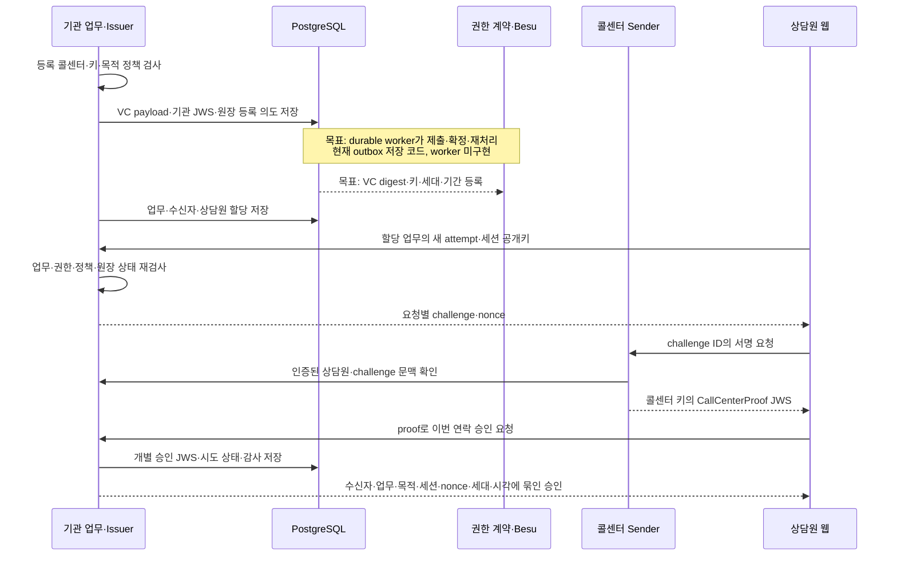
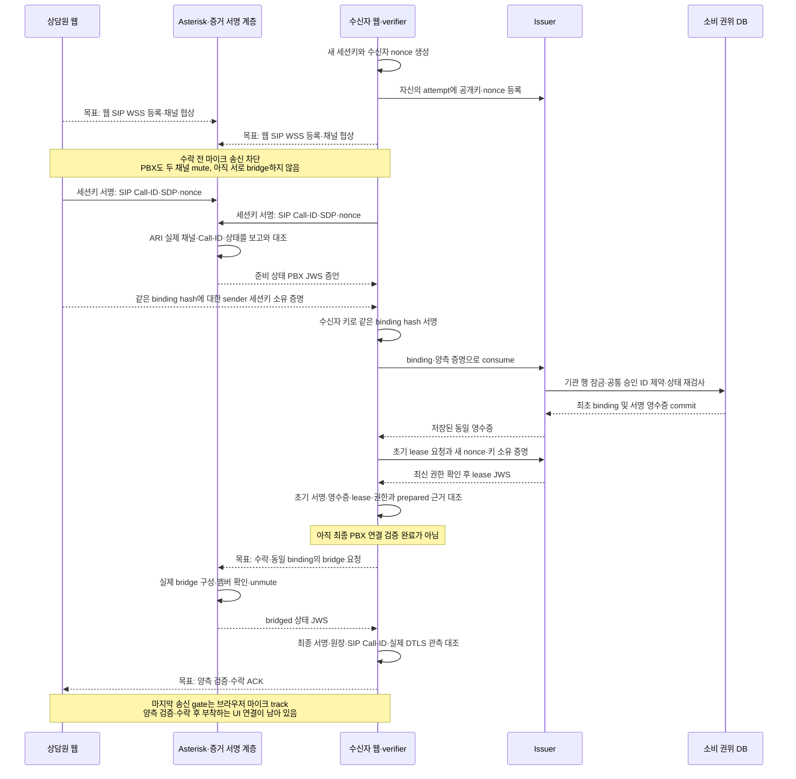
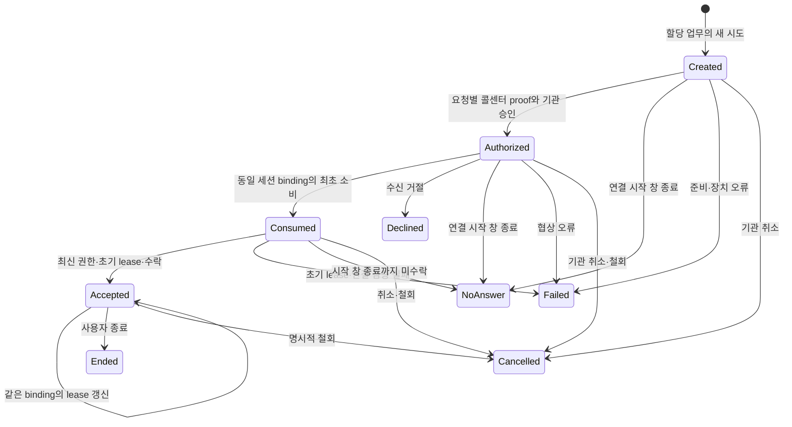

# 03. 통화 처리 흐름

[서비스 가이드](README.md) · 이전: [아키텍처](02-ARCHITECTURE.md) · 다음: [신뢰·보안](04-TRUST-AND-SECURITY.md)

아래는 확정한 목표 흐름입니다. v3 업무·승인·소비·lease와 PBX 제어 API는 코드가 있지만, **PBX 화면·전체 사건 처리·자동 회수·배포 연결은 미완성**입니다. v2 직접 통화 화면과 새 흐름을 같은 완료 상태로 읽지 않습니다.

## 1. 재사용 위임과 이번 연락의 승인

VC는 해당 업무 범위의 콜센터 위임이고 연락 대상 고객을 임의로 정하는 허가가 아닙니다. 개별 승인에는 기관이 정한 수신자, 업무/사건 ID, 목적·정책 hash, attempt/session, 브라우저 공개키 hash, nonce, 만료, 권한 세대를 결합합니다. 새 정상 통화마다 새 온체인 위임을 만드는 설계가 아닙니다.

## 2. 수신자 challenge, 실제 연결과 일회 소비

서버의 `success` 문자열은 검증 완료 근거가 아닙니다. 수신 SDK는 등록 키의 서명, VC와 승인 관계, 실제 소비 영수증, 현재 lease·권한 snapshot, 수신자가 만든 nonce, 관측한 SDP·DTLS(전송 계층 보안) 종단과 SIP Call-ID를 대조해야 합니다. 지원 브라우저에서 필요한 관측을 얻지 못하면 확인 불가로 처리합니다.

현재 PBX 제어 API는 bridge 멤버 확인 뒤 unmute와 bridged 서명을 한 호출에서 수행합니다. 이때도 브라우저 마이크는 아직 송신하지 않아야 하며, 최종 JWS·실제 연결 대조와 양측 수락 후에만 track을 부착하는 것이 목표입니다. 이 마지막 UI/ACK 연결과 API 실패 시 전체 회수는 미완성입니다.

최초 소비에서 binding을 고정합니다. 같은 binding 재시도는 저장된 **동일 JWS 영수증**을 반환하고 다른 binding은 거절합니다. commit 뒤 응답이 유실되어도 동일 결과를 복구하도록 작성했습니다. v1/v2/v3는 서로 다른 strict schema이며 자동 downgrade하지 않습니다. 공통 SQL 소비 namespace·제약은 작성했지만 실제 migration·경합·legacy trigger 동작은 미검증입니다.

## 3. 시간과 상태

| 시간 | 의미 | 만료 시 동작과 현재 이행 상태 |
|---|---|---|
| 개별 승인 연결 시작 **120초** | 이번 연락을 처음 연결할 수 있는 창 | 새 소비·초기 연결 차단. 이미 유효하게 연결된 통화를 120초마다 새 통화로 만들지 않음. v3 로직 단위 검증 |
| 현재 권한 증거 최대 **10초** | 시계 오차까지 포함한 상태 최신성 상한 | 새 연결 차단, 진행 중은 확인 불가 표시·정지/종료/명시적 미확인 계속. v3는 관측 age 8초·허용 미래 오차 1초로 검사하며 10초 보장은 시계 가정과 실환경 시험 필요 |
| 진행 통화 lease | 같은 session·binding·generation을 유지하는 짧은 허가 | v3 초안은 30초, 순번·새 nonce·키 소유 증명으로 갱신. lease가 끝난 연결의 자동 부활은 거절 |
| 업무·VC·키의 유효기간 | 연락 권한의 상한 | 새 발신·연결·갱신 거절. 키/세대 변경 뒤 구승인 재활성화 금지 |
| 분석 연결·예산 | STT와 LLM 사용 한도 | 분석만 중단·장애 표시. 기관 승인이나 통화 철회로 바꾸지 않음 |

v3 코드에는 업무/VC 기간과 별도로 최대 통화 4시간의 임시 상한도 있습니다. 이는 사용자 확정 정책이나 실측값이 아니며, 기관의 통화 정책·운영 검증을 거쳐 조정해야 합니다. 현재 v2 화면은 여전히 짧은 승인 만료 시 연결을 종료하므로 새 lease 흐름으로의 화면 이행이 필요합니다.

그림은 주요 전이입니다. 코드에서는 terminal 결과의 동일 재전달을 허용하고, 다른 terminal 결과로 바꾸는 늦은 사건은 거절합니다. 거절 후 새 시도는 새 session·nonce·승인으로 시작합니다. 부재 판정은 시작 창 종료 전에는 허용하지 않습니다. 소비 후 사라진 사용자는 시작 창 종료 시 부재로, 초기 연결 검증 실패는 오류로 마무리하고 서버가 양측 PBX 자원을 회수해야 합니다. 현재 outcome API는 있으나 자동 timeout·모든 실패 경로의 회수 worker는 아직 완성되지 않았습니다.

## 4. 진행 중 확인 실패·종료·복구

| 사건 | 목표 사용자 동작 | 현재 남은 연결 |
|---|---|---|
| 기관 취소·위임 철회·기관 정지·세대 변경 | 인증 표시 철회, 양측 음성·PBX leg·AI 종료 | API 거절과 일부 v2 WS 회수 있음. v3 PBX 자동 회수·원장 사건 worker 미완성 |
| 정족수 부족·stale·조회 장애 | 새 연결 차단. 진행 중은 ‘확인 불가’, 정지·종료·명시적 계속 선택 | v3 lease가 current/unavailable을 구분. UI 선택·지속 감시 연결 필요 |
| AI timeout·동의 철회·예산 초과 | 분석 중단·근거 철회·장애 안내 | revision·stop 코드. 통화 권한 철회와 구분 |
| ICE restart·새 PeerConnection·전환 | 기존 binding 무효, 새 시도부터 재검증 | 자동 전환 미지원. SIP 재협상은 거절하는 제한 프로파일 |
| 로그아웃·세션 폐기 | live connection과 분석 작업 회수 | 기존 WS watcher 있음. PBX 별도 종료 감시 필요 |
| 프로세스 재시작·백업 복원 | 소비·checkpoint·현재 세대 대조 전 새 연락 금지 | recovery gate SQL·검사 작성. 독립 최신성 anchor·검토된 해제 절차 미완성 |

개발 근거: [프로토콜](../PROTOCOL.md), [MASTER CALL-001~006](../MASTER-DEVELOPMENT-SPEC.md#call-001), [service-authority.ts](../../services/api/src/service-authority.ts), [PBX 제어](../../services/api/src/asterisk.ts), [v3 수신 verifier](../../packages/verifier/src/service.ts).
