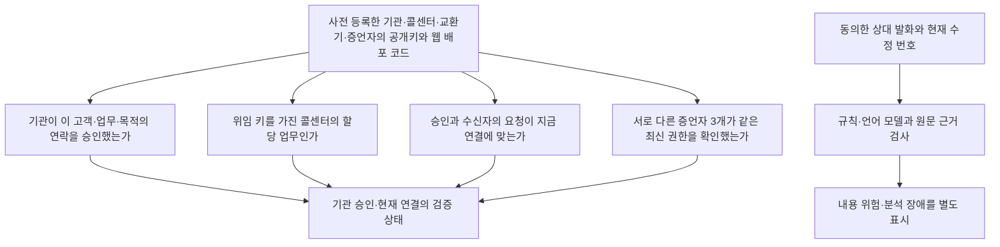

# 04. 신뢰·보안 설계

[서비스 가이드](README.md) · 이전: [통화 흐름](03-CALL-FLOW.md) · 다음: [구현 및 검증 현황](05-IMPLEMENTATION-STATUS.md)

## 누구를 신뢰해 무엇을 확인하는가

출발점은 **사전 등록한 기관·공개키, 권한 원장과 신뢰 설정**입니다. 기관명이나 HTTPS 주소를 제시했다는 이유만으로 믿지 않습니다. 임의 주소에서 가져온 키를 승인자로 받아들이지 않습니다. 수신 웹을 배포하는 코드와 그 코드가 신뢰할 키 목록도 보호 대상입니다.

## 기관 주소와 업무 위임 증서

기관·콜센터는 등록된 URI(식별 주소)를 사용합니다. DID(분산 식별자)나 고객 지갑은 필수가 아닙니다. 기존 직접 통화 코드는 DID 문서의 키 관계도 검사하지만, 추가 서버 경로는 DID 조회 없이 등록 주소·키를 사용합니다. 기본 키 준비·신뢰 설정·화면도 등록 URI로 연결했으며 DID 원격 조회를 필수로 실행하지 않습니다.

VC(검증 가능한 자격 증명)는 기관이 콜센터에 맡긴 업무 범위를 담는 위임 증서입니다. 기관·콜센터와 등록 키, 정책·유효기간·위임 ID·권한 세대·원장 상태 참조를 포함합니다. 기관 서명과 현재 원장 상태를 함께 검사합니다. 사본을 가진 것만으로 발신할 수 없으며 콜센터 키로 이번 요청에 서명하고 특정 고객·업무의 개별 승인을 받아야 합니다.

[W3C VC 2.0](https://www.w3.org/TR/vc-data-model-2.0/)과 [JOSE/COSE 서명 표현](https://www.w3.org/TR/vc-jose-cose/)을 바탕으로 CallSign 전용 위임 형식을 사용합니다. `CallSignRegistryStatus`는 기존 권한 원장을 참조하는 규칙입니다. 별도 철회 원장이나 범용 지갑 호환 인증을 구현했다고 주장하지 않습니다. 철회 요청을 DB에서 먼저 차단하는 것과 체인에 철회가 확정되는 시점은 구별합니다.

## 서명과 재사용 방지

JWS는 JSON 데이터의 서명 표현이며, 오프체인 데이터는 Ed25519 알고리즘으로 서명합니다. EIP-712는 체인 관리 명령의 내용을 구조화해 서명하는 데 사용합니다.

| 근거 | 누가 서명하고 무엇을 확인하는가 |
|---|---|
| 위임 증서·개별 승인·일회 사용 영수증·통화 유지 허가 | 기관 승인키. 기관·고객·업무·목적·통화·키 버전·권한 세대가 맞는지 확인 |
| 요청별 콜센터 증거 | 콜센터 장기키. 서버가 제시한 일회성 난수·상담원·통화 시도·브라우저 공개키를 결합 |
| 양측 통화용 키의 소유 증명 | 각 브라우저 단기키. 같은 승인·세션 결합 데이터와 역할·난수에 서명 |
| 교환기 연결 증언 | 별도 PBX 증거키. Asterisk의 실제 채널·통화 ID·브리지와 브라우저 보고를 대조 |
| 주요 체인 공동 관리 명령 | 관리 승인자들의 EIP-712 서명. 체인·계약·동작·일회성 값·기한을 결합해 다른 명령으로 전용 방지 |

모든 원장 변경에 공동 서명이 붙는 것은 아닙니다. 현재 계약의 위임 등록·철회는 관리자 권한, 긴급 정지는 정지 권한자, 기관 등록·복구는 공동 승인으로 처리합니다. 관리 화면·재인증도 이 차이를 따라야 합니다.

수신자·목적·키·협상 문서·연결이 달라지면 승인을 사용할 수 없어야 합니다. ‘승인 소비’는 기관·승인 ID를 특정 결합 데이터에 한 번 사용했다고 저장하는 것입니다. 같은 결합 데이터 재시도는 **동일한 저장 영수증**을 돌려주고, 다른 결합의 재사용은 거절합니다. 초기 시연·직접 통화·교환기 연동 사이에서 형식을 섞거나 이전 형식으로 자동 우회하지 않습니다. 실제 DB 경합 검증은 남아 있습니다.

## 서로 다른 세 정족수

정족수는 결정을 인정하기 위해 필요한 서로 다른 참여자의 수입니다.

| 정책 | 맡는 일 | 대신하지 못하는 것 |
|---|---|---|
| Besu QBFT 검증자 **4개** | 블록 합의·계약 실행·상태 저장 | 기관 업무의 진실성·AI 정확도 |
| Witness(상태 증언자) **4개 중 3개 서명** | 각자의 노드에서 조회한 같은 체인·블록·상태에 서명 | 체인 자체 증명·상담원 개인 신원 |
| 주요 관리 승인자 **3명 중 2명 승인** | 기관 등록·복구 등 권한 변경 공동 승인 | 현재 상태의 증언 |

증언자는 별도 신뢰 계층입니다. 같은 블록·상태를 서명한 서로 다른 등록 키만 정족수에 포함합니다. 느린 하나나 특정 원장 조회 서버 하나에만 의존하지 않으며, 오래된 블록에 새 서명을 붙여 최신성을 늘리지 않습니다. QBFT 블록 헤더·확정 서명·저장 상태 증명을 직접 검사하는 확장은 **미구현이며 기본 서비스 완료 조건과 별도**입니다.

한 서버의 네 프로세스는 실제 기관들이 독립적으로 운영한다는 증거가 아닙니다. 가짜 원장 응답과 서명 단위 시험으로 실제 분산 운영·침해 내성을 입증할 수도 없습니다.

## 정지·키 교체·복원

단독 긴급 조치는 자기 기관의 일시 정지만 허용하는 설계입니다. 정지 해제·키 교체·복구는 공동 승인 후 새 키·권한 세대를 활성화해야 합니다. 구세대의 위임·승인이 다시 살아나면 안 됩니다. 공동 복구·새 승인키 확인·구 위임/승인/통화 무효화, 관리 permission·최근 auth_time·자원 회수를 기본 경로에 연결했습니다. 실제 공동 운영·로그인·원장 전파는 미검증입니다.

재시작 뒤에도 승인 사용 이력·최고 관측 블록·권한 세대를 유지해야 합니다. DB 기준 상태와 복구 전 사용 차단 코드를 추가했지만 **DB·체인·키를 모두 옛 백업으로 돌렸을 때 내부 일치만으로 최신성을 알 수는 없습니다.** 복원 대상 밖의 최신 기준과 철회·사용 이력을 확인하지 못하면 새 승인 발급·연결을 중단해야 합니다. 별도 호스트의 HTTPS anchor와 SQL 소비 journal을 대조하고 일치할 때만 재개하도록 연결했습니다. anchor만 전진한 뒤 DB commit이 유실된 경우에는 자동 해제하지 않습니다. 최신 일관 증거 복구·재신뢰 판단과 실환경 복원 시험이 필요합니다.

## 음성 분석·개인정보·외부 제공자

- 수신자 동의 후 **상대방 수신 음성**을 전송합니다. 자신의 마이크 분석으로 대체하지 않습니다. 거절 시 전송하지 않고 철회 시 작업·전사·버퍼를 정리해야 합니다.
- CallSign 서버는 원음을 기본 영구 저장하지 않습니다. 전사는 수정 분석용 메모리에서 처리합니다. 브라우저 표시·모든 장애 경로의 삭제 검증은 남아 있습니다.
- Deepgram에는 동의한 **상대 음성 바이트**와 전사 모델·한국어 등 연결 옵션을 보냅니다. Anthropic에는 **분석할 전사문과 목적 정책**을 보내며 원음은 보내지 않습니다. 현재 코드의 구성 기준이고 실제 호출은 하지 않았습니다. 제공자 보관·학습·처리 지역·계약 설정은 별도 확인해야 하며 CallSign의 미보관 설정으로 외부 삭제까지 보장하지 않습니다.
- 전사문 속 지시는 실행 명령으로 받아들이지 않습니다. 모델에 도구를 주지 않고 출력 형식·실제 원문·현재 수정 번호를 대조합니다. AI는 통화 제어 권한이 없습니다.
- 분석 불가·예산 초과·경고 없음은 안전 판정이 아닙니다. 실제 한국어 전사·위험 탐지의 오탐·미탐·지연은 측정하지 않았습니다.

## 남는 신뢰와 한계

기관 승인자·콜센터·교환기 운영자의 공모, 침해된 브라우저·OS, 웹 코드와 신뢰 키 목록을 바꿀 수 있는 배포자, DB·키 접근 운영자는 여전히 신뢰 대상입니다. 교환기 증언은 그 시스템이 확인한 연결 사실이며 상담원 개인의 신원이나 내부 음성 경로 전체의 무침해를 증명하지 않습니다. 정상 권한을 가진 상담원의 위험 발언도 암호학적 권한만으로 예방할 수 없습니다.

상세 근거: [위협 모델](../THREAT-MODEL.md), [한계](../KNOWN-LIMITATIONS.md), [통신 형식·용어](../PROTOCOL.md#protocol-profiles), [표준 적용](../STANDARDS.md), [설계 결정](../adr/0002-finals-offline.md), [전체 개발 명세](../MASTER-DEVELOPMENT-SPEC.md).

키 교체는 새로운 기관 승인키·권한 세대를 실제 원장에서 확인한 뒤 활성화합니다. 콜센터 키도 바꾸면 정렬한 전체 키 목록의 해시에 별도 공동 서명을 요구합니다. 복구 서명에 콜센터 키 변경 내용이 포함된 것으로 간주하지 않습니다. 구 위임·승인·진행 통화는 무효화하며 새 신뢰 설정을 배포해야 합니다. 실제 키 회전은 미실행입니다.

PBX 증거의 인증서 지문은 배치한 Asterisk 인증서의 고정값이고, 브라우저가 실제 DTLS 종단에서 얻은 인증서와 대조합니다. 서버의 ARI 조회는 채널·통화 ID·브리지를 확인합니다. 서버가 브라우저 보고만으로 DTLS handshake를 독립 관측했다고 주장하지 않습니다.
