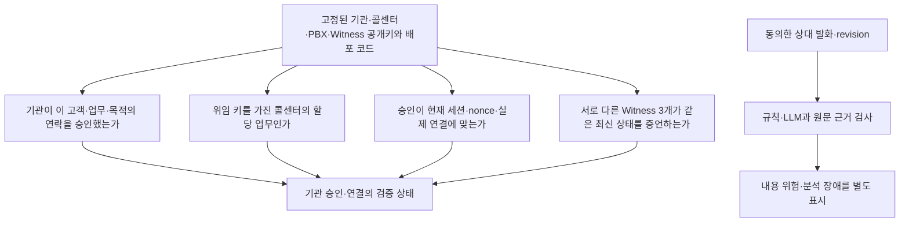

# 04. 신뢰·보안 설계

[서비스 가이드](README.md) · 이전: [통화 흐름](03-CALL-FLOW.md) · 다음: [구현 및 검증 현황](05-IMPLEMENTATION-STATUS.md)

## 누구를 신뢰해 무엇을 확인하는가

신뢰의 출발점은 **등록 기관과 등록 키·권한 원장·고정 trust bundle**입니다. 기관명을 주장하거나 HTTPS URI를 제시하는 것만으로 신뢰하지 않습니다. 임의 URI에서 키나 문서를 가져와 승인자로 등록하지 않습니다.

## 기관 URI와 업무 위임 VC

기본 서비스는 기관·콜센터의 URI(식별 주소)를 사용합니다. DID(분산 식별자)는 필수 조건에서 제외했고 고객에게 DID나 지갑을 요구하지 않습니다. 기존 DID resolver·등록 DID 검사는 v2 호환 코드로 보존됐습니다. 새 v3 발급 경로는 DID resolver를 호출하지 않지만 기존 키 준비·trust 생성·화면은 아직 DID 전제가 남아 있어 전체 기본 경로 전환은 미완성입니다.

VC는 발급 기관, 콜센터 식별자·등록 키, 업무 범위·정책, 유효기간, 위임 ID, 권한 세대와 상태 참조를 담습니다. 기관의 서명과 등록 키·원장의 활성 상태를 함께 검사합니다. **위임 VC의 복사본만으로는 발신할 수 없습니다.** 콜센터의 요청별 challenge 서명과 이번 업무에 대한 별도 개별 승인이 필요합니다.

[W3C VC 2.0](https://www.w3.org/TR/vc-data-model-2.0/)과 [JOSE/COSE 표현](https://www.w3.org/TR/vc-jose-cose/)을 바탕으로 프로젝트 전용 업무 위임 프로파일을 사용합니다. `CallSignRegistryStatus`는 해당 원장 상태를 참조하는 규칙이며 별도 철회 원장이나 범용 지갑 인증을 주장하지 않습니다. 정지·철회 요청의 DB pending 의도는 먼저 거부할 수 있지만 원장 확정과 구분합니다.

## 서명·재사용 방지

| 근거 | 서명자와 확인 내용 |
|---|---|
| VC·개별 승인·소비 영수증·lease | 기관의 Ed25519 키로 JWS(JSON 웹 서명). 기관·고객·업무·목적·세션·키 버전·세대를 대조 |
| 요청별 서비스 proof | 콜센터 Sender 키. 서버 challenge·상담원·attempt·브라우저 공개키 결합 |
| 양측 세션 소유 증명 | 각 브라우저 단기키. 같은 binding hash·역할·nonce를 서명 |
| PBX 연결 증언 | 별도 PBX 증거키. 실제 ARI 채널·Call-ID·브리지와 브라우저 보고·승인을 결합 |
| 주요 온체인 공동 관리 명령 | 승인자들의 EIP-712 구조화 서명. chain·계약·action·nonce·기간으로 replay 범위 제한 |

모든 온체인 트랜잭션에 2-of-3 EIP-712가 붙는다는 뜻은 아닙니다. 현재 계약의 위임 등록·철회는 관리자 접근 제어, 긴급 정지는 정지 권한자 제어를 사용합니다. 공동 등록·복구와 단독 정지의 경로·권한이 다르므로 관리 UI와 재인증 정책도 이를 따라야 합니다.

다른 수신자·업무·목적·세션·세대·SDP로 바뀐 요청은 거절해야 합니다. 승인 소비는 기관·승인 ID의 영속 단일 namespace에 고정하고 동일 binding만 동일 영수증으로 복구합니다. v1/v2/v3 schema를 혼용하거나 낮은 버전으로 자동 우회하지 않습니다. 현재 common SQL 경로의 실제 경합 검증은 남아 있습니다.

## 서로 다른 세 정족수

| 정책 | 무엇을 맡는가 | 무엇을 대신하지 못하는가 |
|---|---|---|
| Besu QBFT 검증자 **4개** | 블록 합의·계약 실행·상태 저장 | 기관 업무의 진실성·AI 정확도 |
| Witness **3-of-4** | 각자 RPC로 본 같은 chain·블록·상태를 서명 | 네이티브 체인 증명·기관 개인 신원 |
| 주요 관리 승인자 **2-of-3** | 기관 등록·복구 등 중요한 권한 변경의 공동 승인 | Witness의 현재 상태 증언 |

Witness는 별도 신뢰 계층입니다. 동일 블록·상태 payload의 등록된 서로 다른 서명만 모읍니다. 느린 하나나 단일 RPC 응답만으로 결정하지 않으며, 오래된 블록에 새 서명을 붙여 freshness를 연장하지 않습니다. QBFT header·commit seal·storage proof를 직접 검증하는 native proof는 **미구현 후속 확장**이며 이번 기본 서비스의 새 연구 과제로 추가하지 않습니다.

한 물리 서버의 프로세스 4개는 현실 기관들의 독립 운영·침해 내성을 입증하지 않습니다. fake RPC와 서명 단위 시험도 같은 한계를 갖습니다.

## 정지·키 교체·복원

자기 기관의 단독 긴급 조치는 일시 정지만 허용하는 설계입니다. 정지 해제·키 교체·복구는 공동 승인 후 새 키·권한 세대를 활성화해야 합니다. 이전 VC·승인이 새 세대에서 다시 살아나지 않아야 합니다. 현재 코드에는 공동 복구·새 승인키 확인·구 v2 객체 무효화가 있으나 새 v3 객체 전체 회수·관리 역할 세분화·주요 작업 재인증은 남아 있습니다.

소비 이력·최고 관측 블록·현재 세대는 프로세스 재시작 후에도 유지해야 합니다. v3 checkpoint와 recovery gate 코드는 작성됐지만, DB·체인·키를 모두 옛 백업으로 돌리면 내부 비교만으로 최신성을 증명할 수 없습니다. 복원 대상 밖의 최신 checkpoint·철회/소비 journal을 확인하지 못하면 신규 발급·연결을 중단해야 합니다. 이 복구·gate 해제 절차는 아직 완성되지 않았습니다.

## 개인정보와 분석 제공자

- 분석은 수신자 동의 후 상대 remote audio를 전송합니다. 거절 시 분석하지 않고 철회 시 진행 작업·전사를 정리해야 합니다.
- 서버의 원음 영구 저장은 기본 비활성화입니다. 전사는 revision 분석을 위한 메모리에 두고 중단 시 지우며, 브라우저에서도 종료·철회 시 표시/버퍼를 정리해야 합니다. 모든 저장·로그·장애 경로의 삭제 검증은 남아 있습니다.
- Deepgram·Anthropic에는 분석에 필요한 데이터가 전달됩니다. 제공자 보관·학습 사용·지역·계약 설정은 계정 정책으로 별도 확인해야 합니다. CallSign의 미보관 설정만으로 외부 삭제를 보장하지 않습니다.
- 전사문은 불신 데이터로 다룹니다. LLM에 도구를 제공하지 않고 출력 schema·정확한 원문 근거·현재 revision을 검사합니다. 모델의 통화 제어는 허용하지 않습니다.
- 분석 불가·예산 초과는 ‘안전’도 ‘사기’도 아닙니다. 실제 한국어 STT/위험 탐지의 오탐·미탐·지연은 측정하지 않았습니다.

## 남는 신뢰와 한계

기관 승인자·콜센터·PBX 운영자의 공모, 침해된 수신 브라우저/OS, 웹 코드와 trust bundle을 바꿀 수 있는 배포자, DB·키 접근 운영자는 여전히 중요한 신뢰 대상입니다. PBX 증언은 그 시스템이 보고한 연결 사실이며 상담원 개인의 신원·내부 음성 구간 전체를 증명하지 않습니다. 정상 상담원의 위험 발언도 암호학적 권한만으로 예방할 수 없습니다.

설계 근거: [위협 모델](../THREAT-MODEL.md), [한계](../KNOWN-LIMITATIONS.md), [표준 적용 범위](../STANDARDS.md), [ADR](../adr/0002-finals-offline.md), [MASTER STATE·GOVERNANCE·OPS 요구사항](../MASTER-DEVELOPMENT-SPEC.md). 상세 구현 판단은 코드·시험과 함께 갱신합니다.
